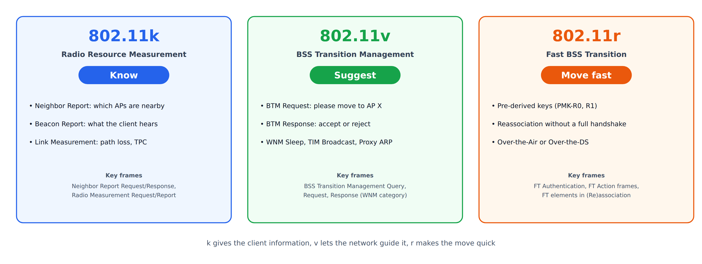
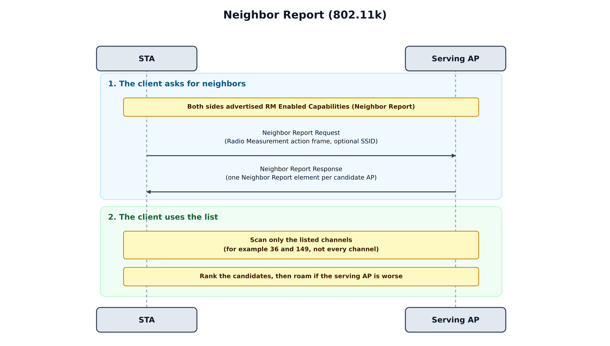
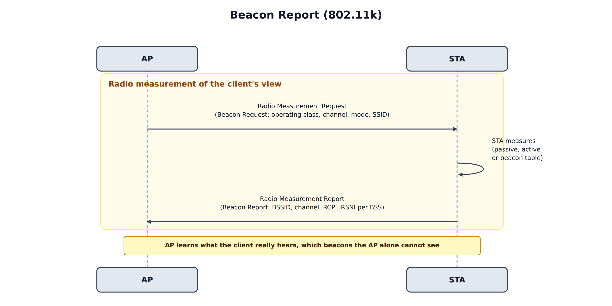
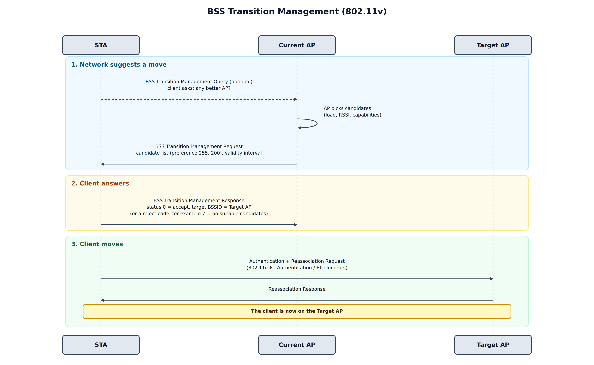
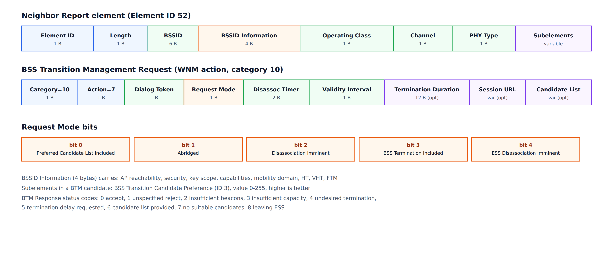
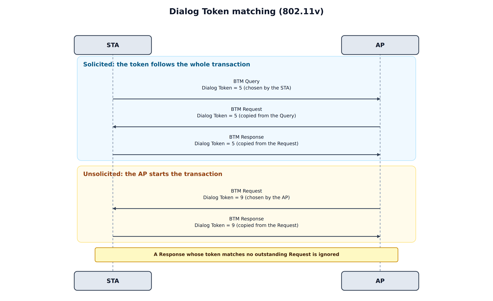
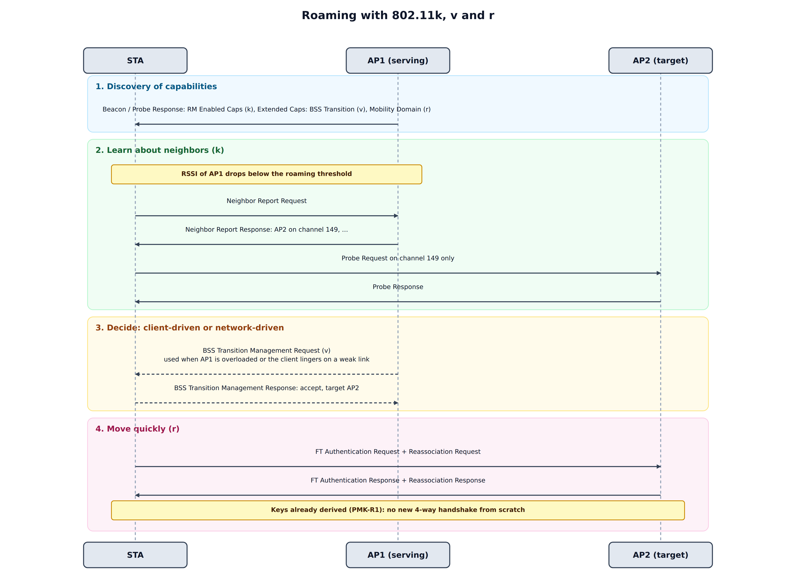

### Overview

---

In a Wi-Fi network with several access points, the **client** decides when to roam and which AP to join. That is a problem. A client sees only its own radio view, it does not know about the load on each AP, and many clients keep a weak link for as long as it still works (the "sticky client" problem). When it does decide to move, it often scans every channel, which takes time and interrupts traffic.

Three amendments to IEEE 802.11 address this, and each solves a different part of the problem:

| Amendment | Name | Role | One line |
|-----------|------|------|----------|
| **802.11k** | Radio Resource Measurement | **Know** | Tells the client which neighbors exist and lets the AP ask what the client hears |
| **802.11v** | Wireless Network Management (WNM) | **Suggest** | Lets the network ask the client to move to a better AP |
| **802.11r** | Fast BSS Transition | **Move fast** | Makes the move itself quick. See [802.11r Fast Roaming](/blog/802_11r_fast_roaming/) |

This post covers **k** and **v**: what they add, how the frames look, how to capture and debug them, and why they work best together with r.

An important point from the start: **none of these features forces the client to do anything.** 802.11k provides information on request. 802.11v makes a *suggestion*. The client keeps the final decision, and client behavior varies a lot between devices.

---

### 802.11k: Radio Resource Measurement

---

802.11k defines a way for APs and stations to **measure and report radio conditions**. Both sides advertise support in the **RM Enabled Capabilities** element, which appears in Beacons, Probe Responses and (Re)association frames. The measurement frames are **Radio Measurement action frames** (category 5).

| Action | Frame | Purpose |
|:------:|-------|---------|
| 0 | Radio Measurement Request | Ask a station to measure something |
| 1 | Radio Measurement Report | The measurement result |
| 2 | Link Measurement Request | Ask for the quality of the link between the two |
| 3 | Link Measurement Report | Result, with TPC and RCPI/RSNI |
| 4 | **Neighbor Report Request** | Client asks the AP for nearby APs |
| 5 | **Neighbor Report Response** | AP answers with a list of neighbors |

For roaming, two features matter most: the Neighbor Report and the Beacon Report.

---

#### Neighbor Report

---

A client that wants to roam normally has to find candidates by scanning. A full scan of the 2.4 GHz and 5 GHz bands (plus 6 GHz, if supported) can take hundreds of milliseconds and interrupts the data traffic. With a Neighbor Report, the client just **asks the serving AP**:

1. The client sends a **Neighbor Report Request**. It can include an SSID, to ask only about neighbors of that network.
2. The AP answers with a **Neighbor Report Response**, which holds one **Neighbor Report element** for each candidate AP.
3. The client scans **only the listed channels** and ranks the candidates.

Each candidate carries the information that a client needs to prioritize it:

| Field | Meaning |
|-------|---------|
| BSSID | MAC address of the neighbor AP |
| BSSID Information | A 4-byte field: AP reachability, security (same RSN or not), key scope, capabilities, **mobility domain** (802.11r), HT, VHT, FTM and so on |
| Operating Class + Channel | Where to find it. The class tells the band and channel width |
| PHY Type | OFDM, HT, VHT, HE and so on |
| Subelements | Optional extras, such as a preference value or location information |

The AP does not discover its neighbors by itself. The list comes from **configuration or from a controller** (for example a controller that knows the position and channel of every AP), so a Neighbor Report is only as good as the list that someone provides.

---

#### Beacon Report

---

An AP can see only its own side of the radio link. The **Beacon Report** reverses this: the AP asks the client **what the client hears**.

The AP sends a **Beacon Request** (measurement type 5) that names an operating class, a channel and a mode:

| Mode | Behavior |
|------|----------|
| Passive | The client listens for Beacons on the channel |
| Active | The client sends Probe Requests and collects the answers |
| Beacon table | The client reports what it already knows, without scanning |

The **Beacon Report** lists, for each BSS the client heard, its BSSID, channel, and two quality values:

* **RCPI** (Received Channel Power Indicator), `dBm = RCPI / 2 − 110`.
* **RSNI** (Received Signal to Noise Indicator), `dB = RSNI / 2 − 10`.

This lets the AP (or a controller) decide with the *client's* view, which can differ greatly from the AP's own measurement, especially with a client that has a weak transmitter or a bad antenna.

---

#### Other 802.11k measurements

---

| Measurement | What it gives |
|-------------|---------------|
| Channel Load | How busy a channel is, as seen by the client |
| Noise Histogram | Distribution of non-Wi-Fi noise power |
| STA Statistics | Counters such as retries and failed frames, for the client's link |
| Link Measurement | Path loss and Transmit Power Control (TPC) information |
| Location (LCI, civic) | Where the AP or station is |

These feed channel planning and network optimization more than roaming itself.

---

### 802.11v: BSS Transition Management

---

802.11v is a large amendment called *Wireless Network Management* (WNM). The part that matters most for roaming is **BSS Transition Management (BTM)**: a way for the **network** to ask a **client** to move.

The AP and the station announce support in the **Extended Capabilities** element, in the *BSS Transition* bit (bit 19). The frames are **WNM action frames** (category 10):

| Action | Frame | Direction |
|:------:|-------|-----------|
| 6 | BSS Transition Management Query | STA → AP, optional: "do you know a better AP for me?" |
| 7 | **BSS Transition Management Request** | AP → STA: "please move to one of these" |
| 8 | **BSS Transition Management Response** | STA → AP: accept or reject |

---

#### When does an AP send a BTM Request?

---

* **Load balancing:** the serving AP is overloaded, and a neighbor has capacity.
* **Band steering:** move a dual-band client from 2.4 GHz to 5 or 6 GHz.
* **Sticky clients:** the client's RSSI is low, but it does not leave.
* **Maintenance:** the AP is about to shut down, change channel or reboot.
* **After a Query:** the client asked for advice.

---

#### The BTM Request

---

The request contains a **Request Mode** field and a few timers, and optionally a candidate list:

| Request Mode bit | Meaning |
|:----------------:|---------|
| 0 | Preferred candidate list included |
| 1 | Abridged: candidates not listed are less preferred than those listed |
| 2 | **Disassociation imminent**: the AP will disassociate the client soon |
| 3 | BSS termination included |
| 4 | ESS disassociation imminent |

Other fields:

* **Disassociation Timer** (in TBTTs): how long until the AP disassociates the client, if bit 2 is set.
* **Validity Interval** (in TBTTs): how long the candidate list is valid. A TBTT is usually 100 TU, about 102.4 ms, so a value of 200 means roughly 20 seconds.
* **Candidate List:** a list of Neighbor Report elements, each with a **BSS Transition Candidate Preference** subelement. The value runs from 1 to 255 and a higher value is better. A value of **0 means the candidate is excluded**.
* Optional: BSS Termination Duration and a **Session Information URL**, for example a page that explains why the client is being moved.

---

#### The BTM Response

---

The client answers with a **status code**:

| Code | Meaning |
|:----:|---------|
| 0 | **Accept**. The Response then carries the *target BSSID* |
| 1 | Reject, unspecified reason |
| 2 | Reject, insufficient Beacons received from the candidate |
| 3 | Reject, insufficient capacity in the candidate |
| 4 | Reject, BSS termination is undesired |
| 5 | Reject, termination delay requested |
| 6 | Reject, but the client provides its own candidate list |
| 7 | Reject, no suitable candidates |
| 8 | Reject, the client is leaving the ESS |

An accept is a promise to move, not the move itself. The client then roams with its normal procedure, for example 802.11r Fast BSS Transition or a regular reassociation.

---

#### Suggestion or command?

---

BTM is a suggestion. The client may reject it, ignore it, or accept it and then come back. How strongly the AP can push depends on the request:

| Approach | Strength | Risk |
|----------|----------|------|
| BTM Request, no disassociation bit | Gentle | Many clients ignore it |
| BTM Request with **Disassociation Imminent** and a timer | Strong. A cooperating client moves | A client that ignores it is disassociated when the timer expires |
| Deauthentication or blocking probe/auth responses | Forced | Breaks the client's connection, and some clients retry or fail badly. Use as a last resort |

A good steering policy asks first with BTM, uses the disassociation timer carefully, and keeps a per-client rejection count so that it does not keep asking a client that always refuses.

---

#### Other 802.11v features

---

BTM is the most used part, but WNM defines more:

| Feature | What it does |
|---------|--------------|
| **WNM Sleep Mode** | A client can sleep for many beacon intervals, and the AP keeps its keys and buffers its frames |
| **TIM Broadcast** | Delivers TIM information in separate frames, so that clients can sleep longer |
| **Proxy ARP** | The AP answers ARP and Neighbor Discovery for sleeping clients, which reduces broadcast traffic |
| **DMS** (Directed Multicast Service) | Converts multicast to unicast per client, which improves reliability |
| **FMS** (Flexible Multicast Service) | Multicast with defined delivery intervals |
| **Time Advertisement** | The AP shares its time (and time zone) with clients |

---

### Protocol Constraints

---

The amendments define a number of rules that **the sender must follow**. They are easy to overlook, and they are the cause of many interoperability problems. The rules below are taken from IEEE 802.11-2020 (RRM in clause 11.11, WNM in clause 11.22, frame formats in clauses 9.4 and 9.6). Check the exact wording in the standard before you rely on a detail.

#### Transaction matching: the Dialog Token

---

The **Dialog Token** is a one-octet field that pairs a request with its response. The sender of the request chooses it, and the responder copies it.

| Exchange | Rule |
|----------|------|
| **BTM Query → Request → Response** (v) | The STA chooses a nonzero token in the Query. A Request sent because of that Query copies it, and the Response copies the Request's token. All three frames carry one value |
| BTM Request without a Query (v) | There is nothing to copy, so the AP chooses the token. The Response copies it |
| **Neighbor Report Request → Response** (k) | Nonzero token in the Request, copied in the Response |
| **Radio Measurement Request → Report** (k) | Nonzero token in the Request, copied in the Report. An **autonomous** report, sent without a request, uses 0 |
| **Link Measurement Request → Report** (k) | The Report copies the token |
| WNM Sleep Mode, DMS, TIM Broadcast (v) | Each request and response pair copies the token in the same way |

Radio Measurement frames have a **second matching key**. Each Measurement Request element carries a **Measurement Token**, which is nonzero and unique inside that frame, and the matching Measurement Report element copies it. A receiver pairs a report with a request by the Dialog Token of the frame *and* the Measurement Token of the element.

The standard states what the **sender** must do. It says much less about a receiver that gets a mismatched token, and implementations normally ignore such a frame.

#### Capability preconditions

---

| Rule | Where the capability is advertised |
|------|------------------------------------|
| An AP sends a BTM Request only to a STA that supports BSS Transition | Extended Capabilities, bit 19, from the (Re)Association Request |
| A STA sends a BTM Query only to an AP that supports it | Extended Capabilities in the Beacon and Probe Response |
| A STA sends a Neighbor Report Request only if the AP supports it | RM Enabled Capabilities element (ID 70) |
| A Beacon Request uses only a mode that the STA supports | Separate bits for passive, active and table mode in the same element |
| Parallel or repeated measurements need support | Capability bits in the same element |
| A BSS that supports RRM sets the *Radio Measurement* bit (bit 12) | Capability Information field of the Beacon, Probe Response and (Re)Association frames |

A request for something that the peer did not advertise is a sender error. For measurements the peer answers with the **Incapable** bit.

#### State and frame validity

---

* **Association is required.** Radio Measurement frames (category 5) and WNM frames (category 10) are Class 3 frames. They are only valid between associated stations.
* **Both categories are robust action frames.** When PMF (802.11w) is negotiated, they must be protected, and an unprotected frame is discarded.
* **A response is mandatory.** A STA that receives a BTM Request sends a BTM Response. A STA that cannot or will not run a measurement answers with a Report that has the **Incapable**, **Refused** or **Late** bit set. It does not stay silent.
* **Direction matters.** The Query, the Neighbor Report Request and the Link Measurement Request come from the STA. The BTM Request and the Neighbor Report Response come from the AP. Measurement Requests and Reports work in both directions, which is why an AP can ask a client for a Beacon Report.

#### Field presence and value rules

---

**BTM Request**

| Condition | Constraint |
|-----------|------------|
| Abridged = 1 | Meaningful only when *Preferred Candidate List Included* = 1 |
| Disassociation Imminent = 1 | The *Disassociation Timer* (in TBTTs) tells the STA how long it has |
| BSS Termination Included = 1 | The *BSS Termination Duration* field is present |
| Each candidate entry | A Neighbor Report element with the Candidate Preference subelement (ID 3). 255 is best, **0 is excluded** |
| Validity Interval | In TBTTs. After it expires, the STA should no longer use the candidate list |
| Optional fields | Present only if the Request Mode bits say so, so a receiver parses by the bits and not by length alone |

**BTM Response**

| Status | Field rule |
|--------|-----------|
| 0 (accept) | The **Target BSSID** field is present. For other statuses it is absent |
| 5 (termination delay requested) | The **BSS Termination Delay** field is present |

**Neighbor Report element**

* The body is at least 13 bytes: BSSID (6), BSSID Information (4), Operating Class (1), Channel (1) and PHY Type (1).
* BSSID Information holds the *AP Reachability* (not reachable, unknown or reachable), *Security*, *Key Scope* and *Mobility Domain* bits. The *Security* bit means that the neighbor offers the same security provisioning, and the *Mobility Domain* bit means that it is in the same 802.11r mobility domain.
* The channel is the primary channel, and it must agree with the operating class and the PHY type.

**Radio Measurement**

* Request Mode bits: *Parallel*, *Enable*, *Request*, *Report* and *Duration Mandatory*. With *Duration Mandatory* = 1, the STA either uses the requested duration or refuses.
* Report Mode bits: *Late*, *Incapable* and *Refused*.
* Number of Repetitions: 0 means a single measurement, and 65535 means repeat until cancelled.
* A Beacon Request uses passive (0), active (1) or table (2) mode. **Table mode must not start a scan.** The *Randomization Interval* spreads the start times of many stations.
* RCPI runs from 0 to 220 (`dBm = RCPI / 2 − 110`), and RSNI is `dB = RSNI / 2 − 10`.

**General:** senders set reserved bits to 0 and receivers ignore them, and a receiver skips optional subelements that it does not know.

#### What the standard does not constrain

---

* Whether a client **must** roam, or how fast. It has to answer honestly, and that is all.
* How an AP builds its neighbor list.
* The steering policy: how often to ask, when to stop asking, and which target to prefer.
* What a receiver does on a token mismatch. In practice the frame is dropped.

### How k, v and r Work Together

---

On their own, each one helps only a little. Together they cover the whole roaming cycle:

1. **Discover capabilities.** The AP advertises RM Enabled Capabilities (k), the BSS Transition bit (v) and a Mobility Domain element (r) in its Beacons and Probe Responses.
2. **Learn about neighbors (k).** When the serving AP's signal gets weak, the client asks for a Neighbor Report, and it probes only the listed channels instead of scanning everything.
3. **Decide.** The client can roam by itself, or the AP can send a BTM Request (v) because of load or a poor link.
4. **Move quickly (r).** The client performs an FT transition. The keys are already derived in the mobility domain, so there is no full 4-way handshake from the beginning.

The result is a shorter scan, a smarter choice of target and a quick handover. This combination is the basis of the Wi-Fi Alliance **Voice Enterprise** certification, which requires 802.11k, v and r for voice-quality roaming. **Wi-Fi Agile Multiband (MBO)** also builds on BTM, and it adds a reason code, so that an AP can tell a client *why* it is being steered.

---

### Debugging

---

To see what is really happening, capture on the monitor interface (or on the AP) and filter on the action categories:

| Wireshark filter | Shows |
|------------------|-------|
| `wlan.fixed.category_code == 5` | Radio Measurement frames (Neighbor and Beacon Reports, Link Measurement) |
| `wlan.fixed.category_code == 10` | WNM frames (BTM Query, Request, Response) |
| `wlan.tag.number == 70` | RM Enabled Capabilities element |
| `wlan.tag.number == 127` | Extended Capabilities element |
| `wlan.tag.number == 52` | Neighbor Report element |

A checklist when roaming assistance does not seem to work:

| Symptom | Likely cause | What to check |
|---------|--------------|---------------|
| Client never sends a Neighbor Report Request | The client does not support it, or the AP does not advertise it | RM Enabled Capabilities in the Beacon and Association Response |
| Neighbor Report Response has only one entry | The AP's neighbor list is empty or incomplete | How the AP or controller builds the list |
| BTM Request sent, no response | The client does not support BTM, or it ignores it | The client's Extended Capabilities, bit 19 |
| Client accepts BTM but joins a different AP | The target was not preferred or not reachable by the client | Preference values, signal at the client, and the candidate's BSSID |
| Client rejects with status 7 or 3 | No suitable candidate, or the candidate is full | Candidate list quality and capacity |
| Client moves, but there is a long gap | No 802.11r, so a full authentication follows | Mobility Domain and FT settings on all APs |
| Clients disconnect after BTM with the disassociation bit | The timer is too short, or the target is not in the same ESS | Timer length, SSID and security on the target |

---

### Practical Notes

---

* **Support depends on the client.** Phones, laptops and IoT devices differ in whether they send Neighbor Report Requests, honor BTM or answer Beacon Requests. Test with the devices that your users actually have.
* **All APs in an ESS must use the same SSID and security** for roaming assistance to work. If the target uses a different security setting, the client will not roam there, even if it accepts the BTM Request.
* **Keep neighbor lists current.** A list with a wrong channel is worse than no list, because the client scans a channel where the AP is not.
* **Do not over-steer.** If an AP moves clients too often, they bounce between APs and the experience gets worse. Use thresholds, hold-off timers and a per-client limit.
* **Be careful with privacy.** Beacon Reports and location data describe where clients are. Handle them like other device-location data.
* **Combine with the right radio settings.** Roaming assistance helps only when the APs are placed with sensible overlap and channel plans. It does not repair a poor RF design.

---

### Summary

---

1. **802.11k** gives information: a **Neighbor Report** tells the client where to look, and a **Beacon Report** tells the AP what the client hears.
2. **802.11v** gives guidance: a **BSS Transition Management Request** suggests that the client moves, and the **Response** says accept or reject, with a status code.
3. BTM is a suggestion, and the Disassociation Imminent bit with a timer is the strongest polite form of it. The client always has the final say.
4. With **802.11r**, the three form a complete roaming toolkit: know, suggest, move fast. Voice Enterprise requires all three.
5. Keep the **neighbor list** current and consistent across the ESS: a Neighbor Report is only as good as the list behind it, and every AP must use the same SSID and security for the client to accept it as a target.
6. The standard binds the **sender**: match the Dialog Token, respect the advertised capabilities, include conditional fields only when their bit is set, and send protected frames when PMF is on.
7. Debug with captures filtered on action categories 5 and 10, and check capabilities on both sides first.
