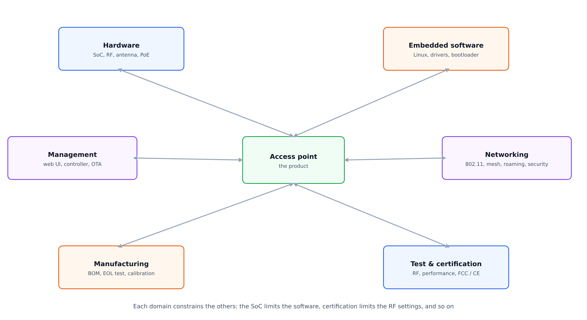
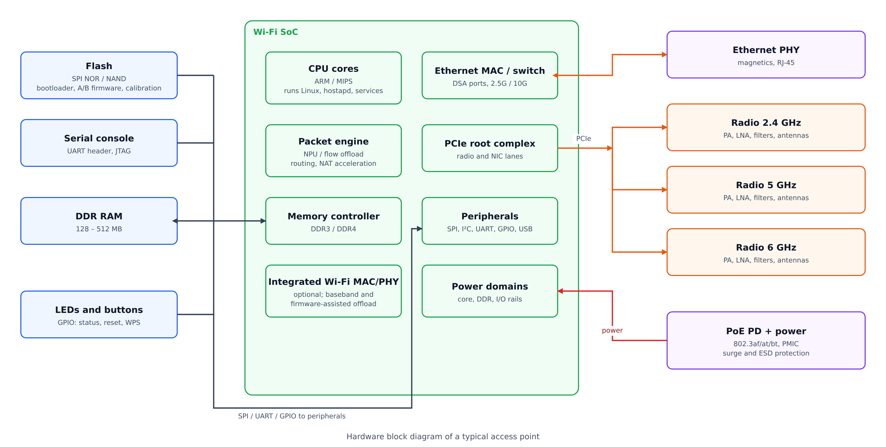
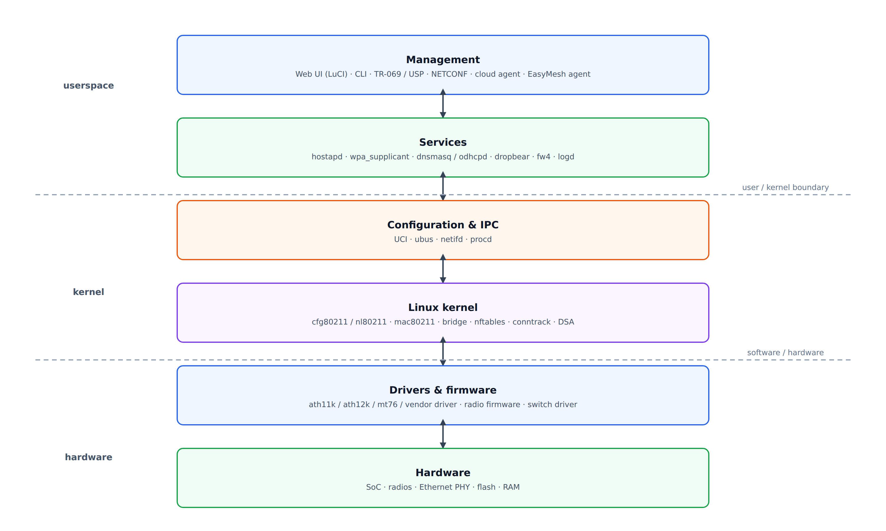
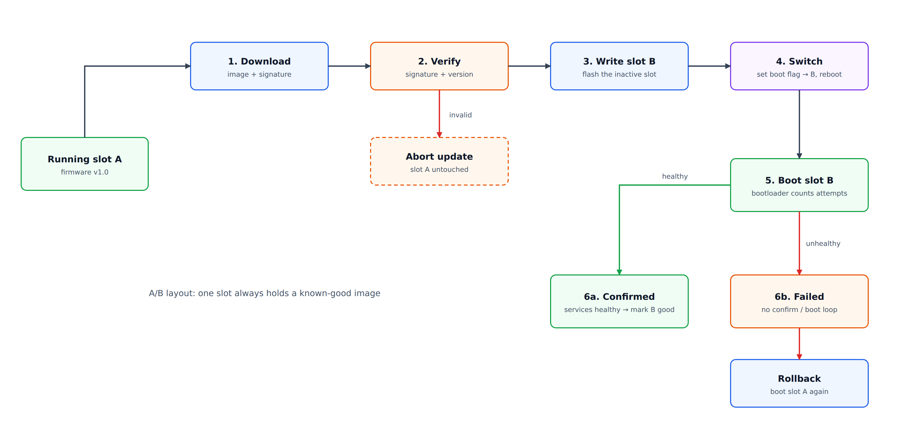
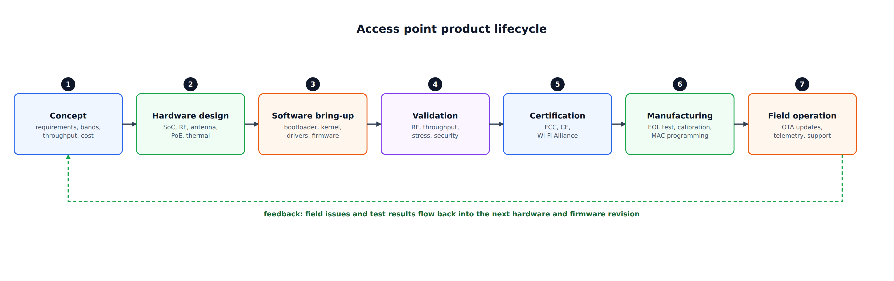

### Overview

---

An access point (AP) looks like a simple box with a few LEDs, but it is a complete system: a radio transmitter, a small Linux computer, a network switch and a managed network service in one enclosure. Building one takes much more than writing software. The work spans **hardware, embedded software, networking protocols, security, testing and manufacturing**, and each area limits the others:

* The **SoC** decides which Wi-Fi standards, how many spatial streams and how much RAM you can have.
* The **RAM and flash** sizes decide which software stack and which update scheme are possible.
* The **antenna and RF design** decide the real range and throughput, whatever the data sheet says.
* The **certification** rules decide which channels and power levels the software may use.

This post goes through each domain, says why it matters, and points out the trade-offs that show up in a production-grade AP. A layered view of the whole system is at the end.

---

### Hardware

---

#### Processor and SoC architecture

---

Most APs are built around a purpose-built Wi-Fi SoC from vendors such as MediaTek, Qualcomm or Broadcom. It integrates a CPU (ARM or MIPS), memory controllers, Ethernet MACs or a switch, PCIe, USB and, in many designs, the Wi-Fi radio subsystem. Others pair a network SoC with separate Wi-Fi chips over PCIe.

Things to check when you select a SoC:

| Item | Why it matters |
|------|----------------|
| CPU cores and clock | Sets the limit for the control plane and for any traffic that is not offloaded |
| Hardware packet acceleration (NPU, flow offload) | Routing and NAT at gigabit or multi-gigabit speed often cannot run on the CPU alone |
| Memory interface (DDR3, DDR4) | Decides RAM size and bandwidth |
| Radio integration | Integrated radios save cost and power. External PCIe radios give more flexibility |
| Ethernet and PCIe lanes | Number of 2.5G or 10G ports, and the number of radios you can attach |
| SDK and driver support | A good chip with a poor SDK costs more than a mediocre chip with a good one |

The SDK matters as much as the silicon. It decides the kernel version you can use, how long you get security patches, and whether you can move towards upstream drivers.

---

#### RF and antenna design

---

Radio design is one of the most specialized skills in AP development. It covers:

* PCB layout for signal integrity, controlled impedance lines and clean power for the RF section.
* RF front end: power amplifiers (PA), low-noise amplifiers (LNA), switches and filters. This decides output power, receive sensitivity and adjacent-band interference.
* Matching networks between the chip, the front end and the antenna.
* Antenna selection and placement: omnidirectional, sector or directional, and MIMO arrays. Antenna spacing and isolation limit how well multiple streams work.

The frequency bands in use are:

| Band | Strength | Limitation |
|------|----------|-----------|
| 2.4 GHz | Best range and wall penetration | Few non-overlapping channels, crowded |
| 5 GHz | Higher throughput, more channels | Shorter range, DFS on some channels |
| 6 GHz (Wi-Fi 6E and later) | Wide, clean channels, up to 320 MHz in Wi-Fi 7 | Shortest range, rules differ by region |

In practice, antenna placement inside the enclosure, and the effect of the plastic and the PCB on it, often change the result more than the chipset does.

---

#### Hardware communication interfaces

---

Internal parts are connected with standard buses: **SPI** for NOR flash, **I²C** for sensors and PoE controllers, **UART** for the serial console, **PCIe** for radios and some NICs, and **USB** for optional storage or a modem.

The Ethernet PHY sits between the SoC's MAC and the RJ-45 connector. Its configuration (speed, EEE, auto-negotiation) affects throughput, power draw and compatibility with other equipment. The serial console and a JTAG or test header are essential for bring-up and for failure analysis, even if they are disabled in production units.

---

#### Power, thermal and protection

---

Most enterprise APs are powered over Ethernet (PoE):

| Standard | Common name | Power at the PSE port |
|----------|-------------|----------------------|
| IEEE 802.3af | PoE (type 1) | 15.4 W |
| IEEE 802.3at | PoE+ (type 2) | 30 W |
| IEEE 802.3bt | PoE++ (types 3 and 4) | 60 W / 90 W |

The device receives less than the PSE sends because of cable loss, so design to the power at the *powered device*. A tri-band Wi-Fi 7 AP with several radios can exceed 802.3at, and then it needs 802.3bt or has to **reduce its features** (fewer streams, lower transmit power) when it detects a lower PoE class. Define that behavior on purpose, and test it.

Also plan for:

* **Thermal design.** AP enclosures are usually passive (no fan). The heat from the SoC and power amplifiers limits sustained throughput and device lifetime.
* **Surge and ESD protection** on the Ethernet port, which is the main path for lightning-induced surges.
* **EMI shielding** and filtering, to pass emissions testing and to avoid desensitizing the receiver.

---

### Embedded Systems

---

#### Operating system

---

APs normally run embedded Linux. The main options are:

| Base | Strengths | Trade-offs |
|------|-----------|-----------|
| **OpenWrt** | Small, mature networking stack, UCI configuration, active community | You maintain the integration with the vendor SDK |
| **Yocto-based custom build** | Full control over components, good for long-term products | More work to set up and maintain |
| **Vendor firmware / SDK** | Fastest start, supports vendor accelerators | Old kernels, slow patches, lock-in |

The choice involves community support, build flexibility, **security update cadence** and licensing (GPL obligations apply to the kernel and to many userspace tools). Decide early who will deliver security fixes over the life of the product, because that decision is hard to change later.

---

#### Device drivers

---

The kernel must expose every hardware part to userspace: Wi-Fi radios (MAC and PHY), Ethernet and the switch (DSA), GPIO for LEDs and buttons, flash (MTD/UBI), and optionally USB.

Wi-Fi driver quality has an outsized effect on performance and stability. Vendor drivers often include proprietary firmware and offload features, while open-source drivers such as `ath10k`, `ath11k`, `ath12k` and `mt76` follow the `mac80211`/`cfg80211` model and are easier to maintain and debug. Many SoC vendors ship out-of-tree drivers for their newest chips, so the cost of keeping up with kernel updates is part of the product plan.

---

#### Resource constraints

---

An entry-level AP can have 128 to 256 MB of RAM and 16 to 128 MB of flash, and older or low-cost designs have less. Newer Wi-Fi 6 and Wi-Fi 7 designs usually have more, because the radio firmware and the offload engines use RAM too. Limited resources require:

* A lean kernel configuration and a small root file system (SquashFS plus an overlay).
* Careful choice of userspace packages and of the C library (musl or glibc).
* No memory leaks in daemons that run for months.
* A watchdog that reboots the device when the system hangs.

Monitor memory use per process in the field, because a leak of a few kilobytes per hour is invisible in the lab and fatal after a month.

---

#### Bootloader and recovery

---

**U-Boot** is the most common bootloader (see [the bootloader post](/blog/bootloader/)). A robust recovery path is a requirement:

* **Dual-image layout:** two firmware slots, so a failed update falls back to the previous image.
* **Reset button** to restore factory settings, and a way to enter recovery mode.
* **TFTP or HTTP recovery** in the bootloader for units that cannot boot.
* **Secure boot** to verify the bootloader and the kernel, so only signed firmware runs.

A bricked unit in the field with no recovery path is a serious operational and financial problem.

---

### Networking and Protocols

---

#### Wi-Fi standards

---

A new design should target **IEEE 802.11ax (Wi-Fi 6)** at the minimum and increasingly **802.11be (Wi-Fi 7)**. The important features are:

* **OFDMA** and **MU-MIMO** for efficiency with many clients.
* **Beamforming** for directional gain.
* **BSS Coloring and spatial reuse** to reduce interference between neighboring cells.
* **TWT (Target Wake Time)** to save power on clients.
* **DFS** for radar avoidance on the 5 GHz channels that require it.
* **MLO, 320 MHz channels and 4096-QAM** in Wi-Fi 7.

Marketing numbers such as "AX6000" add up the rates of all radios. A single client uses only one band at a time (or several links with MLO), so look at the per-band rate and the number of spatial streams.

---

#### Mesh networking

---

Multi-AP deployments use mesh protocols to coordinate roaming and backhaul. **Wi-Fi EasyMesh** (built on IEEE 1905.1) is the interoperability standard, see [prplMesh](/blog/prplmesh/). **IEEE 802.11s** is an alternative that works at the MAC layer. Many vendors also use proprietary protocols for tighter control of roaming decisions. A wireless backhaul normally uses a 4-address link, see [WDS](/blog/wds/), and a dedicated backhaul radio or band avoids halving the throughput.

---

#### Client and connection management

---

Enterprise APs handle dozens to hundreds of clients at once. The main tools are:

* **Band steering**, which pushes capable clients from 2.4 GHz to 5 or 6 GHz.
* **Load balancing** across radios or APs.
* **Fast BSS Transition (802.11r)** and **802.11k/v** for fast roaming. See the [802.11r post](/blog/802_11r_fast_roaming/).
* **Airtime fairness**, so that slow clients do not use most of the airtime.
* **Rate limiting and QoS** (WMM, DSCP mapping), per client or per SSID.

---

#### Security

---

WPA3 (SAE handshake) is now the baseline for new deployments, with WPA2/WPA3 transition mode for older clients, and **PMF (802.11w)** to protect management frames. Enterprise networks add **802.1X** authentication with a RADIUS server and a certificate infrastructure. For open networks, **OWE** gives encryption without a password. See the [WPA3 post](/blog/wpa3/).

The AP also needs hardening beyond Wi-Fi:

* Close or protect management ports, and disable unused services.
* Use unique per-device default credentials, never a shared password.
* Keep the TCP/IP stack and the web server updated.

---

#### Remote management

---

APs in large deployments are managed centrally. The common options are:

| Protocol | Typical use |
|----------|-------------|
| **TR-069** (CWMP) | ISP-managed home gateways, now being replaced by **TR-369** (USP) |
| **SNMP** | Legacy monitoring |
| **NETCONF / YANG** | Structured, transactional configuration |
| **REST / MQTT / WebSocket** | Vendor cloud controllers |
| **EasyMesh (1905.1)** | Controller to agent control inside a mesh |

The AP must keep serving clients when the controller is unreachable, and it must keep its last good configuration.

---

### System Software

---

#### Web UI and CLI

---

The local web UI and a command line (for example BusyBox over SSH) are often the first things that users and integrators see. They should expose all the important settings, while staying safe against misuse: input validation, CSRF protection, session management and rate-limited login. On OpenWrt, LuCI and `uci` provide this layer.

---

#### Background services

---

The userspace stack on a Linux AP usually contains:

* **`hostapd`**: the AP role (authentication, association, key management).
* **`wpa_supplicant`**: the station role, used for a wireless backhaul or uplink.
* **`dnsmasq`** or **`odhcpd`**: DHCP and DNS (and IPv6 router advertisement).
* **`dropbear`**: a small SSH server.
* **`netifd`, `procd`, `ubus`**: network configuration, process supervision and the internal message bus on OpenWrt. See [Network OpenWrt Configuration](/blog/network-openwrt-configuration/).
* **A logging and diagnostics agent**, see [Logging and Log Management](/blog/log/).

---

#### Controller integration

---

Managed APs send telemetry (client lists, channel utilization, radio statistics, events) and receive configuration from a controller. REST APIs, WebSocket streams and MQTT publish/subscribe are common transports. The AP has to handle an unreliable cloud connection without dropping client traffic, and it should retry with back-off instead of generating load when many devices reconnect at once.

---

#### OTA firmware updates

---

Over-the-air updates must be atomic and safe:

* A failed update must not brick the device. Use **A/B partitions** with automatic rollback if the new image does not boot or does not confirm itself.
* Verify a **signature** on the downloaded image, so a malicious update cannot be installed.
* Preserve user settings across updates, and migrate them when the configuration format changes.
* Stage rollouts (a small percentage first), so a bad release does not reach all devices at the same moment.

---

### Testing and Optimization

---

#### RF testing

---

Before shipping, each unit needs RF calibration and test: transmit power per channel and band, EVM, receive sensitivity, frequency error and spectral mask. This is usually automated on a test fixture at the end of the production line, and the calibration data is stored in a dedicated flash partition.

---

#### Network performance benchmarks

---

Standard measurements are throughput (UDP and TCP with `iperf3`), latency, jitter and QoS under mixed traffic. Test both:

* **Single-client peak** performance, ideally in a shielded chamber for repeatable results.
* **Aggregate throughput** with many clients and mixed traffic, which is what customers actually experience.

Also test the data path with NAT, firewall and VPN enabled, because the offload engines often work only for simple flows.

---

#### Stress and load testing

---

Simulating many stations reveals race conditions, memory leaks and association table limits that do not show up in light testing. Useful tools are:

* Real client farms or traffic generators in an RF-shielded chamber for dense scenarios.
* `mac80211_hwsim` and `wmediumd` to simulate many virtual radios in software, which suits **functional and protocol testing** (roaming, association, mesh logic), not RF performance.
* Soak tests that run for days, with memory and CPU monitoring.
* Fault injection: unplugging the uplink, rebooting the controller, and cutting power during an update.

---

#### Security testing

---

Analyze the firmware for known-vulnerable library versions (an SBOM helps), hardcoded credentials and exposed debug interfaces. Run penetration tests against the management interfaces (web UI, SSH, SNMP) and against the Wi-Fi side (fuzzing management frames, EAPOL and the WPS or SAE handshakes) before a production release.

---

### Certification and Manufacturing

---

#### Regulatory certifications

---

Before a product can be sold in most markets it has to pass regulatory testing:

* **FCC** (United States): Part 15 radio emissions.
* **CE** (Europe): the Radio Equipment Directive (RED), which also includes cybersecurity requirements for connected radio equipment.
* **RoHS**: limits on hazardous substances in components.
* **Wi-Fi CERTIFIED™**: interoperability testing by the Wi-Fi Alliance.

Software is part of certification. The **country code**, the allowed channels, the maximum power and DFS behavior must be enforced by the firmware, and users must not be able to override them. Include certification time and cost in the schedule early, because a failed test can delay the launch by weeks.

---

#### Bill of Materials and supply chain

---

Component choice affects cost, availability and long-term supply. Critical parts (SoC, PMIC, RF front end, flash and RAM) often have long lead times and need qualified alternates. Cost optimization of the BOM continues through the whole product lifecycle, but any change of a part may require a new RF or EMC test.

---

#### Production line testing

---

Automated end-of-line testing checks that every unit meets the specification. A typical sequence includes:

1. Boot and flash programming (bootloader, firmware and calibration data).
2. RF output power and receive sensitivity.
3. Ethernet link and throughput.
4. LED and button functions.
5. **Unique data programming**: MAC addresses, serial number and device credentials.
6. Final firmware version check and a log record per unit, for traceability.

---

### Design Trade-offs in Practice

---

| Decision | One side | Other side |
|----------|----------|-----------|
| More RAM and flash | More features, simpler updates | Higher BOM cost |
| Vendor SDK vs upstream drivers | Faster launch, offload support | Old kernels, hard to patch |
| More radios and streams | Higher peak throughput | More power, heat and cost |
| Strong defaults for security | Fewer incidents | More support calls for old clients |
| Frequent OTA updates | Faster fixes | More risk, needs staged rollout |

There is no universal answer. The right choice depends on whether the product is a consumer router, an enterprise AP or an ISP gateway.

---

### System overview

---

The diagram below is interactive. Click any layer to expand it, then click a chip to read details about that component.

<iframe src="/diagrams/ap_interactive_layer_diagram.html"
        width="100%"
        height="640"
        style="border:none;display:block"
        title="Access Point interactive layer diagram">
</iframe>

---

### Summary

---

1. An AP is a radio, a small Linux computer, a switch and a network service in one box, and every domain limits the others.
2. The **SoC and its SDK** decide the standards, the offload and the software choices for years.
3. **RF design, antenna placement, PoE budget and thermal design** often matter more for real performance than the chipset.
4. Use embedded Linux with a clear **security-update owner**, a lean footprint and a **dual-image recovery** path.
5. Treat **OTA updates, logging and remote management** as core features, not extras.
6. Test RF, performance, stress and security, and enforce **regulatory limits in firmware**.
7. Plan certification, the supply chain and production testing from the start.
