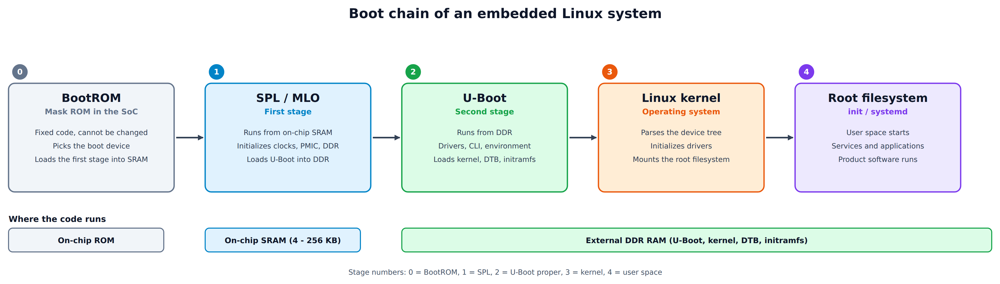
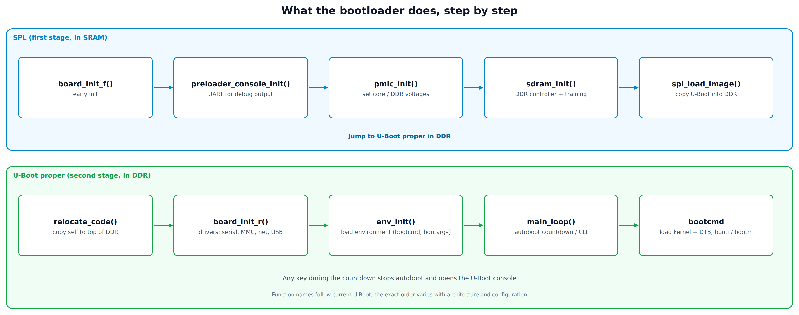
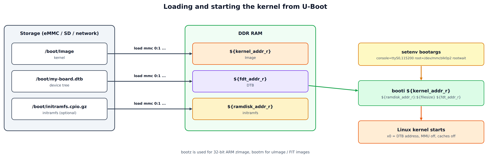
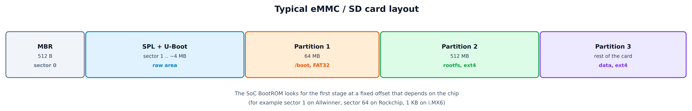
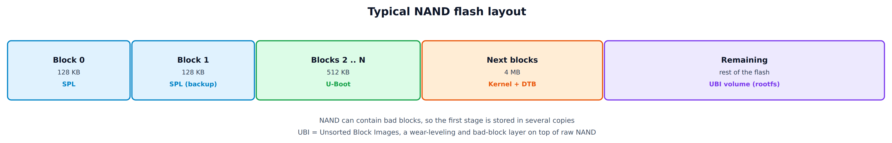
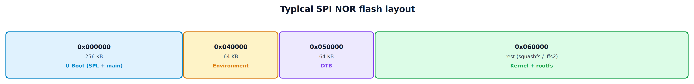
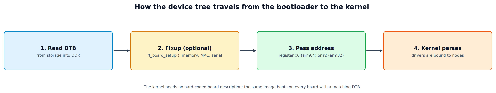
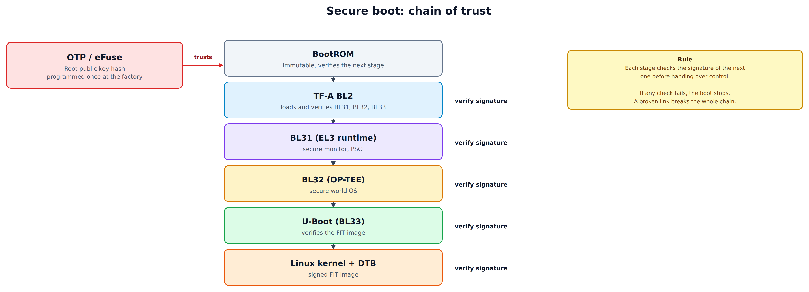

### Overview

---

#### What is a bootloader?

---

The bootloader is the first piece of software that runs when an embedded system is powered on or reset. Its main jobs are to **initialize the basic hardware** and to **load the Linux kernel** into RAM and start it.

The bootloader matters more on an embedded board than on a PC, because:

- Embedded hardware is very diverse. There is no standard BIOS or UEFI.
- The DDR controller must be set up before any large piece of software can run.
- The kernel can come from many places: SPI NOR, NAND, eMMC, an SD card, USB or the network.
- It gives developers a console to test, flash and debug the board.

---

#### Where it sits in the system

---

<div style="text-align: center;">



</div>

Each stage prepares the resources that the next, larger stage needs:

* The **BootROM** is code burned into the SoC. It can only use on-chip memory, and it is just smart enough to find and load the next stage.
* The **SPL** (Secondary Program Loader, also called MLO on TI chips) is small enough to fit in on-chip SRAM. Its main job is to bring up DDR.
* **U-Boot proper** runs from DDR and has room for drivers, a command line, scripting and network boot.
* The **kernel** takes over, mounts the root filesystem and starts user space.

---

### The Boot Process

---

#### Stage 0: BootROM

---

When the SoC comes out of reset, the CPU starts to execute code at a fixed address in the **internal ROM**. Users cannot change this code.

The BootROM:
- Puts the CPU in a known state
- Sets up a basic clock
- Reads the boot-mode pins or fuses and finds the boot device (SD, eMMC, SPI flash, USB, UART...)
- Loads the SPL into internal SRAM, optionally checks its signature, and jumps to it

```
BootROM address (ARM Cortex-A):
- Reset vector: 0x00000000, or 0xFFFF0000 when "high vectors" are selected
  (many AArch64 SoCs use an implementation-defined reset address instead)
- The exception vector table is at this address
```

---

#### Stage 1: SPL (Secondary Program Loader)

---

The SPL is the first-stage bootloader. It is very small, usually below 64 KB, so that it fits in on-chip SRAM.

**What the SPL does:**

```c
/* Typical SPL flow (simplified) */
void board_init_f(ulong dummy)
{
    /* 1. Bring up the UART for debug output */
    preloader_console_init();

    /* 2. Configure the power management IC (PMIC) */
    pmic_init();

    /* 3. Initialize DDR / SDRAM: the most important step */
    sdram_init();

    /* 4. Load U-Boot from storage into DDR */
    spl_load_image();
}
```

**Typical on-chip SRAM sizes (approximate; check the reference manual):**

| SoC | SRAM size | First-stage limit |
|-----|-----------|-------------------|
| TI AM335x | 128 KB | about 100 KB (MLO) |
| NXP i.MX6 | 256 KB | depends on the variant, shared with the boot ROM |
| Allwinner H3 | 32 KB | about 32 KB |
| Rockchip RK3399 | 200 KB | about 100 KB |
| Raspberry Pi | none used | The VideoCore firmware loads the kernel or U-Boot, so there is no SPL |

---

#### Stage 2: The main bootloader (U-Boot)

---

After DDR is ready, U-Boot proper is loaded and runs with the full address space available.

<div style="text-align: center;">



</div>

The exact sequence depends on the architecture and the configuration, but the shape is always the same: SPL gets DDR working, U-Boot relocates itself to the top of RAM (`relocate_code()`), initializes the drivers (`board_init_r()`), loads the environment and enters `main_loop()`, where the autoboot countdown runs `bootcmd`.

---

#### Stage 3: Loading the kernel

---

<div style="text-align: center;">



</div>

```bash
# Typical kernel boot sequence in U-Boot

# 1. Read the kernel image from MMC
load mmc 0:1 ${kernel_addr_r} /boot/Image

# 2. Read the Device Tree Blob
load mmc 0:1 ${fdt_addr_r} /boot/my-board.dtb

# 3. Read the initramfs (optional)
load mmc 0:1 ${ramdisk_addr_r} /boot/initramfs.cpio.gz

# 4. Set the kernel command line
setenv bootargs "console=ttyS0,115200 root=/dev/mmcblk0p2 rootwait rw"

# 5. Boot the kernel
booti ${kernel_addr_r} ${ramdisk_addr_r}:${filesize} ${fdt_addr_r}
```

---

### Common Bootloaders

---

##### Overview

---

| Bootloader | Architectures | Interface | Use case |
|------------|---------------|-----------|----------|
| **U-Boot** | ARM, x86, MIPS, RISC-V, PowerPC and more | CLI, scripts | The most common choice, runs on almost everything |
| **Barebox** | ARM, x86, MIPS, RISC-V | Unix-like shell | A modern alternative to U-Boot |
| **GRUB2** | x86, ARM64, RISC-V | Scripting, menu | x86 embedded systems and UEFI |
| **Coreboot** | x86, ARM | Payload based | Embedded PCs, Chromebooks |
| **RedBoot** | ARM, MIPS, x86 | CLI | Older devices such as legacy routers (no longer developed) |
| **LILO** | x86 | Simple | Obsolete |

---

##### Choosing a bootloader

---

```
Typical ARM / RISC-V embedded system          → U-Boot
System that needs secure boot                  → U-Boot + TF-A (ARM Trusted Firmware)
Modern development, flexible shell             → Barebox
x86 embedded (industrial PC)                   → GRUB2 or Coreboot
Small IoT device with little flash             → Stripped-down U-Boot or SPL only
```

---

### U-Boot: The Universal Bootloader

---

##### U-Boot source tree

---

```
u-boot/
├── arch/                    # CPU architectures (arm, x86, mips, riscv...)
│   └── arm/
│       ├── cpu/             # CPU-specific code
│       ├── dts/             # Device Tree sources
│       └── mach-*/          # SoC / machine specific code
├── board/                   # Board-specific code
│   ├── raspberrypi/
│   ├── ti/
│   └── freescale/
├── cmd/                     # CLI commands (mmc.c, net.c...)
├── common/                  # Shared code
│   └── spl/                 # SPL framework
├── drivers/                 # Device drivers
│   ├── mmc/
│   ├── net/
│   ├── serial/
│   └── usb/
├── fs/                      # Filesystems (ext4, fat, ubifs...)
├── include/                 # Header files
├── lib/                     # Libraries (crypto, lzma, zlib...)
├── net/                     # Network stack (TFTP, DHCP, NFS...)
└── tools/                   # mkimage and other host tools
```

---

##### U-Boot environment variables

---

Environment variables are how U-Boot is configured at run time. They can be stored in flash, eMMC or a file.

```bash
# Show all variables
printenv

# Set variables
setenv ipaddr 192.168.1.100
setenv serverip 192.168.1.1
setenv netmask 255.255.255.0

# Save them to non-volatile storage
saveenv

# Important variables:
# bootdelay    - autoboot delay in seconds, -1 = never autoboot
# bootcmd      - default boot command
# bootargs     - kernel command line
# ethaddr      - MAC address
# ipaddr       - static IP of the board
# serverip     - IP of the TFTP server
```

**bootcmd examples:**

```bash
# Boot from eMMC
setenv bootcmd 'mmc dev 0; \
    load mmc 0:1 ${kernel_addr_r} Image; \
    load mmc 0:1 ${fdt_addr_r} board.dtb; \
    booti ${kernel_addr_r} - ${fdt_addr_r}'

# Boot from the network (TFTP)
setenv bootcmd 'dhcp; \
    tftp ${kernel_addr_r} Image; \
    tftp ${fdt_addr_r} board.dtb; \
    booti ${kernel_addr_r} - ${fdt_addr_r}'

# Boot with the root filesystem on NFS (set bootargs, then boot as above)
setenv bootargs 'console=ttyS0,115200 \
    root=/dev/nfs \
    nfsroot=192.168.1.1:/srv/nfs/rootfs,v3,tcp \
    ip=dhcp'
```

---

##### Scripting in U-Boot

---

U-Boot has a simple shell with conditions and loops:

```bash
# A script with conditions
setenv boot_script '
    echo "Detecting boot media...";
    if mmc dev 0; then
        echo "Booting from eMMC";
        run boot_emmc;
    elif mmc dev 1; then
        echo "Booting from SD card";
        run boot_sd;
    else
        echo "Fallback: network boot";
        run boot_net;
    fi
'

# Convert a text script to a binary script image
mkimage -T script -C none -n 'Boot Script' \
    -d boot.txt boot.scr
```

---

##### Commonly used U-Boot commands

---

```bash
# ---- System information ----
bdinfo              # Board information
version             # U-Boot version
coninfo             # Console devices

# ---- Memory ----
md.b 0x80000000 64  # Display memory (bytes), 64 bytes from 0x80000000
mw.l 0x80000000 0 16 # Write memory (long), 16 words = 0
cp.b src dst len    # Copy memory

# ---- MMC / SD ----
mmc list            # List MMC devices
mmc dev 0           # Select MMC device 0
mmc info            # MMC information
mmc read addr blk cnt # Read raw blocks
fatls mmc 0:1       # List files on a FAT partition
ls ext4 mmc 0:2 /   # List files on an ext4 partition
load mmc 0:1 addr filename  # Load a file from a partition

# ---- Network ----
ping 192.168.1.1    # Ping
dhcp                # Get an address with DHCP
tftp addr filename  # Download with TFTP

# ---- Flash (SPI / NAND / NOR) ----
sf probe            # Probe the SPI flash
sf read addr offset len   # Read from SPI flash
sf write addr offset len  # Write to SPI flash
sf erase offset len       # Erase SPI flash
nand info           # NAND information
nand read addr offset len # Read from NAND

# ---- USB ----
usb start           # Start USB
usb info            # USB devices
usb storage         # List USB storage

# ---- Boot ----
booti addr - fdtaddr  # Boot an ARM64 Linux Image
bootz addr - fdtaddr  # Boot an ARM32 zImage
bootm addr            # Boot a uImage or FIT image
```

---

##### Typical kernel load addresses

---

These are examples. The real values come from the board's default environment, so always check `printenv` on your board.

```
ARM 32-bit (common):
  kernel_addr_r  = 0x82000000
  fdt_addr_r     = 0x88000000
  ramdisk_addr_r = 0x88080000

ARM 64-bit (AArch64):
  kernel_addr_r  = 0x40200000
  fdt_addr_r     = 0x40000000
  ramdisk_addr_r = 0x44000000

RISC-V 64-bit:
  kernel_addr_r  = 0x80200000
  fdt_addr_r     = 0x80000000
```

---

### Barebox

---

##### Introduction

---

Barebox is a modern bootloader that started as a "next generation U-Boot". It has a more Unix-like shell and a driver model that is close to the one in the Linux kernel.

---

##### Main features

---

- **A capable shell**: variables, conditions and loops, in a POSIX-like shell
- **Device model**: closely follows the Linux kernel device and driver model
- **Device Tree**: good support for DTS and DTB
- **Scripting**: more flexible than the U-Boot shell
- **Filesystem view**: devices and files are mounted under `/dev` and `/mnt`, like on Linux

---

##### Barebox script example

---

```bash
#!/bin/sh
# /env/boot/mmc - Barebox boot script

# Detect and mount the device
if [ -e /dev/mmc0.0 ]; then
    mkdir -p /mnt/mmc
    mount /dev/mmc0.0 /mnt/mmc

    kernel=/mnt/mmc/zImage
    fdt=/mnt/mmc/board.dtb

    if [ -f $kernel ] && [ -f $fdt ]; then
        global.linux.bootargs.dyn.root="root=/dev/mmcblk0p2 rootwait"
        bootm -o $fdt $kernel
    fi
fi

# Fallback: network boot
dhcp
tftp /zImage $kernel
tftp /board.dtb $fdt
bootm -o $fdt $kernel
```

The device names and the way `bootargs` is built vary between Barebox versions, so treat this as a sketch.

---

### GRUB in Embedded Linux

---

##### When to use GRUB on embedded systems

---

GRUB is a good fit for x86 and x86_64 embedded systems such as:
- Industrial PCs (IPC)
- Devices with Intel Atom or AMD Embedded processors
- Systems with UEFI firmware
- Chromebooks and mini PCs

---

##### GRUB configuration

---

```
# /boot/grub/grub.cfg

set default=0
set timeout=3

menuentry "Embedded Linux" {
    linux /boot/vmlinuz console=ttyS0,115200 quiet root=/dev/sda2
    initrd /boot/initramfs.img
}

menuentry "Recovery Mode" {
    linux /boot/vmlinuz-recovery console=ttyS0,115200 \
          root=/dev/sda3 init=/bin/sh
}
```

---

### Memory Layout and Partitioning

---

##### Typical eMMC / SD card layout

---

<div style="text-align: center;">



</div>

The BootROM looks for the first stage at an offset that is fixed by the chip, so the raw area has to be written at exactly that place.

**Example: SPL and U-Boot positions on an eMMC (TI AM335x):**

```
Offset 0x000000 : MBR
Offset 0x020000 : MLO (SPL), sector 256
Offset 0x060000 : U-Boot binary, sector 768
Offset 0x260000 : U-Boot environment
Offset 0x280000 : DTB
Offset 0x300000 : Start of the first partition
```

---

##### NAND flash layout

---

<div style="text-align: center;">



</div>

NAND can contain bad blocks, which is why the first stage is written more than once. UBI sits on top of the raw NAND and does the wear leveling and bad-block handling for the root filesystem (UBIFS).

---

##### SPI NOR flash layout

---

<div style="text-align: center;">



</div>

```
Address     Size        Content
0x000000    256 KB      U-Boot (SPL + main)
0x040000    64  KB      U-Boot environment
0x050000    64  KB      DTB
0x060000    the rest    Kernel + rootfs (squashfs / jffs2)
```

---

##### Creating the partition table

---

```bash
# Create the partition table of an SD card on the host
sudo fdisk /dev/sdX << EOF
o        # New MBR partition table
n p 1    # Partition 1, primary
         # First sector (default)
+64M     # Size 64 MB
t 0b     # Type FAT32
n p 2    # Partition 2, primary
         # First sector (default)
+2G      # Size 2 GB
n p 3    # Partition 3, primary
         # (remaining space)
w        # Write and exit
EOF

# Format
sudo mkfs.vfat -F 32 -n BOOT /dev/sdX1
sudo mkfs.ext4 -L rootfs /dev/sdX2
sudo mkfs.ext4 -L data /dev/sdX3
```

Double-check the device name. A wrong `/dev/sdX` destroys the disk of your host.

---

### Building and Configuring

---

##### Setting up the cross-compile environment

---

```bash
# Install a cross compiler (Ubuntu / Debian)
sudo apt-get install gcc-aarch64-linux-gnu    # ARM64
sudo apt-get install gcc-arm-linux-gnueabihf  # ARM32 hard-float
sudo apt-get install gcc-riscv64-linux-gnu    # RISC-V 64

# Set the environment
export CROSS_COMPILE=aarch64-linux-gnu-       # ARM64
export ARCH=arm64

# Or for ARM32
export CROSS_COMPILE=arm-linux-gnueabihf-
export ARCH=arm
```

---

##### Configuring U-Boot

---

```bash
# Get the source
git clone https://github.com/u-boot/u-boot.git
cd u-boot

# List the defconfigs for your board family
ls configs/ | grep -i raspberrypi
ls configs/ | grep -i imx6

# Pick the defconfig of your board
make rpi_4_defconfig            # Raspberry Pi 4
make mx6ull_14x14_evk_defconfig # NXP i.MX6ULL EVK
make am335x_evm_defconfig       # TI AM335x EVM
make rock64-rk3328_defconfig    # Rock64 (RK3328)

# Customize (menuconfig)
make menuconfig

# What to look at in menuconfig:
# Boot media: MMC, SPI Flash, NAND, USB, Network
# SPL: enable SPL, SPL size limits
# Environment: storage location, size, offset
# Filesystems: FAT, ext2/4, UBIFS
# Network: DHCP, TFTP, NFS
# Security: Secure Boot, FIT signature
```

---

##### Building U-Boot

---

```bash
# Build everything
make -j$(nproc)

# Output files:
# u-boot.bin         - raw U-Boot binary
# u-boot.img         - U-Boot with a mkimage header
# u-boot-dtb.bin     - U-Boot + DTB
# spl/u-boot-spl.bin - SPL binary
# MLO                - SPL for TI (with a special header)
# u-boot.itb         - FIT image (U-Boot + DTB, loaded by the SPL)

# Build only the host tools
make tools

# Build only the device trees
make dtbs
```

---

##### Writing U-Boot to eMMC / SD

---

The offsets below are examples. Take the real values from the SoC reference manual or from the U-Boot board documentation.

```bash
# ---- SD card (from a Linux host) ----

# TI AM335x, raw mode: MLO at sector 256, U-Boot at sector 768
sudo dd if=MLO of=/dev/sdX bs=512 seek=256 conv=notrunc,sync
sudo dd if=u-boot.img of=/dev/sdX bs=512 seek=768 conv=notrunc,sync

# NXP i.MX6: one image written at an offset of 1 KB
sudo dd if=u-boot-dtb.imx of=/dev/sdX bs=1K seek=1 conv=notrunc,sync

# ---- From the running U-Boot CLI ----

# Download over TFTP
tftp ${loadaddr} u-boot.bin

# Write to eMMC
mmc dev 0
# Write from sector 2 (offset 1024 bytes); the size is counted in sectors
setexpr sz ${filesize} / 0x200
setexpr sz ${sz} + 1
mmc write ${loadaddr} 2 ${sz}

# Write to SPI flash
sf probe 0
sf erase 0 0x50000
sf write ${loadaddr} 0 ${filesize}
```

---

##### Adding support for a custom board

---

```c
/* board/mycompany/myboard/myboard.c */
#include <common.h>
#include <init.h>
#include <asm/io.h>

/* DDR configuration (i.MX6 style, values depend on your DDR chip) */
static const struct mx6_ddr_sysinfo ddr_info = {
    .dsize      = 1,  /* 32-bit data bus */
    .cs_density = 32,
    .ncs        = 1,
    .cs1_mirror = 0,
    .rtt_wr     = 1,  /* DDR3_RTT_60_OHM */
    .rtt_nom    = 1,
    .walat      = 1,
    .ralat      = 5,
    .mif3_mode  = 3,
    .bi_on      = 1,
    .sde_to_rst = 0x10,
    .rst_to_cke = 0x23,
};

/* Board information */
int checkboard(void)
{
    puts("Board: MyBoard v1.0\n");
    return 0;
}

/* Early init: before the console is ready */
int board_early_init_f(void)
{
    /* Set up the UART pads */
    setup_uart();
    return 0;
}

/* Main board init */
int board_init(void)
{
    /* Address of the boot parameters */
    gd->bd->bi_boot_params = PHYS_SDRAM + 0x100;

    setup_i2c();
    setup_usb();
    setup_spi();

    return 0;
}

/* Late init: set dynamic environment variables */
int board_late_init(void)
{
    /* Read the serial number from fuses or an EEPROM */
    char serial[32];
    read_serial_number(serial);
    env_set("serial#", serial);

    /* Choose the boot media at run time */
    if (is_recovery_button_pressed())
        env_set("bootcmd", "run recovery_boot");

    return 0;
}
```

The `setup_*()` and `read_serial_number()` calls are placeholders for your own board code.

---

### Device Tree (DTB)

---

##### The role of the device tree at boot

---

The device tree (DT) describes the hardware so that the bootloader can pass it to the kernel. The kernel then finds out which devices exist without having them hard-coded.

<div style="text-align: center;">



</div>

---

##### Device tree example

---

```dts
/* arch/arm64/boot/dts/vendor/my-board.dts */
/dts-v1/;
#include "my-soc.dtsi"

/ {
    model = "MyCompany MyBoard v1.0";
    compatible = "mycompany,myboard", "vendor,my-soc";

    /* RAM */
    memory@40000000 {
        device_type = "memory";
        reg = <0x0 0x40000000 0x0 0x40000000>; /* 1 GB at 0x40000000 */
    };

    /* Default console */
    chosen {
        stdout-path = "serial0:115200n8";
        /* bootargs can be set here or by the bootloader */
    };
};

/* Enable UART0 from the dtsi */
&uart0 {
    status = "okay";
};

/* I2C bus with a PMIC */
&i2c0 {
    status = "okay";
    clock-frequency = <400000>;

    pmic@58 {
        compatible = "dlg,da9063";
        reg = <0x58>;
        interrupt-parent = <&gpio1>;
        interrupts = <5 IRQ_TYPE_LEVEL_LOW>;
    };
};

/* Ethernet */
&ethernet0 {
    status = "okay";
    phy-mode = "rgmii-id";
    phy-handle = <&phy0>;

    mdio {
        phy0: ethernet-phy@0 {
            reg = <0>;
            reset-gpios = <&gpio2 10 GPIO_ACTIVE_LOW>;
        };
    };
};
```

---

##### U-Boot DTB fixup

---

```c
/* The bootloader can change the DTB before it hands it to the kernel */

int ft_board_setup(void *blob, struct bd_info *bd)
{
    /* Update the memory node with the real RAM size */
    fdt_fixup_memory(blob, (u64)PHYS_SDRAM, (u64)PHYS_SDRAM_SIZE);

    /* Add the serial number to the /chosen node */
    char serial[32];
    read_serial_from_fuse(serial);
    fdt_setprop_string(blob, fdt_path_offset(blob, "/chosen"),
                       "serial-number", serial);

    /* Copy the MAC addresses from the environment (ethaddr, eth1addr...) */
    fdt_fixup_ethernet(blob);

    return 0;
}
```

---

### Bootloader Security

---

##### Secure boot chain

---

<div style="text-align: center;">



</div>

The hash of the root public key is programmed once into OTP or eFuse. The immutable BootROM trusts that hash, and each stage verifies the signature of the next one before it runs it. On ARM, the usual stages are the Trusted Firmware-A images: BL2 (loads and verifies the rest), BL31 (the EL3 runtime), BL32 (the secure OS, for example OP-TEE) and BL33 (the normal-world bootloader, usually U-Boot). The exact stages and who loads whom depend on the SoC vendor.

---

##### FIT image with signature

---

```dts
/* boot.its - FIT Image Tree Source */
/dts-v1/;

/ {
    description = "Signed Boot Image";
    #address-cells = <1>;

    images {
        kernel@1 {
            description = "Linux Kernel";
            data = /incbin/("Image");
            type = "kernel";
            arch = "arm64";
            os = "linux";
            compression = "none";
            load = <0x40200000>;
            entry = <0x40200000>;

            hash@1 {
                algo = "sha256";
            };
        };

        fdt@1 {
            description = "Device Tree";
            data = /incbin/("my-board.dtb");
            type = "flat_dt";
            arch = "arm64";
            compression = "none";

            hash@1 {
                algo = "sha256";
            };
        };
    };

    configurations {
        default = "conf@1";

        conf@1 {
            description = "Default Config";
            kernel = "kernel@1";
            fdt = "fdt@1";

            signature@1 {
                algo = "sha256,rsa2048";
                key-name-hint = "dev";
                sign-images = "kernel", "fdt";
            };
        };
    };
};
```

```bash
# Create and sign the FIT image
mkimage -f boot.its -k /path/to/keys -K u-boot.dtb \
        -r -o boot.itb

# Create the keys
openssl genrsa -F4 -out dev.key 2048
openssl req -batch -new -x509 -key dev.key -out dev.crt

# Inspect the FIT image
dumpimage -l boot.itb
```

The `-K u-boot.dtb` option stores the public key in the U-Boot device tree, so U-Boot can verify the signature at run time.

---

##### Rollback protection

---

```c
/* Anti-rollback protection with a counter (ARC)
   stored in eFuse or RPMB */

int board_check_rollback(void)
{
    /* Read the current counter value from eFuse */
    uint32_t arc = read_anti_rollback_counter();

    /* Read the version of the new image */
    uint32_t new_version = get_image_version();

    if (new_version < arc) {
        printf("ERROR: Anti-rollback check failed! "
               "Image v%d < ARC v%d\n", new_version, arc);
        return -EPERM;
    }

    /* Raise the counter if the image is newer */
    if (new_version > arc)
        update_anti_rollback_counter(new_version);

    return 0;
}
```

eFuse counters can only go up, so an attacker cannot install an older, vulnerable image once a newer one has been booted.

---

##### Locking down U-Boot

---

```bash
# In U-Boot menuconfig: remove the dangerous features
CONFIG_BOOTCOMMAND="run distro_bootcmd"  # Fixed boot command
CONFIG_BOOTDELAY=-2                       # Boot at once, no way to stop
CONFIG_CMD_BOOTD=n                        # Remove the bootd command
CONFIG_CMD_LOADS=n                        # No loading over serial
CONFIG_ENV_IS_NOWHERE=y                   # Do not store the environment
CONFIG_SILENT_CONSOLE=y                   # Silence the console in production
```

---

### Debug and Troubleshooting

---

##### Typical console output

---

A normal boot prints something like this:

```
U-Boot SPL 2024.01 (Jan 15 2024 - 10:30:00 +0700)
Trying to boot from MMC1

U-Boot 2024.01 (Jan 15 2024 - 10:30:00 +0700)

CPU:   Cortex-A53 @ 1200 MHz
Model: MyCompany MyBoard v1.0
DRAM:  1 GiB
MMC:   mmc@fe310000: 0, mmc@fe320000: 1
Loading Environment from FAT... OK
Hit any key to stop autoboot:  3 2 1 0

## Loading kernel from FIT Image at 40000000 ...
...
Starting kernel ...

[    0.000000] Booting Linux on physical CPU 0x0000000000 [0x410fd034]
[    0.000000] Linux version 6.6.0 ...
```

---

##### Common problems

---

**Problem 1: No output after power-on**
```
Possible causes:
- The SPL was written at the wrong offset
- Clock or power is not correct
- The UART is not configured

Debug:
- Check the JTAG / SWD output
- Measure the UART signal with an oscilloscope
- Check the PMIC power rails
- Confirm the SPL offset in the SoC datasheet
```

**Problem 2: The SPL runs but U-Boot is not loaded**
```
SPL: Trying to boot from MMC
SPL: mmc init failed with error: -5
### ERROR ### Please RESET the board ###

Possible causes:
- DDR initialization failed
- The SPL looks for U-Boot at the wrong offset
- The eMMC / SD card is faulty

Debug:
U-Boot> md.l 0x80000000 4  # Is DDR accessible?
U-Boot> mmc info            # Check the MMC
U-Boot> mmc read 0x80000000 0x60 0x100  # Read sector 96 (U-Boot offset)
```

**Problem 3: U-Boot runs but does not boot the kernel**
```
Wrong Image Format for bootm command
ERROR: can't get kernel image!

Possible causes:
- Wrong kernel load address
- The image format does not match the command (Image vs zImage vs uImage)
- The DTB was not found

Debug:
U-Boot> ls mmc 0:1          # Does the file exist?
U-Boot> load mmc 0:1 ${kernel_addr_r} Image
U-Boot> iminfo ${kernel_addr_r}  # Show image information
```

**Problem 4: Kernel panic right after boot**
```
[    0.000000] Kernel panic - not syncing: VFS:
               Unable to mount root fs on unknown-block(0,0)

Cause: the root filesystem was not found

Debug:
U-Boot> setenv bootargs "... root=/dev/mmcblk0p2 rootwait debug"
# Add "debug" and "rootwait" to bootargs
# Check the root= device node again
```

---

#### Debugging with JTAG / OpenOCD

---

```bash
# Start OpenOCD with a JTAG adapter
openocd -f interface/jlink.cfg \
        -f target/imx6.cfg

# Connect with telnet (port 4444)
telnet localhost 4444

# Debug commands
> halt                    # Stop the CPU
> targets                 # List targets
> reg                     # Show registers
> mdw 0x80000000          # Read a memory word
> arm disassemble 0x80000000 20  # Disassemble
> bp 0x80200000 4 hw      # Hardware breakpoint
> resume                  # Continue
> step                    # Single step

# Load and debug U-Boot
> load_image u-boot 0x80800000 bin
> reg pc 0x80800000
> resume
```

---

#### Using the UART debug console

---

```bash
# Connect to the UART from the host
# Install minicom or picocom
sudo apt install picocom

# Connect (usually 115200 baud)
picocom -b 115200 /dev/ttyUSB0

# Save a log for analysis
picocom -b 115200 /dev/ttyUSB0 --logfile boot.log

# Look at the timing in the log
grep -E "^\[.*\]" boot.log | head -50  # Kernel timestamps
```

---

#### Bootloader debug checklist

---

```
□ Are the power rails at the right voltage? (VDD_CORE, VDD_IO, VDD_DDR)
□ Is the clock source oscillating? (measure with an oscilloscope)
□ Are the BOOT_MODE pins correct? (boot from eMMC / SD / SPI?)
□ Is the SPL written at the right offset? (see the SoC datasheet)
□ Do the DDR training logs show errors?
□ Are the environment variables correct? (printenv)
□ Is the kernel image at the expected address? (iminfo)
□ Does the DTB compatible string match the kernel drivers?
□ Does bootargs name the right root device?
□ Is the filesystem corrupted? (fsck.ext4)
```

---

### References

---

##### Official documentation

---

| Document | Link |
|----------|------|
| U-Boot Documentation | https://docs.u-boot.org |
| U-Boot Source | https://github.com/u-boot/u-boot |
| Barebox Documentation | https://www.barebox.org/doc |
| Linux Device Tree | https://devicetree.org |
| Trusted Firmware-A | https://trustedfirmware-a.readthedocs.io |

---

##### SoC-specific resources

---

| SoC | Resource |
|-----|----------|
| NXP i.MX | https://www.nxp.com/design/software/embedded-software/i-mx-software |
| TI AM335x | https://www.ti.com/product/AM3358 |
| Rockchip | https://opensource.rock-chips.com |
| Allwinner | https://linux-sunxi.org |
| Broadcom (RPi) | https://github.com/raspberrypi/firmware |

---

##### Books

---

- "Embedded Linux Development Using Yocto Project" - Otavio Salvador
- "Mastering Embedded Linux Programming" - Chris Simmonds
- "Building Embedded Linux Systems" - Karim Yaghmour
- "Linux Kernel Development" - Robert Love

---

##### Community and support

---

- **U-Boot mailing list**: u-boot@lists.denx.de
- **Linux kernel mailing list**: linux-kernel@vger.kernel.org
- **Embedded Linux wiki**: https://elinux.org
- **Bootlin (free training material)**: https://bootlin.com/docs

---

> **Note**: This document is an overview. Details differ between SoCs, boards and U-Boot versions. Always check the SoC datasheet and the release notes of the U-Boot version you use.

---
