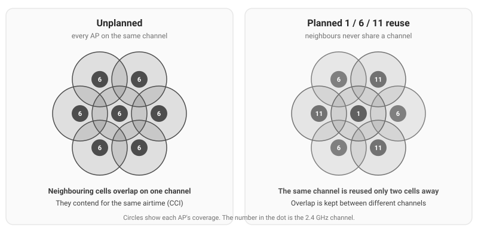

### Overview

---

Co-Channel Interference (CCI) is what happens when two or more radios that can hear each other transmit on the same channel. It is not a malfunction. CSMA/CA is working exactly as designed: every device defers while another one is transmitting. The problem is that "clear" never lasts long when several independent networks share the same slice of spectrum, so the one resource every station needs, **airtime**, is divided among all of them. CCI is why a dense apartment building, a conference hall or a multi-AP mesh network can show excellent signal strength everywhere and still deliver poor throughput.

The word "interference" is a little misleading. Co-channel frames are not corrupted: they are decoded and correctly deferred to. CCI is really **contention**, and its cost is waiting, not errors.

---

### Co-Channel vs. Adjacent-Channel vs. Non-Wi-Fi Interference

---

Three different problems all show up as "my Wi-Fi is slow", but they have different root causes and different fixes:

- **Co-Channel Interference (CCI):** another BSS (an AP or its clients) on the *same* channel. Its frames carry a decodable 802.11 preamble, so every compliant device detects them at the carrier-sense threshold, defers, and sets its NAV for the frame's duration. Nothing is corrupted. Airtime is simply shared, fairly but wastefully, across every BSS that overlaps.
- **Adjacent-Channel Interference (ACI):** a neighbor on a *nearby, overlapping* channel (for example channels 3 and 6 in 2.4 GHz). From this channel's point of view its signal is not a valid preamble, so it can only trigger **energy detection**. A strong neighbor above the ED threshold makes devices defer anyway. A weaker one below it is ignored by CCA, so stations transmit on top of it and frames are corrupted by the lower SINR instead of being queued fairly.
- **Non-Wi-Fi interference:** wireless audio and video transmitters, Bluetooth, microwave ovens, baby monitors, Zigbee, cordless phones. Like ACI, Wi-Fi radios see these only as energy, never as a frame. Above the ED threshold they hold the channel busy; below it they silently raise the noise floor and cause retransmissions. A continuous transmitter with a 100% duty cycle can make a channel unusable while carrying no Wi-Fi traffic at all.

See [Clear Channel Assessment](/blog/wifi-overview/#clear-channel-assessment-cca) for how the Energy Detection (ED) and Carrier Sense (CS) thresholds work at the PHY layer.

---

### How It Works at the PHY and MAC Layers

---

802.11 uses CSMA/CA, and the deciding step is **Clear Channel Assessment (CCA)**, which uses two thresholds on a 20 MHz channel:

| Mechanism | Threshold (20 MHz) | Triggered by | What happens |
|---|---|---|---|
| Preamble detection (carrier sense) | about −82 dBm | any decodable 802.11 frame, including other BSSs on the same channel | the station defers for the frame; virtual carrier sense (NAV) extends the deferral from the Duration field |
| Energy detection (ED) | about −62 dBm | any energy: ACI, non-Wi-Fi sources, very strong Wi-Fi | the station defers while the energy stays above the threshold |

- **Co-channel case.** Because the carrier-sense threshold is 20 dB lower than ED, a neighboring BSS on the same channel makes a station defer at a much greater distance than raw noise would. Every overlapping BSS adds its own transmissions, control frames and beacons to the time the channel is busy, so each station gets a smaller share of airtime. Collisions still happen when two stations finish their backoff in the same slot, and the larger the contention domain, the more often that happens.
- **Energy-only case (ACI and non-Wi-Fi).** If the interferer is above the ED threshold, stations defer to it as if it were traffic, and airtime is lost. If it is below the threshold, stations transmit anyway, the receiver sees a worse SINR, frames fail their FCS check, no ACK comes back, and the MAC retransmits, usually at a lower MCS. Under a sustained interferer this retry cycle repeats, and useful throughput collapses even though the radio transmits constantly.

---

### Causes of Co-Channel Interference

---

- **Few non-overlapping channels in 2.4 GHz.** Only channels 1, 6 and 11 avoid overlapping each other in most regions (1, 5, 9 and 13 where channels 12 and 13 are allowed and 802.11b is not a concern). Any other assignment adds adjacent-channel overlap on top of the co-channel overlap that already exists.
- **High-density deployments.** Apartment buildings, offices and campuses routinely have dozens of independently managed BSSs within range of each other, all competing for the same handful of usable channels.
- **Clients, not only APs.** A client at the edge of a cell can be heard by APs and clients of neighboring BSSs that cannot hear its own AP. The contention domain includes every device on the channel, which is why CCI is worse than a map of AP cells suggests.
- **Too much transmit power.** A cell bigger than it needs to be puts more neighbors inside the −82 dBm carrier-sense range.
- **Wide channels.** 40, 80 and 160 MHz channels cut the number of independent channels in 5 GHz (only a handful of 80 MHz channels, and two 160 MHz channels in many regions). Neighbors are forced onto the same or overlapping channels, and traffic on any 20 MHz subchannel affects the wide channel's CCA.
- **Multi-AP mesh backhaul.** A wireless backhaul hop shares the same radio and airtime budget as the fronthaul clients on that AP (see [Backhaul Optimization](/blog/easymesh-system/#backhaul-optimization)), so a poorly planned mesh can create co-channel interference against itself, AP to AP, without any external network involved.

---

### Impact of Channel Occupancy on Throughput

---

A simple airtime model shows why occupancy, not signal strength, sets the ceiling. For a single link (Single-Link Operation, SLO), the average throughput $Th_{SLO}$ is approximately:

$$
\begin{aligned}
Th_{SLO} &= \frac{(1 - \alpha)L}{T}
\end{aligned}
$$

Where:
- $\alpha$ is the occupancy (fraction of time the channel is busy with other devices' transmissions) of the link
- $L$ is the packet size
- $T$ is the time needed to send one packet, including its overheads, at the link's current rate

Throughput is proportional to the free airtime $(1 - \alpha)$: it falls **linearly** as occupancy rises, and reaches zero when the channel is fully busy. The model ignores collisions and retransmissions, which grow with the number of contending stations, so real throughput falls faster than this at high occupancy. Latency degrades even more sharply, because queues build up as the free airtime approaches the offered load.

| Occupancy ($\alpha$) | Free airtime ($1-\alpha$) | Effect |
|---|---|---|
| 0.1 | 90% | negligible; the channel is essentially free |
| 0.5 | 50% | throughput roughly halved compared with an idle channel |
| 0.8 | 20% | severe; latency-sensitive applications start to suffer |
| 0.95 | 5% | near collapse; collisions and retries take most of what is left |

This is also why Multi-Link Operation (802.11be, Wi-Fi 7) is a structural answer to CCI rather than only a channel-planning fix. A multi-link device can send each frame on whichever link becomes free first, or spread traffic across several links, so it is not limited by one busy channel's $\alpha$ the way an SLO station is. See [Wi-Fi 7](/blog/wifi7/) for how MLO distributes traffic across links.

---

### Measuring Co-Channel Interference

---

- **Channel utilization (CCA busy fraction).** APs advertise it in the BSS Load element (0 to 255, the share of time the AP sensed the medium busy), and on Linux you can read it from the driver with `iw dev wlan0 survey dump`: divide `channel busy time` by `channel active time` (see [Important Parameters](/blog/wifi-overview/#important-parameters)). A high busy fraction while your own BSS carries little traffic is the clearest signature of CCI.
- **Neighboring BSSs on the same channel and their RSSI.** A scan that shows other BSSIDs on your channel above about −82 dBm is literally what CCI looks like at the radio: not noise, but fully decodable neighbors that every station defers to.
- **Retry and no-ACK rates.** Rising retries with stable signal strength to your own AP point to collisions or interference rather than range.
- **Spectrum analysis** for non-Wi-Fi sources, which never appear in a Wi-Fi scan because they have no SSID or BSSID. Enterprise systems classify them (Cisco CleanAir reports the type, severity, duty cycle and RSSI of each interferer).

---

### Mitigation Strategies

---

- **Channel planning:** keep 2.4 GHz on the non-overlapping 1/6/11 pattern (or 1/5/9/13 where allowed), use the many more channels available in 5 GHz and 6 GHz, and choose channel width for density. In dense enterprise 5 GHz, 20 or 40 MHz usually gives more total capacity than 80 MHz.
- **Transmit power control:** smaller cells put fewer neighboring BSSs inside carrier-sense range in the first place. Lower AP power only up to a point: clients do not always reduce their own power, and an AP much quieter than its clients creates asymmetric links. Enterprise controllers automate channel and power (Cisco RRM: DCA and TPC).
- **Disable low data rates:** removing 1, 2, 5.5 and 11 Mbps (and often 6 and 9 Mbps) shortens beacons and management frames, which otherwise take a lot of airtime on every channel, and pushes clients to roam earlier.
- **BSS coloring and OBSS_PD (802.11ax spatial reuse):** each BSS carries a color in the HE PHY header, so a station can tell inter-BSS frames from its own BSS's frames. For inter-BSS frames it may use a higher detection threshold (OBSS_PD, between −82 and −62 dBm) and transmit instead of deferring, provided it lowers its transmit power accordingly. This trades a little range for more simultaneous transmissions in dense deployments. See the OBSS_PD row in [Important Parameters](/blog/wifi-overview/#important-parameters).
- **Coordinated channel selection:** in a multi-AP network, letting every AP pick its channel independently is exactly how a network creates CCI against itself. A Wi-Fi EasyMesh Controller collects a Channel Preference Report from every Agent and computes one network-wide plan, so in-range APs are not placed on the same channel (see [Channel Selection](/blog/easymesh-system/#channel-selection)).
- **Band and client steering:** moving clients from a congested 2.4 GHz channel to 5 or 6 GHz, or to a less-loaded AP, reduces $\alpha$ for everyone left behind without changing the channel plan.
- **RTS/CTS** addresses the related but distinct hidden-node problem rather than CCI itself (see [Hidden Node and RTS/CTS](/blog/wifi-overview/#hidden-node-and-rtscts)). It is worth ruling out separately, because both show the same symptom: missing ACKs and rising retransmissions.

---

### Practical Example

---

**Co-channel neighbors.** A 2.4 GHz AP on channel 6 carries enough traffic of its own to keep the channel about 30% busy ($\alpha = 0.3$ as seen by a new transmission), leaving 70% of the airtime free. Two neighboring apartments then install APs on channel 6, within −75 dBm of each other. Their traffic is decoded and deferred to, so the busy fraction rises to $\alpha = 0.8$. Free airtime drops from 70% to 20%, a throughput cut of about 70%, while the signal from your own AP has not changed at all. Moving one network to channel 1 and the other to 11, or moving clients to 5 GHz, restores most of the lost airtime.

**Non-Wi-Fi interferer.** Now replace the neighbors with an always-on wireless audio transmitter on a fixed 2.4 GHz frequency. Close to the AP, at −55 dBm, it is above the ED threshold: the AP sees the channel as permanently busy and can barely transmit. Farther away, at −75 dBm, it is below ED, so stations transmit on top of it, frames fail, and retries consume the airtime instead. Either way the cure is different from CCI: find the device with a spectrum analyzer and remove it, or move the Wi-Fi network to a channel or band it does not touch.

This is why CCI is diagnosed from occupancy and retry counters rather than signal strength: the AP can show full bars right up to the moment the channel is too busy to use.

---

### References

---

- IEEE Std 802.11-2020: clause 10.3 (DCF: CSMA/CA, backoff and NAV), the CCA requirements in each PHY clause, and the BSS Load element
- IEEE Std 802.11ax-2021: clause 26.10, spatial reuse (BSS color and OBSS_PD)
- IEEE P802.11be: multi-link operation
- Wi-Fi Alliance, Wi-Fi EasyMesh Specification: channel preference and channel selection
- D. Coleman and D. Westcott, *CWNA Certified Wireless Network Administrator Study Guide*, Sybex (co-channel and adjacent-channel interference, channel reuse)
- Cisco, *Radio Resource Management White Paper* (dynamic channel assignment, transmit power control, CleanAir)
- On this blog: [Clear Channel Assessment](/blog/wifi-overview/#clear-channel-assessment-cca), [Channel Selection in Wi-Fi EasyMesh](/blog/easymesh-system/#channel-selection), [Wi-Fi 7 and Multi-Link Operation](/blog/wifi7/), [Enterprise Wireless](/blog/wireless/)
