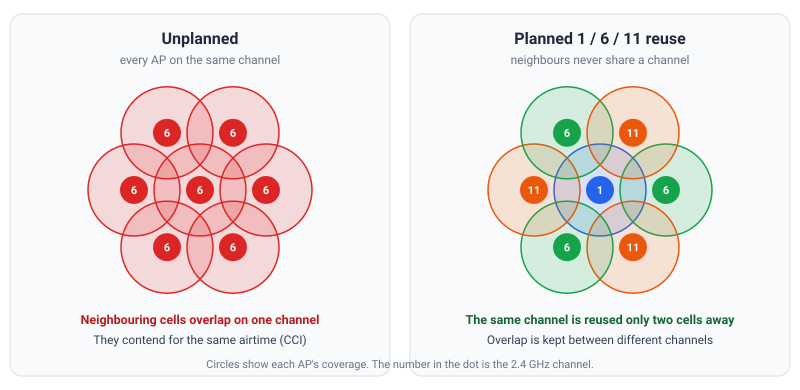

### Overview

---

Co-Channel Interference (CCI) is what happens when two or more radios that can hear each other are transmitting on the exact same channel. Unlike a corrupted frame, this is not a malfunction, CSMA/CA is working exactly as designed, deferring every device's transmission until the channel is clear. The problem is that "clear" never lasts long when several independent networks are all queued up to use the same slice of spectrum, so the one resource every station actually needs, airtime, gets divided among all of them. CCI is why a dense apartment building, a conference hall, or a multi-AP mesh network can have excellent signal strength everywhere and still deliver poor throughput.

---

### Co-Channel vs. Adjacent-Channel Interference

---

It helps to separate three things that all show up as "my Wi-Fi is slow" but have different root causes and different fixes:

- **Co-Channel Interference (CCI):** another BSS on the *exact same* channel. Its frames are fully decodable, so every compliant device correctly defers to them via Carrier Sense. Nothing is corrupted, the airtime is just shared, fairly but wastefully, across every BSS that overlaps.
- **Adjacent-Channel Interference (ACI):** a neighbor on a *nearby, overlapping* channel (for example channels 3 and 6 in 2.4 GHz). The signal isn't a decodable 802.11 preamble from this channel's point of view, so it is picked up only as raw energy. Devices don't defer to it the way they would to a real co-channel neighbor, so transmissions collide and frames get corrupted instead of being fairly queued.
- **Non-Wi-Fi interference:** sources such as wireless audio/video transmitters, Bluetooth, microwave ovens, baby monitors, and Zigbee devices. These follow the same path as ACI, Wi-Fi radios can only see them as energy, never as a frame to defer to, so they are often the most disruptive of the three despite carrying no data of their own.

See [Clear Channel Assessment](/blog/wifi-overview/) for how the Energy Detection (ED) and Carrier Sense (CS) thresholds that drive this distinction actually work at the PHY layer.

---

### Mechanism of Interference at PHY and MAC Layers

---

- **Physical (PHY) layer:** IEEE 802.11 devices use Carrier Sense Multiple Access with Collision Avoidance (CSMA/CA) to check whether a channel is busy before transmitting. A continuously-operating non-Wi-Fi source, a wireless audio transmitter is a good real-world example, raises the energy level on the channel, so Wi-Fi stations see it as persistent "noise" or a "busy medium" even though there is no frame to decode.
- **MAC layer:** once the medium is sensed as busy, a station must back off and wait a random interval before re-checking. If a collision happens anyway, because the interferer isn't a decodable 802.11 frame and nobody deferred to it in time, the data frame is corrupted, the sender never gets an ACK, and the MAC layer forces a retransmission. Under sustained interference this retry cycle repeats continuously, and useful throughput collapses even though the radio is transmitting constantly.

A wireless audio transmitter sitting on a fixed 2.4 GHz frequency is a useful mental model for the worst case: it never backs off, never stops, and is invisible to Wi-Fi's Carrier Sense, so every Wi-Fi device sharing that spectrum pays the MAC-layer retry cost for traffic that isn't even Wi-Fi.

---

### Causes of Co-Channel Interference

---

- **Few non-overlapping channels in 2.4 GHz.** Only channels 1, 6, and 11 (20 MHz wide) don't overlap each other; any other channel assignment creates adjacent-channel overlap on top of whatever co-channel overlap already exists.
- **High-density deployments.** Apartment buildings, offices, and campuses routinely have dozens of independently-managed BSSs within range of each other, all competing for the same handful of usable channels.
- **Wide channel widths.** An 80 or 160 MHz channel in 5/6 GHz covers more of the band at once, which raises the odds that *some part* of it overlaps a neighboring network's channel.
- **Multi-AP mesh backhaul.** A wireless backhaul hop shares the same radio and airtime budget as the fronthaul clients on that AP, see [Backhaul Optimization](/blog/EasyMesh-system/), so a poorly-planned mesh can generate co-channel interference against itself, AP to AP, without any external network involved at all.

---

### Impact of Channel Occupancy on Throughput

---

The relationship between channel occupancy (utilization) and throughput follows directly from how much airtime is actually left over. For Single-Link Operation (SLO), the average throughput ($Th_{SLO}$) can be approximated as:

$$
\begin{aligned}
Th_{SLO} &= \frac{(1 - \alpha)L}{T}
\end{aligned}
$$

Where:
- $\alpha$ is the occupancy (utilization) of the primary link
- $L$ is the packet size
- $T$ is the total transmission time

As occupancy ($\alpha$) rises toward 1.0 (100%), the free airtime term ($1-\alpha$) shrinks toward zero and throughput collapses with it, not gradually, but increasingly steeply as the channel fills up:

| Occupancy ($\alpha$) | Free airtime ($1-\alpha$) | Effect on throughput |
|---|---|---|
| 0.1 | 90% | Negligible; channel is essentially free |
| 0.5 | 50% | Throughput roughly halved versus an idle channel |
| 0.8 | 20% | Severe degradation; latency-sensitive apps start to suffer |
| 0.95 | 5% | Near-collapse; retries dominate airtime |

This is also why Multi-Link Operation (802.11be / Wi-Fi 7) is a structural answer to CCI rather than just a channel-planning fix: a station that can spread traffic across two or more links at once isn't fully exposed to a single occupied channel's $\alpha$ the way an SLO station is. See [Wi-Fi 7](/blog/wifi7/) for how MLO distributes traffic across links.

---

### Measuring Co-Channel Interference

---

- **Channel utilization / CCA busy fraction**, reported in the BSS Load element and readable directly from the driver with `iw dev wlan0 survey dump` (see [Clear Channel Assessment](/blog/wifi-overview/)). A high busy fraction with little traffic of your own is the clearest signature of CCI.
- **RSSI from neighboring BSSs on the same channel.** A strong RSSI from someone else's AP on your channel is literally what CCI looks like at the radio, it isn't noise, it's a fully decodable, correctly-deferred-to neighbor.
- **Retransmission / no-ACK rate.** A rising retry rate with stable signal strength to your own AP usually points at contention or interference rather than range.
- **Spectrum analysis**, for the non-Wi-Fi sources that never show up in an ordinary Wi-Fi scan at all because they have no SSID or BSSID to report.

---

### Mitigation Strategies

---

- **Channel planning:** keep 2.4 GHz deployments on the non-overlapping 1/6/11 pattern, and spread APs across the much larger number of non-overlapping channels available in 5 GHz and 6 GHz.
- **Transmit Power Control (TPC):** shrinking each AP's cell size reduces how many neighboring BSSs fall within Carrier Sense range in the first place, which is the precondition for CCI to exist at all.
- **BSS Coloring + OBSS_PD (802.11ax spatial reuse):** lets a station identify frames from an overlapping BSS and, below a raised energy threshold, transmit anyway instead of deferring, trading a little range for more simultaneous transmissions in dense deployments. See the OBSS_PD row in [Clear Channel Assessment](/blog/wifi-overview/).
- **Controller-driven channel selection:** in a multi-AP network, letting every AP choose its own channel independently is exactly how a network can create CCI against itself. A Controller that collects a Channel Preference Report from every Agent and computes one coordinated, network-wide plan avoids ever placing two in-range APs on the same channel to begin with, see [Channel Selection](/blog/EasyMesh-system/) in Wi-Fi EasyMesh.
- **Band and client steering:** moving a client off a congested channel onto a cleaner band or a less-loaded AP directly reduces $\alpha$ for everyone left behind, without touching the channel plan itself.
- **RTS/CTS** addresses the related but distinct hidden-node problem rather than CCI itself, see [Hidden Node and RTS/CTS](/blog/wifi-overview/), though it's worth ruling out separately, since both show up as the same symptom: NO ACK and rising retransmissions.

---

### Practical Example

---

Take a 2.4 GHz network sharing spectrum with an always-on wireless audio transmitter. Before the interferer is introduced, channel occupancy from the network's own traffic sits around $\alpha = 0.3$. Using the throughput model above, that leaves 70% of the airtime free, plenty of headroom.

Once the audio transmitter starts broadcasting continuously, every Wi-Fi station sharing that spectrum sees the channel as busy far more often, even though not one byte of the interferer's signal is a decodable Wi-Fi frame. If the effective occupancy rises to $\alpha = 0.8$ purely from backoff and retransmission overhead caused by the interferer, free airtime drops from 70% to 20%, a throughput cut of more than two-thirds, with no change at all to the network's own traffic load. This is the practical reason CCI (and its close relative, non-Wi-Fi interference) is diagnosed by occupancy and retry counters rather than by signal strength alone: the AP can show full bars right up until the moment the channel is too busy to use.

---

### References

---

- IEEE Std 802.11-2020, and the 802.11ax-2021 and 802.11be amendments
- [Clear Channel Assessment (CCA)](/blog/wifi-overview/)
- [Channel Selection in Wi-Fi EasyMesh](/blog/EasyMesh-system/)
- [Wi-Fi 7 and Multi-Link Operation](/blog/wifi7/)
