### Overview

---

WiFi Mesh network (wireless mesh network), also known as “multi-hop” network, is a new wireless networking solution developed based on WiFi technology. Unlike traditional WiFi network, WiFi Mesh network is a network technology based on multi-hop routing and peer-to-peer network, which is a new network structure. In the traditional wireless network, WiFi technology constitutes the internal network. The terminal joins the network through WiFi. The connection port on the device is Ethernet or optical port. In the network deployment, once the wired distance is determined, the location of the device WiFi will also be fixed. If you want to change the location of WiFi, you need to adjust the corresponding wired network, which is more difficult to operate and consumes a lot of time and wiring costs. Therefore, the traditional WiFi construction method has the shortcomings of high cost, poor flexibility, complex operation, etc. It is not suitable for building online services in scenarios such as high wireless quality and aesthetics, less maintenance investment and weak wired network. Mesh network only needs to install corresponding subnodes, no need to change the wired network, and it is very convenient and fast to set up a network [1].

---

### Benefits

---

Wi-Fi EasyMesh brings these capabilities to home and small office Wi-Fi networks.

1. Increased network capacity: Supports more simultaneous services and higher realized throughput when operating in Wi-Fi 6 and Wi-Fi 6E
2. Flexible design: Allows for best placement of multiple APs providing extended coverage
3. Easy setup: Delivers seamless, secure device onboarding and configuration using QR codes through Wi-Fi Easy Connect technology
4. Network intelligence: Advanced diagnostics for Wi-Fi 6 capabilities through Wi-Fi Data Elements facilitate service provider support and responds to network conditions to maximize performance
5. Effective service prioritization and Quality of Service (QoS) support: Capability to prioritize low latency applications when needed and guides devices to roam to the best connection and avoid interference
6. Scalability: Enables addition of Wi-Fi EasyMesh APs from multiple vendors

---

### Protocol

---

#### P1905.1 AL MAC Address

---

- A P1905.1 Abstraction Layer within a P1905.1 Device uses a MAC Address for identification.
- The P1905.1 AL MAC Address is locally administered.
- The P1905.1 AL MAC Address may be used as a source and destination address for data and P1905.1 control packets destined for the device.
- Each P1905.1 AL shall use a MAC Address that is not used by any other P1905.1 AL in the P1905.1 Network to which it connects.

---

#### Protocols for IEEE 802.11 access point autoconfiguration with IEEE Std 1905.1

---

AP autoconfiguration process use CMDU to send IEEE 802.11 paramaters from the registration server to the AP registration client to set initial configuration or update the existing configuration of the IEEE 802.11 interface. This operation provides an automated way to setup an extended service set for multiple APs and acts a registration client and uses an authenticated 1905.1 interface to send messages to another 1905.1 device acting as registration server. The 1905.1 network should be configured with a registration server that can be configured using buttons to facilitate the normal operation of 1905.1 devices.

After successful authentication of the 1905.1 interface, the AP-autoconfiguration process will be triggered. The AP automatic configuration process is divided into the following two stages:

1. Registrar discovery phase: to obtain information about registrars available on the 1905.1 network

2. IEEE 802.11 parameter configuration phase: Transmits configuration data between the registration server and the registration client (as specified in Wi-Fi simple configuration). The 1905.1 abstraction layer provides a transparent transmission protocol for WSC frames M1 and M2.

After receiving M1, the registration server sends M2, which contains key-encrypted configuration data. This process is defined per interface and applies to every unconfigured IEEE 802.11ap interface.

---

#### Registrar discovery phase

---

If the 1905.1 device contains an unconfigured IEEE 802.11 AP interface, the Registrar discovery phase SHOULD begin after successful authentication of the 1905.1 interface. The registration client sends an AP-autoconfiguration search message to discover the registration server. This multicast search message includes the UnconfiguredFreqBand TLV to discover whether the registration server can support automatic configuration of the requested frequency band. If the registration server supports the requested functionality, it shall return a unicast AP-autoconfiguration response message.

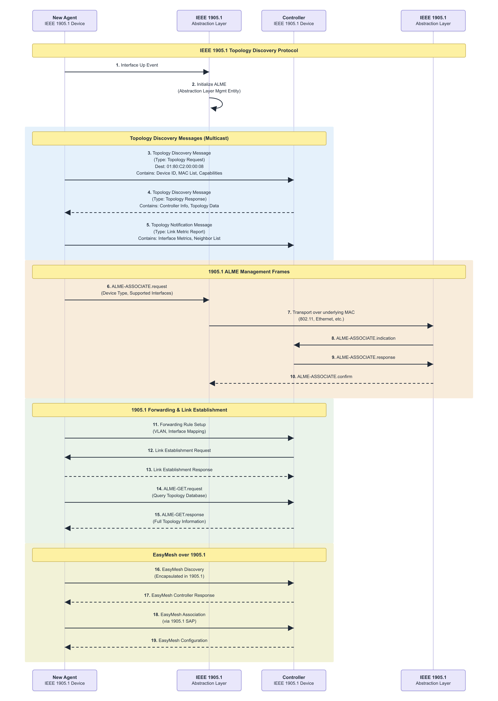

---

#### IEEE 802.11 parameter configuration phase

---

The IEEE 802.11 parameter configuration process should be started after receiving the AP-autoconfiguration response message. The IEEE 802.11 parameter configuration process is completed by exchanging messages: AP-autoconfiguration WSC (M1) and AP-autoconfiguration WSC (M2) (the content and format of m1 and m2 defined in wi-fi simple configuration). IEEE 802.11 configuration data is delivered to registered clients in M2. If The IEEE 802.11 parameter configuration does not complete successfully, the registered client should restart the Registrar discovery process. IEEE 802.11 settings (ConfigData) in M2 frame.

---

### Renewing of configuration

---

The AP-autoconfiguration renew message should be multicast by the registration server to notify AP registration clients that have configured data using the AP-autoconfiguration process to restart the AP-autoconfiguration process to update the data. This data update process is very important for the 1905.1 network to maintain synchronization of configuration parameters during the life cycle (restart, upgrade operations, etc.). All APs previously configured by the registration server should start The IEEE 802.11 parameter configuration after receiving the AP-autoconfiguration renew message. All APs previously configured by the registration server should start The IEEE 802.11 parameter configuration after receiving the AP-autoconfiguration renew message.

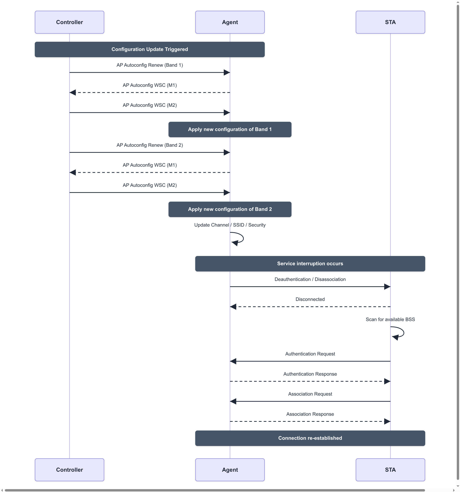

---

### Topology Managerment

---

- Topology discovery message (neighbor multicast): If the following event occurs, then within 1 s, a 1905.1 management entity shall transmit a topology discovery message
- Topology query message (unicast): A 1905.1 management entity may send a topology query message to another 1905.1 management entity
- Topology response message (unicast): If a 1905.1 management entity receives a topology query message, then within 1 s it shall respond. The topology response message shall contain the same MID that was received in the topology query message.
- Topology notification message (relayed multicast): If a 1905.1 management entity detects that any of the information specified to be sent in a topology response message has changed, then it shall within 1 s

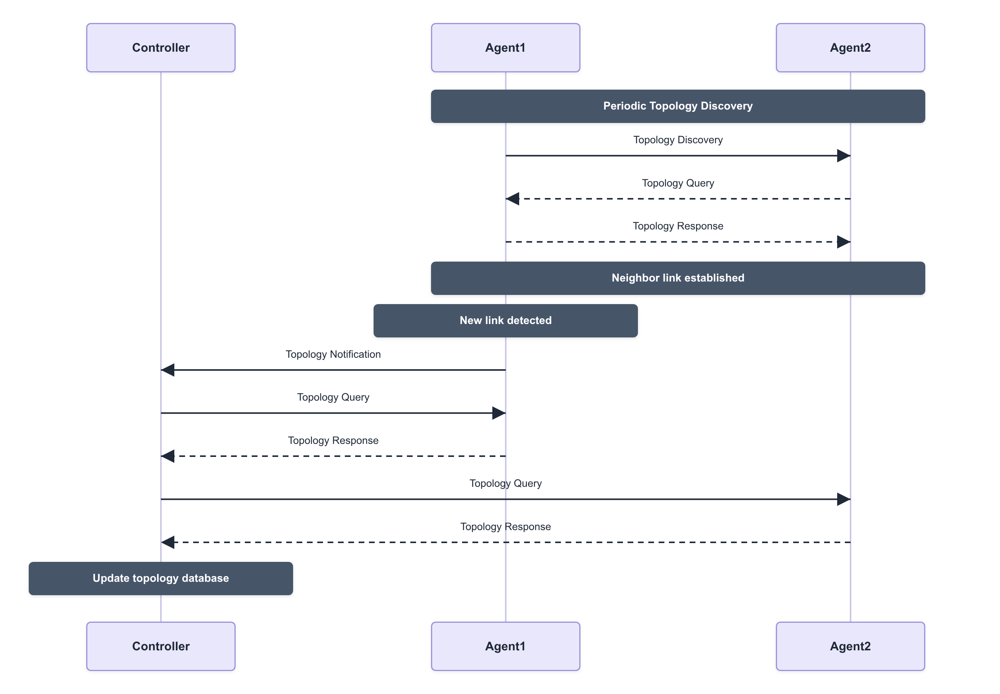

---

### Link metrics

---

The 1905.1 device provides link metric information for each authenticated 1905.1 interface by triggering the 1905.1 ALME primitive, thereby triggering the 1905.1 link metric information dissemination protocol information. 1905.1 Link metric information dissemination protocol includes a link metric query message process and a link metric response message process.

The Link metric information dissemination protocol enables a 1905.1 management entity to obtain link metric information on another 1905.1 device. A 1905.1 device receiving this message provides link metric information related to all of its interfaces to the specific 1905 neighbor device or to all of its other 1905 neighbor devices. 1905.1 Link metric information dissemination protocol includes a link metric query message process and a link metric response message process.

Link metric query messages can be sent from one 1905.1 management entity to another 1905.1 management entity, and all interfaces between all 1905 devices can send this message to each other. Link metric query messages are transmitted in CMDU unicast. If a 1905.1 managed entity receives a Link metric query message, it shall respond using the Link metric response message

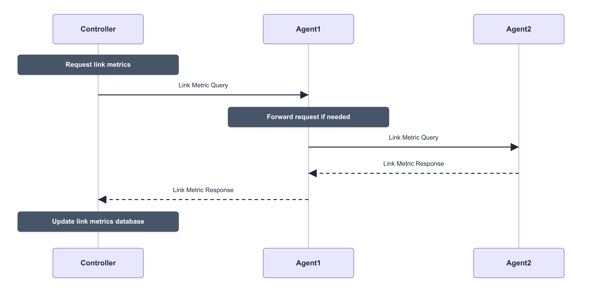

---

### Channel Selection

---

In a multi-AP network, uncoordinated channel choices between Agents create co-channel and adjacent-channel interference that degrades both the wireless backhaul and the fronthaul links seen by client stations. The Wi-Fi EasyMesh channel selection protocol lets the Controller collect each Agent's channel preferences and coordinate a consistent channel plan across the whole network, instead of leaving every AP to pick a channel on its own.

- Channel Preference Query (unicast): The Controller sends this to a 1905.1 management entity to request the current channel preference of each of its radios.
- Channel Preference Report (unicast): The Agent responds with a preference value (0 = not usable, up to 14 = most preferred) for every channel of every supported operating class, together with a reason code, such as a regulatory restriction, DFS/radar, or high interference, whenever a channel is restricted.
- Channel Selection Request (unicast): After aggregating the preference reports from every Agent, the Controller selects a channel plan that avoids overlap between APs and meets regulatory constraints, then instructs each Agent which channel and bandwidth its radio(s) should use.
- Channel Selection Response (unicast): The Agent accepts or declines the requested channel; a decline carries a reason code so the Controller can recompute the plan.
- CAC (Channel Availability Check): If the selected channel is a DFS channel, the Agent must first listen for radar for the regulatory-mandated interval before it may transmit on that channel.
- Operating Channel Report (unicast, relayed): Once a radio is actually operating on its new channel, the Agent reports the operating channel and bandwidth back to the Controller. This same message is also sent whenever the channel changes for any other reason, such as a DFS radar event forcing a channel move.

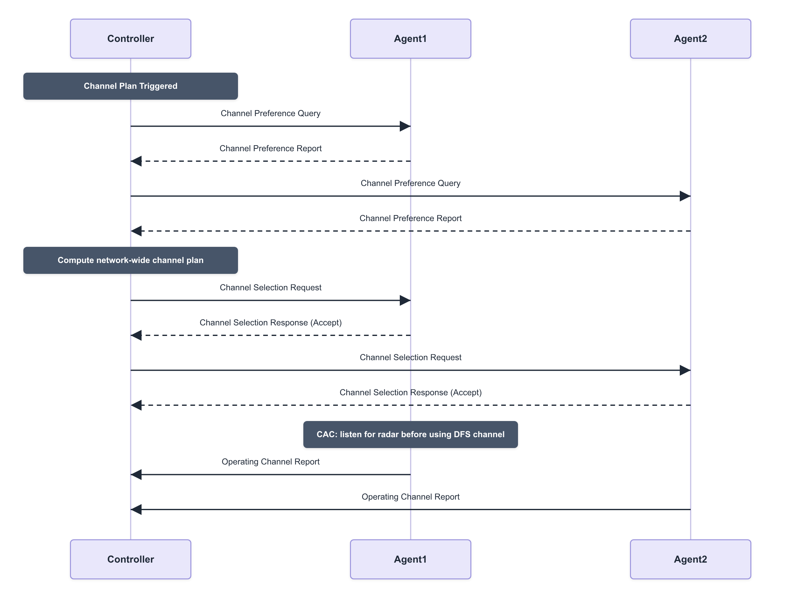

---

### Capability Information Reporting

---

Before the Controller can make network-wide decisions, which channel plan to pick, how to steer clients, which policies to push down, it needs to know what each Agent and each of its radios is actually capable of. The AP Capability Query and Report messages let the Controller build this capability database for every Agent in the network, typically right after an Agent completes onboarding.

- AP Capability Query (unicast): The Controller sends this to a newly onboarded (or already known) Agent to request its full set of capabilities.
- AP Capability Report (unicast): The Agent responds with a CMDU carrying several TLVs, including:
  - AP Radio Basic Capabilities: per radio, the maximum number of BSS it can support and the list of supported operating classes/channels.
  - AP HT / VHT / HE Capabilities: per radio PHY capability flags such as spatial streams, channel width, and supported MCS for 802.11n/ac/ax.
  - Backhaul STA Radio Capabilities: whether a radio can also operate as a wireless backhaul station, and any restriction to a specific set of BSSIDs.
  - Channel Scan Capabilities: which bands/channels a radio can scan on request, when it may scan, and its minimum scan interval.
  - CAC Capabilities: which DFS operating classes/channels a radio supports Channel Availability Check on, which CAC methods it implements, and their durations.
  - Device Inventory: vendor, model, and serial number of the device, plus the chipset vendor for each radio.
- If a radio's capabilities materially change at runtime, for example a firmware update that adds a new PHY mode, the Agent should trigger an unsolicited AP Capability Report so the Controller's database stays current without waiting to be asked again.

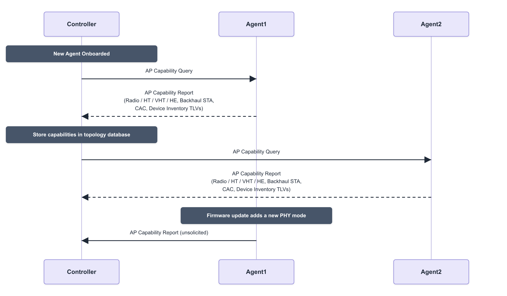

---

### Client Steering

---

Client steering is how the Controller moves an already-associated station to a better BSS, a different band, a less congested radio, or a neighboring Agent, without waiting for the client to decide to roam on its own. Because consumer devices are often slow or reluctant to roam even when a much better AP is available, EasyMesh gives the Controller an explicit, Agent-mediated way to steer the client using 802.11v BSS Transition Management (BTM).

- Unassociated STA Link Metrics Query / Response (unicast): Before steering, the Controller can ask a candidate target Agent how strongly it currently hears a given client (identified by MAC address), even though that client isn't associated to it yet. This lets the Controller confirm a target AP is actually a good choice before committing to steer.
- Client Steering Request (unicast): The Controller sends this to the Agent currently serving the client, listing one or more candidate target BSSIDs and the steering mode:
  - Steering Opportunity: the Agent sends a BTM request to the client and gives it a window of time to roam voluntarily, without forcing a disconnect.
  - Steering Mandate: the Agent must steer the client immediately, forcing it off the current BSS (via BTM Disassociation Imminent, or deauthentication as a last resort) if it doesn't comply.
- BTM Request / BTM Response (802.11v, over the air): The Agent sends the client a BSS Transition Management request naming the preferred target BSSID(s); the client's response indicates whether it accepted and which BSSID it intends to move to.
- Client Steering BTM Report (unicast): The Agent reports the client's BTM response status back to the Controller, so the Controller knows whether the steering attempt succeeded, was rejected, or timed out.
- Client Association Control Request (unicast): The Controller can use this to temporarily block a client from re-associating with the old BSSID while steering is in progress, preventing it from bouncing straight back.
- Once the client associates with the target Agent, that Agent's own Topology Notification tells the Controller the steering completed and the topology database is updated with the client's new point of attachment.

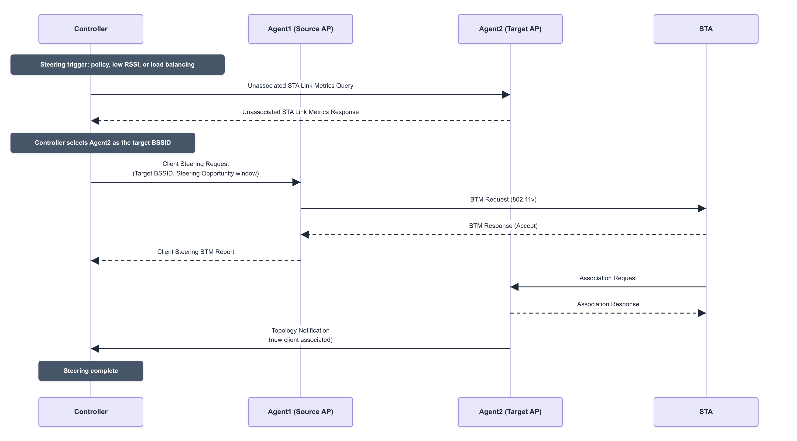

---

### Backhaul Optimization

---

In a multi-hop EasyMesh network, Agents can connect to each other wirelessly instead of over Ethernet. That wireless backhaul hop sits upstream of every client behind it, so a weak or overloaded backhaul link degrades the whole branch of the mesh, not just one station. Backhaul optimization is how the Controller selects and continuously re-optimizes these wireless backhaul connections, building on the generic 1905.1 Link Metrics and Topology protocols already described above.

- Wired-first preference: During onboarding, an Agent prefers an Ethernet (wired) 1905.1 uplink whenever one is available, and only falls back to a wireless backhaul station (bSTA) link when no wired uplink exists.
- Backhaul STA Radio Capabilities, learned via Capability Information Reporting, tell the Controller which of an Agent's radios may operate as a backhaul STA, and whether that is restricted to a specific set of BSSIDs.
- Initial parent selection: An Agent with a wireless-only backhaul scans for compatible backhaul BSSs during onboarding and associates with the one offering the best signal, subject to the Controller's autoconfiguration policy.
- Ongoing monitoring: 1905.1 Link Metrics (Tx/Rx PHY rate, RSSI, packet error rate) and AP Metrics (channel utilization) continuously feed the Controller's view of every backhaul link's health.
- Backhaul Steering Request (unicast): When the Controller determines a wireless-backhaul Agent would be better served by a different upstream BSSID, because its current link is weak or congested, or a stronger/less-loaded parent has appeared, it sends this message naming the target backhaul BSSID the Agent's bSTA should move to.
- Backhaul Steering Response (unicast): The Agent reports whether the move to the new backhaul BSSID succeeded or failed.
- Loop and hop-count avoidance: Before it ever sends a Backhaul Steering Request, the Controller checks its topology database (built from Topology Discovery/Notification) to reject any re-parenting decision that would create a loop or push a branch beyond the maximum supported hop count.

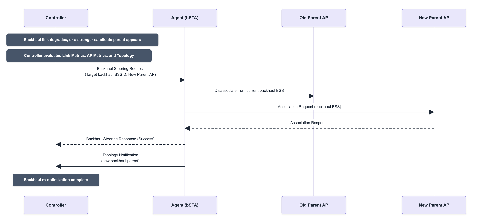

---

### Multi-AP Messaging

---

Every exchange described above, topology discovery, link metrics, channel selection, capability reporting, client steering, backhaul optimization, rides on the same underlying transport: the 1905.1 CMDU (Control Message Data Unit), which Wi-Fi EasyMesh (Multi-AP) extends with its own message types and TLVs rather than inventing a new wire format.

- Ethernet encapsulation: a CMDU is carried directly in an Ethernet frame using EtherType `0x893A`, addressed from one device's AL MAC address to another's, there is no IP layer involved.
- CMDU header: Message Version, a Message Type (identifying which protocol message this is, Topology Discovery, AP Capability Query, Client Steering Request, and so on), a Message ID (MID) used to correlate requests with responses and to detect duplicates, a Fragment ID, and a Flags byte carrying the Last Fragment Indicator and Relay Indicator bits.
- Fragmentation: a CMDU whose TLVs don't fit in a single Ethernet frame is split across multiple fragments sharing the same MID, reassembled by the receiving Abstraction Layer using the Fragment ID and Last Fragment Indicator.
- TLV payload: after the header, the CMDU carries a list of Type-Length-Value elements, one TLV per piece of information (an AP Radio Identifier, a Channel Preference, a Steering Policy, and so on), terminated by an End of Message TLV.
- Addressing and relay: a unicast CMDU targets a specific AL MAC address directly; a multicast CMDU (such as Topology Discovery) is sent to the reserved address `01:80:C2:00:00:13` and forwarded hop-by-hop by every 1905.1 Abstraction Layer in the network while the Relay Indicator bit is set, which is how discovery and notification messages reach devices that aren't directly adjacent.
- Multi-AP Profiles: Profile-1, Profile-2, and Profile-3 define successive generations of EasyMesh capability (baseline steering and autoconfiguration; metric collection, traffic separation and Easy Connect onboarding; enhanced security and newer Wi-Fi generations). Each Agent advertises the profile(s) it supports in its AP Capability Report, so the Controller knows which message set and TLVs it may use with that specific Agent.
- Policy Config: rather than having the Controller poll for everything, a Multi-AP Policy Config Request lets it push operating policy, steering policy, metric reporting policy, channel scan reporting policy, to an Agent in one message, so the Agent knows what to report proactively instead of waiting to be asked.

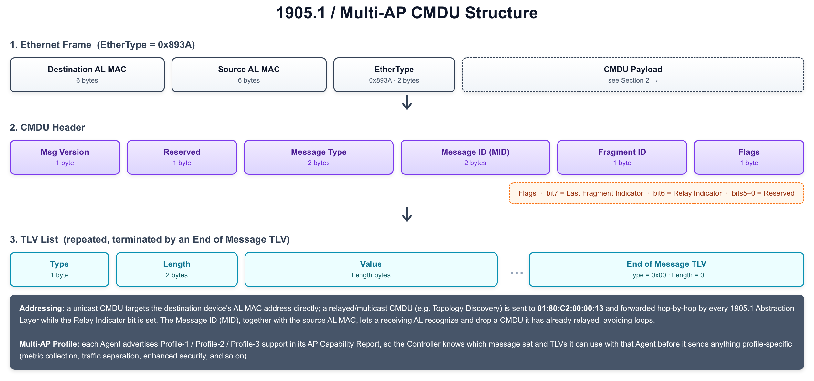

---

#### Four-Address MAC Header

---

Multi-AP Messaging covers how Controllers and Agents talk to each other, but client traffic itself has to cross the wireless backhaul link between Agents too, and an ordinary 802.11 frame doesn't carry enough addresses to do that transparently. The number of address fields in an 802.11 MAC header depends on the frame's ToDS and FromDS bits, and EasyMesh relies specifically on the ToDS = 1, FromDS = 1 case to bridge client traffic across a wireless hop.

- ToDS = 0, FromDS = 0 (IBSS/ad-hoc): three addresses are enough, Address 1 = DA, Address 2 = SA, Address 3 = BSSID.
- ToDS = 1, FromDS = 0 (station → AP): Address 1 = BSSID (the receiver, RA), Address 2 = SA (the transmitter, TA), Address 3 = DA.
- ToDS = 0, FromDS = 1 (AP → station): Address 1 = DA (RA), Address 2 = BSSID (TA), Address 3 = SA.
- ToDS = 1, FromDS = 1 (AP → AP, i.e. wireless backhaul / WDS): a fourth address field appears. Address 1 = RA (the immediate receiving radio), Address 2 = TA (the immediate transmitting radio), Address 3 = DA (the frame's final destination), Address 4 = SA (the frame's original source), this is the four-address format EasyMesh Agents use on the wireless backhaul.
- Why a fourth address is needed at all: a three-address frame can only name the immediate wireless transmitter/receiver plus one more endpoint, which is sufficient for a single client–AP hop but not for a multi-hop mesh, where the radio sending a frame over one hop is neither the frame's true original source nor its final destination.
- What it buys the network: because SA and DA survive each wireless hop unmodified, Agents can bridge client traffic across the backhaul exactly like a wired Ethernet switch would, with no NAT or re-addressing at any hop, the whole EasyMesh network behaves as one flat L2 broadcast domain / ESS, which is also what lets the Topology and Link Metrics protocols described earlier reason about a single, consistent MAC-level view of the network.

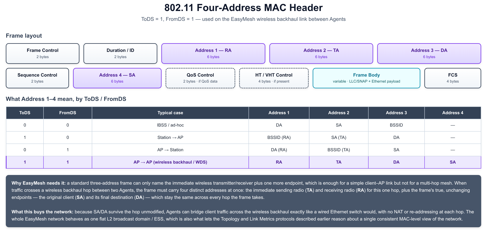

---

### Supplemental Protocol Rules & Procedures

---

Beyond the message-specific protocols above, 1905.1/EasyMesh defines several cross-cutting rules that every device follows regardless of which message it's handling, how to avoid relay loops, how aggressively to retry, how to onboard without WSC, and how to carry data the standard doesn't define a message for.

- CMDU deduplication: because many CMDUs (Topology Discovery, Topology Notification, Push Button Event Notification) are sent to the 1905.1 multicast address and relayed hop-by-hop, a receiving AL tracks the (Source AL MAC, Message ID) pair of CMDUs it has already seen and silently discards any repeat, otherwise the network would loop the same packet forever.
- Relay rule: a CMDU is relayed only if its Relay Indicator flag is set; the receiving AL retransmits it unmodified out of every other 1905.1-capable interface besides the one it arrived on, and if the CMDU is also addressed to this device locally, processes it as well. Non-relayed CMDUs are consumed only by the immediate neighbor.
- Retry and timeout rules: messages that expect a reply (AP-Autoconfiguration Search/Response, Topology Query/Response, Link Metric Query/Response, and so on) carry a response-time budget, typically within 1 second, and a bounded retry count, so a sender gives up and reports a failure instead of retrying indefinitely.
- Push Button Configuration: as an alternative to the registrar/WSC flow described earlier, pressing a physical (or virtual) push button on any 1905.1 device makes it multicast a Push Button Event Notification CMDU, so other devices already in push-button mode join the same onboarding session within a bounded "push button walk time" window, this limits the chance an unrelated device joins during the overlap.
- Vendor Specific TLV passthrough: a device that doesn't recognize a TLV, including a Vendor Specific TLV carrying another vendor's proprietary data, ignores that TLV and continues processing the rest of the CMDU rather than discarding the whole message, which is what lets vendor extensions coexist with standard interop.
- Generic Phy support: interfaces that are neither 802.11 nor Ethernet (MoCA, G.hn, powerline) are advertised with a Generic Phy TLV identifying the medium by OUI and variant, so the Controller can still include that link in its topology and link-metric view even though the medium has no 1905.1-specific protocol of its own.
- Higher Layer Data message: lets two devices from the same vendor exchange a proprietary higher-layer payload inside a standard CMDU, without needing a new standardized message type for every vendor-specific extension.

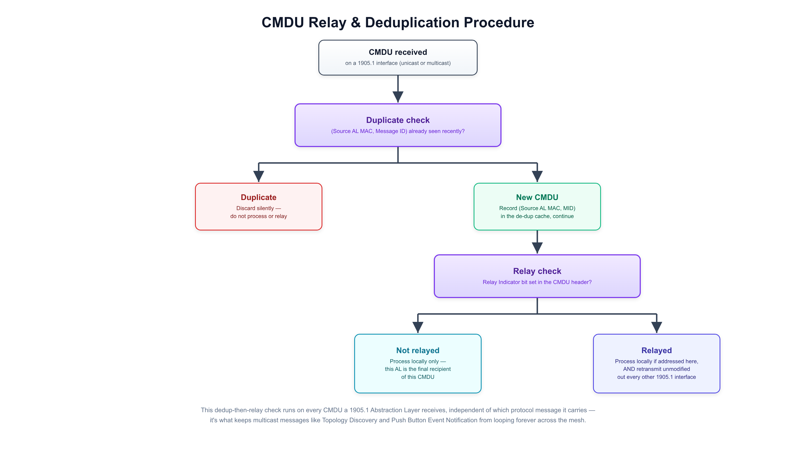

---

### Higher Layer Data Payload over 1905.1

---

1905.1 is fundamentally an L2 topology and management protocol, Topology Discovery/Query/Response tell the Controller which devices exist and how they're wired together at the MAC layer, but say nothing about how to actually reach a device over IP or what to call it in a UI. The Higher Layer Query and Higher Layer Response messages close that gap, letting one 1905.1 management entity ask another for exactly that information, carried as TLVs inside the same CMDU framework described earlier.

- Higher Layer Query (unicast): sent by one 1905.1 AL to another to request its higher-layer identification and reachability information. The query itself carries no mandatory TLVs, it simply asks for whatever the destination is willing to share.
- Higher Layer Response (unicast): the target replies with whichever of the following TLVs apply:
  - 1905 Profile Version TLV: which version of the 1905.1 profile/standard the device implements, so the querying AL knows what message set and TLVs to expect from it.
  - Device Identification TLV: the device's friendly name, manufacturer name, and model name, suitable for displaying in a management UI without a separate lookup.
  - Control URL TLV: a URL pointing at the device's own higher-layer management interface (such as a local web UI), so another device or a user can jump straight to it.
  - IPv4 TLV / IPv6 TLV: the device's active interfaces together with their current IPv4 and/or IPv6 addresses, what actually lets a higher-layer application reach the device over IP once 1905.1 topology discovery has already told it the device exists.
- Why it matters: this pair of messages is the bridge between the L2 topology the Controller already has from Topology Management and the L3+ information a management application actually needs, without requiring every device to also run a separate discovery protocol such as mDNS or UPnP on top of 1905.1.
- Transport: like every other 1905.1 message, Higher Layer Query/Response is carried as an ordinary CMDU, Ethernet-encapsulated with EtherType `0x893A`, addressed unicast to the target's AL MAC, and subject to the same header, TLV, and relay rules covered in Multi-AP Messaging and Supplemental Protocol Rules & Procedures.

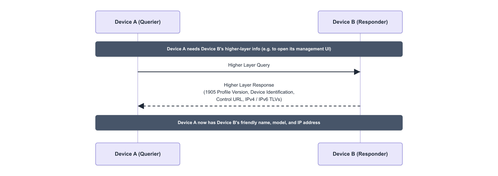

---

### Multi-AP Control Messaging

---

Multi-AP Messaging described how every CMDU is framed, addressed, and relayed. On top of that shared transport, Wi-Fi EasyMesh defines its own family of control-plane message types, allocated in their own numeric range so they never collide with the base 1905.1 messages they're layered over, that the Controller uses to actively configure and monitor Agents. Several of these were already introduced alongside the feature they support; this section rounds out the picture with the ones that cut across all of them: policy push, metrics collection, and failure reporting.

- Multi-AP Policy Config Request (unicast): rather than have the Controller poll for everything, this message pushes a bundle of policy TLVs to an Agent in one shot, a Steering Policy (which clients it may steer on its own initiative, and RSSI thresholds for doing so), a Metric Reporting Policy (how often to report AP/STA metrics, and the RSSI/utilization thresholds that should trigger an unsolicited report), and a Channel Scan Reporting Policy, so the Agent knows what to report proactively instead of waiting to be asked every time.
- AP Metrics Query / Response (unicast): asks an Agent for the operating metrics of its own radios and BSSs, channel utilization, number of associated STAs, and (on Profile-2 and later) estimated spatial-stream airtime, as opposed to the Link Metrics protocol covered earlier, which describes the 1905.1 links between devices rather than a radio's own load.
- Associated STA Link Metrics Query / Response (unicast): asks an Agent for the link quality of one specific, already-associated client, Tx/Rx PHY rate, RSSI, and packet error counts, which is the fronthaul counterpart to the backhaul-focused Link Metrics protocol, and the same data the Controller leans on when deciding whether a client in Client Steering is a good or bad candidate to move.
- 1905 Ack Message (unicast): sent in place of, or alongside, a specific response whenever a request is only partially honored or fails outright. It carries one or more Error Code TLVs identifying exactly which part of the request couldn't be satisfied and why, such as an unsupported channel, an unknown client MAC, or a radio that doesn't exist, so the Controller gets per-item failure detail instead of a single pass/fail flag, and can decide whether to retry, fall back, or recompute its plan.

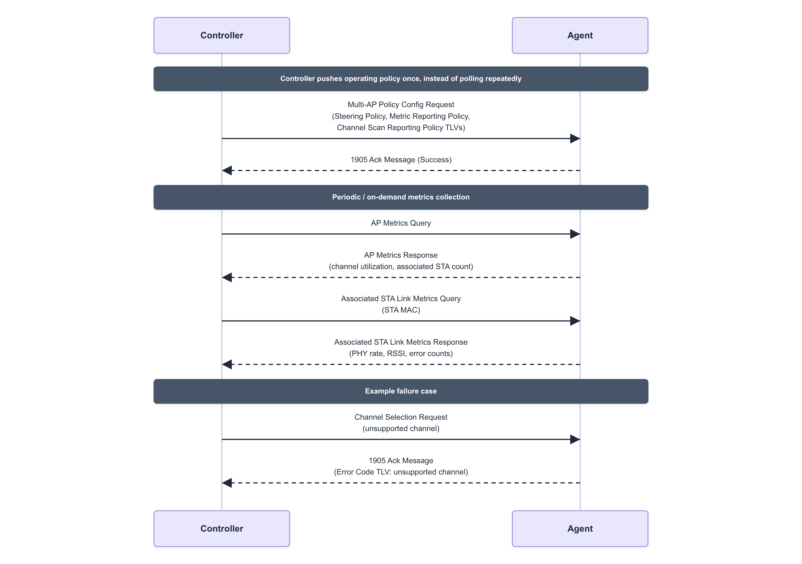

---

### Traffic Separation

---

A home or office Wi-Fi network increasingly carries several logically distinct SSIDs, a primary network, a guest network, an IoT network, that should never be able to reach each other, even though every Agent in the mesh shares the same physical backhaul. Traffic Separation, introduced in EasyMesh Profile-2, lets the Controller enforce that isolation consistently across the whole network using ordinary 802.1Q VLANs, instead of requiring a separately managed VLAN-aware switch configuration at every Agent.

- Default 802.1Q Settings: the Controller configures a Primary VLAN ID (PVID) and default 802.1p priority for each Agent's backhaul, the VLAN used for any traffic that isn't explicitly mapped elsewhere, including the 1905.1 control traffic itself.
- Traffic Separation Policy: maps each individual SSID/BSS to a specific VLAN ID, so a client that associates to, say, the guest SSID has its traffic tagged with the guest VLAN from the moment it reaches the Agent, all the way across the mesh.
- Delivered via Policy Config: both the Default 802.1Q Settings and the Traffic Separation Policy are carried as TLVs inside the same Multi-AP Policy Config Request used to push Steering and Metric Reporting policy, so an Agent learns its entire operating policy, including VLAN assignment, in one message.
- Wired backhaul: an Agent's Ethernet backhaul port operates as an 802.1Q trunk carrying every VLAN in use across the mesh, tagging and untagging frames exactly as a managed switch would.
- Wireless backhaul: 802.11 frames have no native VLAN tag field, so instead of tagging the 802.11 header itself, the VLAN ID travels inside the bridged Ethernet frame carried in the four-address frame's body described earlier, which is what lets a tagged frame survive a wireless backhaul hop unmodified, just as it would cross a wired trunk link.
- Fronthaul enforcement: each radio/BSS only ever emits and accepts traffic for the VLAN its SSID is mapped to, so a device on one SSID never sees broadcast or multicast traffic from another, even though every AP in the building might be transmitting all the SSIDs.
- Net effect: the whole EasyMesh network behaves like a single switch with multiple VLAN-isolated ports distributed across every Agent, kept in sync by the Controller the same way it keeps channel plans and steering policy in sync.

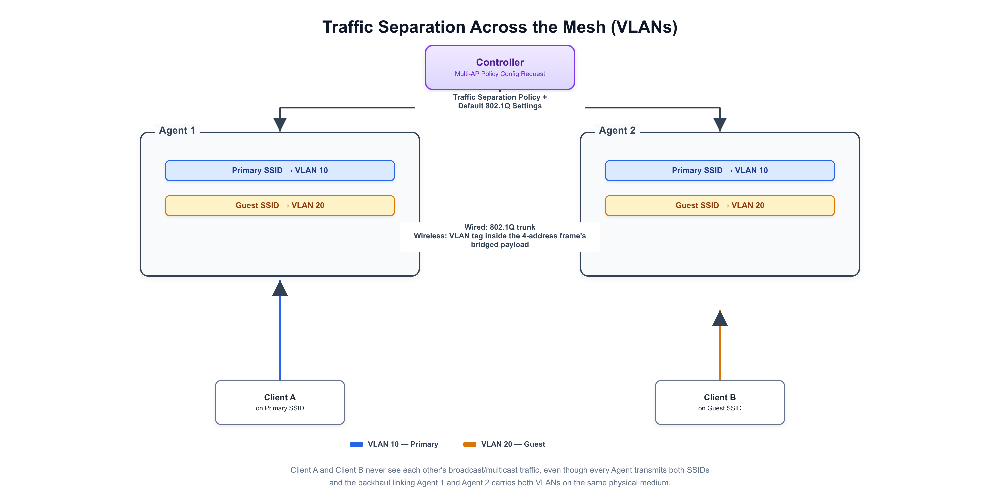

---

### Service Prioritization

---

Even with a well-chosen channel plan and healthy backhaul links, a mesh network still has to decide which packets get to use the radio first when there's contention, a video call and a large file transfer competing for the same airtime shouldn't be treated equally. Service Prioritization is how EasyMesh keeps that decision consistent across every hop a packet takes through the mesh, rather than leaving it to whatever each Agent's driver happens to do by default.

- WMM Access Categories: every 802.11 frame is queued into one of four Access Categories, Voice (AC_VO), Video (AC_VI), Best Effort (AC_BE), or Background (AC_BK), each with its own contention parameters, so higher-priority categories get more frequent and more reliable access to the medium under contention.
- DSCP-to-UP mapping: traffic usually already arrives marked with a DSCP value from the application or an upstream gateway; each Agent maps that DSCP value to an 802.11 User Priority (UP) and from there to a WMM Access Category, so classification an application already expressed in its IP headers carries through to the wireless hop.
- Service Prioritization policy: the Controller pushes a prioritization policy to Agents so a given flow is classified and queued the same way at every Agent in the mesh, not just the first one a client associates with, without it, a flow correctly prioritized at the ingress Agent could lose that treatment crossing a wireless backhaul hop to another Agent.
- Backhaul-aware prioritization: because a wireless backhaul hop shares airtime with every fronthaul client on that radio, an Agent applies the same Access Category treatment to backhaul-relayed traffic that it would have applied directly, so a latency-sensitive flow doesn't degrade just because it was forwarded through an extra hop.
- Composition with Traffic Separation: VLANs and Access Categories solve different problems and compose cleanly, a VLAN tag decides which broadcast domain a frame belongs to, while its Access Category decides how urgently it gets transmitted. The same frame carries both as it crosses the mesh.
- Why it needs to be network-wide: a channel or Agent that silently ignores DSCP/UP markings becomes a weak link, a voice call can sound fine for most of its path and still break up the moment it crosses that one Agent, which is exactly the inconsistency a network-wide Service Prioritization policy is meant to prevent.

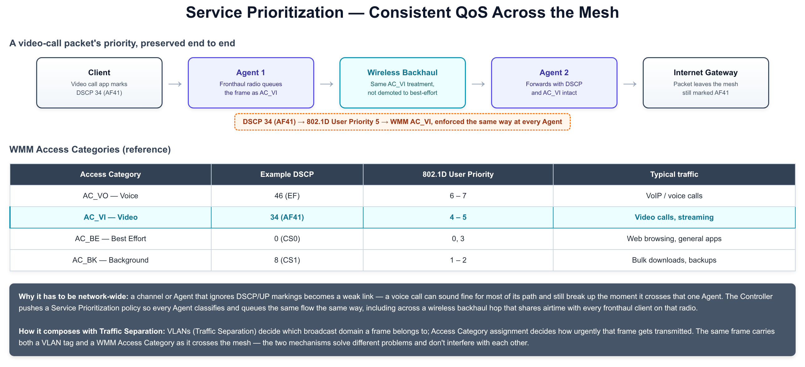

---

### Documents

---

<a href="https://drive.google.com/file/d/1SzujbgECt6dTly01quXK-KZKYT5CKy5f/view?usp=drive_link" target="_blank">IEEE 1905.1</a> 
<a href="https://drive.google.com/file/d/1UXO2X4WSJrsJYC_kCy4bWiUoYXrfzvBA/view?usp=drive_link" target="_blank">Wi-Fi EasyMesh Specification v6.0</a> 
<a href="https://drive.google.com/file/d/1ZpApjcITXl4s2GjMRIrW2VB2OAmpy3Iz/view?usp=drive_link" target="_blank">IEEE 1905.1 Presentation</a>

---

### References

---

[1] https://www.cdatatec.com/wifi-mesh-easymesh-technology-and-products.html \
[2] https://www.wi-fi.org/discover-wi-fi/wi-fi-easymesh