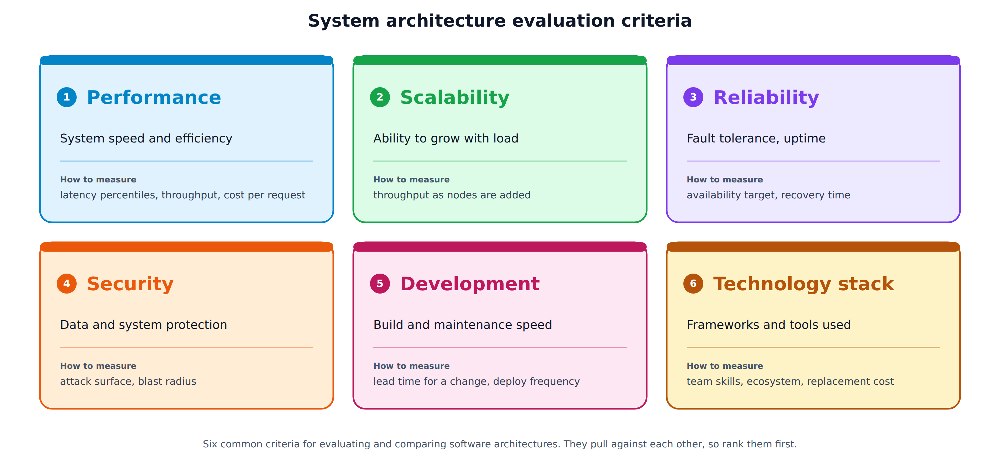
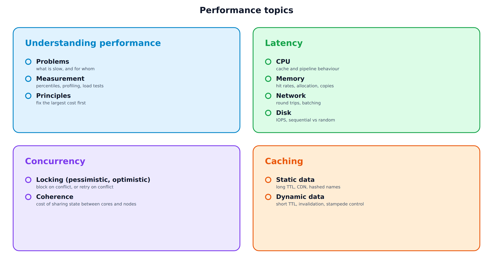
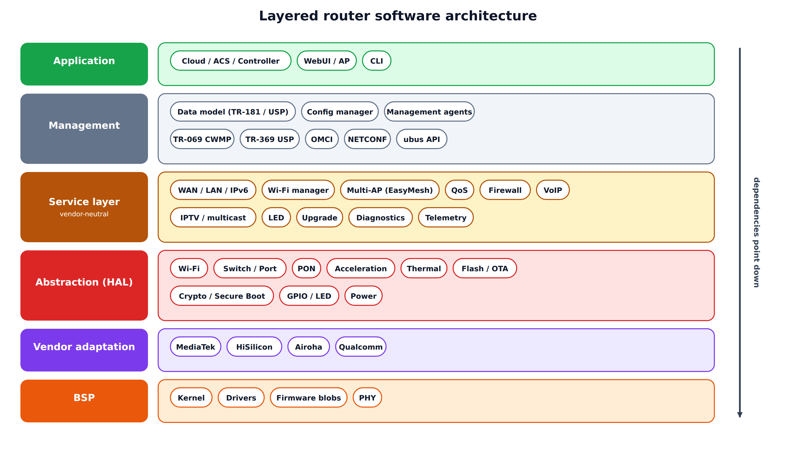

### Developer To Architect

---

A developer is paid to make **one component correct**. An architect is paid to make **a whole system keep working while it grows**: more users, more devices, more engineers, more features, and more things that can fail. The difference is not seniority, it is the question you ask.

| A developer asks | An architect asks |
|------------------|-------------------|
| Does this function work? | What happens to this function when the load is 100 times higher? |
| Which library is best? | What does it cost to replace this library in three years? |
| How do I fix this bug? | What class of bugs does this design make impossible, and which does it make likely? |
| How do I finish my task? | How do five teams finish theirs without blocking each other? |

Habits that I have seen separate the two:

* **Think in trade-offs, not in best practices.** Every real decision gives something up. Write down what you give up.
* **Own the quality attributes.** Features are visible. Latency, availability, security and operability are invisible until they fail, so someone must own them explicitly.
* **Optimise for change.** A system is judged by how cheaply it can change, not by how elegant it was on day one.
* **Make decisions explicit.** A short written record of why a choice was made is worth more than the diagram of what was chosen.
* **Stay close to the code.** An architect who stops reading code, traces and incident reports ends up designing systems that do not exist.

---

### What Makes a System "Large Scale"?

---

Large scale does not only mean many users. A system is large in several independent dimensions, and each one breaks a different assumption:

| Dimension | Example | What breaks |
|-----------|---------|-------------|
| **Load** | Millions of requests per second | A single machine, a single database, a lock |
| **Data** | Petabytes of state | Backups, migrations, queries that scan |
| **Geography** | Users on every continent | The speed of light: latency can only be hidden, never removed |
| **Fleet** | Millions of deployed devices (routers, phones, sensors) | Manual operations, version diversity, flaky connectivity |
| **Organisation** | Hundreds of engineers in dozens of teams | Shared ownership, release coordination, one big codebase |
| **Time** | Ten years of accumulated decisions | Understanding, upgrade paths, data formats |

Two consequences follow, and they are the core of this post:

1. **At scale, rare events become routine.** A disk that fails once in five years fails every day in a fleet of two thousand disks. Design for failure as the normal case.
2. **At scale, coordination is the real cost.** Anything that needs every node, every team or every request to agree is the first thing that stops scaling.

---

### Evaluating an Architecture

---

There is no "good architecture" in the abstract, only an architecture that fits a set of priorities. Six criteria cover most reviews:



| Criterion | The question to ask | A measurable form |
|-----------|--------------------|-------------------|
| **Performance** | How fast and how efficient is it? | p50 / p99 latency, throughput, CPU and memory per request |
| **Scalability** | Can it grow with load by adding resources? | Throughput as a function of nodes, cost per extra unit of load |
| **Reliability** | Does it keep working when parts fail? | Availability (SLO), MTTR, error budget |
| **Security** | Are the data and the system protected? | Attack surface, blast radius of a compromised component |
| **Development** | How fast can we build and maintain it? | Lead time for a change, deploy frequency, onboarding time |
| **Technology stack** | Are the frameworks and tools the right ones? | Team skills, ecosystem, licence and support, replacement cost |

These criteria **pull against each other**. More replicas raise reliability and cost. Stronger consistency hurts latency. Strict security slows development. A useful review ranks the criteria for *this* product first, for example "reliability and security first, development speed second", and only then judges the design.

---

#### Quality attribute scenarios

---

Vague goals such as "must be fast" cannot be tested. Write each requirement as a scenario:

```
Source:       a user in Europe
Stimulus:     opens the dashboard
Environment:  normal load, one availability zone degraded
Response:     the page renders
Measure:      p99 under 800 ms, 99.95% of requests succeed over 30 days
```

A scenario like this can be load-tested, monitored and argued about.

---

### Scalability

---

#### Vertical and horizontal scaling

---

| | Vertical (scale up) | Horizontal (scale out) |
|--|---------------------|------------------------|
| How | A bigger machine | More machines |
| Limits | The biggest machine you can buy, and it is a single point of failure | Coordination between machines |
| Complexity | Low | High: partitioning, consistency, load balancing |
| Use it | First. It is cheap in engineering time | When one machine is no longer enough |

Scale up as far as is sensible, then scale out. Scaling out is a one-way door that adds complexity to every later decision.

---

#### The rules that make scale-out possible

---

* **Stateless services.** Keep no per-user state in the process. State lives in a database, cache or token, so any instance can serve any request and instances can be added or killed freely.
* **Partition the data (sharding).** Split data by a key so that each node owns a subset. Choose a key with an even spread and one that most queries can use. Moving a hot shard later is painful.
* **Remove shared bottlenecks.** A global lock, a single sequence generator or one leader for every write caps the whole system at the speed of one machine.
* **Prefer asynchronous work.** A queue turns a spike into a longer backlog instead of an outage.

---

#### Laws worth remembering

---

**Amdahl's law.** If a fraction $p$ of the work can run in parallel on $n$ workers, the best speed-up is

$$
S(n) = \frac{1}{(1 - p) + \dfrac{p}{n}}
$$

With $p = 0.95$ the limit is 20 times, however many nodes you add. The serial part, such as a lock or a coordinator, sets the ceiling.

**Little's law.** In a stable system the average number of requests in flight $L$ equals the arrival rate $\lambda$ times the average time each spends in the system $W$:

$$
L = \lambda \, W
$$

If a service takes 200 ms per request and must handle 5,000 requests per second, it needs $5000 \times 0.2 = 1000$ requests in flight, so thread pools, connections and queues must be sized for about that number. When $W$ grows, $L$ grows with it, which is how a slow dependency fills every thread.

---

### Reliability and Availability

---

#### Availability is a budget

---

| Availability | Downtime per year | Downtime per month |
|--------------|-------------------|--------------------|
| 99% | 3.65 days | 7.3 hours |
| 99.9% | 8.76 hours | 43.8 minutes |
| 99.99% | 52.6 minutes | 4.4 minutes |
| 99.999% | 5.26 minutes | 26 seconds |

Each extra nine costs roughly ten times more. Pick the number from the business impact of downtime, not from pride. The **error budget** is the allowed unreliability (for example 0.1% for a 99.9% target). While budget remains, ship features. When it is spent, work on reliability.

---

#### Composition rules

---

If components are required in series, availabilities multiply. If they are redundant, failures multiply:

$$
A_{\text{series}} = \prod_i A_i
\qquad
A_{\text{parallel}} = 1 - \prod_i (1 - A_i)
$$

Five dependencies at 99.9% each, all required, give only $0.999^5 \approx 99.5\%$. Two independent replicas at 99.9% give $1 - 0.001^2 = 99.9999\%$, but only if their failures really are independent. Two replicas in the same rack, on the same power feed or running the same buggy release fail together.

---

#### Techniques

---

* **Remove single points of failure,** and look for the hidden ones: a shared DNS, a shared certificate, a shared configuration service.
* **Failure domains.** Spread replicas across hosts, racks and zones so one fault cannot take out all copies. Bound the **blast radius** with cells or shards, so a bad change hurts 5% of users instead of 100%.
* **Timeouts, retries and backoff.** Every remote call needs a timeout. Retry with exponential backoff and jitter, and only for idempotent operations, or retries become a self-inflicted overload.
* **Circuit breakers and bulkheads.** Stop calling a failing dependency and isolate resource pools, so one slow service cannot consume every thread.
* **Graceful degradation.** Decide what the product does without each dependency: serve stale data, hide a widget, queue the action.
* **Idempotency.** Make operations safe to repeat, with request IDs, so retries and at-least-once delivery do not double-charge or double-apply.
* **Backpressure and load shedding.** Reject early and cheaply instead of failing slowly under overload.

---

### Performance

---



---

#### Understand and measure first

---

Optimise nothing until you can measure it. Track **percentiles, not averages**: the p99 of a service is what a user sees once they make a few dozen calls, and a fan-out that waits for 100 backends is dominated by the slowest of them. Profile in production-like conditions and fix the largest cost first.

---

#### Latency has a hierarchy

---

Orders of magnitude, on typical current hardware:

| Operation | Rough time |
|-----------|-----------|
| CPU cache hit | about 1 ns |
| Main memory access | about 100 ns |
| SSD random read | about 100 microseconds |
| Round trip inside a data centre | about 0.5 ms |
| Round trip between continents | about 100 to 150 ms |
| Spinning disk seek | about 10 ms |

Each layer is roughly 10 to 1000 times slower than the one above it. Most performance work is about **avoiding a trip down the hierarchy**: keep hot data in memory, batch network calls, avoid chatty protocols, and move data closer to users.

---

#### Concurrency

---

* **Locking.** *Pessimistic* locks assume conflict and block others, which is simple and safe under heavy contention. *Optimistic* concurrency assumes conflicts are rare, works without locks and retries on a version mismatch, which scales better when contention is low.
* **Coherence cost.** Sharing mutable state between cores or nodes costs cache-line bouncing or network round trips. Share less: partition the data, give each worker its own, and merge results.
* **Event loops versus threads.** Event-driven designs handle many idle connections cheaply but must never block. Thread-per-request designs are simpler but cost memory per connection.

---

#### Caching

---

A cache trades freshness for speed. Decide per data type:

| Data | Strategy | Watch out for |
|------|----------|---------------|
| **Static** (assets, reference data) | Long TTL, CDN, content-hashed names | Invalidation on deploy |
| **Dynamic** (user data, query results) | Short TTL, write-through or explicit invalidation, per-key versions | Stale reads, thundering herd on expiry, cache stampede |

"There are only two hard things in computer science: cache invalidation and naming things." Cache only what you can afford to see stale, and always have a plan for the cache being empty.

---

### Data at Scale

---

Data decisions are the hardest to reverse, so make them with the most care.

---

#### Replication and consistency

---

Replication gives availability and read scale, and it forces a choice about **consistency**. In a network partition a system must choose between staying consistent (refusing some requests) and staying available (possibly returning stale data). This is the **CAP** trade-off. Even without a partition there is a latency-versus-consistency trade-off (PACELC).

| Model | What you get | Typical use |
|-------|--------------|-------------|
| **Strong** (linearizable) | Every read sees the latest write | Money, inventory, locks |
| **Eventual** | Replicas converge if writes stop | Feeds, counters, caches |
| **Causal / read-your-writes** | Related operations are seen in order | User-facing sessions |

---

#### Choosing a store

---

| Need | Fits | Trade-off |
|------|------|-----------|
| Transactions, relations, ad-hoc queries | Relational database | Scaling writes beyond one node is hard |
| Huge key-value workloads with simple access | Key-value / wide-column store | Limited query model |
| Documents with flexible schema | Document store | Joins and cross-document transactions are weak |
| Full-text and analytics search | Search engine | Not a system of record |
| Time series (metrics, telemetry) | Time-series database | Specialised queries |
| Events as the source of truth | Append-only log | Rebuilding state means replaying |

Use one database that you understand well until it genuinely cannot cope. A polyglot system multiplies the operational burden.

---

#### Patterns

---

* **CQRS and event sourcing:** separate the write model from the read models, and store changes as events. Powerful, but a large step in complexity. Use it where history and audit really matter.
* **Sagas:** replace distributed transactions with a sequence of local transactions and compensating actions.
* **Outbox pattern:** write the data change and the outgoing event in the same local transaction, then publish from the outbox, so no event is lost.
* **Schema evolution:** make every change backward and forward compatible (add fields, never repurpose them) so old and new versions can run side by side.

---

### Communication Between Components

---

| Style | Examples | Good for | Cost |
|-------|----------|----------|------|
| **Synchronous request / response** | REST, gRPC | Queries, simple flows | Caller is coupled to the callee's speed and availability |
| **Asynchronous messaging** | Queues, pub/sub | Spikes, retries, loose coupling | Eventual consistency, ordering, duplicates |
| **Event streaming** | Log-based brokers | Many consumers, replay, audit | Operating the platform, schema discipline |
| **Local IPC** | Unix sockets, message queues, shared memory | Processes on one machine | Limited to a single host (see [IPC](/blog/ipc/)) |

Rules that prevent most integration pain:

* **Define contracts first** (an API schema or protocol definition) and version them.
* **Assume at-least-once delivery** and make consumers idempotent.
* **Avoid distributed monoliths:** services that must deploy together, or that call each other in long synchronous chains, have all the costs of microservices and none of the benefits.

---

### Architecture Styles

---

| Style | Strength | Weakness | Choose it when |
|-------|----------|----------|----------------|
| **Layered monolith** | Simple to build, test and deploy | Grows into a ball of mud without discipline | Small team, new product |
| **Modular monolith** | One deployable, but strict module boundaries | Needs enforced boundaries | Most teams, most of the time |
| **Microservices** | Independent deploy and scale per team | Distributed-system costs on every call | Many teams and clear domain boundaries |
| **Event-driven** | Loose coupling, easy fan-out | Harder to follow and debug | Many independent reactions to a change |
| **Plug-in / hexagonal** | The core is isolated from I/O and vendors | Extra indirection | Long-lived products with changing integrations |

Teams split into microservices too early more often than too late. Start with a **modular monolith**, draw boundaries along business domains (bounded contexts), and split a module out only when it needs its own scale, its own release cadence or its own team. **Conway's law** is real: the system's structure copies the organisation's communication structure, so design both together.

---

### Security by Design

---

* **Least privilege** for every service, user and key.
* **Defence in depth:** assume any single control will fail.
* **Zero trust inside the network:** authenticate and authorise every call, even between internal services.
* **Secrets out of code:** a secret store with rotation, never a repository or an image.
* **Limit the blast radius:** per-tenant isolation, scoped tokens, network segmentation.
* **Secure the supply chain:** pinned and scanned dependencies, signed builds.
* **Threat-model early:** list assets, trust boundaries and attackers, and rank the risks before the design is frozen.

---

### Operability and Observability

---

A system you cannot see is a system you cannot run. Build observability in from the start:

* **Metrics** show the trend (rate, errors, duration for services; utilisation, saturation, errors for resources).
* **Logs** show the detail. Make them structured, and include a request ID.
* **Traces** show where the time went across services.
* **Alerts** page a human only for symptoms users feel, with a runbook attached. Alerting on every cause creates fatigue.

Deployments are part of the architecture:

* **CI/CD** with automated tests and a fast, boring release process.
* **Progressive delivery:** canary releases, feature flags and fast rollback limit the cost of a bad change.
* **Infrastructure as code** keeps environments reproducible.
* **Chaos and game days** prove that the failure handling you designed really works.

---

### Choosing a Technology Stack

---

Technology choices outlive the people who made them. Ask:

| Question | Why it matters |
|----------|----------------|
| Does the team already know it? | Skill is a bigger factor than benchmark numbers |
| How mature is the ecosystem and the community? | Libraries, hiring, answers at 3 a.m. |
| What is the operational cost? | Running it costs more than writing it |
| What are the licence and vendor risks? | Lock-in and support terms |
| How hard is it to replace? | Put the unstable choice behind an interface |
| Does it fit the failure model? | Memory safety, concurrency model, deployment size |

A good rule is to **spend "innovation tokens" sparingly**: pick boring, proven technology for the parts that are not your differentiator, and take risks only where the new technology gives a real advantage.

---

#### Record decisions

---

Keep a short **Architecture Decision Record** for each significant choice:

```
Title:        Use PostgreSQL as the system of record
Status:       Accepted
Context:      We need transactions, relations and ad-hoc reporting; load is under 5k writes/s.
Decision:     PostgreSQL with one primary and two read replicas.
Consequences: Strong consistency and simple queries; writes cannot scale past one node,
              so we will shard by tenant if we pass 20k writes/s.
Alternatives: A wide-column store (rejected: weak query model).
```

The point is the **context and the consequences**. A year later nobody remembers why, and the record answers it.

---

### Case Study: A Layered Router Platform

---

Not every large scale system lives in a data centre. A home or carrier gateway is a **fleet** problem: millions of devices, several chip vendors, years of firmware versions, and a cloud that must manage all of them. The architecture below is the layered model I use for router software:



| Layer | Responsibility | Why it exists |
|-------|----------------|---------------|
| **BSP** | Kernel, drivers, firmware blobs, PHY | Everything tied to one chipset |
| **Vendor adaptation** | One adapter per SoC vendor (for example MediaTek, HiSilicon, Airoha, Qualcomm) | Confine vendor differences to one place |
| **Abstraction (HAL)** | Uniform interfaces for Wi-Fi, switch, PON, acceleration, thermal, flash/OTA, crypto and secure boot, GPIO/LED, power | Let upper layers ignore the chip |
| **Service layer (vendor-neutral)** | WAN/LAN and IPv6, Wi-Fi manager, Multi-AP (EasyMesh), QoS, firewall, VoIP, IPTV and multicast, LED, upgrade, diagnostics, telemetry | The product logic, written once and reused on every platform |
| **Management** | Data model (TR-181 / USP), configuration manager, management agents (TR-069 CWMP, TR-369 USP, OMCI, NETCONF, ubus API) | One way to configure and observe the device, whatever the protocol |
| **Application** | Cloud / ACS / controller, web UI, CLI | What operators and users touch |

The same principles from the rest of this post show up in a small form:

* **Dependency direction.** Dependencies point downwards, and only through interfaces. The service layer never calls a vendor SDK directly. This is the **hexagonal** idea: the business logic is isolated from I/O and vendors.
* **A porting seam.** Adding a new SoC means writing a vendor adapter and a HAL implementation. The service layer, the data model and the cloud do not change. That is what makes ten products on four chipsets possible with one team.
* **One data model.** A single TR-181 data model above the services lets TR-069, TR-369 and the web UI all drive the same configuration, so a fix in one place is a fix everywhere.
* **Fleet operability.** Remote upgrade (OTA) with rollback, staged rollout, telemetry and diagnostics are first-class services, because you cannot send an engineer to a million homes.
* **Resource limits are real.** A device with a few hundred megabytes of RAM and flash needs budgets for memory, CPU and storage, and it must keep forwarding traffic even when management is unhealthy. Separate the **data plane** (must never stop) from the **control and management plane** (can restart).

For concrete examples of the same layering, see how the Multi-AP stack is split into processes in [prplMesh](/blog/prplmesh/) and how a Wi-Fi AP separates control from the data path in [hostapd](/blog/hostapd/).

---

### Common Anti-Patterns

---

| Anti-pattern | Symptom | Better |
|--------------|---------|--------|
| **Premature microservices** | Ten services, one team, constant cross-service bugs | A modular monolith |
| **Distributed monolith** | Services deployed in lock step | Fewer, larger services with stable contracts |
| **Resume-driven design** | The newest tool for a plain problem | Boring technology |
| **Big-bang rewrite** | Two systems, neither finished | Strangler pattern: replace piece by piece |
| **Golden hammer** | One database or framework for every job | Match the tool to the access pattern |
| **No observability** | Incidents debugged by guessing | Metrics, logs and traces from day one |
| **Ignoring failure** | Works in the demo, falls over in production | Timeouts, retries, degradation, game days |
| **Architecture by committee** | Nothing decided, or decided to please everyone | One accountable owner, written decisions |

---

### A Practical Checklist

---

Before you approve a design, can you answer these?

1. **What are the top three quality attributes, in order,** and what are their measurable targets?
2. **What is the expected load now and in two years,** and what is the first bottleneck?
3. **What fails, and what does the user see?** Walk through each dependency.
4. **What is the blast radius of a bad deploy** and how fast can we roll it back?
5. **Where is the state,** who owns it, and how is it backed up and restored?
6. **How do we change the data format** without a flag day?
7. **How do we know it is healthy,** and who gets paged when it is not?
8. **What is the cost** to run it at the target scale?
9. **Which decision is hardest to reverse,** and have we recorded why we made it?

---

### Summary

---

1. **Architecture is trade-offs under constraints.** Rank the criteria first: performance, scalability, reliability, security, development speed and technology stack. Then judge the design.
2. **Scale changes what is normal.** Failures become routine and coordination becomes the cost, so design for failure and remove shared bottlenecks.
3. **Make the system stateless and partitioned,** and use asynchronous work to absorb spikes.
4. **Treat availability as a budget,** and use redundancy, failure domains, timeouts and graceful degradation to spend it wisely.
5. **Measure before you optimise,** watch percentiles, and remember the latency hierarchy.
6. **Be most careful with data decisions.** They are the hardest to reverse.
7. **Start simple:** a modular monolith, boring technology, and written decisions. Split and specialise only for a measured reason.
8. **The same ideas work at every size,** from a cloud service with millions of requests to a router platform with millions of devices.
