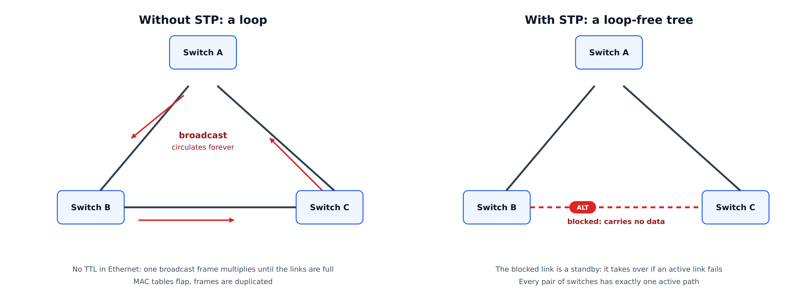
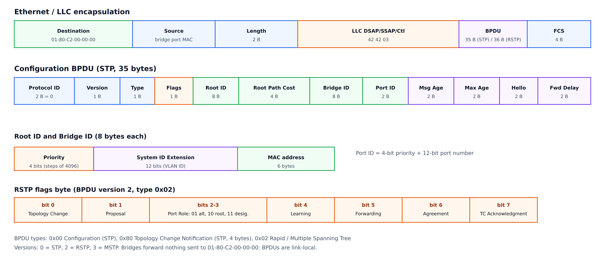
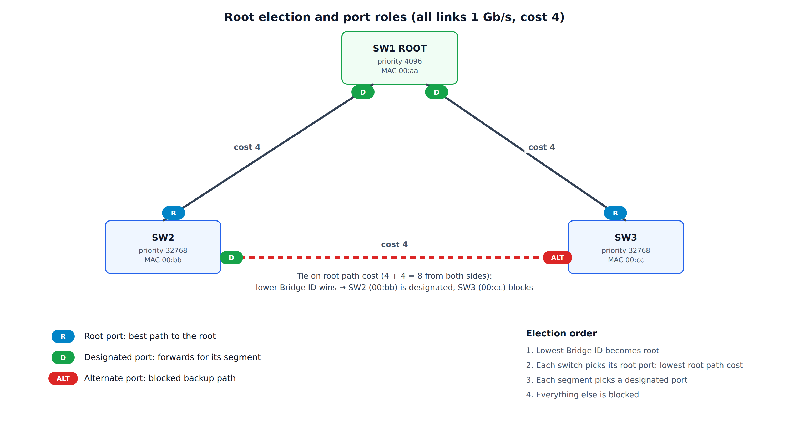
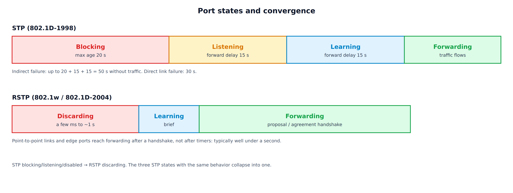
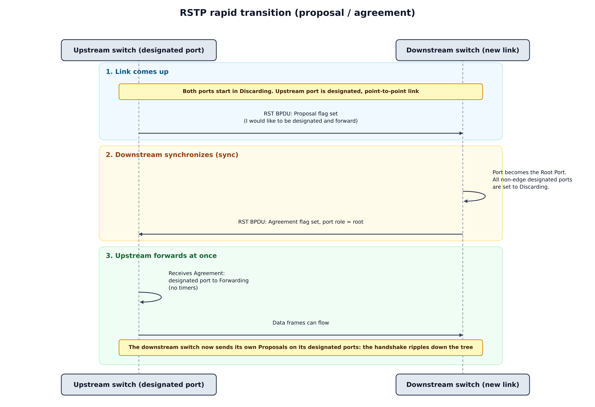
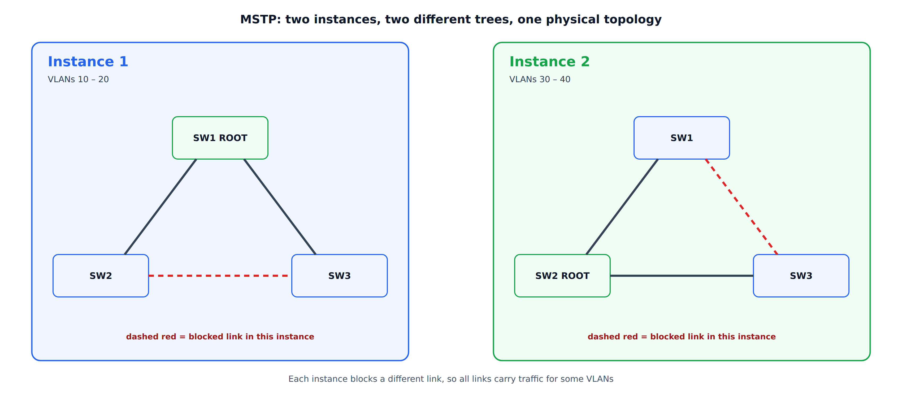

### Overview

---

Ethernet has no equivalent of the IP **TTL** field. A frame that enters a loop of bridges is never discarded by the forwarding plane, and a broadcast, multicast or unknown-unicast frame is **copied onto every other port** at every hop. Within a second, one frame becomes thousands of copies, the links saturate, and every switch's CPU is busy handling the flood. This is a **broadcast storm**. Even unicast traffic suffers from a loop, because a source MAC address is learned on a different port each time a looping copy arrives (**MAC table flapping**), and receivers see duplicated frames.

The **Spanning Tree Protocol** solves this at Layer 2 by letting the bridges agree, with no central controller, on a **loop-free subset of the topology**: a tree that reaches every bridge. The links that are not part of the tree are put in a **blocked** state. They stay physically up, and they take over when an active link fails.

<div style="text-align: center;">



</div>

The protocol family has gone through three generations:

| Protocol | Standard | Key idea | Convergence |
|----------|----------|----------|-------------|
| **STP** | IEEE 802.1D-1998 | One tree for the whole bridged network, timer-driven | 30 to 50 s |
| **RSTP** | IEEE 802.1w, merged into 802.1D-2004 | Explicit handshakes between neighbors, fewer states | Typically well under 1 s on point-to-point links |
| **MSTP** | IEEE 802.1s, merged into 802.1Q-2005 and later | Several trees (instances), VLANs mapped to instances | Same as RSTP, per instance |

Vendors added their own per-VLAN variants (PVST+, Rapid PVST+), described later.

---

### Core Concepts

---

STP is a **distributed spanning-tree algorithm**. Every bridge runs the same state machine, exchanges a small control frame, and arrives at the same answer. The vocabulary:

* **Bridge ID (BID):** 8 bytes that identify a bridge: a 4-bit **priority** (in steps of 4096, default 32768), a 12-bit **system ID extension** (used as the VLAN ID in per-VLAN variants, and as the instance ID in MSTP), and the 6-byte **MAC address**. The lowest BID wins every comparison.
* **Root bridge:** the bridge with the lowest BID. All paths in the tree lead to it.
* **Path cost:** a value assigned to each port, depending on link speed. The **root path cost** of a bridge is the sum of the port costs along its best path to the root.
* **Port ID:** 2 bytes: a 4-bit priority (default 128, in steps of 16) and a 12-bit port number. It is used as the last tie-breaker.
* **BPDU** (Bridge Protocol Data Unit): the control frame that bridges exchange.

---

#### Path cost

---

| Link speed | Short cost (802.1D-1998) | Long cost (802.1D-2004) |
|-----------:|------------------------:|-----------------------:|
| 10 Mb/s | 100 | 2,000,000 |
| 100 Mb/s | 19 | 200,000 |
| 1 Gb/s | 4 | 20,000 |
| 10 Gb/s | 2 | 2,000 |
| 100 Gb/s | 1 | 200 |

The 16-bit "short" costs could not tell fast links apart, so 802.1D-2004 defines 32-bit costs calculated as roughly 20 Tb/s divided by the link speed. **All bridges in a network must use the same cost method**, or the paths they compute will not match.

---

#### Port roles

---

| Role | Meaning |
|------|---------|
| **Root port** | The one port on a non-root bridge with the best path to the root. Exactly one per non-root bridge |
| **Designated port** | The port on a segment that has the best path to the root, and that forwards frames for the segment. One per segment. All ports of the root bridge are designated |
| **Alternate port** (RSTP) | A blocked port that offers an alternative path to the root, through another bridge. It becomes the root port if the current one fails |
| **Backup port** (RSTP) | A blocked port on the same segment as a designated port of the same bridge. It is a spare for that segment |
| **Blocked / Disabled** | Not participating in the topology. A blocked port still receives BPDUs |

---

#### The priority vector

---

Every decision in STP is a **comparison of vectors**, and a lower value is always better. A BPDU carries four values in order, and the first one that differs decides:

1. **Root Bridge ID**: which bridge the sender believes is the root.
2. **Root Path Cost**: the sender's cost to that root.
3. **Designated Bridge ID**: the sender's own BID.
4. **Designated Port ID**: the sending port.

A port that receives a BPDU also uses its own **receiving port ID** as a final tie-breaker (this is how a bridge decides between two of its own ports that are wired to the same neighbor). The receiving bridge adds the cost of the receiving port to the Root Path Cost, then compares the result with what it already knows.

---

### BPDU Format

---

BPDUs are sent to the reserved group address **01-80-C2-00-00-00** (the *Bridge Group Address*), using an 802.3 length field and an LLC header with DSAP and SSAP **0x42**. A standard bridge never forwards frames addressed to this range, so a BPDU is **link-local**: it only travels one hop and is regenerated by each bridge. (The neighbor protocols LLDP and LACP use other addresses in the same reserved block. See [LLDP](/blog/lldp/).)

<div style="text-align: center;">



</div>

A Configuration BPDU is 35 bytes:

| Field | Size | Meaning |
|-------|:----:|---------|
| Protocol ID | 2 | Always 0 |
| Version | 1 | 0 = STP, 2 = RSTP, 3 = MSTP |
| Type | 1 | 0x00 Configuration, 0x80 Topology Change Notification, 0x02 RST or MST |
| Flags | 1 | Topology Change and TC Acknowledgment (STP), more bits in RSTP |
| Root ID | 8 | Bridge ID of the bridge that the sender believes is the root |
| Root Path Cost | 4 | The sender's cost to the root |
| Bridge ID | 8 | The sender's own Bridge ID |
| Port ID | 2 | The port that sent the BPDU |
| Message Age | 2 | Time since the root generated the information, in 1/256 s |
| Max Age | 2 | Age at which the information is discarded, set by the root |
| Hello Time | 2 | Interval between BPDUs, set by the root |
| Forward Delay | 2 | Time spent in each of the listening and learning states, set by the root |

An **RST BPDU** adds one byte, *Version 1 Length*, which makes 36 bytes in total, and uses the extra flags bits:

| Bit | Flag |
|:---:|------|
| 0 | Topology Change |
| 1 | **Proposal** |
| 2–3 | **Port Role** (01 alternate or backup, 10 root, 11 designated) |
| 4 | Learning |
| 5 | Forwarding |
| 6 | **Agreement** |
| 7 | Topology Change Acknowledgment |

The timers (Hello, Max Age, Forward Delay) are always **set by the root** and copied by all other bridges. This is why timer values do not need to be configured on every switch, and why changing them on a non-root bridge has no effect.

---

### Classic STP (802.1D-1998)

---

#### How the tree is built

---

1. **Root election.** At start-up, every bridge assumes that it is the root and sends BPDUs with its own BID as the Root ID. When a bridge receives a BPDU with a lower Root ID, it adopts that root and starts relaying the information. After a few BPDU exchanges, all bridges agree on the bridge with the lowest BID.
2. **Root port selection.** Each non-root bridge picks the port that receives the best (lowest) vector. That port becomes its root port.
3. **Designated port selection.** On each segment, the port that advertises the best vector (lowest root path cost, then lowest Bridge ID, then lowest port ID) becomes the designated port.
4. **Everything else is blocked.**

Only the root generates Configuration BPDUs. Other bridges **relay** them out of their designated ports, with updated Message Age and cost. This is why, in classic STP, losing the path to the root means losing the BPDU stream, and the bridge has to wait for Max Age to expire before it reacts.

<div style="text-align: center;">



</div>

In the example, SW1 has the lowest priority (4096) and becomes the root. SW2 and SW3 each reach it with cost 4, so their ports to SW1 are root ports. On the link between SW2 and SW3 both bridges advertise the same root path cost, so the **lower Bridge ID decides**: SW2 (00:bb) wins the designated role and SW3 (00:cc) blocks its port.

---

#### Port states

---

Classic STP uses **timers** to be sure that the topology has settled before a port forwards. This prevents a temporary loop while the information is still spreading.

<div style="text-align: center;">



</div>

| State | Receives BPDUs | Sends BPDUs | Learns MACs | Forwards data |
|-------|:--------------:|:-----------:|:-----------:|:-------------:|
| Disabled | no | no | no | no |
| Blocking | yes | no | no | no |
| Listening | yes | yes | no | no |
| Learning | yes | yes | yes | no |
| Forwarding | yes | yes | yes | yes |

With the default timers (**Hello 2 s, Max Age 20 s, Forward Delay 15 s**):

* A port that must start forwarding moves through Listening (15 s) and Learning (15 s): **30 seconds** of no traffic.
* If the failure is *indirect* (for example the root link of a neighbor fails), the bridge only notices when it stops receiving BPDUs and **Max Age** (20 s) expires, then waits another 30 s. That is up to **50 seconds**.

For a network that carries voice, video or DHCP clients, this is far too long, and it was the main motivation for RSTP.

The default timers also set the **network diameter**. The Message Age grows with each hop, and a BPDU is discarded once it reaches Max Age. The standard's recommended limit is a diameter of **7 bridges**, and it is a reason to design a shallow, well-planned topology.

---

#### Topology changes

---

When the topology changes, the MAC address tables of the bridges are wrong: a MAC address may now be reachable through a different port, and frames are sent to a dead path until the entries age out (default **300 s**). STP shortens that wait:

1. A bridge that detects a change (a port goes to Forwarding, or from Forwarding to Blocking) sends a **TCN BPDU** (type 0x80, 4 bytes) out of its root port.
2. Each upstream bridge acknowledges it (the TC Acknowledgment flag) and forwards it towards the root.
3. The root sets the **Topology Change** flag in its Configuration BPDUs for Max Age + Forward Delay (35 s).
4. Every bridge that receives the flag shortens the aging time of its MAC table to the **Forward Delay** (15 s), so that stale entries disappear quickly and the traffic is flooded until the table is learned again.

A flapping port therefore keeps triggering topology changes, flushing MAC tables across the whole network and causing a burst of flooding each time. This is a common source of "the network is slow every few seconds" problems.

---

### RSTP (802.1w / 802.1D-2004)

---

RSTP keeps the same election and the same vectors, but changes **how ports react**. The three main ideas:

---

#### 1. Fewer states, explicit roles

---

The Disabled, Blocking and Listening states have the same forwarding behavior (no data, no learning), so RSTP merges them into **Discarding**. The remaining states are **Learning** and **Forwarding**. Port *roles* (root, designated, alternate, backup) are separated from port *states*, which makes the logic much cleaner.

---

#### 2. BPDUs as a keepalive between neighbors

---

In RSTP **every bridge sends its own BPDUs** every Hello Time, not only relayed ones from the root. A bridge declares its neighbor lost after **three missed Hellos** (6 s with the default), and it no longer waits for Max Age. A link failure is detected immediately from the loss of the link. Both mechanisms make failure detection local and fast.

---

#### 3. Proposal and agreement instead of timers

---

On a **point-to-point** link (full duplex), two bridges can agree directly that it is safe for a port to forward. This replaces the Listening and Learning timers.

<div style="text-align: center;">



</div>

1. The upstream designated port is in Discarding and sends an RST BPDU with the **Proposal** flag.
2. The downstream bridge sees that the BPDU is **superior**. It makes the port its root port, and performs a **sync**: it sets all its *non-edge* designated ports to Discarding, so that no loop can form below it.
3. It answers with an RST BPDU with the **Agreement** flag.
4. The upstream port moves to Forwarding **at once**.
5. The downstream bridge starts the same handshake on its own designated ports, and the transition ripples down the tree at the speed of the BPDU exchange.

The sync is what makes this safe: a bridge never forwards on a new port until everything below it is blocked or has agreed.

---

#### Edge ports and link types

---

* An **edge port** connects to an end host and cannot be part of a loop. It goes straight to Forwarding and never triggers a topology change. It stops being an edge port as soon as it receives a BPDU (the bridge then knows that another bridge is attached).
* The **link type** decides whether the handshake is possible. A **full-duplex** link is treated as point-to-point. A **half-duplex** link is treated as shared, and falls back to the slower timer-based behavior because a proposal cannot be answered by one neighbor alone.

---

#### Topology changes in RSTP

---

RSTP is more selective. Only a port that goes to **Forwarding** (other than an edge port) causes a topology change. The detecting bridge **flushes its MAC table at once** on all ports except the one where the change arrived, and propagates the change in its BPDUs (TC flag) for twice the Hello Time. There are no TCN BPDUs, and the root plays no special role. The result is that a change affects the network for a much shorter time.

---

#### Compatibility

---

An RSTP bridge sends the legacy format on a port when it receives a version 0 (STP) BPDU from a neighbor, and that port then **falls back to STP behavior** with timers. A single old bridge slows down only the links that are attached to it, but it is still worth finding.

---

### MSTP (802.1s)

---

With a single tree, a blocked link carries **no traffic at all**. In a network with redundant links this wastes half of the capacity. **Per-VLAN spanning tree** fixes this by running a separate tree for each VLAN, but with 4,000 VLANs the CPU and BPDU load is high.

**MSTP** maps **groups of VLANs to a small number of instances** (up to 64 MSTIs in a region, plus instance 0). Each instance has its own tree, its own root and its own port roles, and all of them are carried in **one BPDU**.

<div style="text-align: center;">



</div>

In the example, VLANs 10–20 follow Instance 1 (root SW1) and VLANs 30–40 follow Instance 2 (root SW2). Each instance blocks a **different link**, so every link carries traffic for some VLANs.

Key MSTP concepts:

| Term | Meaning |
|------|---------|
| **MST region** | A set of bridges with the **same MST configuration**: region name, revision number and the VLAN-to-instance table |
| **MST configuration identifier** | Carried in the BPDU. It holds the region name, the revision and a 16-byte **digest** (MD5) of the VLAN-to-instance table |
| **IST** (instance 0) | The instance that always exists, and carries the BPDUs for the whole region. It runs the legacy-compatible tree |
| **MSTI** | One of the additional instances, with its own priority vector |
| **CIST** | The Common and Internal Spanning Tree: the IST inside a region, joined to the other regions and to non-MST bridges, and seen from outside as a single bridge |

Two bridges are in the same region only if the name, the revision **and the digest** are identical. A single VLAN mapped to the wrong instance on one switch silently puts that switch in a **different region**. This is the most common MSTP misconfiguration, and the symptoms (blocked ports, some VLANs not forwarding) can be confusing. MSTP also uses a hop count (**remaining hops**, default 20) in place of Message Age.

---

### Vendor Variants

---

| Variant | Idea | Note |
|---------|------|------|
| **PVST+** | One 802.1D instance per VLAN. BPDUs sent on each VLAN | Proprietary. Interoperates with 802.1D through the native VLAN |
| **Rapid PVST+** | One 802.1w instance per VLAN | Proprietary. Fast, but CPU and BPDU load grows with the number of VLANs |
| **Standard MSTP** | 802.1s | Interoperable between vendors |

Mixing a per-VLAN variant with standard MSTP is possible but delicate. The boundary uses the CIST, and the per-VLAN trees follow the CIST at the boundary, so the design needs care.

---

### Protection Features

---

STP trusts every BPDU it receives, so a misconfigured or malicious device can influence the topology. The common protections are:

| Feature | What it does | Typical placement |
|---------|--------------|-------------------|
| **BPDU Guard** | Disables a port that receives any BPDU | Edge (access) ports |
| **Root Guard** | A port may not become a root port. If it receives a superior BPDU it is blocked until the BPDUs stop | Ports toward other administrative domains or access switches |
| **Loop Guard** | If a non-designated port stops receiving BPDUs, keep it blocked instead of making it designated | Non-designated ports on point-to-point links |
| **BPDU Filter** | Do not send or process BPDUs on the port | Rarely. It removes loop protection, so use it with great care |
| **Unidirectional Link Detection** (vendor) | Detects a link that works in only one direction | Fiber links |

**Why Loop Guard and UDLD matter.** On a *unidirectional* link, a port can stop receiving BPDUs while still transmitting. The bridge on the blocked side then thinks that the neighbor has gone, moves its port to designated and forwarding, and creates a loop that STP cannot see, because the BPDUs that would reveal it never arrive. This is one of the most damaging failure modes in practice.

---

### Failure Modes and Design Guidance

---

| Problem | Cause | Remedy |
|---------|-------|--------|
| Broadcast storm after a cable is added | STP disabled, a device that drops BPDUs (some unmanaged switches, hubs, some virtual switches) or a unidirectional link | Enable STP everywhere, use Loop Guard or UDLD, find the device that eats BPDUs |
| Random bridge becomes the root | Default priority 32768 everywhere, so the lowest MAC wins (often the oldest switch) | **Set the root and a backup root explicitly**: priority 4096 on the core switch, 8192 on the backup |
| Suboptimal paths, traffic crossing a slow link | Wrong root placement or different cost methods on the bridges | Put the root in the center of the topology, and use one cost method |
| Repeated short outages | A flapping port keeps generating topology changes | Make end-host ports edge ports, find the flapping link |
| Edge port suddenly blocks | A rogue switch or a loop behind the port, BPDU Guard has triggered | Remove the device, then re-enable the port |
| MSTP VLANs not forwarding | Region mismatch: name, revision or VLAN-to-instance table differs | Compare the configuration digest on all bridges |
| Long outages on an old network | Classic STP with 30–50 s timers | Move to RSTP or MSTP |

Design rules that follow from the protocol:

1. **Choose the root on purpose.** Never leave it to the lowest MAC address.
2. **Keep the diameter small** (7 or less with default timers). Do not tune the timers on a non-root bridge, since they come from the root.
3. **Use RSTP or MSTP**, with one cost method everywhere.
4. **Declare edge ports** and protect them with BPDU Guard.
5. **Use Root Guard** at the border between the core and anything that you do not control.
6. **Protect fiber and long links** with Loop Guard or UDLD.
7. **Avoid relying on STP as the main path design.** Active-active designs (link aggregation, multi-chassis LAG, routed access) use all links, and leave STP as a safety net only.

---

### Linux Bridge and STP

---

The Linux bridge can run STP, but there is a difference that is easy to miss:

* The **kernel** implements only the **classic 802.1D** STP (version 0 BPDUs, with timers).
* **RSTP and MSTP** are provided by a **user-space daemon** (for example `mstpd`), which controls the bridge when the kernel STP is set to *user mode*.

```
# classic STP in the kernel
ip link set dev br0 type bridge stp_state 1

# user-space STP (for mstpd): kernel hands BPDUs to the daemon
ip link set dev br0 type bridge stp_state 2

# bridge priority, and timers (in centiseconds)
ip link set dev br0 type bridge priority 4096
ip link set dev br0 type bridge hello_time 200 max_age 2000 forward_delay 1500

# per-port protections and cost
bridge link set dev lan1 guard on        # BPDU Guard
bridge link set dev uplink root_block on # Root Guard
bridge link set dev uplink cost 100
```

STP is **disabled by default** on a Linux bridge. This matters on embedded systems: a bridge that joins Ethernet ports, a wireless interface and, for example, a [WDS link](/blog/wds/) can form a loop if two paths connect the same segments, and without STP the result is a storm.

---

### Debugging

---

BPDUs are easy to capture. They are sent to a fixed address and they use LLC, so a capture filter is simple:

```
tcpdump -i eth0 -e -vv stp           # decode BPDUs
bridge -d link show                  # port state, cost and flags
mstpctl showbridge br0               # root, priorities and timers (mstpd)
mstpctl showport br0                 # port roles and states (mstpd)
```

In Wireshark use the `stp` display filter. When you read a BPDU, check these first:

1. **Root ID.** Is it the bridge that you expect? A surprising value means a rogue or misconfigured device.
2. **Root Path Cost** and **Bridge ID.** They tell you which side wins on a given link.
3. **Flags.** A constant Topology Change flag means a flapping port somewhere.
4. **Version and Type.** A version 0 BPDU in an RSTP network shows a legacy neighbor.
5. **Message Age and timers.** Values that do not match the root's can point to a misbehaving bridge.

---

### Summary

---

1. A loop in a bridged network never ends, because Ethernet has no TTL. STP breaks loops by **blocking** redundant links and keeping them as standbys.
2. Bridges elect the root with the **lowest Bridge ID**, then pick root ports and designated ports by comparing the **priority vector**: root ID, root path cost, designated bridge ID, designated port ID.
3. **BPDUs** are link-local frames sent to 01-80-C2-00-00-00. The root sets the timers for everybody.
4. **Classic STP** relies on timers (Max Age 20 s, Forward Delay 15 s) and takes 30 to 50 seconds to converge.
5. **RSTP** replaces timers with local keepalives and the **proposal/agreement** handshake, and converges in well under a second on point-to-point links.
6. **MSTP** maps VLANs to a few instances, so that different VLANs use different trees and no link stays idle. The region configuration (name, revision and VLAN table digest) must match exactly.
7. Choose the root deliberately, use edge ports with BPDU Guard, add Root Guard at administrative borders and Loop Guard or UDLD on long links.
8. On Linux, the kernel runs only classic STP. RSTP and MSTP need a user-space daemon.
