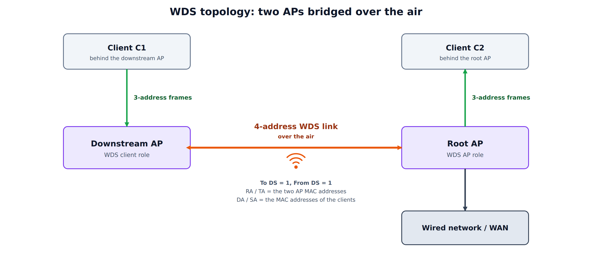
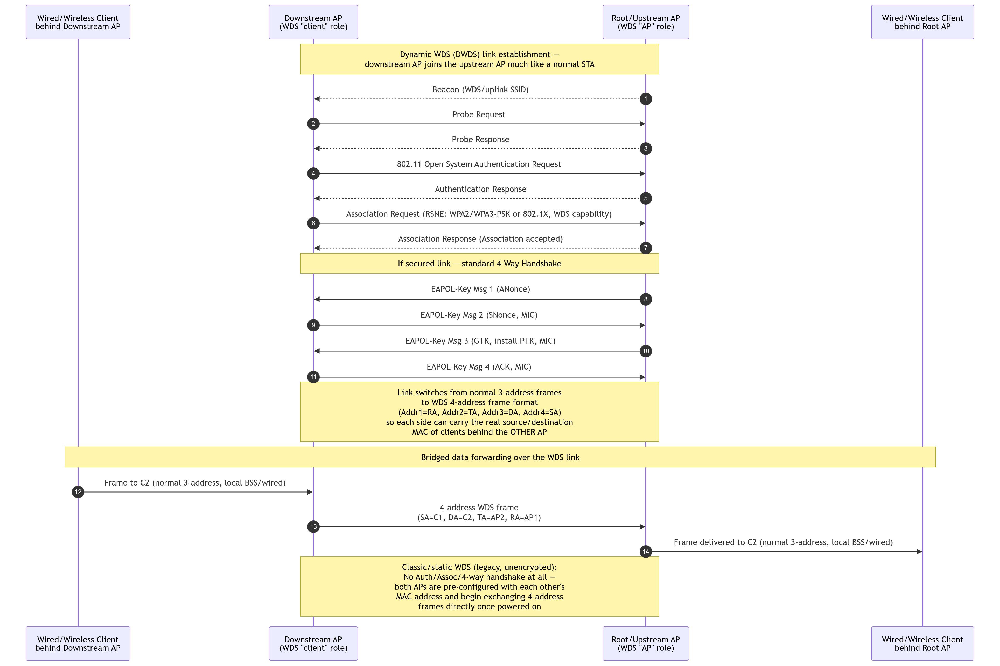
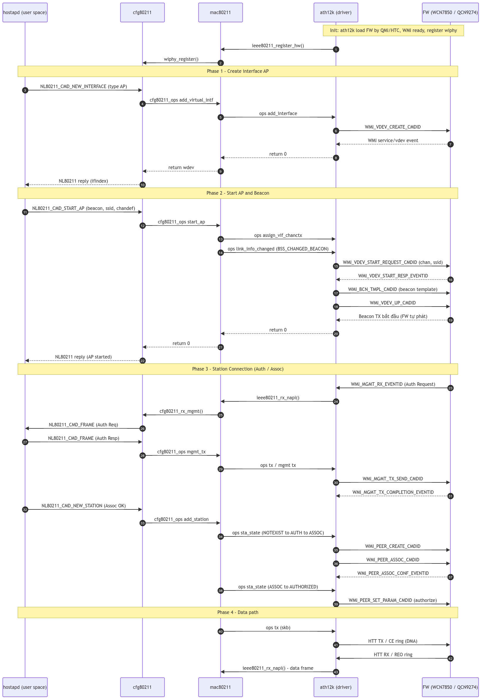

### Overview

---

A **Wireless Distributed System (WDS)** connects access points to each other over the air, so that they can extend one Layer 2 network without an Ethernet cable between them. The IEEE 802.11 standard calls the abstraction that joins the APs the *distribution system (DS)*. Normally the DS is a wired Ethernet backbone. With WDS, the DS itself runs over a Wi-Fi link.

In a WDS link:

* One AP, the **root (upstream) AP**, plays the **AP role**. It is connected to the wired network or to the internet.
* The other AP, the **downstream AP**, plays the **client role** on the wireless link, and serves its own clients on its own BSS (or on its wired ports).
* The two APs forward frames for the clients behind each of them, so everything sits in the same broadcast domain.

The key difference from a plain client connection is that a normal Wi-Fi station can only carry **its own** MAC address, while a WDS link must carry the MAC addresses of the *devices behind* the downstream AP. That is why WDS uses the **4-address frame format**.

---

### Why WDS?

---

| Need | How WDS helps |
|------|---------------|
| No cable to the extender | The extender joins the root AP wirelessly and bridges its clients. |
| Same subnet everywhere | The link is bridged at Layer 2, so clients keep their IP address when they move between APs. |
| Wireless backhaul for a mesh | Many Multi-AP / EasyMesh products use a 4-address backhaul link between nodes (see [prplMesh](/blog/prplmesh/)). |
| Bridging a wired segment | A wired device behind the downstream AP appears on the root's network with its own MAC address. |

The price is airtime. Each frame is sent again over the radio, so a repeater that uses a single radio for both the uplink and its own clients loses roughly half of its throughput. Using a separate radio or band for the backhaul avoids this.

---

### The 4-Address Frame Format

---

A normal 802.11 data frame has three addresses. The **To DS** and **From DS** bits in the Frame Control field tell the receiver how to read them:

| To DS | From DS | Meaning | Addr1 | Addr2 | Addr3 | Addr4 |
|:-----:|:-------:|---------|-------|-------|-------|-------|
| 0 | 0 | Station to station (IBSS) | DA | SA | BSSID | - |
| 1 | 0 | Station to AP | BSSID (RA) | SA (TA) | DA | - |
| 0 | 1 | AP to station | DA (RA) | BSSID (TA) | SA | - |
| **1** | **1** | **AP to AP (WDS)** | **RA** | **TA** | **DA** | **SA** |

When both bits are set, the frame needs four addresses because the **transmitter and receiver of the wireless hop** (the two APs) are different from the **original source and final destination** (the devices behind them):

* **RA** (receiver address): the AP that receives the frame on this wireless hop.
* **TA** (transmitter address): the AP that transmits it on this hop.
* **DA** (destination address): the final destination, for example a client behind the root AP.
* **SA** (source address): the original sender, for example a client behind the downstream AP.

A 3-address link cannot do this. If a downstream AP simply forwarded a client's frame as a normal station, the root AP would drop or mis-learn it, because the source MAC would not match the associated station.

---

### Roles and Topology

---

<div style="text-align: center;">



</div>

* **Root / upstream AP** (WDS "AP" role): accepts the WDS link and creates a virtual interface for every WDS peer.
* **Downstream AP** (WDS "client" role): behaves like a station towards the root, but forwards the traffic of everything behind it.
* **Clients** on either side use normal 3-address frames on their own local BSS or wired port. Only the AP-to-AP hop is 4-address.

---

### Static (Classic) WDS and Dynamic WDS

---

There are two ways to bring a WDS link up.

| Aspect | Static / classic WDS | Dynamic WDS (client or 4-address mode) |
|--------|----------------------|----------------------------------------|
| Link setup | Both APs are configured with the other's MAC address | The downstream AP joins the root AP like a normal station |
| 802.11 authentication and association | None. Frames are exchanged directly | Open System authentication, then Association |
| Security | Usually none, or a vendor-specific scheme | Standard WPA2 / WPA3 (PSK or 802.1X) with the 4-way handshake |
| Peers | Fixed, listed by MAC address | Any station that asks for 4-address mode and is allowed by the root |
| Interoperability | Poor. Pre-standard and vendor specific | Better, because it reuses the normal association procedure |
| Typical use today | Legacy equipment | Repeaters, mesh backhaul links, OpenWrt WDS |

**Dynamic WDS** is the form used by current stacks. The IEEE standard defines the 4-address frame format, but it does not define the procedure that sets a WDS link up. Each stack therefore decides how the downstream AP asks for 4-address mode and how the root AP accepts it. This is why static WDS between products from different vendors rarely works.

---

### Dynamic WDS Connection Flow

---

The diagram below shows how a downstream AP joins a root AP in dynamic WDS, and what changes once the link is up.

<div style="text-align: center;">



</div>

The link goes through the same steps as any station, then switches frame format:

1. **Scan.** The downstream AP learns about the root AP from its Beacon (the uplink SSID) or by sending a Probe Request and reading the Probe Response.
2. **Open System authentication.** A two-frame exchange. It only opens the 802.11 association.
3. **Association.** The Association Request carries the RSN element (WPA2/WPA3-PSK or 802.1X) and states that the station wants a WDS link. The root accepts it.
4. **4-way handshake** (secured link). The usual EAPOL-Key messages derive the PTK and install the keys.
5. **Switch to 4-address.** From now on the link carries 4-address frames, so each side can send the real source and destination MAC addresses of the devices behind the other AP.
6. **Bridged forwarding.** A frame from client C1, behind the downstream AP, to client C2, behind the root AP, travels like this:
   * C1 to the downstream AP: a normal 3-address frame.
   * Downstream AP to the root AP: a 4-address WDS frame with SA = C1, DA = C2, TA = the downstream AP and RA = the root AP.
   * Root AP to C2: a normal 3-address frame, on the local BSS or the wired port.

In **classic WDS** none of steps 1 to 4 exist. The two APs already know each other's MAC address and start exchanging 4-address frames as soon as they are powered on, which is also why that link is normally unencrypted.

---

### Implementation on Linux

---

On Linux, hostapd and wpa_supplicant run the control plane in user space, and `cfg80211`, `mac80211` and the driver (or firmware) run the data plane.

**On the downstream (client-role) side**, the wireless interface is put into 4-address mode through nl80211 (the `NL80211_ATTR_4ADDR` attribute), for example with `iw`:

```
iw dev wlan0 set 4addr on
```

The interface then sends data frames with To DS and From DS both set.

**On the root (AP-role) side**, hostapd creates one virtual interface per WDS peer:

```
# hostapd.conf
wds_sta=1          # enable per-station WDS interfaces (4-address)
wds_bridge=br-lan  # bridge the per-station interfaces are added to
```

When a station that sends 4-address frames associates, hostapd creates an `AP_VLAN` interface for it (named like `wlan0.sta1`) and adds it to the bridge. This is what lets the bridge learn the MAC addresses of the devices behind each downstream AP. Without that interface, the kernel would treat the 4-address frames as invalid.

On OpenWrt the same configuration is available as the `wds` option on the access point and on the client interface.

---

#### From hostapd down to the firmware

---

The sequence below shows the layers that an AP bring-up and a station connection pass through on a `mac80211` driver with offloaded firmware (here ath12k with a WCN7850 / QCN9274 firmware). A WDS peer takes exactly this path, and the new virtual interface and the new station appear in the `NEW_INTERFACE` and `NEW_STATION` steps.

<div style="text-align: center;">



</div>

The diagram has four phases:

1. **Create the AP interface.** hostapd sends `NL80211_CMD_NEW_INTERFACE`. `cfg80211` calls `add_virtual_intf`, `mac80211` calls the driver's `add_interface`, and the driver asks the firmware to create a virtual device with `WMI_VDEV_CREATE_CMDID`.
2. **Start the AP and the Beacon.** `NL80211_CMD_START_AP` carries the Beacon template, the SSID and the channel. The driver starts the vdev (`WMI_VDEV_START_REQUEST_CMDID`), downloads the beacon template (`WMI_BCN_TMPL_CMDID`) and brings the vdev up. The firmware then sends the Beacons by itself.
3. **Station connection (Auth / Assoc).** The firmware receives the Authentication Request and passes it up through the driver, `mac80211` and `cfg80211` to hostapd as `NL80211_CMD_FRAME`. hostapd answers with its own `NL80211_CMD_FRAME` for the response. When it accepts the association, it sends `NL80211_CMD_NEW_STATION`, and the driver creates the peer in the firmware (`WMI_PEER_CREATE_CMDID`, `WMI_PEER_ASSOC_CMDID`) and authorizes it (`WMI_PEER_SET_PARAM_CMDID`).
4. **Data path.** Frames move by DMA through the HTT TX and RX rings between the driver and the firmware, and reach `mac80211` through `ieee80211_rx_napi()`.

The management plane (authentication, association, key exchange) is handled by hostapd, while the firmware sends the Beacons and the data path itself, which is how a modern driver keeps the CPU load low.

---

### Security

---

* **Static WDS** is normally unencrypted, or protected only by a vendor-specific key. Anyone who knows the peer MAC addresses can try to inject frames.
* **Dynamic WDS** uses the normal WPA2 or WPA3 mechanisms. The downstream AP authenticates with a PSK or with 802.1X, the 4-way handshake derives a PTK, and the link is encrypted like any station link.
* Treat the downstream AP as a trusted device: it forwards traffic for other MAC addresses, so a compromised repeater can inject frames for any client behind it.
* Use PMF and WPA3 where both APs support them.

---

### Limitations and Practical Tips

---

| Issue | Why it happens | What to do |
|-------|----------------|------------|
| Throughput drops by about half on a repeater | The same radio carries the uplink and the downlink, and every frame is sent twice | Use a dedicated radio or band for the backhaul |
| Broadcast loops | WDS bridges at Layer 2, so a second path creates a loop | Avoid multiple links between the same APs, or enable STP on the bridge |
| Cross-vendor links fail | The standard defines the frame format but not the link setup | Use the same stack on both sides, or a standard mechanism such as EasyMesh or 802.11s |
| Clients behind the repeater do not get an IP | The 4-address interface is not in the bridge | Check `wds_bridge` and that the `wlan0.sta*` interface is a bridge member |
| MAC address table grows | Every MAC behind every repeater is learned by the root | Size the bridge forwarding table for the number of devices |

---

### WDS, EasyMesh and 802.11s

---

* **WDS** is a Layer 2 bridge between APs. It carries 4-address frames, but defines no routing, topology discovery or path selection.
* **EasyMesh (Multi-AP)** adds a management layer on top: a controller, agents, onboarding, topology and steering. Its backhaul station usually runs in 4-address mode, so the wireless backhaul in a prplMesh node is a WDS link. See [prplMesh](/blog/prplmesh/).
* **IEEE 802.11s** is a different design. It has its own mesh frame format, with a mesh control field and mesh path selection (HWMP), and does not use WDS.

---

### Summary

---

1. A WDS link joins two APs over the air and carries traffic for the devices behind them.
2. That requires the **4-address frame format**: To DS = 1, From DS = 1, with RA, TA, DA and SA.
3. **Static WDS** is configured by MAC address and has no authentication. **Dynamic WDS** uses the normal association procedure and standard WPA security, and is the form in use today.
4. On Linux, the client side enables 4-address mode through nl80211, while hostapd creates one virtual interface per WDS peer (`wds_sta=1`) and adds it to the bridge.
5. A repeater that shares one radio between uplink and clients loses about half of its throughput, so use a separate radio or band where you can.
