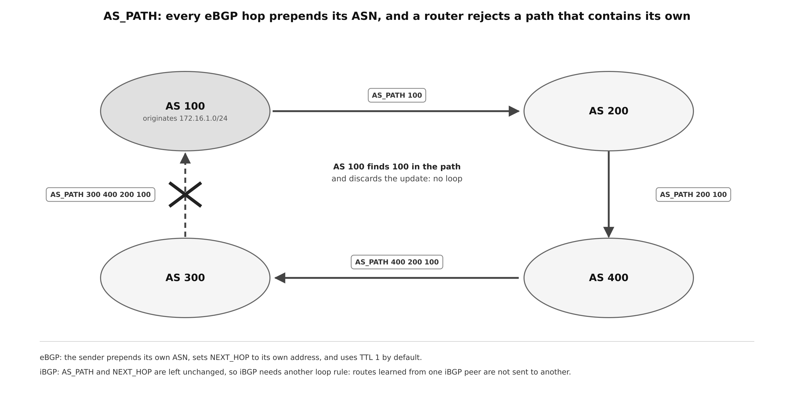
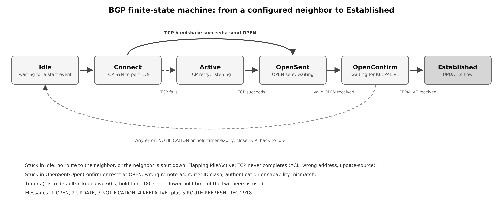
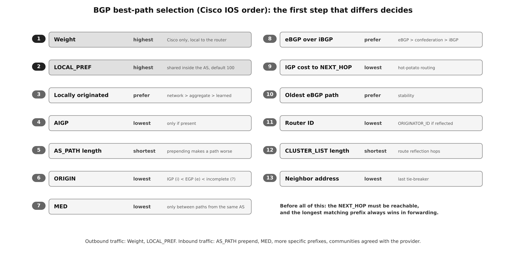

### Overview

---

**BGP (Border Gateway Protocol)**, version 4 (RFC 4271), is the routing protocol that holds the Internet together. Each network that has its own routing policy (an ISP, a cloud provider, a university, a large enterprise) is an **autonomous system**, and BGP is how these systems tell each other which prefixes they can reach. Inside a network, an IGP such as [OSPF](/blog/ospf/) finds the shortest path. Between networks, BGP decides **which path is allowed and preferred** by policy.

BGP is an **Exterior Gateway Protocol (EGP)**, and it differs from an IGP in almost every design choice:

| | IGP (OSPF, IS-IS, EIGRP) | BGP |
|---|---|---|
| Scope | One organization | Between organizations, and inside large ones |
| Neighbors | Discovered with hellos | **Configured by hand**, by IP address |
| Transport | Directly over IP or Layer 2 | **TCP port 179** |
| Algorithm | Link state or distance vector | **Path vector** |
| Path choice | Lowest metric | **Policy first**, a long list of attributes |
| Scale | Thousands of prefixes | The full Internet table: more than a million IPv4 and IPv6 prefixes |
| Updates | Periodic or on change | **Incremental only**, after the initial exchange |

---

The design goals were **scalability, flexibility and stability**. BGP sends only changes, carries rich attributes that policies can match and change, and prefers stable paths over marginally better ones.

---

### Autonomous Systems and ASNs

---

From the BGP point of view, an **autonomous system (AS)** is a set of routers under one organization's control, using one or more IGPs and a common routing policy. Each AS is identified by an **Autonomous System Number (ASN)**.

* ASNs were originally **16-bit** (1–65535). RFC 4893, later replaced by RFC 6793, extended them to **32-bit**, which allows about 4.29 billion numbers. A 4-byte ASN is often written as a plain number (`4200000001`) or in dot notation (`64086.59905`).
* Public ASNs are assigned by **IANA** through the regional registries. To get one, an organization usually needs its own public address space, **connections to more than one provider**, and a routing policy that differs from its providers' policies.
* **Private ASNs** work like private IP addresses: they must not appear on the Internet. The ranges are **64512–65534** (16-bit) and **4200000000–4294967294** (32-bit).

Use only an ASN assigned to you, one given by your provider, or a private one. Announcing someone else's ASN or prefixes is a **route hijack**, and it can black-hole traffic far beyond your own network.

---

### Path Vector and Loop Prevention

---

BGP does not build a full topology like a link-state protocol. Like a distance-vector protocol, it advertises a route with a description of how to get there. But instead of a single distance, it carries the **list of ASs the route has crossed**: the **AS_PATH** attribute.

<div style="text-align: center;">



</div>

1. AS 100 advertises 172.16.1.0/24 to AS 200 with AS_PATH `100`.
2. AS 200 prepends its ASN and advertises `200 100` to AS 400, which advertises `400 200 100` to AS 300.
3. AS 300 advertises `300 400 200 100` back to AS 100.
4. AS 100 finds **its own ASN** in the path and **discards** the route.

This rule makes inter-AS routing loop-free without any knowledge of the topology. The AS_PATH also gives a rough distance (the number of AS hops), and it is the main thing policies match on.

---

### Sessions and Transport

---

#### TCP and neighbors

---

* BGP runs over **TCP port 179**, so it gets reliable, ordered delivery and flow control for free, and never needs to retransmit periodically.
* There is **no neighbor discovery**. Each peer is configured with its IP address and ASN.
* Because TCP is routed, peers **do not have to be directly connected**. A multi-hop session needs a route to the peer in the routing table (static, connected or learned from an IGP). **A default route is not enough** to bring up a multi-hop session on most implementations.
* Most implementations set the **Don't Fragment** bit and rely on Path MTU Discovery.

A **BGP session** is the established TCP connection and BGP adjacency between two peers. BGP is often described as an *application* that exchanges routes, because the session and the routes it carries are separate things: the session can follow one path while the routes describe others.

---

#### eBGP and iBGP

---

| | **eBGP** | **iBGP** |
|---|---|---|
| Peers | In **different** ASs | In the **same** AS (or the same confederation) |
| Administrative distance (Cisco) | **20** | **200** |
| TTL | **1** by default: the peer must be directly connected, unless `ebgp-multihop` is set | 255: sessions between loopbacks across the IGP are normal |
| AS_PATH | The sender **prepends its ASN** | Not changed |
| NEXT_HOP | Set to the sender's own address | **Not changed** (it remains the eBGP peer's address) |
| Loop prevention | AS_PATH check | **Routes learned from an iBGP peer are not sent to another iBGP peer** |

---

The last row is the key to iBGP design. Because the AS_PATH does not change inside an AS, it cannot detect loops there. BGP uses an **iBGP split-horizon rule** instead, which has two consequences:

* All iBGP routers must be in a **full mesh** (*n(n−1)/2* sessions), or use **route reflectors** (RFC 4456) or **confederations** to relax the rule. A route reflector re-advertises iBGP routes to its clients, and adds the **ORIGINATOR_ID** and **CLUSTER_LIST** attributes to prevent loops.
* The NEXT_HOP of a route learned by eBGP must be **reachable** for every iBGP router, so either the IGP carries the external link, or the border router uses `next-hop-self`.

**Why not redistribute BGP into the IGP?** An AS that provides transit (an ISP) needs every router to know external routes. Putting them into the IGP does not work: an IGP cannot handle the Internet table, it selects paths only by metric, and it cannot carry BGP attributes. The answer is to run iBGP between the routers on the transit path, and let the IGP carry only internal addresses and next hops.

---

### Messages

---

Every BGP message has a 19-byte header: a 16-byte **Marker** (all ones), a 2-byte **Length** and a 1-byte **Type**. A message is at most 4096 bytes (RFC 8654 allows up to 65535 with a negotiated capability).

| Type | Message | Purpose |
|:----:|---------|---------|
| 1 | **OPEN** | Starts the session: version 4, **My AS**, **Hold Time**, **BGP Identifier** (router ID), and optional **capabilities** (address families, 4-byte ASN, route refresh, ADD-PATH, graceful restart) |
| 2 | **UPDATE** | Advertises or withdraws routes: withdrawn prefixes, **path attributes**, and the prefixes (**NLRI**) that share those attributes |
| 3 | **NOTIFICATION** | Reports an error, with a code and subcode, and **closes the session** |
| 4 | **KEEPALIVE** | Keeps the session alive when there are no updates |
| 5 | **ROUTE-REFRESH** | Asks the peer to resend its routes (RFC 2918), used for soft resets |

---

A 4-byte ASN does not fit in the 2-byte *My AS* field of the OPEN message. A speaker with a large ASN puts **AS_TRANS (23456)** there, and sends its real ASN in the *4-octet AS* capability.

The **BGP router ID** is a 32-bit number, chosen like in OSPF: a configured `bgp router-id`, else the highest loopback address, else the highest interface address. Set it statically.

**Timers.** The keepalive interval is typically one third of the hold time. Cisco IOS defaults to **60 s keepalive and 180 s hold time**, and the two peers use the **lower** of their proposed hold times. If the hold timer expires without a KEEPALIVE or UPDATE, the session is torn down.

---

### The Finite-State Machine

---

<div style="text-align: center;">



</div>

| State | What happens |
|-------|--------------|
| **Idle** | Waiting for a start event. Refuses incoming connections. Returns here after any error |
| **Connect** | Waiting for the TCP connection to complete. On success, sends OPEN and moves to OpenSent. On failure, moves to Active |
| **Active** | Retrying TCP and listening for the peer's connection. On success, sends OPEN and moves to OpenSent |
| **OpenSent** | OPEN sent, waiting for the peer's OPEN. If it is valid (version, ASN, hold time, router ID), sends KEEPALIVE and moves to OpenConfirm |
| **OpenConfirm** | Waiting for the first KEEPALIVE, then moves to Established |
| **Established** | The session is up. Routes are exchanged with UPDATE messages |

---

If both routers open a TCP connection at the same time, the **connection collision** is resolved by keeping the connection initiated by the router with the **higher BGP Identifier**.

A session that **oscillates between Idle and Active** almost always has a TCP problem: no route to the peer, a wrong neighbor address, a firewall blocking port 179, or a session sourced from the wrong interface (`update-source`). A session that is **reset after OPEN** usually has a configuration mismatch: a wrong `remote-as`, a duplicate router ID, authentication, or a missing address family.

---

### Path Attributes

---

Each route carries **path attributes (PAs)**. They describe the path, and they are what the best-path algorithm and the policies work on. RFC 4271 groups them in four classes:

| Class | Meaning | Examples |
|-------|---------|----------|
| **Well-known mandatory** | Recognized by all implementations, **included in every update** | **ORIGIN**, **AS_PATH**, **NEXT_HOP** |
| **Well-known discretionary** | Recognized by all, included when needed | **LOCAL_PREF**, **ATOMIC_AGGREGATE** |
| **Optional transitive** | May not be recognized, but **must be passed on** | **AGGREGATOR**, **COMMUNITY** |
| **Optional non-transitive** | May not be recognized, and **not passed on** if not | **MED** (MULTI_EXIT_DISC), **ORIGINATOR_ID**, **CLUSTER_LIST**, **MP_REACH_NLRI**, **MP_UNREACH_NLRI**, **AIGP** |

---

| Attribute | Meaning |
|-----------|---------|
| **ORIGIN** | How the route entered BGP: **i** (IGP, a `network` statement), **e** (EGP, historic), **?** (incomplete, usually redistribution) |
| **AS_PATH** | The ASs crossed, newest first. Used for loop prevention and as a path length |
| **NEXT_HOP** | The address to forward to. It must be resolvable in the routing table |
| **LOCAL_PREF** | Preference for leaving the AS through this path. Shared inside the AS only, default **100**, higher is better |
| **MED** | A hint to a **neighboring AS** about which entry point to prefer. Lower is better |
| **COMMUNITY** | Tags used to apply policy (see below) |
| **Weight** | Not an attribute on the wire: a Cisco value **local to one router**, 32768 for local routes and 0 for learned routes by default, higher is better |

---

### How a Router Processes Routes

---

<div style="text-align: center;">


</div>

BGP keeps three tables:

* **Adj-RIB-In**: routes as they were received from each peer, before any policy.
* **Loc-RIB**: every valid route after inbound policy, from all peers and from local origination. The **best path** for each prefix is chosen here and offered to the global routing table.
* **Adj-RIB-Out**: one per peer, the routes after outbound policy, as they will be advertised.

---

#### Originating routes

---

A BGP `network` statement **does not enable BGP on an interface**, unlike the OSPF command with the same name. It tells BGP to put a prefix in the Loc-RIB **if that exact prefix and mask exist in the routing table**. The attributes are set from the source:

| Source in the routing table | NEXT_HOP | ORIGIN | Weight | MED |
|-----------------------------|----------|:------:|:------:|-----|
| Connected network | 0.0.0.0 | i | 32768 | 0 |
| Static or IGP route | The next hop from the routing table | i | 32768 | The IGP metric |
| Redistributed route | As above | **?** | 32768 | The IGP metric |

---

Each route in the Loc-RIB is then advertised in three steps:

1. **Validity check.** The prefix must be valid and the NEXT_HOP must be **resolvable** in the routing table. Otherwise the route stays in the table but is not used.
2. **Outbound policy.** If the route is not denied, it goes into the Adj-RIB-Out for that peer.
3. **Advertisement.** A NEXT_HOP of 0.0.0.0 (locally originated) is replaced with the address of the session. On eBGP, the ASN is prepended.

BGP can also take routes from **redistribution** (static, connected, OSPF, EIGRP). Redistributing an IGP into BGP is safe and common. Redistributing **BGP into an IGP** should be done with extreme care, if at all, because a full table will overwhelm the IGP.

Only the **single best path** for a prefix is advertised to peers, unless **ADD-PATH** is negotiated.

---

### Basic Configuration

---

Think of BGP configuration in three modular parts:

1. **Session parameters**: the neighbor's address and ASN, and settings such as authentication, timers and the update source.
2. **Address family initialization**: `address-family ipv4 unicast`, `ipv6 unicast` and so on. Prefix advertisement and summarization are configured **inside the address family**.
3. **Activation**: a neighbor must be **activated** in at least one address family before the session is attempted.

```
router bgp 65100
 bgp router-id 192.168.1.1
 bgp log-neighbor-changes
 no bgp default ipv4-unicast            ! do not auto-activate every neighbor for IPv4
 neighbor 10.12.1.2 remote-as 65200     ! eBGP
 neighbor 192.168.3.3 remote-as 65100   ! iBGP, between loopbacks
 neighbor 192.168.3.3 update-source Loopback0
 !
 address-family ipv4 unicast
  network 10.12.1.0 mask 255.255.255.0
  network 192.168.1.1 mask 255.255.255.255
  redistribute ospf 1
  neighbor 10.12.1.2 activate
  neighbor 192.168.3.3 activate
  neighbor 192.168.3.3 next-hop-self
 exit-address-family
```

Without `no bgp default ipv4-unicast`, IOS activates every neighbor for IPv4 automatically, which is the legacy behavior.

| Command | Shows |
|---------|-------|
| `show bgp ipv4 unicast summary` | One line per neighbor: **V**ersion, **AS**, messages received and sent, **TblVer**, **InQ/OutQ**, **Up/Down**, and **State/PfxRcd** (a number of prefixes means Established, a word is the current state) |
| `show bgp ipv4 unicast` | The Loc-RIB: `*` valid, `>` best, Network, Next Hop, **Metric** (MED), **LocPrf**, **Weight**, **Path** and origin code |
| `show bgp ipv4 unicast 10.12.1.0/24` | Every path for one prefix, with all attributes and why the best one won |
| `show bgp ipv4 unicast neighbors 10.12.1.2` | Session details: state, timers, **negotiated capabilities**, counters |
| `show bgp ipv4 unicast neighbors 10.12.1.2 advertised-routes` | The **Adj-RIB-Out** for that neighbor |
| `show bgp ipv4 unicast neighbors 10.12.1.2 received-routes` | The Adj-RIB-In (needs `soft-reconfiguration inbound`) |

---

The older `show ip bgp` commands predate multiprotocol BGP. The `show bgp <afi> <safi>` form works for every address family.

---

### Summarization

---

Summarization reduces the size of BGP tables, speeds up best-path calculation, and **hides flaps**: a component route that goes up and down does not change the summary.

There are two techniques:

* **Static**: create a static route to **Null0** for the summary, and advertise it with a `network` statement. Simple, but the summary is advertised **even if none of the component networks exist**.
* **Dynamic**: `aggregate-address`. The aggregate is created **only while at least one component route is in the BGP table**, and the router installs a **discard route to Null0** for the aggregate to prevent loops.

```
address-family ipv4 unicast
 aggregate-address 192.168.0.0 255.255.0.0                     ! summary + components
 aggregate-address 172.16.0.0 255.255.240.0 summary-only       ! summary only
 aggregate-address 10.0.0.0 255.0.0.0 as-set summary-only      ! keep path history
```

* Without options, the aggregate is advertised **in addition to** the more specific routes.
* `summary-only` suppresses the component routes.
* An aggregate is a **new route**: the original AS_PATH, MED and communities are lost. The aggregating router sets **ATOMIC_AGGREGATE** (information was lost) and **AGGREGATOR** (its ASN and router ID).
* `as-set` keeps the component ASNs as an unordered **AS_SET** in the path (written `{65100,65300}`), and copies attributes from the components. This keeps loop prevention working, but the aggregate changes whenever a component's path changes.

IPv6 aggregation works the same way under the IPv6 address family, with `aggregate-address 2001:db8::/62 summary-only`. Each extra bit in the prefix length covers twice as many /64 networks: a /62 covers 4, a /61 covers 8 and a /60 covers 16.

---

### Multiprotocol BGP and IPv6

---

**MP-BGP** (RFC 2858, now RFC 4760) lets one BGP session carry routes of many protocols. It adds two optional non-transitive attributes, **MP_REACH_NLRI** and **MP_UNREACH_NLRI**, which carry prefixes together with an address family:

* **AFI** (Address Family Identifier): the protocol, for example 1 = IPv4, 2 = IPv6.
* **SAFI** (Subsequent AFI): the use, for example 1 = unicast, 2 = multicast, 128 = MPLS L3VPN.

IPv4 unicast is AFI 1 / SAFI 1, and IPv6 unicast is AFI 2 / SAFI 1. Each address family has **its own table and its own configuration**, and the peers negotiate the families they support in the OPEN message. MP-BGP and MBGP are two names for the same thing.

For IPv6, everything above still applies, including TCP port 179. Only the address family changes:

```
router bgp 65100
 bgp router-id 192.168.1.1
 no bgp default ipv4-unicast
 neighbor 2001:DB8:0:12::2 remote-as 65200
 !
 address-family ipv6 unicast
  network 2001:DB8::1/128
  network 2001:DB8:0:12::/64
  neighbor 2001:DB8:0:12::2 activate
 exit-address-family
```

`show bgp ipv6 unicast neighbors <addr>` confirms that the **IPv6 Unicast** capability was "advertised and received". In `show bgp ipv6 unicast`, a next hop of **::** means a locally originated prefix. An IPv6 session can also carry IPv4 routes and the other way round, as long as the next hop is reachable in that family.

---

### Multihoming

---

Adding a second circuit and a second BGP session is **multihoming**. The goal is to remove single points of failure:

| Design | Survives | Still fails on |
|--------|----------|----------------|
| One router, two links to **one provider** | A link failure | The router, or a failure inside the provider |
| Two routers, **one provider** | A link or a router failure | A failure inside the provider |
| One router, **two providers** | A link or a provider failure, and allows better path selection | The router |
| Two routers with **iBGP** between them, **two providers** | A link, a router, or a provider failure | Nothing single |

---

#### Avoid becoming a transit AS

---

<div style="text-align: center;">


</div>

By default, BGP advertises everything it learns. An enterprise connected to two providers would then advertise SP1's routes to SP2 and the other way round, and Internet traffic could flow **through the enterprise** whenever its AS_PATH is shorter. The enterprise links would saturate with other people's traffic.

The fix is an **outbound policy on every eBGP session** that allows only **locally originated** prefixes: an AS path filter with `^$`, or a prefix list of the organization's own address space. Providers filter their customers' announcements in the same way.

The same problem appears in **enterprise WANs**. Branch routers connected to two MPLS providers can become accidental transit points between sites when a link fails. This saturates small branch circuits and creates **asymmetric, non-deterministic** routing that is hard to troubleshoot. Branches should advertise only their **LAN prefixes**, never what they learn from the WAN. Planned transit at a data center, where bandwidth is sized for it, is a normal design.

A common active/passive design sets a higher **LOCAL_PREF** on the preferred provider at every site, so that traffic between sites is **symmetric** (the same path in both directions) and **deterministic** (predictable).

---

### Conditional Matching

---

Policies need a way to select routes. IOS offers four tools.

#### ACLs

---

Standard ACLs (1–99, 1300–1999, or named) match a network address with a wildcard: `permit 172.16.0.0 0.0.255.255` matches anything in 172.16.0.0/16.

**Extended ACLs** (100–199, 2000–2699) mean something different with BGP than with packets or IGPs. For BGP, the **source** fields match the **network address** and the **destination** fields match the **subnet mask**:

| Extended ACL entry | Matches |
|--------------------|---------|
| `permit ip 10.0.0.0 0.0.0.0 255.255.0.0 0.0.0.0` | Only 10.0.0.0/16 |
| `permit ip 10.0.0.0 0.0.255.0 255.255.255.0 0.0.0.0` | Any 10.0.x.0/24 |
| `permit ip 172.16.0.0 0.0.255.255 255.255.255.0 0.0.0.255` | Any 172.16.x.x with a length from /24 to /32 |

---

This works, but it is hard to read, which is why prefix lists are usually preferred.

---

#### Prefix lists

---

A prefix list entry has a **high-order bit pattern** and a **bit count** (a prefix such as `10.0.0.0/8`), and optional **length** limits:

* `ge` (greater than or equal) and `le` (less than or equal) select a range of prefix lengths within the pattern.
* Without `ge` or `le`, only the **exact** prefix and length match.
* IOS requires *bit count < ge ≤ le*. To match one exact length longer than the bit count, use the same value for `ge` and `le`.

| Entry | Matches |
|-------|---------|
| `10.0.0.0/8` | Only 10.0.0.0/8 |
| `10.0.0.0/8 le 32` | Everything inside 10.0.0.0/8 |
| `10.0.0.0/8 ge 22 le 26` | Inside 10.0.0.0/8, with a length from /22 to /26: 10.0.0.0/24 matches, 10.0.0.0/8 and 10.0.0.0/30 do not |
| `10.168.0.0/13 ge 24` | Inside 10.168.0.0/13 (10.168–10.175), /24 or longer |
| `0.0.0.0/0` | Only the default route |
| `0.0.0.0/0 le 32` | Everything |

---

```
ip prefix-list RFC1918 seq 5  permit 10.0.0.0/8 le 32
ip prefix-list RFC1918 seq 10 permit 172.16.0.0/12 le 32
ip prefix-list RFC1918 seq 15 permit 192.168.0.0/16 le 32
ipv6 prefix-list PRIVATE-IPV6 permit FD00::/8 le 128
```

Entries are processed **top-down, first match wins**, and sequence numbers default to steps of 5. Every prefix list ends with an **implicit deny**. IPv6 prefix lists work exactly the same way, with hex notation.

---

#### Regular expressions on the AS_PATH

---

Sometimes it is easier to select routes **by origin or path** than by prefix. Regular expressions match the AS_PATH as a string:

| Symbol | Meaning |
|--------|---------|
| `^` | Start of the path |
| `$` | End of the path |
| `_` | A delimiter: space, start, end, comma or brace |
| `.` | Any character |
| `*` `+` `?` | Zero or more, one or more, zero or one |
| `[ ]` `-` | A character set, a range |

---

| Expression | Matches |
|------------|---------|
| `^$` | **Locally originated** routes (empty AS_PATH) |
| `^200_` | Learned from neighbor AS 200 |
| `_200$` | **Originated** by AS 200 |
| `_200_` | Passing through AS 200 anywhere |
| `^[0-9]+$` | Exactly one AS: routes originated by a direct neighbor |
| `^[0-9]+(_[0-9]+)?(_[0-9]+)?$` | Three AS hops or fewer |

---

Test a regex against the table before using it in a policy: `show bgp ipv4 unicast regexp _200$`. Expressions go into **AS path ACLs**: `ip as-path access-list 1 permit ^$`.

---

### Route Maps

---

A **route map** combines matching with actions, and is the main way to build per-neighbor policy in BGP. Each entry has:

1. A **sequence number**, which sets the processing order (default steps of 10).
2. A **processing action**, `permit` or `deny` (default `permit`).
3. Optional **match** conditions. An entry without a match statement matches **everything**.
4. Optional **set** actions, applied to permitted routes.

```
route-map ISP1-IN deny 10
 match ip address prefix-list BOGONS
route-map ISP1-IN permit 20
 match as-path 10
 match ip address prefix-list CGNAT
 set local-preference 222
route-map ISP1-IN permit 30
 match as-path 10
 set weight 65200
route-map ISP1-IN permit 40                ! everything else, unchanged
```

Rules to remember:

* Processing is **top-down and stops at the first matching entry**, unless the entry has `continue`.
* **Several values on one match line** (`match ip address prefix-list A B`) are combined with **OR**.
* **Several match lines** in one entry are combined with **AND**.
* A `deny` inside a prefix list or ACL means "**does not match** this entry", not "drop the route". The route simply falls through to the next sequence.
* Every route map ends with an **implicit deny**. A final permit entry with no match is needed to let other routes through.
* `continue` lets a matching route keep being evaluated by later entries. It is rarely used, because it makes troubleshooting harder.

| Match | Selects on |
|-------|------------|
| `match ip address prefix-list NAME` | Prefix and length |
| `match ip address ACL` | Prefix, with ACL semantics |
| `match as-path N` | An AS path ACL (1–500) |
| `match community LIST` | A community list |
| `match local-preference N` | LOCAL_PREF |
| `match metric N [+- dev]` | MED, exactly or within a deviation |
| `match tag N` | A route tag set by another router or protocol |

---

| Set | Effect |
|-----|--------|
| `set weight 0–65535` | Cisco weight, local to the router |
| `set local-preference N` | LOCAL_PREF |
| `set as-path prepend 65100 65100` | Make the path longer |
| `set metric N` / `+N` / `-N` | MED |
| `set origin igp \| incomplete` | ORIGIN |
| `set ip next-hop A.B.C.D \| peer-address \| self` | NEXT_HOP |
| `set community 65100:300 [additive]` | Communities: replace, or add with `additive` |
| `set tag N` | A tag for later matching |

---

### Filtering and Applying Policy

---

IOS has four ways to filter routes per neighbor and direction. All of them end with an **implicit deny**:

| Method | Command | Matches on |
|--------|---------|------------|
| Distribute list | `neighbor X distribute-list ACL in\|out` | An ACL (extended ACLs: network and mask) |
| Prefix list | `neighbor X prefix-list NAME in\|out` | Prefixes and lengths |
| AS path filter | `neighbor X filter-list N in\|out` | An AS path ACL |
| Route map | `neighbor X route-map NAME in\|out` | Anything, and can **change attributes** |

---

```
ip as-path access-list 1 permit ^$
!
router bgp 65200
 address-family ipv4 unicast
  neighbor 10.12.1.1 filter-list 1 out          ! only our own routes to ISP1
  neighbor 10.12.1.1 prefix-list RFC1918 in
  neighbor 10.12.1.1 route-map ISP1-IN in
```

A good practice is a **separate inbound and outbound policy for every eBGP neighbor**, even when they look the same today.

---

#### Applying changes

---

A new policy does not apply to routes that have already been received or sent. The session must be refreshed:

* **Hard reset**: `clear ip bgp 10.12.1.1`. It tears down the session and withdraws all routes. It is disruptive, so avoid it in production.
* **Soft reset**: `clear bgp ipv4 unicast 10.12.1.1 soft [in|out]`. Outbound, the router resends its Adj-RIB-Out. Inbound, it asks the peer for a **route refresh** and reprocesses the routes, without dropping the session. A soft reset can be limited to one address family, which matters when one peer carries several. Use `*` for all peers.

---

### Communities

---

A **community** is an **optional transitive** attribute: a 32-bit tag attached to a route. It does nothing by itself, but routers can match it to apply policy, in the same AS or in other ASs. It is normally written in the **new format** `ASN:value` (two 16-bit numbers), where the first half is the ASN that defines the meaning. IOS shows the raw 32-bit number unless `ip bgp-community new-format` is set.

**Well-known communities**:

| Community | Meaning |
|-----------|---------|
| **NO_EXPORT** (65535:65281) | Do not advertise to **eBGP** peers. iBGP is allowed |
| **NO_ADVERTISE** (65535:65282) | Do not advertise to **any** peer |
| **LOCAL_AS / NO_EXPORT_SUBCONFED** (65535:65283) | Do not advertise outside the local AS, even to other confederation members |
| `internet` (0:0, Cisco keyword) | Used to mark routes that may be advertised to the Internet, with an outbound route map at the edge |

---

**Extended communities** (RFC 4360) have an 8-byte structured format, and are used for route targets in MPLS VPNs and for other typed information. **Large communities** (RFC 8092) use three 32-bit values, `ASN:value:value`, so that networks with 4-byte ASNs can define their own communities.

Many providers publish community values that customers can set to control their traffic: lower the local preference in the provider's network, prepend toward a given peer, or not announce a prefix in a region. This is the most precise tool for **inbound** traffic engineering.

```
router bgp 65100
 address-family ipv4 unicast
  neighbor 10.12.1.2 send-community both        ! IOS does not send communities by default
!
ip community-list 100 permit 333:333            ! expanded lists (100-500) take regex
route-map COMMUNITY-CHECK deny 10
 match community 100
route-map COMMUNITY-CHECK permit 20
 set weight 111
!
route-map SET-COMM permit 10
 match ip address prefix-list CUSTOMER
 set community 65100:300 additive               ! keep existing communities
```

Without `additive`, `set community` **replaces** all the existing communities on the route. Use `show bgp ipv4 unicast community 65100:300` to list routes with a given community.

---

### Best-Path Selection

---

BGP can hold many paths for the same prefix. It chooses **one best path**, installs it in the routing table, and advertises only that one. The decision is re-run when a next hop's reachability changes, when an interface to an eBGP peer fails, when redistribution changes, or when paths are added or withdrawn. The first path received becomes the best, and each new path is compared with the current best.

Before the algorithm, two facts matter:

* **Longest match always wins in forwarding.** A /24 is preferred over a /16 whatever their attributes. Best-path selection only compares paths for **the same prefix and length**.
* A path is a candidate only if its **NEXT_HOP is reachable** (and it is not denied by policy).

<div style="text-align: center;">



</div>

1. **Highest Weight.** Cisco-specific, local to the router, never advertised. Useful to force a choice on one router regardless of everything else.
2. **Highest LOCAL_PREF.** Shared with every iBGP peer, never sent to eBGP peers. Default 100. The standard tool to choose the **exit point** of the AS for outbound traffic.
3. **Locally originated.** Routes from a `network` statement or redistribution, then local aggregates, then routes learned from peers.
4. **Lowest AIGP** (RFC 7311). An optional non-transitive metric that lets BGP use accumulated IGP costs across several ASs under one administration. A path with AIGP is preferred over one without it.
5. **Shortest AS_PATH.** An AS_SET counts as one. **AS path prepending** (repeating your own ASN) makes a path less attractive: prepending on your advertisements influences **inbound** traffic, while prepending on received routes influences outbound traffic.
6. **Lowest ORIGIN**: IGP (i), then EGP (e), then incomplete (?).
7. **Lowest MED.** Compared only between paths **from the same neighboring AS** (unless `bgp always-compare-med`). A missing MED counts as 0 in IOS, which makes it the best (`bgp bestpath med missing-as-worst` reverses this). A MED received from an eBGP peer may be passed to iBGP peers but must not be sent to other ASs.
8. **eBGP over iBGP**: eBGP, then confederation eBGP, then iBGP.
9. **Lowest IGP cost to the NEXT_HOP.** Each router leaves the AS through its nearest exit (**hot-potato routing**). Two routers in the same AS can therefore choose different exits for the same prefix.
10. **Oldest eBGP path.** Prefers stability: a newer path that only ties does not cause a change. It is not deterministic from a design point of view.
11. **Lowest router ID** of the advertising peer (the ORIGINATOR_ID for a reflected route).
12. **Shortest CLUSTER_LIST**: the path that crossed the fewest route reflectors.
13. **Lowest neighbor address.** The final tie-breaker, typically for two sessions with the same router.

If `maximum-paths` is set, several paths that tie up to step 9 can be installed for **load sharing**, while BGP still advertises only one best path.

---

#### Traffic engineering summary

---

| Goal | Tools |
|------|-------|
| **Outbound** traffic (which exit my AS uses) | **Weight** on one router, **LOCAL_PREF** for the whole AS |
| **Inbound** traffic (how others reach me) | **More specific prefixes**, **AS path prepending**, **MED** toward one neighbor AS, **provider communities** |

---

Inbound control is always weaker, because other ASs decide based on their own policies, and many providers ignore MED or override attributes. The only method that every network respects is **longest match**. For example, an organization that owns 100.64.0.0/16 and has two Internet routers can advertise the /16 from both (for redundancy), and advertise 100.64.1.0/24 only from R1 and 100.64.2.0/24 only from R2. Traffic to each /24 enters through the router that announces it, and falls back to the /16 if that router fails. (Most providers do not accept IPv4 prefixes longer than /24 from customers.)

---

### Securing BGP Sessions

---

BGP trusts its peers by design, and a wrong announcement can spread across the Internet in seconds. Practical protections:

| Protection | Purpose |
|------------|---------|
| **Prefix filters on every eBGP session**, inbound and outbound | Accept only expected prefixes (customer routes, no bogons, no default unless wanted). Send only your own |
| `neighbor X maximum-prefix N` | Tear down the session if a peer suddenly sends too many routes (a route leak) |
| `neighbor X password` (TCP MD5) or TCP-AO | Authenticate the TCP session |
| `neighbor X ttl-security hops 1` (GTSM, RFC 5082) | Accept packets only with TTL 255, so that remote attackers cannot reach the session |
| **RPKI** route origin validation | Check that the origin AS is authorized for the prefix, using signed ROAs, and drop invalid routes |
| Remove private ASNs (`remove-private-as`) | Keep private ASNs off the Internet |

---

FRRouting follows **RFC 8212** by default: an eBGP session with no inbound and outbound policy **sends and accepts nothing**. This is a safe default that surprises people moving from IOS.

---

### BGP on Linux with FRRouting

---

On Linux and OpenWrt, BGP is provided by FRRouting's `bgpd` (BIRD is another common choice, especially at Internet exchanges). The configuration is close to IOS:

```
! /etc/frr/frr.conf  (bgpd=yes in /etc/frr/daemons)
ip prefix-list OWN seq 5 permit 203.0.113.0/24
ip prefix-list ANY seq 5 permit 0.0.0.0/0 le 24
bgp as-path access-list LOCAL seq 5 permit ^$
!
route-map ISP-IN permit 10
 match ip address prefix-list ANY
 set local-preference 200
route-map ISP-OUT permit 10
 match ip address prefix-list OWN
 match as-path LOCAL
!
router bgp 65100
 bgp router-id 192.168.1.1
 neighbor 10.12.1.2 remote-as 65200
 neighbor 10.12.1.2 password s3cret
 neighbor 10.12.1.2 ttl-security hops 1
 !
 address-family ipv4 unicast
  network 203.0.113.0/24
  neighbor 10.12.1.2 route-map ISP-IN in
  neighbor 10.12.1.2 route-map ISP-OUT out
  neighbor 10.12.1.2 maximum-prefix 1000000
 exit-address-family
```

```
vtysh -c 'show bgp summary'
vtysh -c 'show bgp ipv4 unicast 203.0.113.0/24'
vtysh -c 'show bgp neighbors 10.12.1.2 advertised-routes'
vtysh -c 'clear bgp 10.12.1.2 soft'
tcpdump -i eth0 -vv tcp port 179          # OPEN, UPDATE, KEEPALIVE, NOTIFICATION
```

FRR installs best paths into the kernel table, where `ip route` shows them as `proto bgp`.

---

### Troubleshooting

---

| Symptom | Likely cause | Check |
|---------|--------------|-------|
| Session stays **Idle** | Neighbor shut down, no route to the peer, or waiting after repeated errors | `show bgp ... summary`, routing table entry for the peer |
| **Idle ↔ Active** | TCP 179 never completes: wrong address, ACL or firewall, wrong `update-source`, eBGP across more than one hop without `ebgp-multihop` | `ping` with the right source, capture on port 179 |
| Reset after OPEN | Wrong `remote-as`, duplicate router ID, authentication mismatch, unsupported capability | `show bgp ... neighbors`, the NOTIFICATION code in the logs |
| Established, 0 prefixes received | Peer's outbound filter, address family not activated, FRR RFC 8212 default | `received-routes` vs your inbound policy |
| Route in the BGP table but not in the RIB | NEXT_HOP unreachable (missing `next-hop-self`), or a better route with lower AD | `show bgp ... <prefix>`, "inaccessible" next hop |
| Route not advertised to an iBGP peer | iBGP split horizon: the route came from another iBGP peer | Full mesh or route reflector |
| `network` statement does nothing | No **exact** match (prefix and mask) in the routing table | `show ip route <prefix>` |
| Unexpected traffic through your AS | Missing outbound filter, you are a transit AS | `advertised-routes` toward each provider |
| Policy change has no effect | No refresh after the change | `clear bgp ... soft in/out` |
| Inbound traffic ignores prepending or MED | The other AS's LOCAL_PREF policy wins first | Use more specific prefixes or provider communities |

---

### Summary

---

1. BGP is a **path-vector EGP** between autonomous systems, identified by 16-bit or 32-bit **ASNs**, with private ranges 64512–65534 and 4200000000–4294967294.
2. It prevents loops with the **AS_PATH**: a router rejects a route that already contains its own ASN.
3. Neighbors are **configured**, not discovered, and talk over **TCP 179**. **eBGP** (AD 20, TTL 1, prepends its ASN, changes the next hop) and **iBGP** (AD 200, no changes, no re-advertising between iBGP peers, so a full mesh or route reflectors) behave differently.
4. Five messages (**OPEN, UPDATE, NOTIFICATION, KEEPALIVE**, ROUTE-REFRESH) drive a state machine from **Idle** through Connect, Active, OpenSent and OpenConfirm to **Established**.
5. Routes carry **path attributes** in four classes. ORIGIN, AS_PATH and NEXT_HOP are mandatory. LOCAL_PREF, MED, communities and the Cisco weight are the main policy levers.
6. Routes flow through **Adj-RIB-In, inbound policy, Loc-RIB, outbound policy, Adj-RIB-Out**. A `network` statement needs an exact match in the routing table, and the NEXT_HOP must be reachable.
7. **aggregate-address** summarizes dynamically, with `summary-only` and `as-set` options. **MP-BGP** carries IPv6 and other families with AFI/SAFI.
8. Multihomed networks must **filter outbound** so they never become a transit AS.
9. **Prefix lists**, **AS path regex** and **route maps** select and modify routes. Communities tag routes for policy across ASs.
10. Best path: **Weight, LOCAL_PREF, local origin, AIGP, AS_PATH, ORIGIN, MED, eBGP over iBGP, IGP cost, age, router ID, cluster list, neighbor address**, and longest match always comes first in forwarding.
