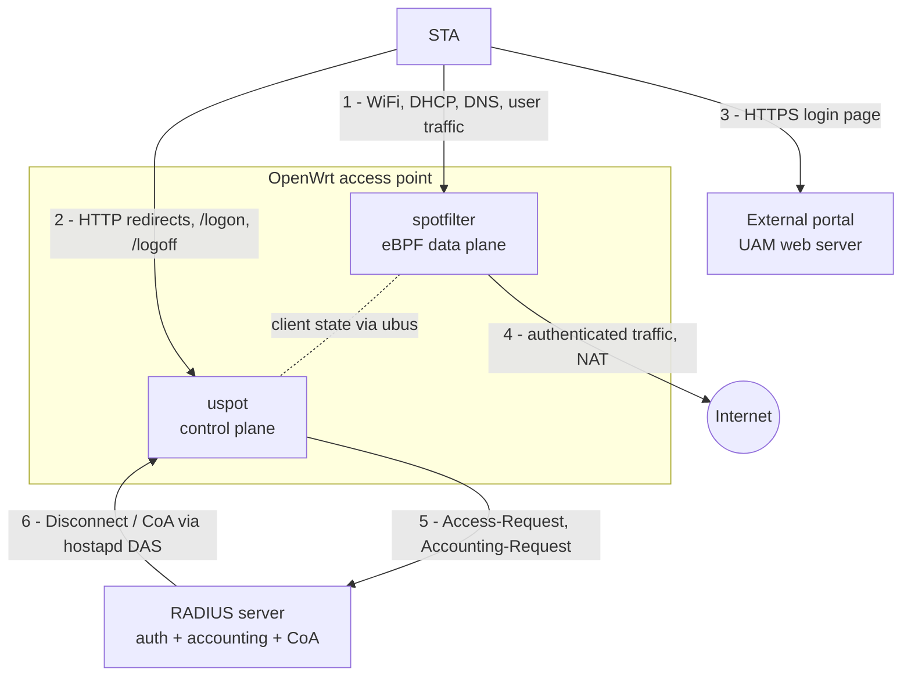
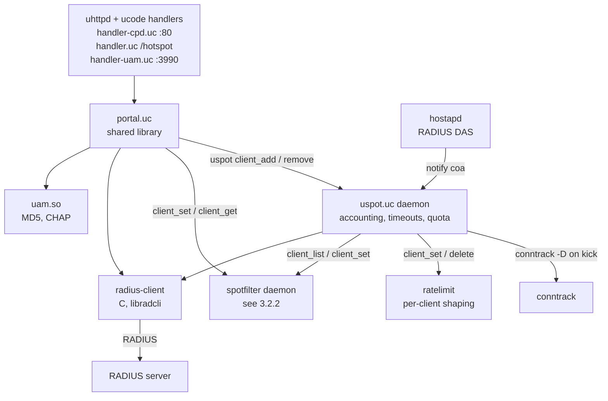
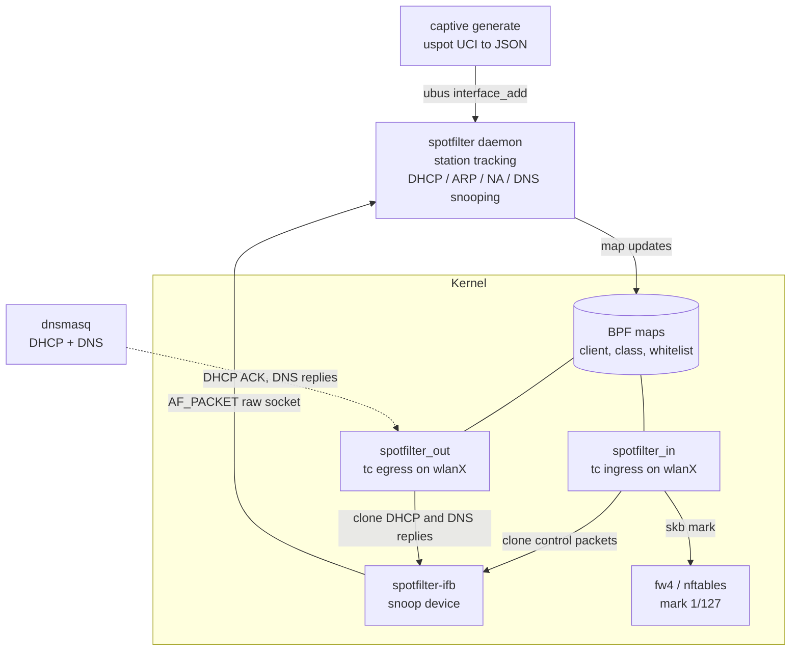

### Overview

---

A captive portal is a Layer-3 gateway policy, not a Wi-Fi feature. The client associates and gets an address normally, and a stateful enforcement point blocks forwarding until a web or API transaction marks that client as authorized. Nothing in IEEE 802.11 defines it. The IETF standardizes only discovery (RFC 8910) and a status API (RFC 8908), plus an informational architecture (RFC 8952). Everything else interception, the login UI, the session model and the firewall mechanics is implementation specific.

---

##### Typical Deployments

---

| Deployment | Typical access method |
| --- | --- |
| Public hotspots and cafés | Terms-of-service click-through |
| Hotels | Room number + surname, or PMS-issued voucher |
| Airports | Time-limited free tier, paid upgrade |
| Enterprise guest access | Sponsor approval, SMS/email OTP |
| Subscription hotspots | Account login, often RADIUS-backed |
| Home routers | Guest SSID with a simple portal |

---

### Component Roles

---

| Component | Role in the portal |
| --- | --- |
| Wireless client (STA) | Associates, runs DHCP/SLAAC, runs OS captive-portal detection, renders the login page. |
| AP / hostapd + driver | Beacons, association, keying, per-STA isolation (`ap_isolate`), VLAN tagging; emits STA connect/disconnect events. No HTTP role. |
| DHCP server (dnsmasq/odhcpd) | Assigns addresses, advertises RFC 8910 option; leases are the main IP↔MAC binding source. |
| DNS resolver | Resolves walled-garden names; must answer truthfully. |
| Gateway / firewall | The enforcement device: drops or redirects unauthorized forwarding, NATs authorized traffic. |
| Portal web server | Serves the splash page, the RFC 8908 API and the login endpoint. |
| Portal controller / session DB | Maps client → session, holds state, programs the firewall, handles expiry. |
| Authentication backend / RADIUS | Validates credentials or vouchers; returns policy (session timeout, bandwidth, VLAN); receives accounting. |

---

### Standard 

---

| Standardized | Implementation-specific |
| --- | --- |
| 802.11 auth/assoc, RSN, SAE, OWE (RFC 8110), 802.1X, 802.11u ANQP elements | HTTP 302 interception and walled-garden lists |
| DHCPv4 opt 114, DHCPv6 opt 103, RA opt 37 (RFC 8910) | OS probe URLs and expected bodies |
| Captive Portal API, `application/captive+json` (RFC 8908) | Splash page, login flows, vouchers |
| CAPPORT architecture (RFC 8952, Informational) | Client identification, firewall rules, session DB |
| HTTP 511 Network Authentication Required (RFC 6585) | Multi-AP session sharing |
| RADIUS (RFC 2865/2866), CoA/Disconnect (RFC 5176) | Vendor RADIUS attributes for portals (e.g. WISPr) |

---

### End-to-end Connection Flow

---

The client reaches the Internet only after thirteen hand-offs, and only stages 10–11 are portal-specific; most field failures happen at stages 4–7, before any login.

---

### Stage-by-stage

---

| # | Stage | Initiator → processor | Protocol / message | Expected result | Common failures |
| --- | --- | --- | --- | --- | --- |
| 1 | Scan, SSID select | STA → AP | Probe Req/Resp, Beacon; optional ANQP (802.11u) | SSID listed with correct security | Hidden SSID; wrong country/channel; client refuses OWE transition mode |
| 2 | 802.11 auth + association | STA → hostapd/driver | Auth (Open/SAE), (Re)Assoc Req/Resp | AID assigned | Max STA reached; ACL deny; SAE H2E/PMF mismatch |
| 3 | Security negotiation | AP ↔ STA | EAPOL-Key 4-way (WPA2/3/OWE) or EAP (802.1X) | PTK/GTK installed, port open | Wrong PSK; PMF required but unsupported; group rekey timeouts |
| 4 | Address assignment | STA → DHCP server; STA → router (RS) | DHCPv4 DORA; SLAAC/DHCPv6; RFC 8910 options | IPv4 lease, IPv6 addresses, opt 114/103/RA 37 | DHCP blocked by guest firewall; pool exhausted by randomized MACs; VLAN mismatch |
| 5 | DNS | STA → resolver | DNS/UDP 53 (or DoT/DoH) | Real answers for all names | Resolver unreachable from guest zone; client uses DoH to a blocked IP |
| 6 | Portal detection | STA OS | RFC 8908 API GET, or HTTP probe | OS decides "captive" | Probe host in walled garden (no detection); probe blocked instead of redirected ("no Internet") |
| 7 | Interception / discovery | Gateway | nftables DNAT tcp/80 → portal; or API URL | 302 or `captive:true` | HTTPS probe timeouts; IPv6 probe bypasses rules; redirect to IP literal with TLS |
| 8 | Portal page | STA → portal web server | HTTPS | Page renders in CNA/browser | Cert not valid for name; CDN assets outside walled garden; CNA lacks cookies/JS features |
| 9 | User action | User → portal app | HTTPS POST | Credentials/voucher submitted | CSRF/session cookie lost between CNA and browser |
| 10 | Backend authorization | Portal → auth backend | RADIUS Access-Request, REST, DB | Accept + policy | RADIUS secret/timeout; clock skew on vouchers |
| 11 | Firewall update | Controller → kernel | netlink (nft), ipset | Client's addresses in auth sets | Race: OS re-probes before rule installed; only IPv4 added |
| 12 | Internet access | STA → Internet via gateway | Routed + NAT | OS shows connected | MTU, upstream DNS, NAT table full |
| 13 | Expiry / logout | Kernel timer or controller | Set timeout, RADIUS Session-Timeout, CoA/Disconnect (RFC 5176), STA disassoc | Client returns to captive | Stale conntrack keeps flows alive; set entries never removed |

---

### Captive Portal Detection on Client Devices

---

Every major OS uses two mechanisms: 
- **positive signal** (RFC 8910 option → RFC 8908 API)
- **legacy cleartext HTTP probe** to a vendor host whose exact response it knows

Any deviation a redirect, a different body, an empty 200 is read as "captive", a timeout or reset is read as "no Internet", which shows no login prompt. Probe URLs below are as documented by the vendor where a vendor document exists; anything marked *observed* comes from third-party captures and can change without notice.

---

#### Standards-based Discovery

---

- The network places an HTTPS API URI in **DHCPv4 option 114**, **DHCPv6 option 103** or **IPv6 RA option 37**. RFC 8910 replaced RFC 7710, whose DHCPv4 code 160 conflicted with other uses ([RFC 8910](https://www.rfc-editor.org/rfc/rfc8910.html)). The URI `urn:ietf:params:capport:unrestricted` tells clients they can skip detection.
- The client sends `GET` with `Accept: application/captive+json`; the server must answer with that content type and a JSON body whose only mandatory key is `captive` (boolean). Optional keys: `user-portal-url`, `venue-info-url`, `can-extend-session`, `seconds-remaining`, `bytes-remaining` ([RFC 8908](https://www.rfc-editor.org/rfc/rfc8908.html)).
- The API **must** be HTTPS with a certificate valid for the provisioned hostname; if validation fails the client must ignore the API and fall back to legacy behaviour. Responses should carry `Cache-Control: private` or `no-store`. A captive network should still allow OCSP/CRL and NTP so the client can validate the certificate.
- Client identity: if the API server cannot see the client's identity itself (e.g. the API is off-box and NATed), RFC 8908 §4 recommends a **per-client API URI** (e.g. `/captive-portal/api/X54PD39JV`) handed out in each DHCP lease.

---

### System Architecture
---

The gateway is the only place that sees all guest traffic, has the DHCP bindings, and can NAT. The APs only bridge the guest SSID into VLAN 30 and isolate clients; they hold no authorization state, so roaming between them does not affect the portal session.

---

#### Responsibilities

---

| Component | Owns | Inputs | Outputs | Must not |
| --- | --- | --- | --- | --- |
| hostapd + driver | Association, keying, PMF, per-STA isolation, VLAN mapping | hostapd.conf (via netifd/UCI) | STA connect/disconnect events (ctrl iface, ubus `hostapd.*`) | Make portal decisions |
| dnsmasq | DHCPv4 leases, opt 114, DNS forwarding | UCI `dhcp` | Lease DB, `dhcp-script` / ubus lease events | Fake DNS answers for the whole Internet |
| odhcpd | RA, DHCPv6, NDP proxying | UCI `dhcp` | IPv6 lease/neighbour data | Hand out global IPv6 if IPv6 is not enforced |
| nftables (fw4 + custom table) | Packet enforcement, redirect, NAT, rate limits | Rules + dynamic sets | Accept/drop/DNAT decisions, counters | Contain business logic |
| Portal controller | Session lifecycle, client identity binding, timers, RADIUS client | Leases, STA events, login results | Set element add/del, accounting, logs | Trust client-supplied identifiers |
| Web server | TLS termination, splash, login, API | HTTP requests | Calls to controller | Expose management UI on the guest interface |
| Auth backend / RADIUS | Credentials, vouchers, policy | Access-Request | Accept + attributes; CoA/Disconnect | — |

---

### Comparison of Deployment Models

---

Gateway-based enforcement with an optionally external or cloud-hosted portal UI is the right default for embedded products; AP-based enforcement only makes sense for standalone single-AP devices or with a controller that synchronizes state.

---

| Aspect | A. Gateway-based | B. AP-based | C. Centralized enterprise (controller) | D. External portal | E. Cloud-managed |
| --- | --- | --- | --- | --- | --- |
| Traffic flow | AP bridges to gateway; gateway redirects, enforces, NATs | AP filters/redirects locally (often bridge-family rules), then bridges or routes | APs tunnel (CAPWAP/GRE/VXLAN) or VLAN-trunk guest traffic to controller/anchor | Enforcement local; splash/login on a remote web server, result returned to enforcement point via signed redirect or API | Local enforcement (AP or gateway) driven by cloud policy; portal often cloud-hosted |
| Session-state location | Gateway | Each AP | Controller (replicated in HA pairs) | Enforcement point + external server | Cloud DB, cached on device |
| Roaming | Transparent across APs on the same L2 guest VLAN | Lost on roam unless APs sync state | Transparent (central anchor) | Same as the enforcement point used | Depends on whether device or cloud is authoritative; usually re-auth by MAC on new AP |
| Scalability | Hundreds to low thousands of clients per gateway (CPU/conntrack bound) | Scales with APs, but per-AP RAM is small | High, controller-sized | Portal scales independently | High; enforcement still local |
| Security boundary | One hardened box; guest never touches AP management | Every AP is an enforcement point and must be hardened | Strong; guests tunneled away from local LAN | Must authenticate the callback (HMAC/token), or anyone can grant access | Cloud account and device-cloud channel become attack surface |
| External dependency | None for local ToS/voucher | None | Controller reachability | Login impossible if WAN or portal host is down | Login and policy changes depend on WAN + cloud; define offline behaviour |
| Operational complexity | Low–medium | Low per box, high at scale | High | Medium | Low for operator, high for vendor |
| Home router | Best fit | Acceptable (single AP) | Overkill | Rare | Common in ISP CPE |
| Hospitality | Good (PMS integration on portal server) | Weak | Good for large hotels | Common (vendor portal) | Very common |
| Public hotspot | Good | Weak | Good (carrier) | Common | Very common |
| Enterprise guest | Good for branches | Weak | Best fit | Common (sponsor portal) | Common |

---

| Model | Typical use | Key strength | Main limitation / design note |
| --- | --- | --- | --- |
| Gateway-based | Single-site routers and gateways | Sees every packet, owns DHCP bindings, applies IPv4 and IPv6 policy consistently | CPU for TLS and nftables set size on small SoCs; budget conntrack entries per client |
| AP-based | Standalone APs that also route (travel routers, single-AP SOHO) | No separate gateway needed | With multiple bridged APs, each sees only its own clients, so a roam re-captures the client unless the session is pushed to all APs. Bridge-family filtering needs `br_netfilter` or the nftables `bridge` family and must handle IPv6 ND and DHCP explicitly |
| Centralized controller | Large enterprise and campus | Guest traffic tunneled to an anchor controller (often in a DMZ): strong isolation, one session store | Tunnel MTU overhead; dependency on the controller |
| External portal | Vendor or hosted login UI (openNDS calls it FAS; vendors call it external captive portal) | UI and authentication scale independently of the enforcement box | Security rests on the token exchange: the enforcement device redirects with a signed query string, the external server calls back with a token. openNDS, for example, sends a hashed client id and requires a return hash computed with a pre-shared `faskey` ([openNDS FAS](https://opennds.readthedocs.io/en/stable/fas.html)) |
| Cloud-managed | Multi-site operators | Same as D, plus central configuration and reporting | Define WAN-loss behaviour: fail-closed (no new logins), fail-open for existing sessions, or a local ToS fallback |

---

### Linux/OpenWrt Implementation

---

| Component | Change needed | Integration point |
| --- | --- | --- |
| hostapd / wpad, driver | None (config only) | UCI `wireless`; ubus `hostapd.<ifname>` events and `del_client`; `hostapd_cli` |
| netifd | None | UCI `network`; ubus `network.interface.guest` |
| dnsmasq | None (config; `dnsmasq-full` if you need nftset walled garden) | UCI `dhcp`, `dhcpscript` lease hook, `dhcp_option` |
| odhcpd | None | UCI `dhcp`; `ubus call dhcp ipv6leases` |
| firewall4 | None | UCI zones/rules; custom table in a separate file |
| nftables | New table `inet portal` | `nft -f`, netlink from controller |
| Web server | New uhttpd instance or nginx bound to guest IP | UCI `uhttpd` or nginx conf |
| Portal controller | **New** daemon | procd service, ubus object `portal`, nft netlink, RADIUS client |

---

### Captive Portal on OpenWrt with uspot + spotfilter

---

| | |
|---|---|
| **Scope** | Design, porting and hardening of a production captive portal for OpenWrt-based access points, built on **uspot** (control plane) and **spotfilter** (eBPF data plane) |
| **Audience** | Firmware / platform engineers, portal & RADIUS backend engineers, QA |
| **Baseline code** | `uspot` (OpenWiFi, J. Crispin) and `spotfilter` (F. Fietkau) as provided in `uspot.zip` and `spotfilter.zip` |
| **Target platform** | Qualcomm-based OpenWrt AP (fw4/nftables, NSS ECM present) |
| **Status** | Draft for development — sections marked **[VERIFY]** must be confirmed on target hardware |

---

#### Why is the uspot

---

| Concern | CoovaChilli (current) | uspot + spotfilter (target) |
|---|---|---|
| Client data path | Every client packet passes through the `chilli` process (raw socket → `tun0`) | Kernel forwarding; packets never enter userspace |
| Throughput | Bounded by one userspace process on the AP CPU | Bounded by kernel / hardware forwarding |
| DHCP for clients | Chilli's own DHCP server | Standard OpenWrt `dnsmasq` |
| Access decision | Per packet in userspace | eBPF classifier sets a firewall mark; fw4 enforces |
| fw4 / nftables integration | Indirect (`iptables-nft` shims, duplicate-packet RST issue required an extra prerouting rule) | Native: one mark, a handful of fw4 rules |
| Accounting counters | Chilli | eBPF per-client counters |
| Code base | C, largely unmaintained (v1.6 on target) | ucode + small C/eBPF components, part of the OpenWrt/OpenWiFi ecosystem |

---

####  System Architecture

---

| # | Interaction |
|---|---|
| 1 | Client associates and sends all its packets through the spotfilter classifier on the WiFi netdev |
| 2 | uspot (uhttpd handlers) redirects garden clients and receives the `/logon` request built by the portal |
| 3 | Client loads the login page from the external portal (whitelisted host); the portal answers with a 302 to the AP's `/logon` |
| 4 | After login, packets carry mark 1 and are forwarded and NATed to the Internet |
| 5 | uspot authenticates the user and reports accounting to RADIUS; Access-Accept carries the policy attributes |
| 6 | The backend disconnects a client through hostapd's Dynamic Authorization Server |

---

#### Control plane (uspot)

---

---

#### Data plane (spotfilter)

---

---

### References

---

- [RFC 8910 — Captive-Portal Identification in DHCP and Router Advertisements](https://www.rfc-editor.org/rfc/rfc8910.html) (Standards Track, Sept 2020)
- [RFC 8908 — Captive Portal API](https://www.rfc-editor.org/rfc/rfc8908.html) (Standards Track, Sept 2020)
- [RFC 8952 — Captive Portal Architecture](https://www.rfc-editor.org/rfc/rfc8952.html) (Informational, Nov 2020)
- [Android 11: Captive portal API support](https://developer.android.com/about/versions/11/features/captive-portal)
- [Apple Developer: How to modernize your captive network](https://developer.apple.com/news/?id=q78sq5rv) (iOS 14 / macOS Big Sur)
- [Apple Developer Forums: captive network documentation scope](https://origin-devforums.apple.com/forums/thread/834869)
- [Apple: Prepare your network or web server for iCloud Private Relay](https://developer.apple.com/support/prepare-your-network-for-icloud-private-relay/)
- [Microsoft Learn: NCSI frequently asked questions](https://learn.microsoft.com/en-us/windows-server/networking/ncsi/ncsi-frequently-asked-questions)
- [Microsoft Learn: Troubleshoot NCSI](https://learn.microsoft.com/en-us/troubleshoot/windows-server/networking/troubleshoot-ncsi-guidance)
- [NetworkManager.conf reference — connectivity section](https://networkmanager.dev/docs/api/latest/NetworkManager.conf.html)
- [Mozilla Support: Firefox captive portal detection](https://support.mozilla.org/kb/captive-portal)
- [OpenWrt 22.03.0 release announcement (firewall4)](https://desiato.infradead.org/pipermail/openwrt-devel/2022-September/039343.html)
- [openNDS FAQ (v10 nftables migration)](https://github.com/openNDS/openNDS/blob/stable/docs/source/faq.rst)
- [openNDS: Forwarding Authentication Service](https://opennds.readthedocs.io/en/stable/fas.html)
