## Overview

---

A captive portal is a Layer-3 gateway policy, not a Wi-Fi feature. The client associates and gets an address normally, and a stateful enforcement point blocks forwarding until a web or API transaction marks that client as authorized. Nothing in IEEE 802.11 defines it. The IETF standardizes only discovery (RFC 8910) and a status API (RFC 8908), plus an informational architecture (RFC 8952). Everything else interception, the login UI, the session model and the firewall mechanics is implementation specific.

---

### Typical Deployments

---

| Deployment | Typical access method |
| --- | --- |
| Public hotspots and cafés | Terms-of-service click-through |
| Hotels | Room number + surname, or PMS-issued voucher |
| Airports | Time-limited free tier, paid upgrade |
| Enterprise guest access | Sponsor approval, SMS/email OTP |
| Subscription hotspots | Account login, often RADIUS-backed |
| Home routers | Guest SSID with a simple portal |

---

### Component Roles

---

| Component | Role in the portal |
| --- | --- |
| Wireless client (STA) | Associates, runs DHCP/SLAAC, runs OS captive-portal detection, renders the login page. |
| AP / hostapd + driver | Beacons, association, keying, per-STA isolation (`ap_isolate`), VLAN tagging; emits STA connect/disconnect events. No HTTP role. |
| DHCP server (dnsmasq/odhcpd) | Assigns addresses, advertises RFC 8910 option; leases are the main IP↔MAC binding source. |
| DNS resolver | Resolves walled-garden names; must answer truthfully. |
| Gateway / firewall | The enforcement device: drops or redirects unauthorized forwarding, NATs authorized traffic. |
| Portal web server | Serves the splash page, the RFC 8908 API and the login endpoint. |
| Portal controller / session DB | Maps client → session, holds state, programs the firewall, handles expiry. |
| Authentication backend / RADIUS | Validates credentials or vouchers; returns policy (session timeout, bandwidth, VLAN); receives accounting. |

---

### Standard 

---

| Standardized | Implementation-specific |
| --- | --- |
| 802.11 auth/assoc, RSN, SAE, OWE (RFC 8110), 802.1X, 802.11u ANQP elements | HTTP 302 interception and walled-garden lists |
| DHCPv4 opt 114, DHCPv6 opt 103, RA opt 37 (RFC 8910) | OS probe URLs and expected bodies |
| Captive Portal API, `application/captive+json` (RFC 8908) | Splash page, login flows, vouchers |
| CAPPORT architecture (RFC 8952, Informational) | Client identification, firewall rules, session DB |
| HTTP 511 Network Authentication Required (RFC 6585) | Multi-AP session sharing |
| RADIUS (RFC 2865/2866), CoA/Disconnect (RFC 5176) | Vendor RADIUS attributes for portals (e.g. WISPr) |

---

### End-to-end Connection Flow

---

The client reaches the Internet only after thirteen hand-offs, and only stages 10–11 are portal-specific; most field failures happen at stages 4–7, before any login.

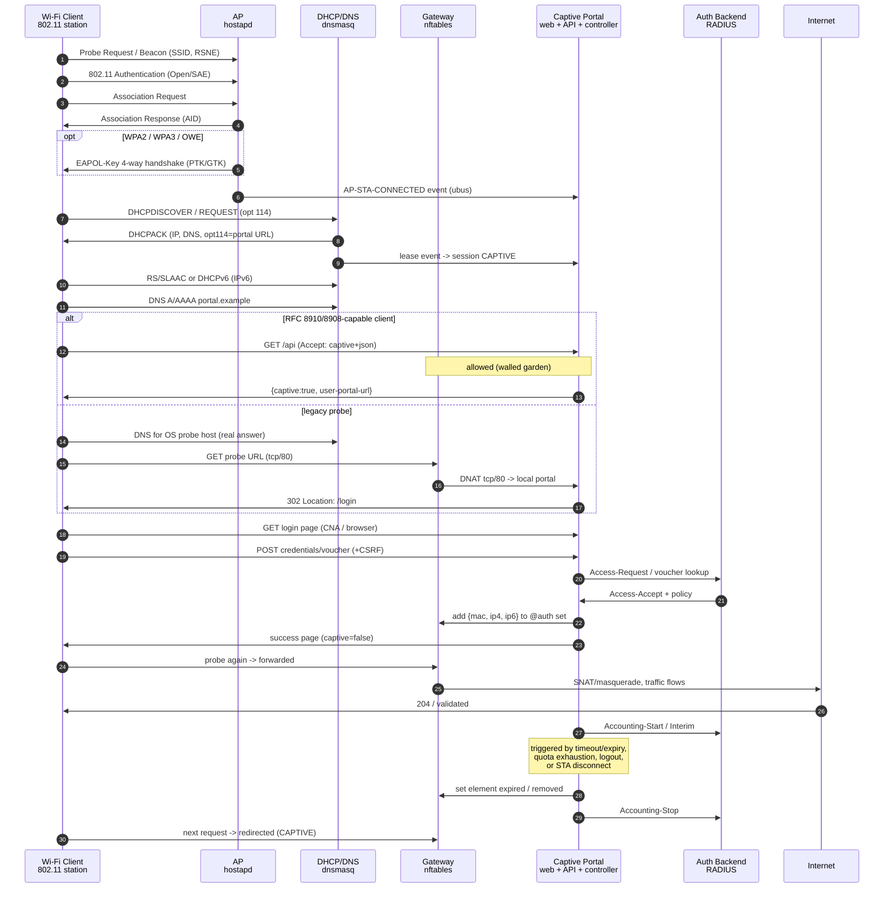

---

### Stage-by-stage

---

| # | Stage | Initiator → processor | Protocol / message | Expected result | Common failures |
| --- | --- | --- | --- | --- | --- |
| 1 | Scan, SSID select | STA → AP | Probe Req/Resp, Beacon; optional ANQP (802.11u) | SSID listed with correct security | Hidden SSID; wrong country/channel; client refuses OWE transition mode |
| 2 | 802.11 auth + association | STA → hostapd/driver | Auth (Open/SAE), (Re)Assoc Req/Resp | AID assigned | Max STA reached; ACL deny; SAE H2E/PMF mismatch |
| 3 | Security negotiation | AP ↔ STA | EAPOL-Key 4-way (WPA2/3/OWE) or EAP (802.1X) | PTK/GTK installed, port open | Wrong PSK; PMF required but unsupported; group rekey timeouts |
| 4 | Address assignment | STA → DHCP server; STA → router (RS) | DHCPv4 DORA; SLAAC/DHCPv6; RFC 8910 options | IPv4 lease, IPv6 addresses, opt 114/103/RA 37 | DHCP blocked by guest firewall; pool exhausted by randomized MACs; VLAN mismatch |
| 5 | DNS | STA → resolver | DNS/UDP 53 (or DoT/DoH) | Real answers for all names | Resolver unreachable from guest zone; client uses DoH to a blocked IP |
| 6 | Portal detection | STA OS | RFC 8908 API GET, or HTTP probe | OS decides "captive" | Probe host in walled garden (no detection); probe blocked instead of redirected ("no Internet") |
| 7 | Interception / discovery | Gateway | nftables DNAT tcp/80 → portal; or API URL | 302 or `captive:true` | HTTPS probe timeouts; IPv6 probe bypasses rules; redirect to IP literal with TLS |
| 8 | Portal page | STA → portal web server | HTTPS | Page renders in CNA/browser | Cert not valid for name; CDN assets outside walled garden; CNA lacks cookies/JS features |
| 9 | User action | User → portal app | HTTPS POST | Credentials/voucher submitted | CSRF/session cookie lost between CNA and browser |
| 10 | Backend authorization | Portal → auth backend | RADIUS Access-Request, REST, DB | Accept + policy | RADIUS secret/timeout; clock skew on vouchers |
| 11 | Firewall update | Controller → kernel | netlink (nft), ipset | Client's addresses in auth sets | Race: OS re-probes before rule installed; only IPv4 added |
| 12 | Internet access | STA → Internet via gateway | Routed + NAT | OS shows connected | MTU, upstream DNS, NAT table full |
| 13 | Expiry / logout | Kernel timer or controller | Set timeout, RADIUS Session-Timeout, CoA/Disconnect (RFC 5176), STA disassoc | Client returns to captive | Stale conntrack keeps flows alive; set entries never removed |

---

### Captive Portal Detection on Client Devices

---

Every major OS uses two mechanisms: 
- **positive signal** (RFC 8910 option → RFC 8908 API)
- **legacy cleartext HTTP probe** to a vendor host whose exact response it knows

Any deviation a redirect, a different body, an empty 200 is read as "captive", a timeout or reset is read as "no Internet", which shows no login prompt. Probe URLs below are as documented by the vendor where a vendor document exists; anything marked *observed* comes from third-party captures and can change without notice.

---

#### Standards-based Discovery

---

- The network places an HTTPS API URI in **DHCPv4 option 114**, **DHCPv6 option 103** or **IPv6 RA option 37**. RFC 8910 replaced RFC 7710, whose DHCPv4 code 160 conflicted with other uses ([RFC 8910](https://www.rfc-editor.org/rfc/rfc8910.html)). The URI `urn:ietf:params:capport:unrestricted` tells clients they can skip detection.
- The client sends `GET` with `Accept: application/captive+json`; the server must answer with that content type and a JSON body whose only mandatory key is `captive` (boolean). Optional keys: `user-portal-url`, `venue-info-url`, `can-extend-session`, `seconds-remaining`, `bytes-remaining` ([RFC 8908](https://www.rfc-editor.org/rfc/rfc8908.html)).
- The API **must** be HTTPS with a certificate valid for the provisioned hostname; if validation fails the client must ignore the API and fall back to legacy behaviour. Responses should carry `Cache-Control: private` or `no-store`. A captive network should still allow OCSP/CRL and NTP so the client can validate the certificate.
- Client identity: if the API server cannot see the client's identity itself (e.g. the API is off-box and NATed), RFC 8908 §4 recommends a **per-client API URI** (e.g. `/captive-portal/api/X54PD39JV`) handed out in each DHCP lease.

---

## System Architecture

---

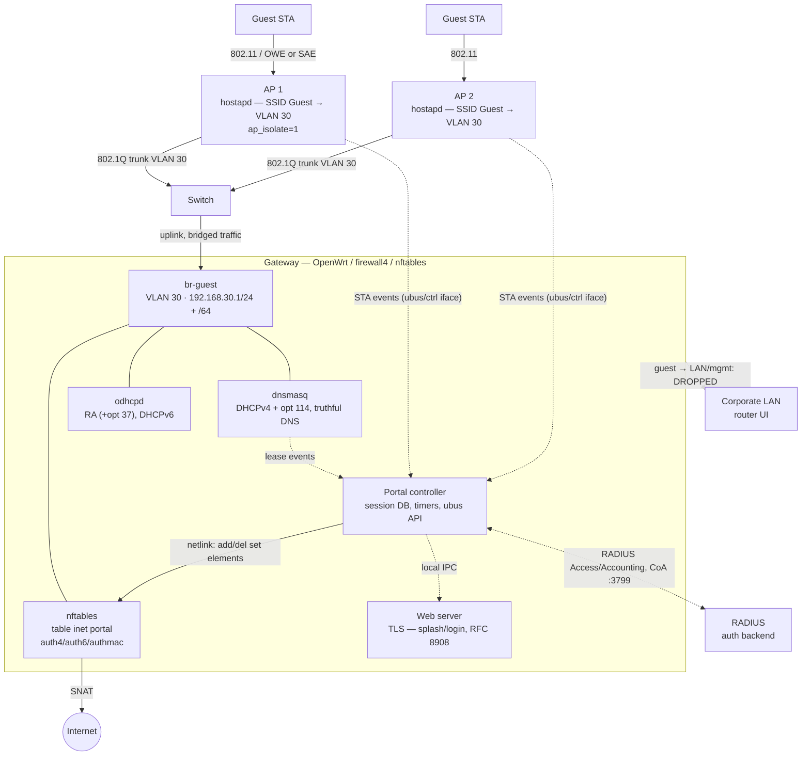

The gateway is the only place that sees all guest traffic, has the DHCP bindings, and can NAT. The APs only bridge the guest SSID into VLAN 30 and isolate clients; they hold no authorization state, so roaming between them does not affect the portal session.

---

### Responsibilities

---

| Component | Owns | Inputs | Outputs | Must not |
| --- | --- | --- | --- | --- |
| hostapd + driver | Association, keying, PMF, per-STA isolation, VLAN mapping | hostapd.conf (via netifd/UCI) | STA connect/disconnect events (ctrl iface, ubus `hostapd.*`) | Make portal decisions |
| dnsmasq | DHCPv4 leases, opt 114, DNS forwarding | UCI `dhcp` | Lease DB, `dhcp-script` / ubus lease events | Fake DNS answers for the whole Internet |
| odhcpd | RA, DHCPv6, NDP proxying | UCI `dhcp` | IPv6 lease/neighbour data | Hand out global IPv6 if IPv6 is not enforced |
| nftables (fw4 + custom table) | Packet enforcement, redirect, NAT, rate limits | Rules + dynamic sets | Accept/drop/DNAT decisions, counters | Contain business logic |
| Portal controller | Session lifecycle, client identity binding, timers, RADIUS client | Leases, STA events, login results | Set element add/del, accounting, logs | Trust client-supplied identifiers |
| Web server | TLS termination, splash, login, API | HTTP requests | Calls to controller | Expose management UI on the guest interface |
| Auth backend / RADIUS | Credentials, vouchers, policy | Access-Request | Accept + attributes; CoA/Disconnect | — |

---

### Comparison of Deployment Models

---

Gateway-based enforcement with an optionally external or cloud-hosted portal UI is the right default for embedded products; AP-based enforcement only makes sense for standalone single-AP devices or with a controller that synchronizes state.

---

| Aspect | A. Gateway-based | B. AP-based | C. Centralized enterprise (controller) | D. External portal | E. Cloud-managed |
| --- | --- | --- | --- | --- | --- |
| Traffic flow | AP bridges to gateway; gateway redirects, enforces, NATs | AP filters/redirects locally (often bridge-family rules), then bridges or routes | APs tunnel (CAPWAP/GRE/VXLAN) or VLAN-trunk guest traffic to controller/anchor | Enforcement local; splash/login on a remote web server, result returned to enforcement point via signed redirect or API | Local enforcement (AP or gateway) driven by cloud policy; portal often cloud-hosted |
| Session-state location | Gateway | Each AP | Controller (replicated in HA pairs) | Enforcement point + external server | Cloud DB, cached on device |
| Roaming | Transparent across APs on the same L2 guest VLAN | Lost on roam unless APs sync state | Transparent (central anchor) | Same as the enforcement point used | Depends on whether device or cloud is authoritative; usually re-auth by MAC on new AP |
| Scalability | Hundreds to low thousands of clients per gateway (CPU/conntrack bound) | Scales with APs, but per-AP RAM is small | High, controller-sized | Portal scales independently | High; enforcement still local |
| Security boundary | One hardened box; guest never touches AP management | Every AP is an enforcement point and must be hardened | Strong; guests tunneled away from local LAN | Must authenticate the callback (HMAC/token), or anyone can grant access | Cloud account and device-cloud channel become attack surface |
| External dependency | None for local ToS/voucher | None | Controller reachability | Login impossible if WAN or portal host is down | Login and policy changes depend on WAN + cloud; define offline behaviour |
| Operational complexity | Low–medium | Low per box, high at scale | High | Medium | Low for operator, high for vendor |
| Home router | Best fit | Acceptable (single AP) | Overkill | Rare | Common in ISP CPE |
| Hospitality | Good (PMS integration on portal server) | Weak | Good for large hotels | Common (vendor portal) | Very common |
| Public hotspot | Good | Weak | Good (carrier) | Common | Very common |
| Enterprise guest | Good for branches | Weak | Best fit | Common (sponsor portal) | Common |

---

| Model | Typical use | Key strength | Main limitation / design note |
| --- | --- | --- | --- |
| Gateway-based | Single-site routers and gateways | Sees every packet, owns DHCP bindings, applies IPv4 and IPv6 policy consistently | CPU for TLS and nftables set size on small SoCs; budget conntrack entries per client |
| AP-based | Standalone APs that also route (travel routers, single-AP SOHO) | No separate gateway needed | With multiple bridged APs, each sees only its own clients, so a roam re-captures the client unless the session is pushed to all APs. Bridge-family filtering needs `br_netfilter` or the nftables `bridge` family and must handle IPv6 ND and DHCP explicitly |
| Centralized controller | Large enterprise and campus | Guest traffic tunneled to an anchor controller (often in a DMZ): strong isolation, one session store | Tunnel MTU overhead; dependency on the controller |
| External portal | Vendor or hosted login UI (openNDS calls it FAS; vendors call it external captive portal) | UI and authentication scale independently of the enforcement box | Security rests on the token exchange: the enforcement device redirects with a signed query string, the external server calls back with a token. openNDS, for example, sends a hashed client id and requires a return hash computed with a pre-shared `faskey` ([openNDS FAS](https://opennds.readthedocs.io/en/stable/fas.html)) |
| Cloud-managed | Multi-site operators | Same as D, plus central configuration and reporting | Define WAN-loss behaviour: fail-closed (no new logins), fail-open for existing sessions, or a local ToS fallback |

---

### Linux/OpenWrt Implementation

---

| Component | Change needed | Integration point |
| --- | --- | --- |
| hostapd / wpad, driver | None (config only) | UCI `wireless`; ubus `hostapd.<ifname>` events and `del_client`; `hostapd_cli` |
| netifd | None | UCI `network`; ubus `network.interface.guest` |
| dnsmasq | None (config; `dnsmasq-full` if you need nftset walled garden) | UCI `dhcp`, `dhcpscript` lease hook, `dhcp_option` |
| odhcpd | None | UCI `dhcp`; `ubus call dhcp ipv6leases` |
| firewall4 | None | UCI zones/rules; custom table in a separate file |
| nftables | New table `inet portal` | `nft -f`, netlink from controller |
| Web server | New uhttpd instance or nginx bound to guest IP | UCI `uhttpd` or nginx conf |
| Portal controller | **New** daemon | procd service, ubus object `portal`, nft netlink, RADIUS client |

---

## Captive Portal on OpenWrt with uspot + spotfilter

---

| | |
|---|---|
| **Scope** | Design, porting and hardening of a production captive portal for OpenWrt-based access points, built on **uspot** (control plane) and **spotfilter** (eBPF data plane) |
| **Audience** | Firmware / platform engineers, portal & RADIUS backend engineers, QA |
| **Baseline code** | `uspot` (OpenWiFi, J. Crispin) and `spotfilter` (F. Fietkau), as provided in `uspot+spotfilter.zip` |
| **Target platform** | Qualcomm-based OpenWrt AP (fw4/nftables, NSS ECM present) |
| **Status** | Draft for development — sections marked **[VERIFY]** must be confirmed on target hardware |

---

### Why is the uspot?

---

| Concern | CoovaChilli (current) | uspot + spotfilter (target) |
|---|---|---|
| Client data path | Every client packet passes through the `chilli` process (raw socket → `tun0`) | Kernel forwarding; packets never enter userspace |
| Throughput | Bounded by one userspace process on the AP CPU | Bounded by kernel / hardware forwarding |
| DHCP for clients | Chilli's own DHCP server | Standard OpenWrt `dnsmasq` |
| Access decision | Per packet in userspace | eBPF classifier sets a firewall mark; fw4 enforces |
| fw4 / nftables integration | Indirect (`iptables-nft` shims, duplicate-packet RST issue required an extra prerouting rule) | Native: one mark, a handful of fw4 rules |
| Accounting counters | Chilli | eBPF per-client counters |
| Code base | C, largely unmaintained (v1.6 on target) | ucode + small C/eBPF components, part of the OpenWrt/OpenWiFi ecosystem |


---

###  System Architecture

---

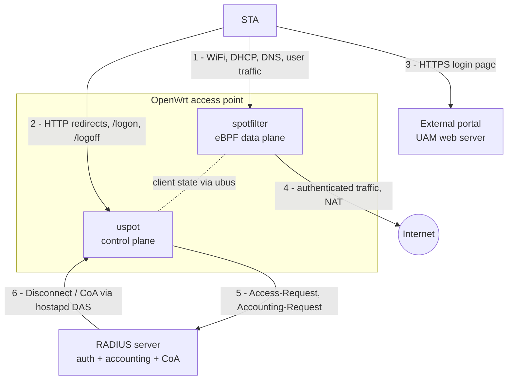

| # | Interaction |
|---|---|
| 1 | Client associates and sends all its packets through the spotfilter classifier on the WiFi netdev |
| 2 | uspot (uhttpd handlers) redirects garden clients and receives the `/logon` request built by the portal |
| 3 | Client loads the login page from the external portal (whitelisted host); the portal answers with a 302 to the AP's `/logon` |
| 4 | After login, packets carry mark 1 and are forwarded and NATed to the Internet |
| 5 | uspot authenticates the user and reports accounting to RADIUS; Access-Accept carries the policy attributes |
| 6 | The backend disconnects a client through hostapd's Dynamic Authorization Server |

---

### Control plane (uspot)

---

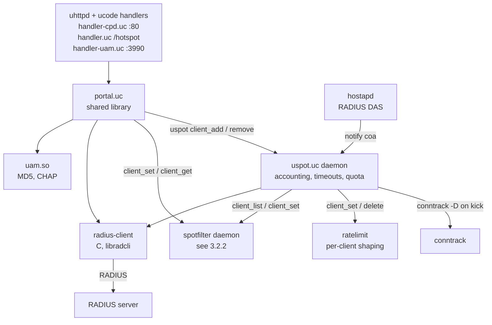

---

### Data plane (spotfilter)

---

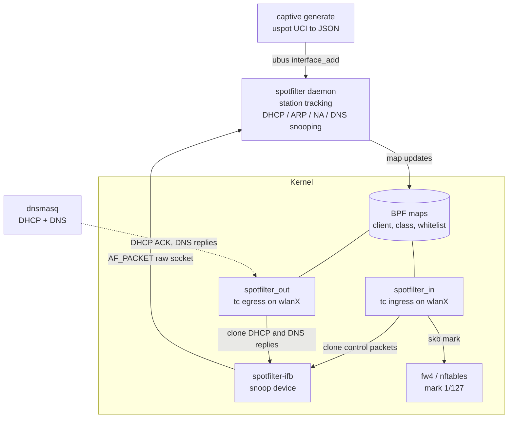

---

### Internal/Local Captive Portal

---

**Correction vs. an earlier draft of this section:** reading the actual `uspot` + `spotfilter` sources shows there is no `uspotfilter` package, no nftables `ipset`, and no `uspot-das` binary. The real enforcement point is **`spotfilter`**, a separate eBPF/tc daemon with ubus object `spotfilter`; it classifies every client packet into one of a small number of **classes** and tags it with an **nftables firewall mark** (`fwmark 1`, mask `127` by convention). `fw4` then only has to match on that mark — there is no per-MAC set to maintain. CoA/Disconnect is not a separate daemon either: it is hostapd's own RADIUS Dynamic Authorization Server, and `uspot.uc` simply subscribes to hostapd's ubus `coa` notification and reacts to it.

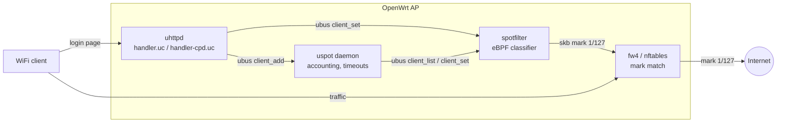

---

| Component | Package / file | Role |
|---|---|---|
| uhttpd + ucode handlers | `uhttpd-mod-ucode`, `/usr/share/uspot/handler*.uc` | Serves the portal: `handler-cpd.uc` (`/cpd`) 302-redirects any garden request to `/hotspot`; `handler.uc` (`/hotspot`) shows the login page and checks the submitted credentials/RADIUS reply **itself**, in the uhttpd worker — there is no separate "auth" ubus call |
| Portal pages | `/www-uspot/*.html` (`click.html`, `credentials.html`, `radius.html`, `allow.html`, `connected.html`) | Complete, self-contained HTML pages (Bootstrap, OpenWiFi branding baked in). `serve.uc` reads them from **`/tmp/ucentral/www-uspot/`**, not `/www-uspot/` — on a uCentral/OpenWiFi image that path is populated for you; on a plain OpenWrt image you must arrange for it to exist (symlink or copy) |
| uspot daemon | `/usr/share/uspot/uspot.uc` (procd service `uspot`) | **Not** the thing that validates credentials. Once a client has been authorised it owns accounting (RADIUS Start/Interim/Stop), idle/session-timeout enforcement (polls `spotfilter` every 10 s), ratelimit, and reacts to hostapd's `coa` ubus notification |
| spotfilter daemon | package `spotfilter` (separate procd service, ubus object `spotfilter`) | eBPF/tc program attached to each captive netdev; classifies clients into classes, applies the fwmark, snoops DHCP/ARP/ND/DNS to learn client addresses, exposes `client_get`/`client_set`/`client_remove`/`client_list`/`interface_add`/`whitelist_add` over ubus |
| fw4 / nftables | UCI `firewall`, custom `mark` matches | No ipset: a `redirect` rule DNATs unmarked HTTP to the portal, a `forward` rule accepts `mark 1/127` traffic to `wan` |
| hostapd DAS | built into hostapd, no uspot package | Receives RADIUS CoA/Disconnect-Request directly; notifies `uspot` over ubus (`notify.type == 'coa'`), which then calls `spotfilter client_remove` |
| dnsmasq | standard OpenWrt | DHCP and DNS for captive clients |

---

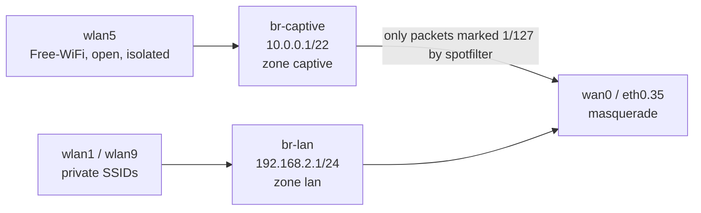

The captive SSID has its **own bridge, IP subnet, DHCP scope and firewall zone**. Private SSIDs are not affected.

---

#### Processing Flows

---

#### Client joins the captive network

---

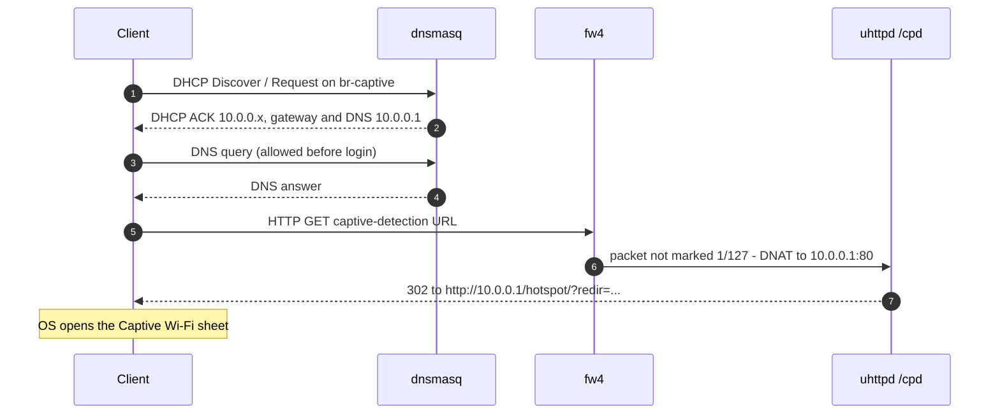

---

#### Login with local credentials

---

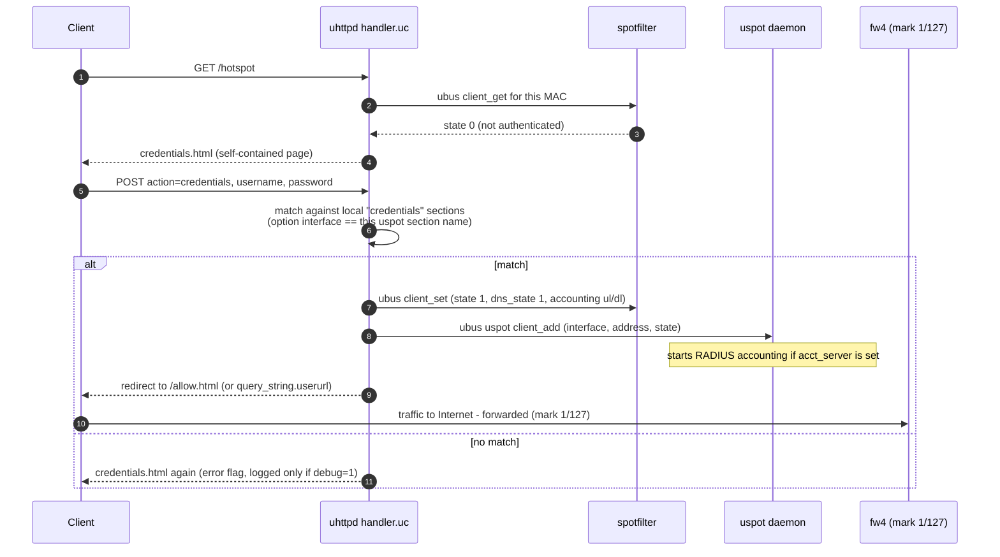

Note the one genuinely confusing bit of the real config: a `credentials` section does **not** reference its parent `uspot` section via an `option uspot` field — it uses `option interface '<uspot section name>'` (`handler.uc`: `cred.interface != ctx.spotfilter`). The word "interface" here means "which uspot/spotfilter instance", not a network device.

---

#### Firewall Decision

---

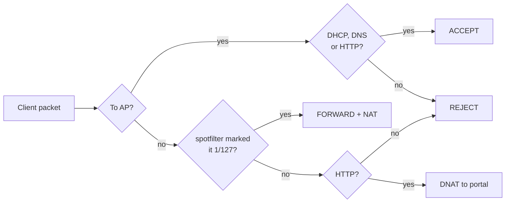

Ports: DHCP = UDP 67, DNS = UDP/TCP 53, HTTP = TCP 80. The DNAT target is `10.0.0.1:80`, where `/cpd` answers with a 302 to `/hotspot`. The "marked 1/127" decision is not made by fw4 itself — it is the `spotfilter` eBPF classifier on the wlan netdev that stamps the skb's fwmark based on the client's current class (unauthenticated clients default to class 0, DNS and whitelisted garden hosts are mapped to the authorised class so they pass before login); fw4 only ever matches on the resulting mark.

---

#### Session End

---

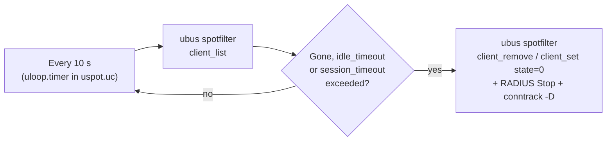

"Gone" means `spotfilter`'s `client_list` no longer reports the client as authenticated (state 0) — e.g. it disconnected from the AP. When a client is removed, `spotfilter` resets its class to the unauthenticated default and the client sees the login page again on its next request.
 
**Important:** this loop's `ubus call spotfilter client_list` fails (returns nothing) if the `spotfilter` service is not running — but you will notice this well before the 10 s loop matters: `portal.handle_request()` calls `spotfilter client_get` on **every** page load and bails out to the generic error page the moment that call fails, logging `uspot: <client-ip> - spotfilter error`. There is no "no client list" log line in this codebase; if you see that symptom, grep for `spotfilter error` instead.

---
#### Prerequisites Packages
---

```
opkg install uspot
```

That alone is enough: `uspot`'s Makefile declares `DEPENDS:=+spotfilter +uhttpd-mod-ucode +libradcli +iptables-mod-conntrack-extra +conntrack +ucode-mod-math +ucode-mod-nl80211 +ucode-mod-rtnl +ucode-mod-uloop +ratelimit`, and `spotfilter` in turn pulls in `+libbpf +libubox +libubus +libnl-tiny +kmod-sched-bpf +kmod-ifb`. `dnsmasq` is part of the base OpenWrt image already. There is no `uspotfilter` or `ucode-mod-bpf` package — the eBPF program ships precompiled inside `spotfilter` itself (`/lib/bpf/spotfilter-bpf.o`), loaded by the `spotfilter` C daemon via `libbpf`, not by ucode.

---
#### Captive network and WiFi
---

```bash
# Bridge with IP address (uspot uses OpenWrt DHCP, unlike CoovaChilli)
uci set network.captive_dev=device
uci set network.captive_dev.name='br-captive'
uci set network.captive_dev.type='bridge'
uci set network.captive_dev.bridge_empty='1'
 
uci set network.captive=interface
uci set network.captive.device='br-captive'
uci set network.captive.proto='static'
uci set network.captive.ipaddr='10.0.0.1'
uci set network.captive.netmask='255.255.252.0'
 
# DHCP scope
uci set dhcp.captive=dhcp
uci set dhcp.captive.interface='captive'
uci set dhcp.captive.start='10'
uci set dhcp.captive.limit='1000'
uci set dhcp.captive.leasetime='1h'
 
# Captive SSID
uci set wireless.wlan5.network='captive'
uci set wireless.wlan5.ssid='Free-WiFi'        # must differ from every private SSID
uci set wireless.wlan5.encryption='none'
uci set wireless.wlan5.isolate='1'             # clients cannot reach each other
uci -q delete wireless.wlan5.key
uci -q delete wireless.wlan5.sae_pwe
uci set wireless.wlan5.ieee80211w='0'
 
uci commit network; uci commit dhcp; uci commit wireless
/etc/init.d/network reload
/etc/init.d/dnsmasq restart
wifi reload
```
 
Verify:
 
```bash
ip addr show br-captive                       # inet 10.0.0.1/22
ifstatus captive | grep -E '"up"|"address"'
```
 
If dnsmasq is restricted to some interfaces (`uci show dhcp | grep "@dnsmasq\[0\].interface"`), add `captive`:
 
```bash
uci add_list dhcp.@dnsmasq[0].interface='captive'
uci commit dhcp; /etc/init.d/dnsmasq restart
```

---
#### Firewall
---

There is **no ipset**. The real enforcement signal is the nftables firewall **mark** that `spotfilter`'s eBPF program stamps on each packet: `fwmark 1`, checked with mask `127` (so other bits of the mark stay free for other uses, e.g. `ratelimit` or hardware-offload hints). This is exactly what `uspot`'s own `README.md` documents:

```bash
# Captive zone - no "forwarding captive -> wan" section!
uci set firewall.captive_zone=zone
uci set firewall.captive_zone.name='captive'
uci add_list firewall.captive_zone.network='captive'
uci set firewall.captive_zone.input='REJECT'
uci set firewall.captive_zone.output='ACCEPT'
uci set firewall.captive_zone.forward='REJECT'
 
# Unauthorised HTTP -> portal on the AP (anything NOT marked 1/127)
uci set firewall.captive_cpd=redirect
uci set firewall.captive_cpd.name='Redirect-unauth-captive-CPD'
uci set firewall.captive_cpd.src='captive'
uci set firewall.captive_cpd.proto='tcp'
uci set firewall.captive_cpd.src_dport='80'
uci set firewall.captive_cpd.target='DNAT'
uci set firewall.captive_cpd.reflection='0'
uci set firewall.captive_cpd.mark='!1/127'
 
# Services on the AP for captive clients (portal + UAM port)
uci set firewall.captive_in=rule
uci set firewall.captive_in.name='Allow-captive-CPD-UAM'
uci set firewall.captive_in.src='captive'
uci set firewall.captive_in.proto='tcp'
uci add_list firewall.captive_in.dest_port='80'
uci add_list firewall.captive_in.dest_port='3990'
uci set firewall.captive_in.target='ACCEPT'
 
uci set firewall.captive_dhcp=rule
uci set firewall.captive_dhcp.name='Allow-DHCP-captive'
uci set firewall.captive_dhcp.src='captive'
uci set firewall.captive_dhcp.proto='udp'
uci set firewall.captive_dhcp.dest_port='67'
uci set firewall.captive_dhcp.target='ACCEPT'
 
uci set firewall.captive_dns=rule
uci set firewall.captive_dns.name='Allow-DNS-captive'
uci set firewall.captive_dns.src='captive'
uci add_list firewall.captive_dns.proto='udp'
uci add_list firewall.captive_dns.proto='tcp'
uci set firewall.captive_dns.dest_port='53'
uci set firewall.captive_dns.target='ACCEPT'
 
# Authorised clients (marked 1/127 by spotfilter) -> Internet
uci set firewall.captive_fwd=rule
uci set firewall.captive_fwd.name='Forward-auth-captive'
uci set firewall.captive_fwd.src='captive'
uci set firewall.captive_fwd.dest='wan'
uci set firewall.captive_fwd.proto='any'
uci set firewall.captive_fwd.mark='1/127'
uci set firewall.captive_fwd.target='ACCEPT'
 
uci commit firewall
/etc/init.d/firewall restart
```
 
The `wan` zone must keep `masq '1'`. Port 3990 (UAM/RADIUS CHAP endpoint, `handler-uam.uc`) only needs to be open if `auth_mode` is `uam`; for plain `credentials`/`radius` modes the CPD/login traffic all stays on port 80. Since there is no set to inspect, verifying enforcement means watching the mark itself, e.g. `nft list table inet fw4` and look for the `mark and 0x7f == 0x1` match on the forward rule, or just check a client's class over ubus (`ubus call spotfilter client_get '{"interface":"captive","address":"<mac>"}'`).

---
#### uhttpd and portal pages
---

---
#### Listener
---

```bash
uci -q delete uhttpd.uspot
uci set uhttpd.uspot=uhttpd
uci add_list uhttpd.uspot.listen_http='10.0.0.1:80'
uci set uhttpd.uspot.redirect_https='0'
uci set uhttpd.uspot.no_dirlists='1'
uci set uhttpd.uspot.max_requests='5'
uci set uhttpd.uspot.home='/www-uspot'
uci add_list uhttpd.uspot.ucode_prefix='/hotspot=/usr/share/uspot/handler.uc'
uci add_list uhttpd.uspot.ucode_prefix='/cpd=/usr/share/uspot/handler-cpd.uc'
uci set uhttpd.uspot.error_page='/cpd'          # every unknown path -> CPD redirect
 
# LuCI must not grab port 80 on all addresses
uci -q delete uhttpd.main.listen_http
uci add_list uhttpd.main.listen_http='192.168.2.1:80'
 
uci commit uhttpd
mkdir -p /www-uspot
```
---
#### Portal pages (no header/footer templates)
---

There is no `templates/*.ut` layer and no mandatory `header.html`/`footer.html` include in this codebase — each page under `/www-uspot/` (`click.html`, `credentials.html`, `radius.html`, `allow.html`, `connected.html`) is a **complete, self-contained HTML document** (Bootstrap + an `OpenWiFi - Captive Portal` card baked into each one). `serve.uc` is what returns them:

```c
{{ fs.readfile('/tmp/ucentral/www-uspot/' + location) }}
```

Two things to get right because of that one line:

1. **The read path is hard-coded to `/tmp/ucentral/www-uspot/`, not `/www-uspot/`.** The package installs its files under `/www-uspot/` (see the Makefile's `$(CP) ./files/* $(1)`), but `serve.uc` never looks there. On a uCentral/OpenWiFi firmware image that path is populated for you as part of the image build; on a plain OpenWrt/fw4 image you must create it yourself, e.g. bind-mount or symlink `/www-uspot` onto `/tmp/ucentral/www-uspot` before `uhttpd` starts. If you skip this, every page request comes back **200 OK with an empty body** (`fs.readfile()` on a missing file returns nothing — there is no 404 or 500), which is easy to mistake for a template/CSS problem.
2. **To customise a page, edit the whole HTML file**, not a header/footer snippet. The pages are plain `.html`, so `{{`/`{%` only matter in the `.uc` templates (`cpd.uc`, `redir.uc`, `error.uc`, `logoff.uc`, `serve.uc` itself) under `/usr/share/uspot/`, which upgrades will overwrite — keep a diff of anything you change there.

One shipped inconsistency worth knowing about: `error.uc` references `{{ header }}` / `{{ footer }}` variables that no caller ever passes in (`include('error.uc', ctx)` from `portal.uc`/`handler.uc` never sets `ctx.header`/`ctx.footer`). In ucode this just renders as nothing rather than failing, so the generic error page silently loses its intended header/footer — it is not a sign that you need to create those files.

---
#### uspot configuration (local credentials)
---

```bash
cat > /etc/config/uspot <<'EOF'
config uspot 'captive'
	option auth_mode 'credentials'
	list ifname 'wlan5'
	option interface 'captive'
	option configure_spotfilter '1'
	option idle_timeout '900'
	option session_timeout '3600'
	option debug '0'
 
config credentials 'user1'
	option interface 'captive'
	option username 'demo'
	option password 'demo123'
 
config credentials 'user2'
	option interface 'captive'
	option username 'guest'
	option password 'guest2026'
EOF
```
 
| Option | Required | Meaning |
|---|---|---|
| section name (`captive`) | yes | uspot instance name; this is the value every `credentials.interface` must match, and the `interface` name used in every `ubus call spotfilter ...` |
| `auth_mode` | yes | `credentials`, `click-to-continue`, `radius`, `uam` |
| `ifname` (list) | yes | Physical WiFi netdevs (e.g. `wlan5`) this instance owns; `uspot` warns and **skips the whole section** if missing. Used for the nl80211 MAC lookup in `portal.uc`/`handler.uc` |
| `interface` | only if `configure_spotfilter '1'` | Name of a `network` (UCI) section — e.g. `network.captive` — whose device is used to build the `spotfilter` config via `captive generate` |
| `configure_spotfilter` | no, but needed here | `1` makes `/etc/init.d/spotfilter`'s `captive generate` emit a class/whitelist config for this instance automatically; without it you must feed `spotfilter interface_add` your own JSON (see `spotfilter/src/example.json`) |
| there is **no `setname`** | — | nftables enforcement is fwmark-based; see the Firewall section above |
| `idle_timeout` | no | Seconds, default 600 |
| `session_timeout` | no | Seconds, default 0 = unlimited |
| `debug` | no | `1` logs each portal step via `logger`/`warn()` |
| `credentials.interface` | yes | Name of the parent `uspot` section this account belongs to — **not** `option uspot` (confusingly named, but it is compared against the uspot/spotfilter instance name in `handler.uc`, not a network interface) |
| `credentials.username/password` | yes | Plain text, case-sensitive |
 
For a terms-only portal use `auth_mode 'click-to-continue'` and no `credentials` sections.
 
Accounts are matched directly inside the uhttpd worker (`handler.uc`'s `request_credentials()` iterates `uci.get_all('uspot')` looking for `.type == 'credentials'`), not by the long-running `uspot` daemon. After editing `/etc/config/uspot`, restart with `/usr/bin/captive restart` (runs `/etc/init.d/spotfilter restart`, `/etc/init.d/uspot restart` and `/etc/init.d/uhttpd restart` in one shot) so the `spotfilter` interface config is regenerated too — a plain `/etc/init.d/uspot restart` is not enough if you changed `ifname`, `interface`, `wl_hosts` or `wl_addrs`.

---
#### Start-up and verification
---

#### Enable services
 
---

```bash
/etc/init.d/spotfilter enable
/etc/init.d/spotfilter start
/etc/init.d/uspot enable
/etc/init.d/uspot restart
/etc/init.d/uhttpd restart
```
 
**spotfilter is a separate service.** The `uspot` init script does not start it. Equivalently, `/usr/bin/captive restart` does all three restarts (`spotfilter`, `uspot`, `uhttpd`) in the right order. Note that `spotfilter`'s own init script only (re)generates its per-instance config from `/etc/config/uspot` in `service_started()` (i.e. on start/restart, via `ubus wait_for spotfilter` then `captive generate "$cfg" | ubus call spotfilter interface_add`) — editing `/etc/config/uspot` and restarting only `uspot` will not push the change into `spotfilter`.

---
#### Checks on the AP
--- 
```bash
ps w | grep -E "uspot|spotfilter" | grep -v grep              # both daemons present
ubus list | grep -E "^uspot$|^spotfilter$"                    # both ubus objects present
netstat -ltn | grep "10.0.0.1:80"                              # portal listener
ubus call spotfilter client_list '{"interface":"captive"}'     # {} before any login
logread -e uspot | tail                                        # no "spotfilter error"
```

---
#### End-to-end test
---
1. Phone (mobile data off) joins `Free-WiFi` and receives `10.0.0.x`.
2. The Captive Wi-Fi sheet opens (or browse to `http://1.1.1.1`) and shows the login form.
3. Log in with `demo` / `demo123`.
4. On the AP:
```bash
   ubus call spotfilter client_list '{"interface":"captive"}'   # phone MAC, "state":1
   logread -e uspot | tail -5    # "allow client to pass traffic", "adding client"
```
5. The phone browses the Internet.
6. After `session_timeout` the uspot daemon's 10 s accounting loop resets the client's `spotfilter` state to 0 (unauthenticated class) and the login page is shown again.

---
### External RADIUS authentication
---

Validated in the lab: login page served by the AP (auth_mode 'radius'), user accounts checked by an existing RADIUS server, authentication only (no accounting). Network, firewall, uhttpd and `spotfilter` are exactly as in the sections above; only the uspot configuration changes and the radcli dictionary is added.

---
#### Processing Flows
---

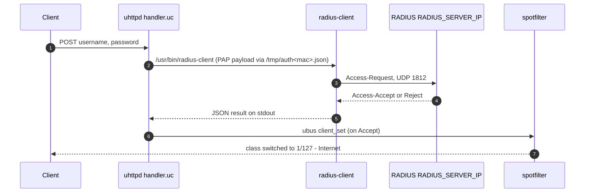

`radius.html` is the form used for `radius` mode (`credentials.html` is the separate, local-accounts page) — both post `username`/`password` plus a hidden `action` field (`radius` vs `credentials`) that `handler.uc`'s `handle_request()` dispatches on.

---
#### Information for the RADIUS administrator
---

The AP must be declared as a RADIUS client (NAS) on the server:
 
| Item | Value |
|---|---|
| NAS IP (source of RADIUS packets) | IP (AP WAN address) |
| Shared secret | Agreed with the RADIUS team; letters and digits only, ≥ 16 characters |
| Port | UDP 1812 (authentication). No accounting |
| NAS-Identifier | `AP-240B2A000002` |
| Authentication method | **PAP** (User-Password) must be allowed. On Windows NPS: enable *Unencrypted authentication (PAP, SPAP)* in the network policy |
| Attributes sent by the AP | User-Name, User-Password, NAS-Identifier, NAS-IP-Address, Called-Station-Id, Calling-Station-Id (client MAC), Framed-IP-Address, NAS-Port-Type = 19 |
| Optional reply attributes | `Session-Timeout`, `Idle-Timeout`, `WISPr-Bandwidth-Max-Down/Up` (bit/s), `Reply-Message` |
| Test account | Requested from the RADIUS team |

---
#### radcli dictionary (mandatory)
---

`radius-client` reads `/etc/radcli/dictionary` on every request. The OpenWrt `libradcli` package does not ship it. Without it every login fails with `invalid credentials` (see 10.8).
 
**Step 1 — standard dictionary.** The files are plain text and architecture-independent; copy them from any Linux host with radcli installed (e.g. Ubuntu `libradcli4`):
 
```bash
# on the Ubuntu PC
sudo apt install libradcli4
ssh root@<AP> 'mkdir -p /etc/radcli'
scp -O /etc/radcli/dictionary* root@<AP>:/etc/radcli/
```
 
On the AP, every file named in an `$INCLUDE` line must exist:
 
```bash
grep '^\$INCLUDE' /etc/radcli/dictionary
ls /etc/radcli/
```
 
**Step 2 — hotspot vendor dictionary.** The radcli set has no WISPr (14122) or ChilliSpot (14559) attributes, which uspot uses. Without them `radius-client` fails with `Failed to lookup attribute key N`.
 
```bash
cat > /etc/radcli/dictionary.hotspot <<'EOF'
# WISPr vendor-specific attributes
VENDOR          WISPr           14122
ATTRIBUTE       WISPr-Location-ID                       1       string  WISPr
ATTRIBUTE       WISPr-Location-Name                     2       string  WISPr
ATTRIBUTE       WISPr-Logoff-URL                        3       string  WISPr
ATTRIBUTE       WISPr-Redirection-URL                   4       string  WISPr
ATTRIBUTE       WISPr-Bandwidth-Min-Up                  5       integer WISPr
ATTRIBUTE       WISPr-Bandwidth-Min-Down                6       integer WISPr
ATTRIBUTE       WISPr-Bandwidth-Max-Up                  7       integer WISPr
ATTRIBUTE       WISPr-Bandwidth-Max-Down                8       integer WISPr
ATTRIBUTE       WISPr-Session-Terminate-Time            9       string  WISPr
ATTRIBUTE       WISPr-Billing-Class-Of-Service          11      string  WISPr
 
# ChilliSpot vendor-specific attributes
VENDOR          ChilliSpot      14559
ATTRIBUTE       ChilliSpot-Max-Input-Octets             1       integer ChilliSpot
ATTRIBUTE       ChilliSpot-Max-Output-Octets            2       integer ChilliSpot
ATTRIBUTE       ChilliSpot-Max-Total-Octets             3       integer ChilliSpot
ATTRIBUTE       ChilliSpot-Bandwidth-Max-Up             4       integer ChilliSpot
ATTRIBUTE       ChilliSpot-Bandwidth-Max-Down           5       integer ChilliSpot
ATTRIBUTE       ChilliSpot-Config                       6       string  ChilliSpot
ATTRIBUTE       ChilliSpot-Lang                         7       string  ChilliSpot
ATTRIBUTE       ChilliSpot-Version                      8       string  ChilliSpot
ATTRIBUTE       ChilliSpot-OriginalURL                  9       string  ChilliSpot
EOF
 
grep -q dictionary.hotspot /etc/radcli/dictionary || \
  echo '$INCLUDE /etc/radcli/dictionary.hotspot' >> /etc/radcli/dictionary
grep -c "$(printf '\t')" /etc/radcli/dictionary.hotspot     # must be 0
```
 
radcli dictionary rules learnt in the lab:
 
| Rule | Consequence if broken |
|---|---|
| Vendor attributes use the format `ATTRIBUTE <name> <id> <type> <vendor>` after a `VENDOR <name> <id>` line; `BEGIN-VENDOR` / `END-VENDOR` blocks are not used | `invalid Vendor-Id` |
| Separate fields with **spaces**. Pasting tab characters into the BusyBox shell triggers tab completion and corrupts the line | `invalid Vendor-Id on line N` |
| Attribute names must be **shorter than about 32 characters** (`WISPr-Session-Terminate-End-Of-Day`, 34 characters, is rejected and therefore omitted above) | `invalid name length on line N` |
| Every `$INCLUDE` target must exist | `couldn't open dictionary` |
 
`radius-client` reads the dictionary on each login, so no restart is needed after editing it.

---
#### uspot Configuration
---

```bash
uci set uspot.captive.auth_mode='radius'
uci set uspot.captive.auth_server='RADIUS_SERVER_IP'
uci set uspot.captive.auth_port='1812'
uci set uspot.captive.auth_secret='<SHARED_SECRET>'
uci set uspot.captive.acct_server='RADIUS_SERVER_IP'
uci set uspot.captive.acct_port='1813'
uci set uspot.captive.acct_secret='<SHARED_SECRET>'
uci set uspot.captive.acct_interval='300'
uci set uspot.captive.nasid='AP-240B2A000002'
uci set uspot.captive.nasmac='24-0B-2A-00-00-02'
uci set uspot.captive.mac_format='AA-BB-CC-DD-EE-FF'
uci -q delete uspot.user1          # local accounts are not used in radius mode
uci -q delete uspot.user2
uci commit uspot
```

Resulting section:
 
```
config uspot 'captive'
	option auth_mode 'radius'
	list ifname 'wlan5'
	option interface 'captive'
	option configure_spotfilter '1'
	option idle_timeout '900'
	option session_timeout '3600'
	option auth_server 'RADIUS_SERVER_IP'
	option auth_port '1812'
	option auth_secret '<SHARED_SECRET>'
	option nasid 'AP-240B2A000002'
	option nasmac '24-0B-2A-00-00-02'
	option mac_format 'AA-BB-CC-DD-EE-FF'
	option debug '0'
```
 
| Option | Note |
|---|---|
| `auth_server`, `auth_secret` | Required in `radius` and `uam` modes |
| `nasid`, `nasmac` | **Required** in `radius` and `uam` modes; the RADIUS payload builder (`portal.radius_init`) uses them for `NAS-Identifier` and `Called-Station-Id`, but nothing in this codebase actually refuses to start without them — an empty `nasid`/`nasmac` just means the server sees an empty attribute |
| `acct_server`, `acct_secret` | Not set: accounting disabled (`uspot.uc` only calls RADIUS Start/Interim/Stop when both are present) |
| **`nas_ip` is not a real option** | `NAS-IP-Address` is always hard-coded to `ctx.env.SERVER_ADDR` — i.e. the AP's *captive-interface* address (`10.0.0.1` in this example), never the WAN address. There is no config knob to change that. If your RADIUS server's NAS definition expects the WAN/management IP instead, you must either declare the NAS by `10.0.0.1` (which may not be routable/unique to the server) or proxy/rewrite upstream — flag this with the RADIUS team before relying on NAS-IP-Address for client identification |
 
No firewall change is needed: RADIUS traffic is generated by the AP itself (zone output ACCEPT) and replies return through conntrack. Check the route first:
 
```bash
ping -c 3 RADIUS_SERVER_IP
ip route get RADIUS_SERVER_IP           # dev eth0.35 src AP_WAN_IP
```

---
#### Switching mode and Testing
---

Sessions from the previous mode (for example a phone logged in with a local account) stay valid until they expire. Clear them when switching mode — restarting `spotfilter` re-adds the interface from scratch, which drops its whole client table for that instance:
 
```bash
/etc/init.d/uspot stop
/etc/init.d/spotfilter restart
/etc/init.d/uspot start
ubus call spotfilter client_list '{"interface":"captive"}'   # {}
```
 
Then on the phone: *Forget this network* and rejoin `Free-WiFi`. Test with two SSH sessions:
 
```bash
tcpdump -ni eth0.35 udp port 1812                       # Access-Request / Access-Accept
logread -f | grep -E "uspot|radcli"                      # "allow client to pass traffic"
```

```bash
root@OpenWrt:~# ubus -v list uspot
'uspot' @07b303b3
        "client_add":{"interface":"String","address":"String","state":"Table"}
        "client_remove":{"interface":"String","address":"String"}
        "interface_list":{}
root@OpenWrt:~# ubus -v list spotfilter
'spotfilter' @0234bd26
        "check_devices":{}
        "client_set":{"interface":"String","address":"String","id":"String","state":"Integer","dns_state":"Integer","accounting":"Array","data":"Table","flush":"Boolean"}
        "client_remove":{"interface":"String","address":"String"}
        "client_get":{"interface":"String","address":"String"}
        "client_list":{"interface":"String"}
        "interface_add":{"name":"String","config":"Table","devices":"Array"}
        "interface_remove":{"name":"String"}
        "whitelist_add":{"interface":"String","address":"Array","state":"Integer"}
        "whitelist_remove":{"interface":"String","address":"Array"}
```

There is no `client_auth`, `das_coa`/`das_disconnect`, or `state_get`/`state_set` method anywhere in this codebase, and `uspot` never calls a `peer_lookup` method either — those were from an unrelated/older design and don't apply here. Expected result for this test: `Access-Request` to RADIUS_SERVER_IP, `Access-Accept` back, `allow client to pass traffic` in the log, phone MAC listed with `"state":1` in `ubus call spotfilter client_list '{"interface":"captive"}'`, Internet working.

---
### External portal (UAM)
---

```
config uspot 'captive'
	option auth_mode 'uam'
	list ifname 'wlan5'
	option interface 'captive'
	option configure_spotfilter '1'
	option auth_server 'EXTERNAL_SERVER_IP'
	option auth_secret 'RadiusSecret123'
	option acct_server 'EXTERNAL_SERVER_IP'
	option acct_secret 'RadiusSecret123'
	option nasid 'AP-240B2A000002'
	option nasmac '24-0B-2A-00-00-02'
	option uam_server 'http://EXTERNAL_SERVER_IP/hotspot/login.php'
	option uam_secret 'UamSecret456'
	option uam_port '3990'
```

Also needed: a second uhttpd listener on `10.0.0.1:3990` for `/login`, `/logon`, `/logout` and `/logoff` (handler `handler-uam.uc`), the `captive_in` firewall rule from the README already covers TCP 3990, and the portal host or IP must be reachable before login. `handler-uam.uc`'s `auth_client()` falls back to `error.uc` on a RADIUS reject unless `final_redirect_url` is set to `uam`, in which case it 302s back to the external portal with `res=reject`.

| Option | Purpose | Confirmed in source? |
|---|---|---|
| `auth_port`, `acct_port` | RADIUS ports, default 1812 / 1813 | Yes (`portal.uc`/`uspot.uc` defaults) |
| `acct_interval` | Interim accounting interval; NAS-local value always overrides a `Acct-Interim-Interval` reply attribute | Yes (`uspot.uc client_add()`) |
| `mac_auth`, `mac_passwd`, `mac_suffix`, `mac_format` | MAC authentication (tries MAC as username before showing the portal) | Yes — but the shipped **config comment says `mac_password`** while the code in `handler.uc` actually reads `ctx.config.mac_passwd`; use `mac_passwd` or MAC-auth silently falls back to the MAC address as the password |
| `location_name` | Sent as the WISPr `WISPr-Location-Name` RADIUS attribute | Yes |
| `final_redirect_url` | `'uam'` redirects back to the external portal with `res=success`/`res=reject` instead of showing the local error/allow page | Yes |
| `challenge` | Shared CHAP challenge seed used by `uam.chap_challenge()`/`uam.md5()` | Yes |
 
There is **no** `auth_server2`/`auth_secret2`/`auth_port2` backup-server pair, no `rad_serv_type` (RadSec), no `das_secret`/`uspot-das`, no `ratelimit_def`, `counters`, `disconnect_delay`, `nas_ip`, or `swapio` option anywhere in `uspot`'s config parsing or source — these do not exist in this codebase and should not be configured expecting an effect. Per-user bandwidth does work, but only via the RADIUS reply attributes `WISPr-Bandwidth-Max-Down/Up` (bit/s) or `ChilliSpot-Bandwidth-Max-Up/Down` (kbit/s), applied by `uspot.uc`'s `client_ratelimit()` through the separate `ratelimit` ubus object.

---
### Troubleshooting
---

Issues met during the lab deployment, in the order they appeared.
 
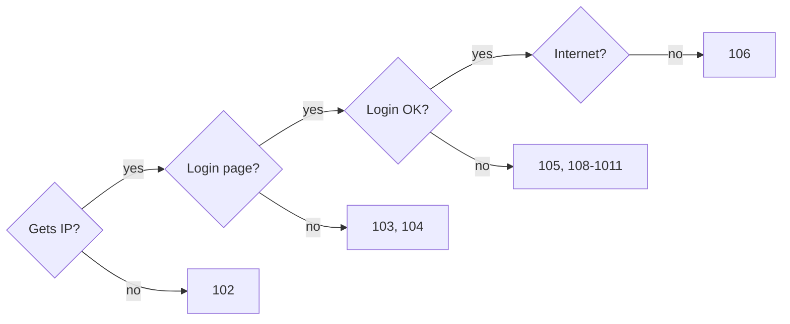
 
Follow the checks left to right; the first "no" points to the section to read.

---
#### 101 uspot daemon exits immediately: `uspot: failed to load config`
---

`uspot.uc` builds its `interfaces{}` table from `uci.foreach('uspot', 'uspot', ...)`; if that returns false (e.g. `/etc/config/uspot` is missing or has no `uspot` sections at all) it logs this exact message and `exit(1)` — procd then respawns it in a crash loop. A section that merely lacks `list ifname` does **not** crash the daemon: `portal.uc` logs `uspot: missing ifname in section "<name>"` and simply skips that one instance, so clients bound to it will fail MAC lookup instead (see 106).

---
#### 102 `dnsmasq-dhcp: no address range available for DHCP request via br-captive`
---

- `ip addr show br-captive` must show `10.0.0.1/22` (else `/etc/init.d/network reload`).
- `uci show dhcp.captive` must exist with `interface 'captive'`.
- Restart dnsmasq after adding the section: `/etc/init.d/dnsmasq restart`.
- Check `dhcp.@dnsmasq[0].interface` / `notinterface` do not exclude `captive`.

---
#### 103 Portal not reachable
---

- `netstat -ltn | grep 10.0.0.1:80` — listener present.
- `uhttpd.main` must not listen on `0.0.0.0:80`.
- Firewall redirect `captive_cpd` and rule `captive_in` present.

---
#### 104 Portal page loads but is blank (`200 OK`, empty body)
---

`serve.uc` reads every page from the hard-coded path `/tmp/ucentral/www-uspot/<file>` (see the "Portal pages" note above), **not** from `/www-uspot/` where the package actually installs its files. `fs.readfile()` on a missing file just returns nothing, so uhttpd happily serves `200 OK` with zero bytes — there is no 404 or 500 to alert you. Check which path is actually populated on the target image:

```bash
ls /tmp/ucentral/www-uspot/ /www-uspot/
```

If `/tmp/ucentral/www-uspot/` is empty or missing (typically on a plain OpenWrt/fw4 image rather than a uCentral/OpenWiFi one), symlink or bind-mount it to `/www-uspot/` before starting `uhttpd`.

---
#### 105 `invalid credentials` with correct password
---

- Each `credentials` section needs **`option interface '<uspot section name>'`** — `handler.uc`'s `request_credentials()` compares `cred.interface` against the uspot/spotfilter instance name (`ctx.spotfilter`), derived from the client's associated `ifname`. There is no `option uspot` field.
- Restart with `/usr/bin/captive restart` after editing accounts (a plain `uspot` restart is enough here since credential matching is read fresh from UCI on every request, but restarting everything avoids chasing a stale `spotfilter`/`ifname` mapping).
- Username and password are case-sensitive; iOS may capitalise the first letter in the Captive Wi-Fi sheet.
- Enable `option debug '1'` and watch `logread | grep uspot` for the `invalid credentials` line that `portal.debug()` logs.

---
#### 106 Every page shows the generic error page / log shows `spotfilter error`
---

Symptoms:
 
- Every request to `/hotspot` (or `/cpd`) renders the generic "An Error occured" page, regardless of auth_mode.
- `logread -e uspot` shows `uspot: <client-ip> - spotfilter error`.
- `ubus list` shows `uspot` but not `spotfilter`.

Cause: **`portal.handle_request()` calls `ubus call spotfilter client_get` on every single request** (to check whether the client is already authenticated) and bails out to `error.uc` the instant that call fails — which it will if the `spotfilter` service is not running, or if the client's uspot instance was never registered with it (`ubus call spotfilter interface_add`, normally triggered by `/etc/init.d/spotfilter`'s `reload_service()` at start).
 
Fix:
 
```bash
/etc/init.d/spotfilter enable
/etc/init.d/spotfilter start
/etc/init.d/uspot restart
ubus list | grep -E "^uspot$|^spotfilter$"     # both present
ubus call spotfilter client_list '{"interface":"captive"}'   # must not error
```
 
If `spotfilter` is running but the interface was never added (e.g. `configure_spotfilter` was `0` and nobody fed it a config manually), `client_get`/`client_list` return `UBUS_STATUS_NOT_FOUND` for that interface name — re-check `option configure_spotfilter '1'` and `option interface` in `/etc/config/uspot`, then restart `spotfilter`.

--- 
#### 107 Vendor firewall messages
---

`[firewall] section name not matched` and `No WAN default route found, skipping WAN zone sync` come from the vendor firewall scripts during network reloads. They are harmless if `ip route | grep default` still shows the WAN gateway.

---
#### 108 RADIUS: `couldn't open dictionary /etc/radcli/dictionary`
---

```bash
uspot-radius: radcli: rc_read_dictionary couldn't open dictionary /etc/radcli/dictionary: No such file or directory
uspot-radius: Failed to read dictionary!
uspot: ... - invalid credentials
```
 
No RADIUS packet is sent; uspot reports every login as invalid. Install the radcli dictionary files.

--- 
#### 109 RADIUS: `Failed to lookup attribute key N`
---

```
uspot-radius: Failed to lookup attribute key 23
uspot: ... - invalid credentials
```
 
The dictionary loads but lacks an attribute that `radius-client` uses — in the lab, the WISPr / ChilliSpot vendor attributes. Add `dictionary.hotspot`. To list the attribute names the binary expects:
 
```bash
grep -ao '[A-Z][A-Za-z]*-[A-Za-z-]*' /usr/bin/radius-client | sort -u
```
---
#### 1010 RADIUS: dictionary syntax errors
---

| Log | Cause | Fix |
|---|---|---|
| `invalid Vendor-Id on line N of dictionary ...` | Tab characters mangled by the shell during paste, or `BEGIN-VENDOR` syntax | Rewrite the file with spaces only, vendor name as last column; check with `grep -c "$(printf '\t')" file` and `head -2 file \| hexdump -C` |
| `invalid name length on line N` | Attribute name too long (≈ 32 characters) | Remove or shorten that attribute |

--- 
#### 1011 RADIUS: no reply or Access-Reject
---

Watch `tcpdump -ni eth0.35 udp port 1812` during a login:
 
| tcpdump | Cause |
|---|---|
| No packet at all | Dictionary problem (108–1010) or uspot not restarted after configuration change |
| Access-Request, no reply | AP not declared as NAS `AP_WAN_IP`, wrong shared secret (servers drop silently), or UDP 1812 blocked on the server side |
| Access-Reject | Wrong account, or PAP not allowed by the server policy; ask the RADIUS team for the server log |

--- 
#### 1012 Phone gets Internet without logging in after a mode change
---

The previous session (e.g. from `credentials` mode) is still valid in `spotfilter`'s client table. Restart `spotfilter` (see "Switching mode and Testing" above) and rejoin the SSID.
 
---

### References

---

- [RFC 8910 — Captive-Portal Identification in DHCP and Router Advertisements](https://www.rfc-editor.org/rfc/rfc8910.html) (Standards Track, Sept 2020)
- [RFC 8908 — Captive Portal API](https://www.rfc-editor.org/rfc/rfc8908.html) (Standards Track, Sept 2020)
- [RFC 8952 — Captive Portal Architecture](https://www.rfc-editor.org/rfc/rfc8952.html) (Informational, Nov 2020)
- [Android 11: Captive portal API support](https://developer.android.com/about/versions/11/features/captive-portal)
- [Apple Developer: How to modernize your captive network](https://developer.apple.com/news/?id=q78sq5rv) (iOS 14 / macOS Big Sur)
- [Apple Developer Forums: captive network documentation scope](https://origin-devforums.apple.com/forums/thread/834869)
- [Apple: Prepare your network or web server for iCloud Private Relay](https://developer.apple.com/support/prepare-your-network-for-icloud-private-relay/)
- [Microsoft Learn: NCSI frequently asked questions](https://learn.microsoft.com/en-us/windows-server/networking/ncsi/ncsi-frequently-asked-questions)
- [Microsoft Learn: Troubleshoot NCSI](https://learn.microsoft.com/en-us/troubleshoot/windows-server/networking/troubleshoot-ncsi-guidance)
- [NetworkManager.conf reference — connectivity section](https://networkmanager.dev/docs/api/latest/NetworkManager.conf.html)
- [Mozilla Support: Firefox captive portal detection](https://support.mozilla.org/kb/captive-portal)
- [OpenWrt 22.03.0 release announcement (firewall4)](https://desiato.infradead.org/pipermail/openwrt-devel/2022-September/039343.html)
- [openNDS FAQ (v10 nftables migration)](https://github.com/openNDS/openNDS/blob/stable/docs/source/faq.rst)
- [openNDS: Forwarding Authentication Service](https://opennds.readthedocs.io/en/stable/fas.html)
