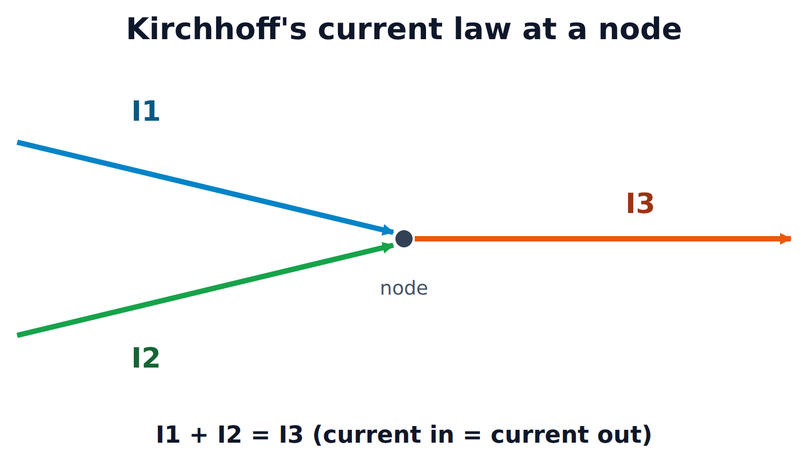
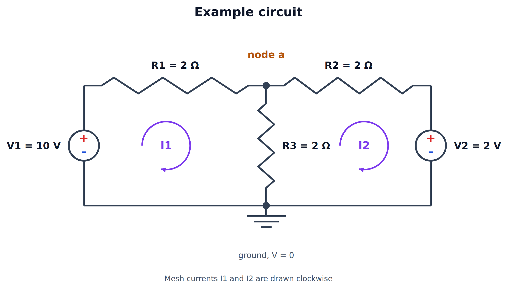

### What is circuit theory?

---

Circuit theory is the analysis of electrical circuits. You apply a few basic rules (Ohm’s law and Kirchhoff’s laws) to a network of components so you can work out the **current** through every branch and the **voltage** at every point.

The approach relies on the *lumped element* model. Each component is treated as an ideal element sitting at a single point, and the wires between components are assumed to have no resistance. This holds as long as the circuit is small compared with the wavelength of the signals in it. For example, at 50 Hz the wavelength is 6000 km, but at 2.4 GHz (Wi-Fi) it is only 12.5 cm, so for RF work you need transmission-line theory instead.

---

### To do this

---

- **Basic rules:** Ohm’s law, Kirchhoff’s current law (KCL), Kirchhoff’s voltage law (KVL)
- **Techniques:** mesh analysis, node analysis
- **Shortcuts:** series and parallel reduction, voltage and current dividers, superposition, Thévenin and Norton equivalents

---

### Reading List

---

- Electronics: Circuits, Amplifiers and Gates, D V Bugg, Taylor and Francis
- Basic Electronics for Scientists and Engineers, D L Eggleston, CUP
- Electromagnetism Principles and Applications, Lorrain and Corson, Freeman
- Elementary Linear Circuit Analysis, L S Bobrow, HRW
- The Art of Electronics, Horowitz and Hill, CUP

---

### Basic quantities

---

| Quantity | Symbol | Unit | Meaning |
|---|---|---|---|
| Charge | $Q$ | coulomb (C) | $1\,\text{C} \approx 6.24 \times 10^{18}$ electrons |
| Current | $I$ | ampere (A) | Rate of flow of charge, $I = \dfrac{dQ}{dt}$ |
| Voltage | $V$ | volt (V) | Energy per unit charge between two points, $V = \dfrac{dW}{dQ}$ |
| Resistance | $R$ | ohm (Ω) | Opposition to current |
| Power | $P$ | watt (W) | Rate of energy transfer, $P = VI$ |

Voltage is always measured **between two points**. When we talk about "the voltage at a node", we mean the voltage between that node and a chosen reference point (ground).

---

### Ohm’s law

---

The voltage across a resistor is proportional to the current through it:

$$
V = IR
$$

where $R$ is the resistance in ohms (Ω). Combining this with $P = VI$, the power dissipated in a resistor is:

$$
P = VI = I^2 R = \frac{V^2}{R}
$$

Sometimes it is easier to work with **conductance**, $G = 1/R$, measured in siemens (S). Then $I = GV$.

---

### Other Circuit Symbols

---

#### Passive Devices

---

Passive devices cannot add energy to a circuit. They can only dissipate it or store it.

| Device | Symbol | V–I relation | Energy |
|---|---|---|---|
| Resistor | $R$ | $V = IR$ | Dissipated as heat |
| Capacitor | $C$ | $I = C\,\dfrac{dV}{dt}$ | Stored in the electric field, $\tfrac{1}{2}CV^2$ |
| Inductor | $L$ | $V = L\,\dfrac{dI}{dt}$ | Stored in the magnetic field, $\tfrac{1}{2}LI^2$ |

In DC steady state, a capacitor behaves like an **open circuit** (no current flows) and an inductor behaves like a **short circuit** (no voltage across it).

---

#### Sources of Electrical Power

---

- **Ideal voltage source:** keeps a fixed voltage across its terminals, whatever current is drawn. A real source (such as a battery) behaves like an ideal source in series with a small internal resistance.
- **Ideal current source:** pushes a fixed current through its branch, whatever voltage that takes. A real source behaves like an ideal source in parallel with a large resistance.
- **Dependent (controlled) sources:** the output voltage or current is set by a voltage or current somewhere else in the circuit. These are used to model transistors and op-amps.

---

#### Ground: the Reference Potential

---

Ground is the node we define as **V ≡ 0 volts**. Every other node voltage is measured relative to it. You can choose any node as ground. The usual choice is the node with the most connections, because it makes the equations simplest.

---

### Passive Sign Convention

---

To keep signs consistent, label each element so that the **current arrow enters the + terminal** of the voltage. With this convention:

$$
P = VI
\qquad
\begin{cases}
P > 0 & \text{the element is absorbing power (load)} \\
P < 0 & \text{the element is delivering power (source)}
\end{cases}
$$

A resistor always gives $P > 0$. A battery that is discharging has current leaving its + terminal, so under this convention $P < 0$: it is delivering power. A battery that is being charged has $P > 0$.

Conservation of energy gives a useful check on any solved circuit: **the powers of all elements add up to zero.** Put another way, the power delivered by the sources equals the power absorbed by everything else.

---

### Kirchhoff’s Laws

---

First, some terms:

- **Node:** a point where two or more elements are joined.
- **Branch:** a single element (or path) between two nodes.
- **Loop:** any closed path through the circuit.
- **Mesh:** a loop that has no other loop inside it.

---

#### Kirchhoff’s Current Law (KCL)

---

The algebraic sum of the currents entering a node is zero. In other words, **current in = current out**:

$$
\sum_{k} I_k = 0
$$

KCL follows from **conservation of charge**: a node cannot store charge.

---

#### Kirchhoff’s Voltage Law (KVL)

---

The algebraic sum of the voltages around any closed loop is zero:

$$
\sum_{k} V_k = 0
$$

KVL follows from **conservation of energy**. Voltage is a potential, so if a charge goes around a loop and comes back to where it started, its net energy change is zero. Going around the loop, the voltage rises (across sources) equal the voltage drops (across loads).

---

### Series and Parallel

---

**Series:** the same current flows through every element, and the voltages add.

$$
R_{\text{eq}} = R_1 + R_2 + \dots + R_n
$$

**Parallel:** every element has the same voltage across it, and the currents add.

$$
\frac{1}{R_{\text{eq}}} = \frac{1}{R_1} + \frac{1}{R_2} + \dots + \frac{1}{R_n}
\qquad\text{for two resistors: }\;
R_1 \parallel R_2 = \frac{R_1 R_2}{R_1 + R_2}
$$

---

#### Voltage Divider

---

Two resistors in series across a voltage $V_{\text{in}}$:

$$
V_{\text{out}} = V_{\text{in}} \, \frac{R_2}{R_1 + R_2}
$$

---

#### Current Divider

---

A current $I$ splitting between two parallel resistors:

$$
I_1 = I \, \frac{R_2}{R_1 + R_2}, \qquad I_2 = I \, \frac{R_1}{R_1 + R_2}
$$

The larger share of the current goes through the **smaller** resistor.

---

### Example Circuit

---

The rest of this post solves the same circuit with each technique, so you can compare them.

We want the current through every resistor.

---

### Mesh Analysis

---

Mesh analysis applies **KVL** around each mesh, with the **mesh currents** as the unknowns.

1. Assign a current to each mesh, usually all clockwise.
2. Write KVL around each mesh. Where two meshes share an element, the current through it is the difference of the two mesh currents.
3. Solve the simultaneous equations. A circuit with $n$ meshes gives $n$ equations.

For the example, take $I_1$ clockwise in the left mesh and $I_2$ clockwise in the right mesh. $R_3$ carries $I_1 - I_2$ (downward).

**Mesh 1:** going clockwise, $V_1$ is a rise of 10 V.

$$
10 = 2I_1 + 2(I_1 - I_2) \;\;\Rightarrow\;\; 4I_1 - 2I_2 = 10
$$

**Mesh 2:** going clockwise, the path passes down through $V_2$ from + to −, so $V_2$ is a 2 V drop.

$$
0 = 2(I_2 - I_1) + 2I_2 + 2 \;\;\Rightarrow\;\; -2I_1 + 4I_2 = -2
$$

In matrix form:

$$
\begin{bmatrix} 4 & -2 \\ -2 & 4 \end{bmatrix}
\begin{bmatrix} I_1 \\ I_2 \end{bmatrix}
=
\begin{bmatrix} 10 \\ -2 \end{bmatrix}
\;\;\Rightarrow\;\;
I_1 = 3\,\text{A}, \quad I_2 = 1\,\text{A}
$$

So:

- $R_1$ carries **3 A**
- $R_2$ carries **1 A**, flowing from $a$ toward $V_2$
- $R_3$ carries $I_1 - I_2 =$ **2 A**, flowing downward

The resistance matrix is symmetric. Each diagonal entry is the total resistance around that mesh, and each off-diagonal entry is minus the resistance shared by the two meshes. Once you see this pattern, you can write the matrix straight from the diagram.

---

### Node Analysis

---

Node analysis applies **KCL** at each node, with the **node voltages** as the unknowns.

1. Choose a ground node.
2. Label the voltage of every other node.
3. Write KCL at each unknown node, using Ohm’s law to express each current in terms of node voltages.
4. Solve. A circuit with $n$ nodes gives $n - 1$ equations.

The example has only one unknown node, $a$. Taking all currents as **leaving** the node:

$$
\frac{V_a - 10}{2} + \frac{V_a}{2} + \frac{V_a - 2}{2} = 0
\;\;\Rightarrow\;\; 3V_a = 12
\;\;\Rightarrow\;\; V_a = 4\,\text{V}
$$

Then:

$$
I_{R1} = \frac{10 - 4}{2} = 3\,\text{A}, \quad
I_{R3} = \frac{4}{2} = 2\,\text{A}, \quad
I_{R2} = \frac{4 - 2}{2} = 1\,\text{A}
$$

These match the mesh results, and here we needed only **one** equation instead of two.

**Which method should you use?** Count the equations. Mesh analysis needs one per mesh, and node analysis needs one per node minus one. Pick whichever gives fewer. Node analysis is also the method SPICE simulators use, because it works for any circuit, including non-planar ones.

---

### Power Check

---

Using the passive sign convention:

| Element | $V$ | $I$ | Power |
|---|---|---|---|
| $V_1$ | 10 V | 3 A leaving + | −30 W (delivers) |
| $R_1$ | 6 V | 3 A | +18 W |
| $R_3$ | 4 V | 2 A | +8 W |
| $R_2$ | 2 V | 1 A | +2 W |
| $V_2$ | 2 V | 1 A entering + | +2 W (absorbs, i.e. being charged) |
| **Total** | | | **0 W** ✓ |

---

### Superposition

---

In a **linear** circuit, the response to several sources is the sum of the responses to each source acting alone. To turn off the other sources:

- replace each **voltage source** with a **short circuit**
- replace each **current source** with an **open circuit**

Applied to the example:

- **$V_1$ alone** ($V_2$ shorted): $R_2 \parallel R_3 = 1\,\Omega$, so $V_a' = 10 \cdot \dfrac{1}{2 + 1} = \dfrac{10}{3}\,\text{V}$
- **$V_2$ alone** ($V_1$ shorted): $R_1 \parallel R_3 = 1\,\Omega$, so $V_a'' = 2 \cdot \dfrac{1}{2 + 1} = \dfrac{2}{3}\,\text{V}$

$$
V_a = \frac{10}{3} + \frac{2}{3} = 4\,\text{V} \;\checkmark
$$

Superposition works for voltages and currents, but **not for power**, because power depends on $I^2$ and so is not linear.

---

### Thévenin and Norton Equivalents

---

Seen from any two terminals, any linear network can be replaced by:

- **Thévenin:** a voltage source $V_{\text{th}}$ in series with a resistance $R_{\text{th}}$
- **Norton:** a current source $I_{\text{N}}$ in parallel with the same resistance $R_{\text{th}}$

The two are related by $V_{\text{th}} = I_{\text{N}} R_{\text{th}}$.

To find the equivalent:

1. $V_{\text{th}}$ is the **open-circuit** voltage across the terminals.
2. $I_{\text{N}}$ is the **short-circuit** current between the terminals.
3. $R_{\text{th}}$ is the resistance seen at the terminals with all independent sources turned off. You can also use $R_{\text{th}} = V_{\text{th}} / I_{\text{N}}$.

**Example:** find the Thévenin equivalent that $R_3$ sees.

Remove $R_3$. With no other path for current, it flows round the outer loop: $I = (10 - 2)/(2 + 2) = 2\,\text{A}$, so

$$
V_{\text{th}} = 10 - 2 \cdot 2 = 6\,\text{V}, \qquad
R_{\text{th}} = R_1 \parallel R_2 = 1\,\Omega
$$

Reconnecting $R_3$:

$$
I_{R3} = \frac{V_{\text{th}}}{R_{\text{th}} + R_3} = \frac{6}{1 + 2} = 2\,\text{A} \;\checkmark
$$

Thévenin equivalents are useful when you want to try several different loads on the same network, because you only need to solve the network once.

---

#### Maximum Power Transfer

---

A load $R_L$ receives the most power when it matches the source resistance, $R_L = R_{\text{th}}$:

$$
P_{\max} = \frac{V_{\text{th}}^2}{4R_{\text{th}}}
$$

At this point the efficiency is only 50%, because the same amount of power is dissipated inside the source. RF systems use matching (for example, 50 Ω antennas and feed lines) to get the most signal through. Power distribution does the opposite and keeps the source resistance much smaller than the load, so that little energy is wasted.

---

### Summary

---

| Tool | Based on | Unknowns | Best when |
|---|---|---|---|
| Ohm’s law | $V = IR$ | — | Always |
| KCL | Conservation of charge | — | Always |
| KVL | Conservation of energy | — | Always |
| Mesh analysis | KVL | Mesh currents | Few meshes, mostly voltage sources |
| Node analysis | KCL | Node voltages | Few nodes, mostly current sources |
| Superposition | Linearity | — | Several independent sources |
| Thévenin / Norton | Linearity | $V_{\text{th}}, R_{\text{th}}$ | Analysing one load or one port |
