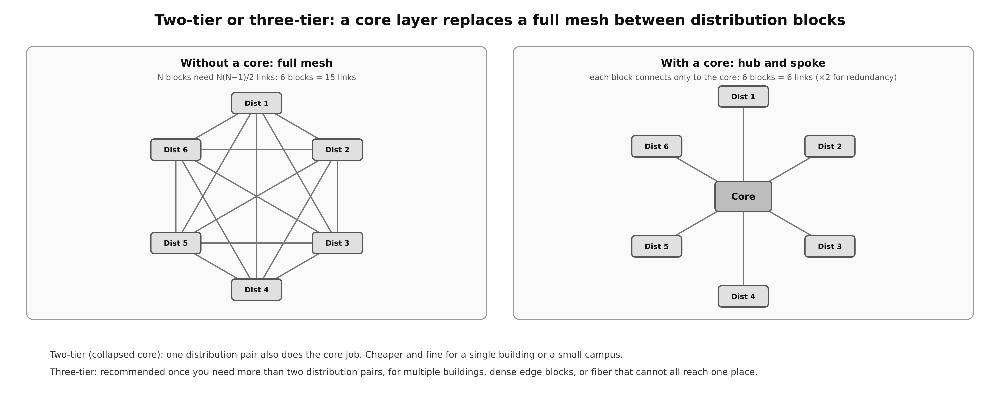
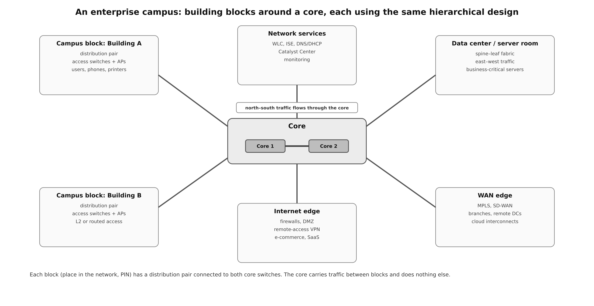
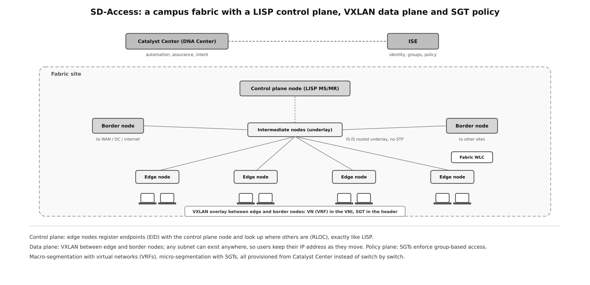

### Overview

---

A campus network has to carry traffic for thousands of users and devices, survive failed links and switches without anyone noticing, grow by whole buildings at a time, and still be simple enough that an engineer on call at 3 a.m. can understand it. None of that happens by connecting switches wherever there is a free port. It comes from architecture: a small number of repeatable patterns, each with a clear job.

This post covers the CCNP Enterprise view of campus architecture:

1. The **hierarchical LAN design model**: access, distribution and core layers.
2. **Two-tier and three-tier** designs, and the building blocks around the core.
3. Where the **Layer 2 / Layer 3 boundary** goes: Layer 2 access or routed access.
4. The **simplified campus** with switch clustering, stacking and EtherChannel.
5. **SD-Access**, the fabric-based design built on the overlays from the [overlay tunnels post](/blog/overlay_tunnels/).

It builds on several earlier posts: [Spanning Tree](/blog/spanning_tree_protocol/), [OSPF](/blog/ospf/), [first-hop redundancy](/blog/ip_services/), [QoS](/blog/qos/) and [enterprise wireless](/blog/wireless/).

---

### The Hierarchical LAN Design Model

---

The hierarchical model divides the network into **layers**, each with a specific set of functions. Because the same layer is built the same way everywhere, the design is **modular**:

- **Scalability**: a new building is just another block with the same design.
- **Fault containment**: a broadcast storm, a loop or a misconfiguration stays inside its block instead of taking down the campus.
- **Serviceability**: a block or a device can be added or taken out of service without affecting the rest of the network.
- **Predictability**: traffic paths, failure behavior and troubleshooting steps are the same in every block.

---

#### Access layer

---

The access layer, also called the **network edge**, is where users and endpoints connect: PCs, phones, printers, cameras, IoT devices and wireless access points. It provides high-bandwidth wired connectivity (Gigabit and multigigabit Ethernet, often with PoE for phones and APs) and is the attachment point for Wi-Fi.

Its jobs:

- **Segmentation**: VLANs put different kinds of devices into different logical networks for performance, management and security.
- **Security at the edge**: the access layer is where unauthorized users and devices are stopped. Typical features are 802.1X and MAB authentication, port security, DHCP snooping, dynamic ARP inspection, IP source guard, and BPDU guard.
- **QoS trust boundary**: traffic is classified and marked as close to the source as possible, so that QoS can be applied end to end (see [Trust Boundary](/blog/qos/#trust-boundary)).

In the hierarchical design, **access switches are not connected to each other**. Traffic between endpoints on different access switches always goes through the distribution layer.

---

#### Distribution layer

---

The distribution layer **aggregates** the access switches of a building or a part of the campus, and is the boundary between the access layer's Layer 2 domain and the routed core:

- **On the Layer 2 side**, it is the edge of the Spanning Tree domain, so a Layer 2 fault cannot propagate past it. It usually hosts the **default gateways** (SVIs) for the access VLANs, protected by a first-hop redundancy protocol.
- **On the Layer 3 side**, it is the natural place to **summarize routes** toward the core. Summarization keeps core routing tables small, hides instability inside a block, and speeds up convergence.
- It is also where **policy** is often applied: ACLs, QoS policies and route filtering.

Distribution switches are always deployed **in pairs**, and every access switch has an uplink to both. The two switches in a pair are interconnected with a Layer 2 or Layer 3 link. On a campus with several buildings, putting a distribution pair inside each building means each building needs only a few fibers back to the core instead of one per access switch, which matters because fiber between buildings is expensive.

---

#### Core layer

---

The core is the **backbone**: it connects the distribution blocks, and the other parts of the network (data center, WAN, internet edge, network services), to each other. Its only job is to move packets fast and never stop:

- **High-speed Layer 3 switching** with redundant, equal-cost paths.
- **High availability and fast convergence**: redundant devices and links, and routing protocols tuned to reconverge in well under a second.
- **No complexity**: no access policy, no endpoints, nothing that could slow down forwarding or make a failure harder to recover from.

---

### Two-Tier and Three-Tier Designs

---

How many layers a site needs depends on its size.

---

#### Two-tier: collapsed core

---

A smaller campus, for example one building with several floors, may not need a separate core. The core functions are **collapsed into the distribution layer**: one pair of core/distribution switches aggregates the access switches and also connects to the WAN edge, the data center or server room, the internet edge and network services. This saves a whole layer of devices while keeping most of the benefits of the hierarchy.

The decision should consider future growth. If the campus is likely to add buildings, or the number of edge devices is going to grow, it is easier to plan for a core from the start than to insert one later.

---

#### Three-tier

---

A separate core is recommended **once more than two distribution pairs are needed**. Typical reasons:

- A large campus of **multiple buildings**, each with its own distribution layer.
- The density of **WAN routers, internet edge devices, data center servers and network services** has grown enough to affect performance if they all hang off one collapsed core.
- **Geographic dispersion**: access switches spread over many buildings would need too much fiber back to a single collapsed core.

The core also removes a scaling problem. Without it, every distribution block must connect to every other block: $N$ blocks need $N(N-1)/2$ links in a full mesh, so 6 blocks need 15 links and 10 blocks need 45. With a core, each block connects only to the core: $N$ connections (doubled for redundancy). Adding a block means adding links to the core only, without touching any other block.

---

#### Building blocks: places in the network

---

A three-tier campus is organized as **building blocks**, also called **places in the network (PINs)**, each connected to the core with its own distribution pair:

| Block | Contents | Role |
|---|---|---|
| Campus / building | access and distribution switches, APs | user and endpoint connectivity |
| Network services | WLCs, ISE, DNS and DHCP, Catalyst Center, monitoring | shared services every user depends on |
| Data center / server room | servers, storage, often a spine–leaf fabric | business-critical applications |
| WAN edge | MPLS, SD-WAN, private lines | branches, remote data centers, dedicated cloud connections |
| Internet edge | firewalls, DMZ, VPN concentrators | internet access, e-commerce, remote access VPN, SaaS and public cloud |

---

The hierarchical design is optimized for **north–south** traffic: endpoints talking to the WAN, the internet, the data center and shared services. Inside a modern data center most traffic is **east–west**, server to server, and the hierarchy is replaced by a **spine–leaf** design, where every leaf switch connects to every spine switch and any two servers are always the same number of hops apart.

---

### Layer 2 Access vs Routed Access

---

The most important design decision inside a block is where the Layer 2 / Layer 3 boundary sits.

---

#### Layer 2 access (STP based)

---

The traditional design uses Layer 2 access switches with 802.1Q trunks to a Layer 3 distribution pair, which provides the IP gateway for every access VLAN.

- **Loop-free design**: each VLAN exists on only one access switch. The two uplinks from that switch go to different distribution switches, and the distribution switches are joined by a Layer 3 link, so there is no Layer 2 loop and STP never has to block anything. Restricting a VLAN to a single switch is the recommended practice.
- **Looped design**: some organizations need the same VLAN on several access switches, for an application or a service that expects one subnet. That creates a Layer 2 loop through the distribution pair. [Spanning Tree](/blog/spanning_tree_protocol/) blocks redundant links to break it, which wastes uplink bandwidth and makes convergence after a failure slower and more fragile.

Because there are two distribution switches, hosts need a **first-hop redundancy protocol** so that their default gateway survives the loss of either one (details in [IP Services](/blog/ip_services/)):

- **HSRP and VRRP** give hosts one virtual IP and MAC address per VLAN. Only the active router forwards, so for each VLAN only one of the two uplinks carries traffic toward the gateway, unless you manually alternate active routers per VLAN.
- **GLBP** hands out several virtual MAC addresses for the same gateway IP and spreads hosts across both distribution switches, so both uplinks are used. This only helps in a loop-free design: in a looped design, STP is already blocking one of the uplinks.
- Align the STP root bridge with the active gateway for each VLAN, so that traffic does not take an extra hop across the distribution interconnect.

---

#### Layer 3 access (routed access)

---

In a **routed access** design, Layer 3 is extended all the way to the access switches. The access switch hosts the SVIs and is the default gateway for its VLANs, and the uplinks to the distribution layer become Layer 3 point-to-point routed links instead of trunks. The Layer 2 / Layer 3 boundary moves from the distribution switch to the access switch.

Advantages over Layer 2 access:

- **No FHRP**: each VLAN has a single gateway, on its own access switch.
- **No STP between access and distribution**: routed links have nothing to block. STP still runs on the access ports as a safety net against loops users create.
- **Both uplinks used**: the routing protocol (OSPF or EIGRP) installs equal-cost paths over both, and load-shares across them.
- **Faster convergence**: a link failure is handled by the routing protocol, typically in well under a second with BFD or tuned timers, instead of by STP and FHRP timers.
- **Easier troubleshooting**: ping and traceroute work hop by hop all the way to the access switch.

The price is flexibility: a subnet (VLAN) **cannot span** access switches, because each one is routed separately. Each access switch also needs routing capability and its own IP plan, with the distribution layer summarizing each block toward the core. When VLANs really must span switches, the answer is the simplified campus design, or an overlay such as SD-Access.

---

### Simplified Campus Design

---

The simplified campus uses **switch clustering** and **stacking** so that several physical switches behave as **one logical switch**:

- **VSS (Virtual Switching System)** on Catalyst 4500/6500, succeeded by **StackWise Virtual** on Catalyst 9000, joins two distribution (or core) switches into one virtual switch with a single control plane and a single management address.
- **StackWise** stacking does the same for access switches: several switches in a closet become one logical switch with a single configuration.
- **Multichassis EtherChannel (MEC)** bundles the uplinks from an access stack to both members of the virtual distribution switch into a single logical link.

Benefits:

- **Simpler design and operations**: fewer logical boxes to configure, monitor and upgrade.
- **No FHRP**: the default gateway is a single logical interface on the virtual distribution switch.
- **Reduced STP dependence**: from STP's point of view each access stack has a single EtherChannel to a single switch, so there is no loop to block. Keep STP enabled anyway as a failsafe, in case two access switches are ever connected to each other.
- **All uplinks forwarding**: every member link of the EtherChannel carries traffic, which increases the bandwidth available to users.
- **Faster convergence**: losing a member link is handled inside the bundle, with sub-second failover and no topology change.
- **Easier troubleshooting**: logically, distribution to access is a simple hub-and-spoke tree.
- **VLANs can span access switches** without blocking any link.

The same approach can be applied to every block in the campus, giving a loop-free, highly available design with high aggregate uplink bandwidth. Other vendors offer the same idea under names such as MLAG and vPC (where the two switches keep separate control planes but present one EtherChannel to the access layer).

---

### Software-Defined Access (SD-Access)

---

**SD-Access** is Cisco's intent-based campus design, built on the Cisco Digital Network Architecture (DNA). It combines a **campus fabric** with a central controller, **Catalyst Center** (formerly DNA Center), and the identity engine **ISE**. Instead of configuring VLANs, ACLs and routing switch by switch, the administrator defines virtual networks, groups and policies centrally, and Catalyst Center provisions the fabric.

The fabric is an overlay on a routed underlay:

| Plane | Technology | What it does |
|---|---|---|
| Underlay | IS-IS routed network (no STP, no Layer 2 between switches) | reachability between fabric nodes' loopbacks |
| Control plane | **LISP** | the control plane node tracks which edge node each endpoint sits behind (EID to RLOC) |
| Data plane | **VXLAN** | traffic between edge and border nodes is tunneled; the VNI identifies the virtual network |
| Policy plane | **Cisco TrustSec, scalable group tags (SGTs)** | group-based access policy carried in the VXLAN header |

---

Fabric roles:

- **Edge nodes** (access switches) connect endpoints, authenticate them with 802.1X/MAB, register them with the control plane node and encapsulate their traffic. Every edge node acts as the default gateway for every fabric subnet (an anycast gateway), so a user keeps the same IP address wherever they connect.
- **Control plane node**: the LISP map server / map resolver for the fabric.
- **Border nodes** connect the fabric to everything outside it: the data center, WAN, internet and other fabric sites.
- **Intermediate nodes** are plain underlay routers.
- A **fabric-mode WLC** integrates wireless: APs tunnel client traffic in VXLAN to the edge node, so wired and wireless users get the same policy.

The result is **automated end-to-end segmentation** without redesigning the network: **macro-segmentation** with virtual networks (VRFs) that keep, for example, building systems and employees completely apart, and **micro-segmentation** with SGTs that control which groups may talk to each other inside a virtual network. On top of normal switching and routing, the fabric adds **host mobility** and **identity-based security**. The VXLAN and LISP mechanics are explained in the [overlay tunnels post](/blog/overlay_tunnels/).

---

### Choosing a Design

---

| Design | Best for | Strengths | Trade-offs |
|---|---|---|---|
| Two-tier (collapsed core) | one building, small campus | fewer devices, lower cost | limited growth; core and distribution roles share one pair |
| Three-tier | multi-building campus, many edge blocks | scales by blocks, fault isolation, fewer inter-building fibers | more devices and links |
| Layer 2 access, loop-free | VLANs that stay within one closet | simple, no blocked links | needs FHRP; VLANs cannot span switches |
| Layer 2 access, looped | VLANs that must span closets (legacy) | flexibility | STP blocks links, slower and riskier convergence; avoid where possible |
| Routed access | new designs with standard IP addressing | no STP/FHRP, ECMP, fast convergence, easy troubleshooting | subnets cannot span access switches |
| Simplified campus (VSS / StackWise Virtual, MEC) | most campuses wanting simplicity | loop-free, all links forwarding, VLANs can span | depends on the clustering technology; plan upgrades carefully |
| SD-Access | large campuses needing segmentation and mobility | automation, identity-based policy, mobility | controller, licensing and fabric skills required |

---

### Summary

---

- The **hierarchical model** splits the campus into **access** (endpoints, VLANs, edge security, QoS trust), **distribution** (aggregation, L2/L3 boundary, gateways, summarization, always in pairs) and **core** (fast, redundant, simple backbone between blocks).
- **Two-tier (collapsed core)** suits a small campus; **three-tier** is recommended once more than two distribution pairs are needed. A core turns an $N(N-1)/2$ full mesh into $N$ connections.
- The campus is built from **blocks (PINs)**: campus buildings, network services, data center, WAN edge and internet edge, all connected to the core. Data centers use **spine–leaf** for east–west traffic.
- **Layer 2 access** keeps the gateway at the distribution layer with an FHRP; keep each VLAN on one access switch to stay loop-free. **Routed access** moves the gateway to the access switch, removes STP and FHRP from the uplinks, uses both uplinks and converges faster, but subnets cannot span switches.
- The **simplified campus** uses **VSS / StackWise Virtual**, **StackWise** and **multichassis EtherChannel** to make the distribution layer one logical switch: no FHRP, no blocked links, VLANs can span, sub-second failover.
- **SD-Access** builds a fabric on a routed underlay with **LISP** (control plane), **VXLAN** (data plane) and **SGTs** (policy), managed from **Catalyst Center** with **ISE**, for automated segmentation and mobility.

---

### References

---

- CCNP Enterprise: Core Networking, Chapter 22: Enterprise Network Architecture (Cisco instructor materials)
- Cisco, *Campus LAN and Wireless LAN Design Guide* (Cisco Validated Design)
- Cisco, *Software-Defined Access Solution Design Guide* (Cisco Validated Design)
- B. Edgeworth, R. Garza Rios, D. Hucaby, J. Gooley, *CCNP and CCIE Enterprise Core ENCOR 350-401 Official Cert Guide*, Cisco Press
- On this blog: [Spanning Tree Protocol](/blog/spanning_tree_protocol/), [OSPF](/blog/ospf/), [IP Services](/blog/ip_services/), [QoS](/blog/qos/), [Overlay Tunnels](/blog/overlay_tunnels/), [Enterprise Wireless](/blog/wireless/)
