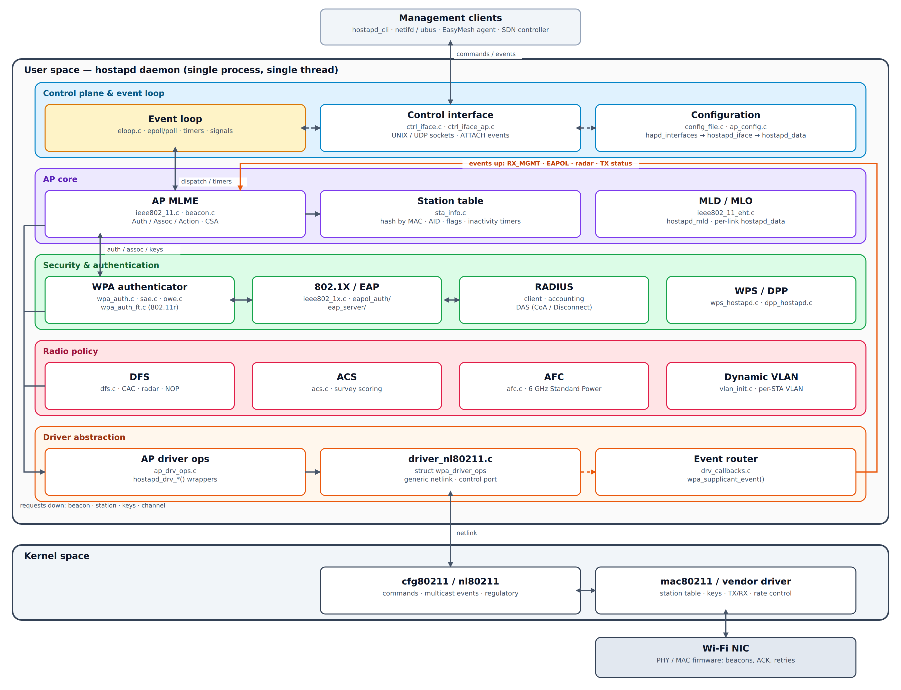
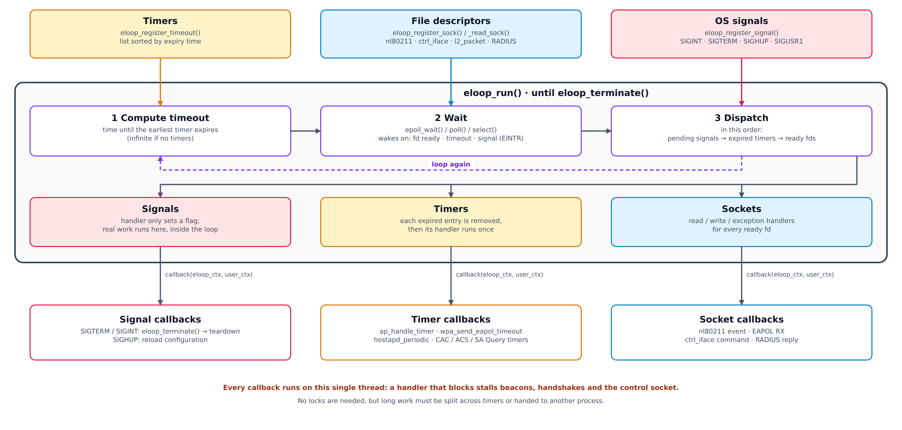
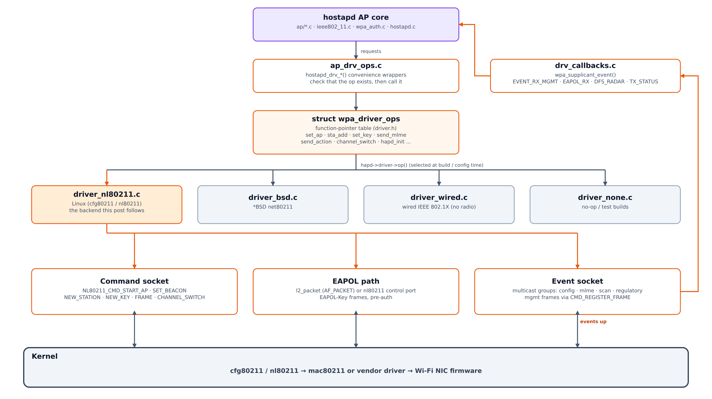
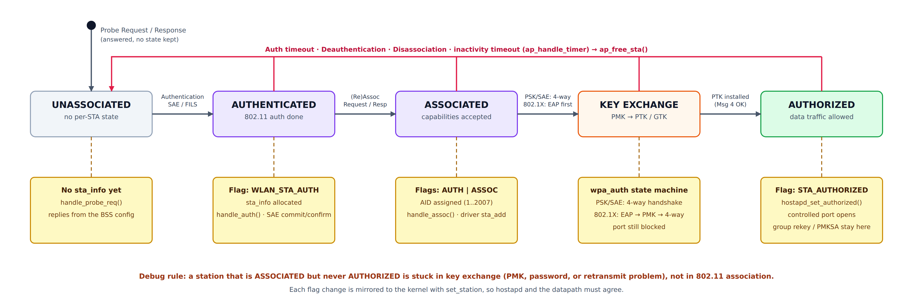
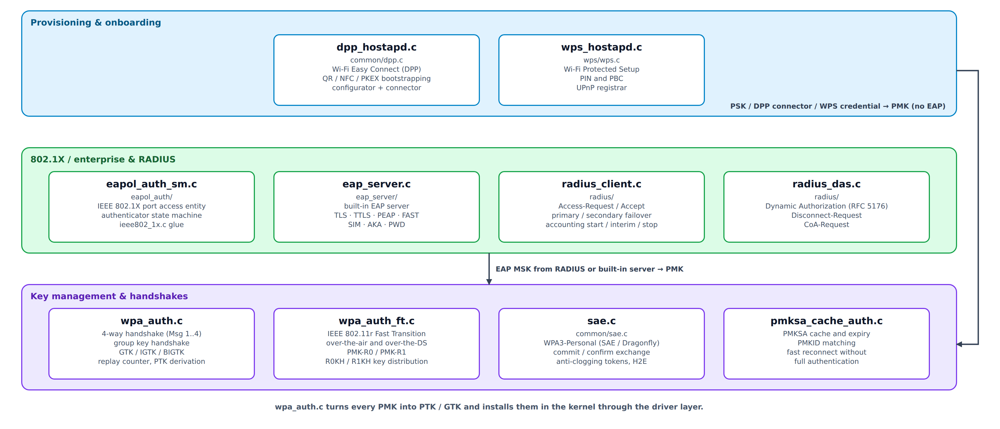
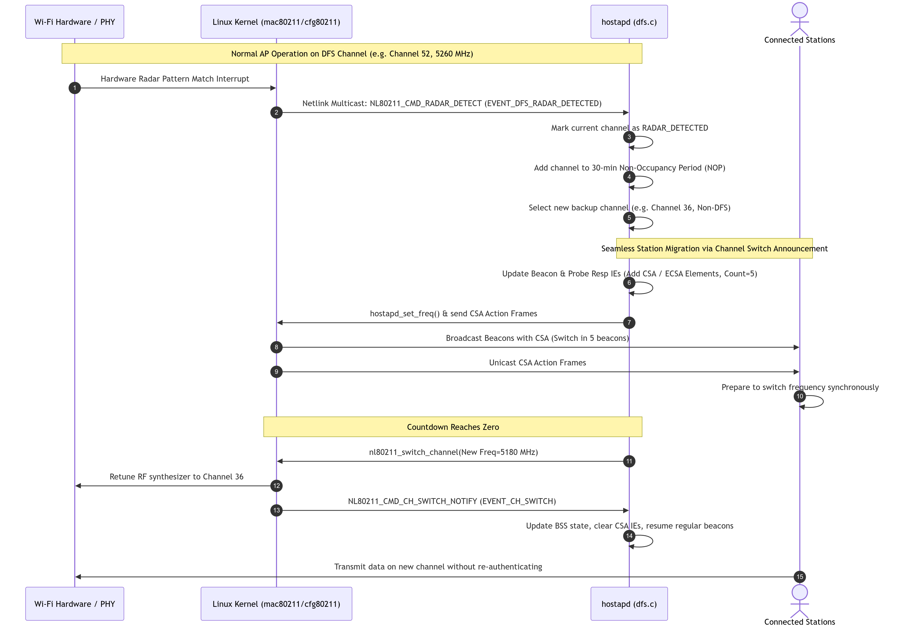
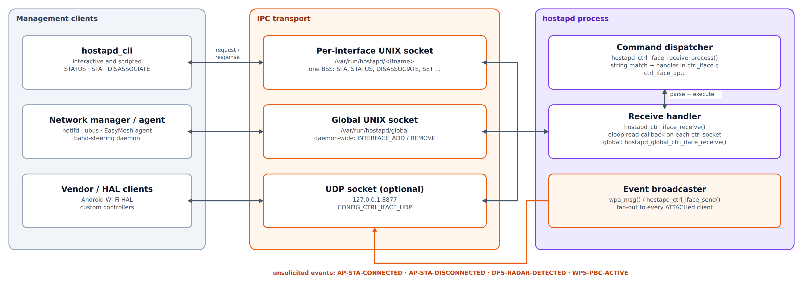
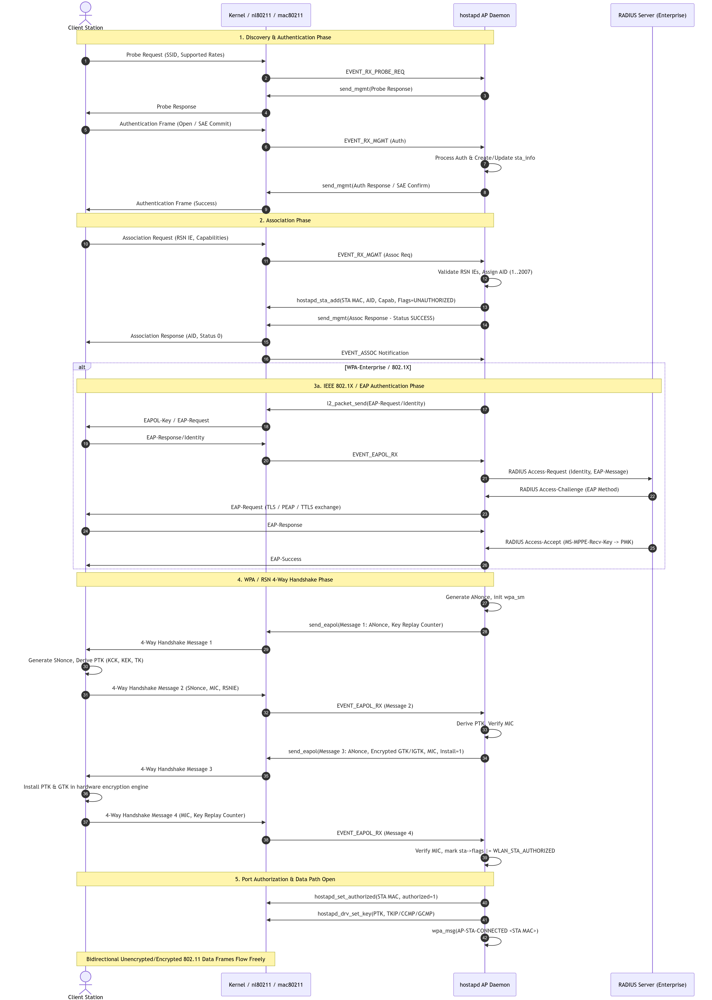

### Why this post

---

The official documentation tells you which options exist. It does not tell you how the pieces fit, or where to look when something breaks. This post is the map I wish I had in my first year. It covers the architecture first, then the code paths that matter, then the traps I have fallen into.

The source references are to hostapd 2.12. Function names are stable across versions, but line numbers are not, so I point to files and functions instead.

---

### What hostapd is (and is not)

---

**`hostapd`** (Host Access Point Daemon) is the user-space control plane of a Linux Wi-Fi AP. The data path is not in it.

The split looks like this:

| Layer | Owns |
| :--- | :--- |
| Firmware / hardware | Beacon timing, ACK and retransmit, aggregation, rate control, PHY/MAC real-time work |
| Kernel (`cfg80211` + `mac80211` or a vendor driver) | Station table in the datapath, key storage, encryption and decryption, power-save buffering, regulatory enforcement |
| **hostapd (user space)** | Authentication and association decisions, beacon content, WPA/RSN/SAE/EAP state machines, key derivation, DFS and ACS policy, roaming policy, control interface |

A mental model that has served me well: **the kernel and firmware do what hostapd tells them, and hostapd decides what is allowed.** In a full-SME AP, `hostapd` receives the Authentication and (Re)Association Request frames, runs the logic, builds the response, and only then tells the kernel to add the station. Some vendor chipsets with offloaded MLME behave differently, and when you integrate one you have to check which side owns which step.

What hostapd covers:

* **AP MLME**: Probe, Authentication, Association, Disassociation, Deauthentication, and Action frame handling.
* **Security**: WPA/WPA2 4-way handshake, group key handshake, SAE (WPA3-Personal), OWE, FILS, DPP, PMKSA caching, 802.11r FT.
* **802.1X**: EAP authenticator, a RADIUS client (authentication, accounting, dynamic authorization), and an optional built-in RADIUS and EAP server.
* **Radio policy**: ACS, DFS (CAC, radar, NOP), CSA/ECSA, BSS Color change, AFC for 6 GHz Standard Power.
* **Generations**: HT, VHT, HE (Wi-Fi 6/6E), EHT (Wi-Fi 7) including MLD/MLO, Multi-BSSID, Passpoint, and the 802.11k/v/u (RRM/WNM/Interworking) feature set.
* **Control**: UNIX socket interface used by `hostapd_cli` and by every orchestration layer (netifd, ubus wrappers, EasyMesh agents).

---

### High-level architecture

---



---

### The object model

---

The in-memory model is a strict hierarchy. Learn it and you can navigate any bug.

```
[struct hapd_interfaces]            daemon-wide state
  │
  ├── [struct hostapd_iface]        one per radio (PHY)
  │     ├── hw_features / current_mode / channel state
  │     ├── state: UNINITIALIZED → ACS / HT_SCAN / DFS → ENABLED
  │     ├── struct hostapd_config *conf         radio-wide config
  │     │
  │     └── [struct hostapd_data **bss]         one per BSS (SSID)
  │           ├── struct hostapd_bss_config *conf
  │           ├── driver ops + drv_priv
  │           ├── struct wpa_authenticator *wpa_auth    WPA/RSN state
  │           ├── struct eapol_authenticator *eapol_auth 802.1X state
  │           ├── struct radius_client_data *radius
  │           ├── wps / dpp contexts
  │           │
  │           └── [struct sta_info]   hash table + list
  │                 ├── addr, aid
  │                 ├── flags (AUTH, ASSOC, AUTHORIZED, MFP, HT, VHT, HE, EHT...)
  │                 ├── struct wpa_state_machine *wpa_sm
  │                 ├── struct eapol_state_machine *eapol_sm
  │                 ├── struct sae_data *sae
  │                 └── vlan_id
  │
  └── [struct hostapd_mld]          Wi-Fi 7 MLD
        ├── mld_addr
        └── links: affiliated hostapd_data across radios
```

The types are in `src/ap/hostapd.h` and `src/ap/sta_info.h`. Four things matter in practice:

1. **`hostapd_iface` is the radio and `hostapd_data` is the BSS.** A lot of bugs come from putting a setting at the wrong level. Channel, country, and `hw_mode` are radio-level. SSID, security, and VLAN are BSS-level. In multi-BSS configurations the first BSS also acts as the radio's "master" for some operations.
2. **`sta_info` is the unit of work.** Almost every handler starts with `ap_get_sta()` and ends by changing `sta->flags`. When you debug, print the flags first.
3. **Station state lives in two places**: hostapd's `sta_info` and the kernel's station entry. The kernel entry is created with `sta_add` and updated through `set_station` flags. Many "connected but no traffic" problems are these two copies disagreeing.
4. **The MLD layer sits above the BSS layer.** With MLO, one association covers several `hostapd_data` links, and the STA state is shared across them. The frame handlers now have to look up "which link did this arrive on?" as well as "which STA?".

---

### Event loop: one thread, no locks

---

Everything runs on one thread in `src/utils/eloop.c`. It multiplexes file descriptors (`epoll`, `poll`, or `select`, depending on the build) and a timer list, and it handles signals through the same loop.

* Sockets: the nl80211 event socket, the control interface sockets, RADIUS UDP sockets, and the EAPOL socket where one is used.
* Timers: `eloop_register_timeout()` / `eloop_cancel_timeout()`. They drive the 4-way handshake retransmits, inactivity polling (`ap_handle_timer`), CAC, the periodic housekeeping in `hostapd_periodic`, and the SA Query and FT timeouts.

The benefit is real: no mutexes and no data races between handlers. Two consequences follow.

* **A slow handler stalls the whole AP.** A blocking call to a RADIUS server or DNS in a callback you added freezes beaconing decisions, handshakes, and the control socket together. Make everything asynchronous or hand it to a helper process.
* **Timer cleanup is your job.** Free a `sta_info` without calling `eloop_cancel_timeout()` for its timers and you get a use-after-free that shows up hours later. Every STA timer must be cancelled in `ap_free_sta()`. I have debugged this class of bug more than once, always in vendor-added code.



---

### Configuration

---

Parsing is in `hostapd/config_file.c`, and the structures and defaults are in `src/ap/ap_config.c`.

* **Radio level** (`struct hostapd_config`): `channel`, `hw_mode`, `country_code`, `ieee80211d`, `ieee80211h` (DFS), `ht_capab`, `vht_oper_*`, `he_*`, `eht_*`, ACS parameters.
* **BSS level** (`struct hostapd_bss_config`): `ssid`, `wpa`, `wpa_key_mgmt`, `rsn_pairwise`, `ieee80211w`, `sae_pwe`, RADIUS settings, VLAN, WPS.
* **Multi-BSS**: the first `interface=` or `bss=` block creates the radio, and later `bss=` blocks add BSSes to it.
* **Reload**: `SIGHUP` or `hostapd_cli reload` re-reads the file, but not every change is applied live. Changes to channel, mode, or country usually mean a full disable and enable of the radio. On a production AP I treat reload as "may restart your BSSes" and never as hot-patching.

---

### Driver abstraction and the nl80211 path

---

hostapd talks to drivers through `struct wpa_driver_ops` in `src/drivers/driver.h`. On Linux the implementation is `driver_nl80211.c`, which uses generic netlink to reach `cfg80211`.



Two directions to keep apart:

**hostapd to kernel (commands).** Through `ap_drv_ops.c` wrappers:

* `NL80211_CMD_START_AP` / `SET_BEACON`: pushes the beacon head and tail that hostapd built. Beacon content is hostapd's job, and the kernel or firmware only transmits it and updates the TIM.
* `NL80211_CMD_NEW_STATION` / `SET_STATION`: adds the STA and updates its state flags (authenticated, associated, authorized, WMM, and so on).
* `NL80211_CMD_NEW_KEY` / `DEL_KEY`: installs keys.
* `NL80211_CMD_FRAME`: sends a management or Action frame.
* `NL80211_CMD_CHANNEL_SWITCH`, `SET_CHANNEL`, and the regulatory and DFS commands.

**Kernel to hostapd (events).** Netlink multicast and registered frames feed into `wpa_supplicant_event()` in `src/ap/drv_callbacks.c`. That one function is the entry point for `EVENT_RX_MGMT`, `EVENT_EAPOL_RX`, `EVENT_DFS_RADAR_DETECTED`, `EVENT_CH_SWITCH`, `EVENT_TX_STATUS`, and many more. If something happens to a station and you don't know why, put a breakpoint or a log line here first.

A detail that matters in newer stacks: EAPOL frames can be exchanged over the **nl80211 control port** instead of a raw `AF_PACKET` socket. That gives correct ordering with key installation and fixes a class of races, but it also changes where EAPOL frames show up in your captures and which driver capabilities you need.

---

### Station lifecycle

---



Management frames enter through `ieee802_11_mgmt()` in `src/ap/ieee802_11.c` and are dispatched by subtype:

* Probe Request goes to `handle_probe_req()`.
* Authentication goes to `handle_auth()` (Open, SAE, FT, FILS).
* (Re)Association Request goes to `handle_assoc()`.
* Disassociation and Deauthentication go to their own handlers.
* Action frames go to `handle_action()` (BA, RRM, WNM, SA Query, DPP, FT Action, and others).

The state progression of a station is:

1. **Auth**: the `sta_info` is created, `WLAN_STA_AUTH` is set, and the STA is added to the driver as authenticated.
2. **Assoc**: hostapd validates the capability and RSN information elements, allocates an AID, sets the `WLAN_STA_ASSOC` and HT/VHT/HE/EHT flags, and updates the driver's station entry.
3. **4-way handshake** (or SAE then 4-way, or EAP then 4-way): `wpa_auth` runs the key exchange.
4. **Authorized**: when the handshake completes, `hostapd_set_authorized` sets `WLAN_STA_AUTHORIZED` and tells the kernel to open the controlled port. Only now does user traffic flow.
5. **Steady state**: `ap_handle_timer()` polls idle stations (a null-data frame after the inactivity period), and an unacknowledged poll disassociates the STA.

The order matters for debugging. A station that is `ASSOC` but not `AUTHORIZED` is stuck in key exchange, and the fault is almost always in the handshake, the PMK, or a mismatched password. It is rarely in the radio.

---

### Security: what actually happens

---



---

#### The 4-way handshake in `wpa_auth.c`

---

The state machines are in `src/ap/wpa_auth.c`, as a pair: `WPA_PTK` (per STA) and `WPA_PTK_GROUP` (for group key updates).

* **Msg 1**: AP sends ANonce.
* **Msg 2**: STA replies with SNonce, MIC, and its RSN IE. The AP derives the PTK from the PMK, both addresses, and both nonces.
* **Msg 3**: AP sends the GTK (and IGTK, BIGTK with PMF and beacon protection), plus a MIC and the Install bit.
* **Msg 4**: STA acknowledges.

Details that decide how it behaves in the field:

* **The PTK is installed after Msg 4 is received**, and not when Msg 3 is sent. This is the KRACK mitigation. It also means that a lost Msg 4 leaves the STA with keys that the AP has not yet installed, so Msg 3 retransmits are expected and must not reinstall anything.
* **Retransmission**: the AP retries EAPOL-Key frames on a short timer (about one second) up to a small count (`wpa_pairwise_update_count`, default 4). Four failed tries end in deauthentication with reason 15 (4-way handshake timeout). If you see reason 15 in the field, check whether the STA ever received Msg 1 or 3 (power save, a bad link, a roaming race) before blaming the crypto.
* **Msg 2 MIC failure** is the signature of a wrong passphrase in WPA2-PSK. In WPA3 SAE the same mistake fails earlier, in the commit/confirm exchange.

---

#### SAE (WPA3-Personal)

---

SAE is a password-authenticated key exchange based on the Dragonfly construction. It protects against **offline** dictionary attacks: an attacker who records the exchange cannot test guesses at leisure. It does not stop **online** guessing, which is why hostapd rate-limits with anti-clogging tokens and a limit on concurrent SAE instances.

Practical notes:

* The password element can be derived by hunting-and-pecking (`sae_pwe=0`) or by hash-to-element (`sae_pwe=1` or `2`). Hash-to-element is faster, constant-time, and **required on 6 GHz**. I have seen many "WPA3 works on 5 GHz but not on 6 GHz" cases that were `sae_pwe` or missing PMF.
* WPA3 mandates PMF. In transition mode (`wpa_key_mgmt=WPA-PSK SAE` with `ieee80211w=1`) older clients still connect with PSK, and WPA3 clients use SAE. Some old clients choke on the SAE AKM in the beacon, so test transition mode against your real client population before you ship it.

---

#### 802.11r Fast Transition

---

FT replaces a full re-authentication with a key hierarchy: PMK-R0 (held by the R0KH) derives PMK-R1 (distributed to R1KHs), which derives the PTK. The roam then takes only an Authentication and Reassociation exchange, either over the air or over the DS.

The hard part is not the crypto. It is **R0KH/R1KH key distribution between APs**. hostapd supports static `r0kh=` / `r1kh=` entries and a `ft_psk_generate_local` mode that derives keys without a central controller. Mismatched mobility domain, wrong NAS-ID, or a lost key push gives the classic symptom: the client falls back to full authentication on every roam and the logs say little. Capture both APs together, with synchronized time, when you debug it.

---

### Radio policy

---

* **ACS (`acs.c`)**: scores channels from survey data and OBSS information. The scoring is a heuristic. On crowded 2.4 GHz it does well. For production I usually pin channels in the controller and use ACS only as a first-boot default.
* **DFS (`dfs.c`)**: a CAC period (60 s on most channels, 10 minutes on weather-radar channels) before any beaconing. On radar detection hostapd issues a CSA, marks the channel unusable for the 30-minute non-occupancy period, and picks a new one. Note that CAC time is invisible on the air, so "my 5 GHz SSID takes a minute to appear after reboot" is almost always DFS and not a bug.
* **AFC (`afc.c`)**: Standard Power 6 GHz APs query an AFC system for allowed channels and maximum EIRP at their location. It must be integrated with the regulatory side of the platform.
* **MLO (`ieee802_11_eht.c`)**: the MLD groups per-band `hostapd_data` links. When something goes wrong in MLO, first ask which link's state and which link's keys are involved, and only then ask what the protocol says.



---

### Control interface

---



Implemented in `hostapd/ctrl_iface.c` and `src/ap/ctrl_iface_ap.c`:

* **Per-interface socket** (`/var/run/hostapd/<ifname>`): `STATUS`, `STA`, `DISASSOCIATE`, `DEAUTHENTICATE`, `GET_CONFIG`, `SET`, `ENABLE`, `DISABLE`, `CHAN_SWITCH`, and many more.
* **Global socket** (`/var/run/hostapd/global`): `INTERFACE_ADD`, `INTERFACE_REMOVE`, and similar. Systems such as OpenWrt's `wifi` stack use this to add and remove BSSes at runtime.
* **Events**: a client sends `ATTACH` and receives unsolicited messages such as `AP-STA-CONNECTED`, `AP-STA-DISCONNECTED`, `EAPOL-RX`, `DFS-RADAR-DETECTED`, and `CTRL-EVENT-EAP-SUCCESS`. This is how mesh agents and band-steering daemons observe the AP, and it is why those events are effectively a public API. Do not change their text format casually.

---

### End-to-end sequence

---



---

### Debugging playbook

---

What I do, in this order:

1. **Turn on hostapd's own debug**: `hostapd -dd -t config.conf` (the `-t` adds timestamps). The log shows every state transition in `wpa_auth` and every management frame decision. Add `-K` only on a lab device, because it prints key material.
2. **Watch the kernel side at the same time**: `iw event -t` shows station add/del, connect, and DFS events with timestamps you can line up with the hostapd log.
3. **Capture over the air** with a monitor interface on the same channel. You need it to tell "the AP never sent it" from "the STA never received it". Decrypting needs the PMK/PSK and the full 4-way exchange in the capture.
4. **Read `STA <mac>` via `hostapd_cli`**: it prints the flags and the authentication state. Compare with `iw dev wlan0 station get <mac>`. If they disagree, you have found your bug class.
5. **Check the disconnect reason code**. Reason 2/3 (previous authentication no longer valid, leaving), 4 (inactivity), 15 (4-way timeout), and 23 (802.1X failure) each point to a different place.
6. **Check timing before logic.** A surprising share of "random drops" turn out to be the one-hour group rekey, inactivity polling, `ap_max_inactivity`, or an upstream RADIUS session timeout. Look for a number that matches the interval (3600, 300, 60).

---

### Mistakes I keep seeing

---

* **Editing hostapd and ignoring the event loop.** Anything blocking is a bug. Anything that holds a pointer to a `sta_info` across an `eloop` callback needs a lookup by address instead, because the entry may be gone by then.
* **Keeping vendor patches as a pile of diffs.** Every upstream rebase becomes a week of conflict resolution. Keep vendor code behind small, clearly named hooks and keep the diff against upstream as small as possible. Your future self will thank you.
* **Trusting default capability negotiation.** HT/VHT/HE/EHT capabilities are intersected between the driver, the config, and the STA. When a client "works at 80 MHz but not 160 MHz", walk the whole chain: driver-reported capabilities, `hostapd.conf`, the regulatory domain, DFS state.
* **Treating PMF as optional because "old clients"**. PMF `required` is mandatory for WPA3 and for 6 GHz. Use `optional` in transition mode and plan the retirement of non-PMF clients.
* **Skipping interoperability tests.** hostapd is the reference implementation most clients are tested against, so it is usually right. But "the AP passes the test suite" and "this phone from 2019 connects" are different statements. Keep a client matrix and run it on every release.

---

### Source tree reference

---

| Path | Role | Where to start |
| :--- | :--- | :--- |
| `hostapd/main.c` | Entry point | `main()`, `hostapd_global_init()` |
| `hostapd/config_file.c` | Config parser | `hostapd_config_read()` |
| `hostapd/ctrl_iface.c` | IPC server | `hostapd_ctrl_iface_receive()` |
| `src/ap/hostapd.c` | AP lifecycle | `hostapd_setup_interface()`, `hostapd_enable_iface()` |
| `src/ap/ieee802_11.c` | MLME and frame handling | `ieee802_11_mgmt()`, `handle_auth()`, `handle_assoc()` |
| `src/ap/sta_info.c` | Station table | `ap_get_sta()`, `ap_sta_add()`, `ap_free_sta()` |
| `src/ap/wpa_auth.c` | WPA/RSN authenticator | `wpa_sm_step()`, `wpa_receive()` |
| `src/ap/wpa_auth_ft.c` | 802.11r | FT over the air and over the DS, R0KH/R1KH |
| `src/ap/beacon.c` | Beacon and probe response | `ieee802_11_set_beacon()` |
| `src/ap/dfs.c` | DFS | CAC, radar handling, NOP |
| `src/ap/acs.c` | Automatic channel selection | survey scoring |
| `src/ap/afc.c` | 6 GHz AFC | AFC client |
| `src/ap/ieee802_11_eht.c` | Wi-Fi 7 / MLO | EHT capabilities, MLD links |
| `src/ap/drv_callbacks.c` | Driver events | `wpa_supplicant_event()` |
| `src/ap/ap_drv_ops.c` | Driver op wrappers | `hostapd_drv_*()` |
| `src/drivers/driver_nl80211.c` | nl80211 driver | netlink send and receive |
| `src/radius/` | RADIUS client and server | authentication, accounting, DAS |
| `src/eapol_auth/` | 802.1X PAE | authenticator state machine |
| `src/eap_server/` | Built-in EAP server | TLS, TTLS, PEAP, SIM/AKA, PWD, FAST |
| `src/utils/eloop.c` | Event loop | timers, sockets, signals |

---

### Takeaways

---

1. **Separation of concerns is the design.** Real-time work stays in firmware and kernel, and decisions and state machines stay in user space. Know which side owns a behavior before you start debugging.
2. **Single-threaded eloop is a feature with rules.** You get freedom from locks, and you pay with a ban on blocking calls and strict timer hygiene.
3. **Two copies of station state exist.** Many of the nastiest bugs are the hostapd view and the kernel view drifting apart.
4. **Most field problems are timing, configuration, or interoperability.** Cryptography is rarely wrong. Check the reason code, the timer values, and the client matrix before you suspect the standard.
5. **Stay close to upstream.** The project moves quickly through Wi-Fi 6E, Wi-Fi 7, and security fixes. Every vendor change you keep out of the core is one less rebase to pay for.
