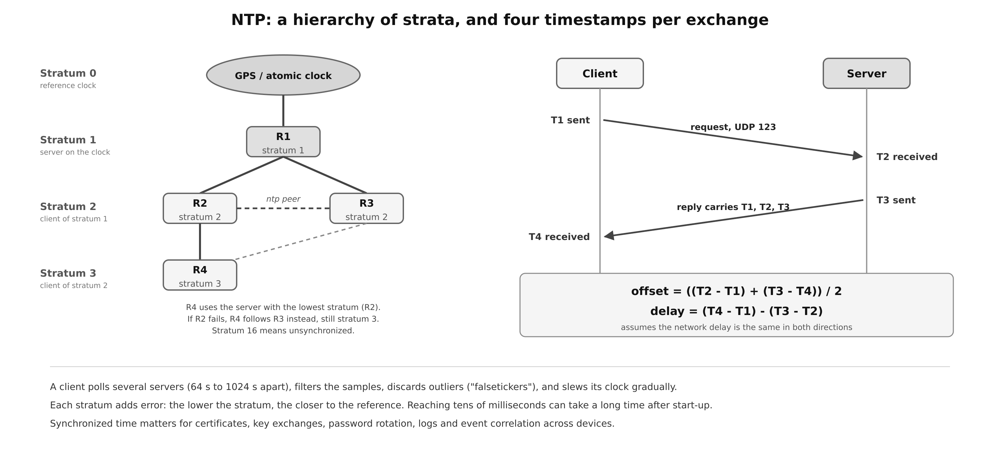
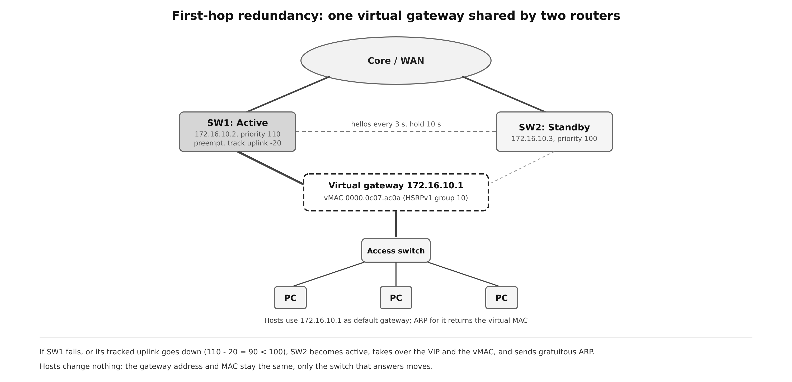
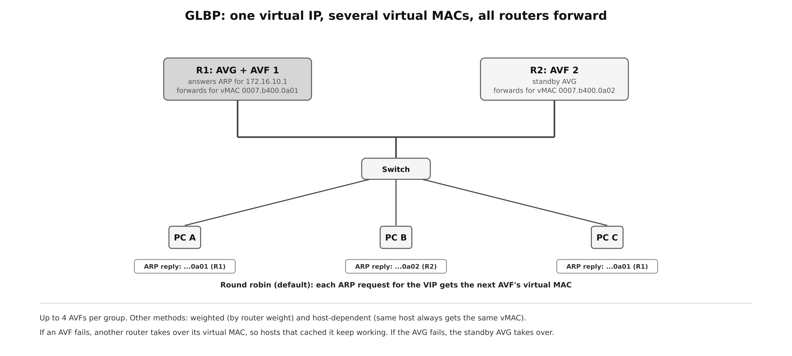
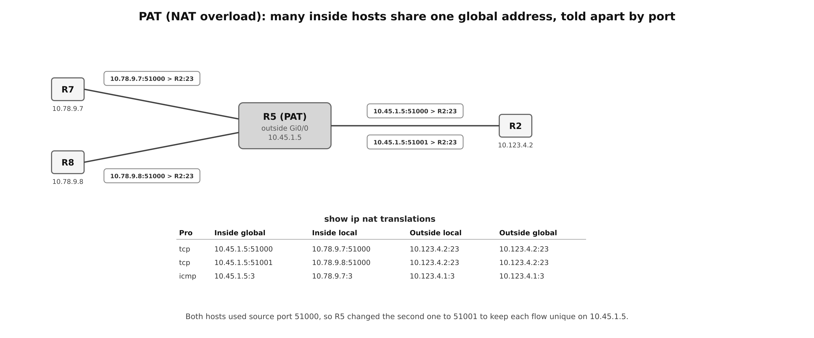

### Overview

---

Routing protocols move packets, but a working network also depends on a few **IP services** that run alongside them. This post covers three of them:

* **NTP** keeps the clocks of every device in agreement, so that certificates, keys, logs and events make sense.
* **First-hop redundancy protocols (FHRPs)**, **HSRP**, **VRRP** and **GLBP**, give hosts a default gateway that survives the failure of a router.
* **NAT** translates addresses between address realms, most often between private addresses and the public Internet.

---

### Time Synchronization with NTP

---

#### Why time matters

---

Every device keeps a **system clock**, and uses it to measure idle periods, timeouts and computations. Each clock runs at a slightly different rate, so devices that are never corrected **drift apart**. In a network, consistent time is needed for:

* **Password and key rotation** at specific intervals.
* **Encryption key exchanges**, which often include timestamps to prevent replay.
* **Certificate validation**, which compares the current time with the validity dates. A device with a wrong clock rejects valid certificates or accepts expired ones.
* **Correlating security events** across routers, switches, firewalls and access control systems.
* **Troubleshooting**: putting the logs of several devices in order to find the root cause.

---

#### NTP and strata

---

**NTP (Network Time Protocol)**, version 4 in RFC 5905, synchronizes clocks in a distributed client/server hierarchy. It runs over **UDP port 123** on the server, with a dynamic source port on the client.

The hierarchy is described by the **stratum**, the distance from a reference clock:

| Stratum | Meaning |
|:-------:|---------|
| 0 | A reference clock: atomic clock, GPS receiver, radio clock. Not on the network itself |
| 1 | A server directly attached to a stratum 0 clock |
| 2 | A client of a stratum 1 server (and usually a server for others) |
| 3–15 | Each level is a client of the level above |
| 16 | **Unsynchronized** |

---

Each stratum adds a little error, so **a lower stratum is more accurate**. A client configured with several servers prefers the one with the **lowest stratum** (among those that pass its sanity checks), and its own stratum becomes that server's stratum plus one.

<div style="text-align: center;">



</div>

---

#### How a client measures its offset

---

Each exchange records four timestamps: **T1** when the client sends the request, **T2** when the server receives it, **T3** when the server sends the reply, and **T4** when the client receives it. From them the client computes:

* **Offset** = ((T2 − T1) + (T3 − T4)) / 2: how far its clock is from the server's.
* **Delay** = (T4 − T1) − (T3 − T2): the round-trip network time, without the server's processing time.

The calculation assumes the delay is the **same in both directions**, which is why asymmetric paths reduce accuracy. A client polls each server regularly (from 64 s up to 1024 s apart), filters the samples, discards servers that disagree with the majority (*falsetickers*), and then **slews** its clock gradually instead of jumping. This makes NTP stable but slow: reaching an accuracy of a few tens of milliseconds can take a long time after start-up. For sub-microsecond accuracy (telecom, finance, industrial control), networks use **PTP** (IEEE 1588) instead.

---

#### Servers, clients and peers

---

* An **NTP client** sets its time from a server. A server never changes its time to follow a client.
* `ntp master [stratum]` makes a Cisco device answer as an authoritative server **from its own clock** when it has no upstream source (stratum 8 by default). Use it only on an isolated network: a device with a wrong clock that claims a low stratum will mislead every client.
* **NTP peers** act as clients and servers **of each other**: each can synchronize to the other. Two core routers that peer with each other and also follow different upstream servers keep the same time even if one loses its upstream.

In a design with R1 at stratum 1, R2 and R3 at stratum 2 and R4 configured with both, R4 follows R2 and runs at stratum 3. If R2 fails, R4 switches to R3, and when R2 returns, R4 moves back.

```
ntp server 192.0.2.10 prefer source Loopback0   ! client, preferred server
ntp server 192.0.2.11 source Loopback0
ntp peer 10.0.0.2                               ! peer with the other core router
ntp master 3                                    ! only if there is no upstream source
!
ntp authenticate                                ! optional authentication
ntp authentication-key 1 md5 S3cret
ntp trusted-key 1
!
clock timezone ICT 7
service timestamps log datetime msec localtime  ! make logs useful
```

| Command | Shows |
|---------|-------|
| `show ntp status` | Synchronized or not, **stratum**, **reference** (the server's address), frequency and precision, reference time, **offset** and **delay** to the server, root and peer dispersion, loop filter state, polling interval and time since the last update |
| `show ntp associations` | Each configured server and peer: stratum, reach, poll, delay, offset, dispersion. `*` marks the server the device is synchronized to, `+` a candidate, `x` a falseticker |

---

On Linux, `chrony` (or `systemd-timesyncd` for a simple client) is the usual NTP implementation: `chronyc sources -v` and `chronyc tracking` show the same information.

---

### First-Hop Redundancy

---

A host has **one default gateway** in its configuration (from DHCP or set by hand). Adding a second router and a second Layer 2 path to the access switch removes the single point of failure in the network, but **not in the host**: if the gateway router fails, the host keeps sending to an address that no longer answers.

A **first-hop redundancy protocol (FHRP)** fixes this by creating a **virtual IP address (VIP)** and a **virtual MAC address** that are shared by several routers. Hosts use the VIP as their gateway. One router answers for it at a time, and if it fails, another takes over the same addresses, so hosts notice nothing.

<div style="text-align: center;">



</div>

When the active router fails, the new active router sends a **gratuitous ARP** for the VIP, so that switches update their MAC tables and the virtual MAC moves to the new port. Since the hosts' ARP entry (VIP → virtual MAC) does not change, they keep forwarding without interruption.

---

#### Object tracking

---

An FHRP only notices that a **neighbor router** died. It does not notice when the active router is alive but has lost its **uplink**, in which case it still attracts all traffic and then black-holes it. **Object tracking** links the FHRP to the state of something else:

```
track 1 interface GigabitEthernet0/1 line-protocol      ! interface up/down
track 2 ip route 0.0.0.0/0 reachability                 ! a route is in the RIB
track 3 ip sla 10 reachability                          ! an IP SLA probe succeeds
```

When the object goes down, the FHRP **lowers the router's priority** by a configured amount, so that a standby router with a higher priority takes over (which requires **preemption** on the standby). `show track` displays each object's state and how many times it changed.

---

#### HSRP

---

**HSRP (Hot Standby Router Protocol)** is Cisco proprietary:

* One router is **active** and forwards traffic sent to the virtual MAC. One is **standby**, ready to take over. Any others listen.
* Routers exchange **hellos** over UDP, every **3 s** by default, with a **hold time of 10 s**.
* The **highest priority** (0–255, default **100**) becomes active, then the **highest interface IP address**.
* **Preemption is disabled by default**: a router that comes back with a higher priority does not take the active role back unless `preempt` is configured.
* The states are Initial, Learn, Listen, Speak, Standby and Active.

| | HSRPv1 | HSRPv2 |
|---|---|---|
| Multicast address | 224.0.0.2 | 224.0.0.102 |
| UDP port | 1985 | 1985 |
| Group numbers | 0–255 | 0–4095 |
| Virtual MAC | 0000.0c07.acXX (XX = group in hex) | 0000.0c9f.fXXX (IPv6: 0005.73a0.0XXX) |
| IPv6 | No | Yes |
| Millisecond timers | Limited | Yes |

---

```
track 1 interface Vlan1 line-protocol
!
interface Vlan10
 ip address 172.16.10.2 255.255.255.0
 standby version 2
 standby 10 ip 172.16.10.1               ! the VIP
 standby 10 priority 110
 standby 10 preempt delay minimum 30     ! wait for routing to converge first
 standby 10 timers msec 250 msec 750     ! optional fast hellos
 standby 10 authentication md5 key-string S3cret
 standby 10 track 1 decrement 20         ! 110 - 20 = 90 < 100: give up the active role
```

`show standby brief` lists each group with the interface, priority, preemption, state, the active and standby routers and the VIP. `show standby` adds the virtual MAC, timers, the number of state changes and the time since the last one, and the tracked objects. When the tracked VLAN 1 interface goes down, the log shows the track state change immediately, then the HSRP role moves to standby.

---

#### VRRP

---

**VRRP (Virtual Router Redundancy Protocol)** is the **open standard** equivalent. It works like HSRP, with different names and defaults:

* The forwarding router is the **master**. The others are **backups**.
* **Preemption is enabled by default.**
* Advertisements are sent by the master only, to **224.0.0.18** (IPv6 **FF02::12**) with **IP protocol 112**, every **1 s** by default. A backup declares the master down after about three intervals.
* The virtual MAC is **0000.5e00.01XX** for IPv4 (**0000.5e00.02XX** for IPv6), where XX is the group (VRID) in hex.
* Priority is 1–254, default **100**. A router that **owns** the virtual IP (uses it as its real interface address) has priority **255** and is always master.
* **VRRPv2** (RFC 3768) supports IPv4 only. **VRRPv3** (RFC 5798, updated by RFC 9568) supports IPv4 and IPv6 and removes authentication. The two versions do not interoperate.

Older IOS versions use a flat, VRRPv2-only syntax:

```
interface Vlan10
 vrrp 10 ip 172.16.10.1
 vrrp 10 priority 110
 vrrp 10 track 1 decrement 20
```

IOS XE uses a hierarchical syntax for VRRPv3, with an address family per instance:

```
fhrp version vrrp v3
!
interface Vlan10
 vrrp 10 address-family ipv4
  address 172.16.10.1
  priority 110
  track 1 decrement 20
  ! vrrpv2   (only to talk to VRRPv2 routers)
```

`show vrrp brief` and `show vrrp` give the same information in both cases: state, priority, master address, virtual MAC and timers.

---

#### GLBP

---

HSRP and VRRP are **active/standby** per group: the standby router's uplink sits idle unless you create several groups and give half the hosts a different gateway. **GLBP (Gateway Load Balancing Protocol)**, also Cisco proprietary, shares the load with **one VIP** by giving different hosts **different virtual MAC addresses**.

<div style="text-align: center;">



</div>

GLBP has two roles:

* The **active virtual gateway (AVG)**, one per group, elected by priority (default 100) and then highest IP. It **answers every ARP request** for the VIP, and assigns the virtual MACs to the forwarders. A standby AVG takes over if it fails.
* Up to **four active virtual forwarders (AVFs)**. Each owns a virtual MAC (**0007.b400.XXYY**, group XX and forwarder YY) and forwards the traffic sent to it. A router can be the AVG and an AVF at the same time. If an AVF fails, another router takes over **its virtual MAC**, so hosts that cached it keep working.

GLBP uses UDP port 3222 to 224.0.0.102, with hellos every 3 s and a hold time of 10 s by default. The AVG chooses which virtual MAC to return in each ARP reply:

| Method | Behavior |
|--------|----------|
| **Round robin** (default) | Each ARP reply returns the next AVF's MAC |
| **Weighted** | AVFs receive hosts in proportion to their **weight** (`glbp 10 weighting 80`), so a bigger router can take more traffic |
| **Host-dependent** | The same host always gets the same virtual MAC, as long as the number of AVFs does not change |

---

```
interface Vlan10
 glbp 10 ip 172.16.10.1
 glbp 10 priority 110
 glbp 10 preempt
 glbp 10 load-balancing weighted
 glbp 10 weighting 80
 glbp 10 timers 1 4
```

`show glbp brief` lists the AVG (active and standby) and each forwarder's state. `show glbp` adds the timers, the preemption settings, the load-balancing method and the weights.

---

#### Comparison

---

| | HSRP | VRRP | GLBP |
|---|---|---|---|
| Standard | Cisco | **IETF** | Cisco |
| Roles | Active / standby | Master / backup | AVG + up to 4 AVFs |
| Load sharing in one group | No | No | **Yes** |
| Default priority | 100 | 100 (255 for the address owner) | 100 |
| Preemption by default | **No** | **Yes** | No (AVG) |
| Hello / hold | 3 s / 10 s | 1 s / ~3 s | 3 s / 10 s |
| Transport | UDP 1985, 224.0.0.2 or .102 | IP 112, 224.0.0.18 | UDP 3222, 224.0.0.102 |
| Virtual MAC | 0000.0c07.acXX / 0000.0c9f.fXXX | 0000.5e00.01XX | 0007.b400.XXYY |

---

Two practical rules apply to all three. Make the FHRP active router the **same switch that is the STP root** for that VLAN (see [Spanning Tree](/blog/spanning_tree_protocol/)), so that traffic does not cross the inter-switch link and back. And use **preemption with a delay**, so that a rebooting router does not take the active role before its routing protocols have converged.

On Linux, **keepalived** implements VRRP:

```
vrrp_instance VI_10 {
    state BACKUP
    interface eth0
    virtual_router_id 10
    priority 110
    advert_int 1
    virtual_ipaddress { 172.16.10.1/24 }
    track_interface { eth1 weight -20 }
}
```

---

### Network Address Translation

---

#### Private addressing

---

In the early Internet, large address blocks were handed out freely, and it became clear that IPv4 addresses would run out. **RFC 1918** reserved three blocks for **private** use. They are not routed on the Internet, and any organization can reuse them internally:

| Block | Size |
|-------|------|
| 10.0.0.0/8 | 16,777,216 addresses |
| 172.16.0.0/12 | 1,048,576 addresses |
| 192.168.0.0/16 | 65,536 addresses |

---

**NAT (Network Address Translation)** lets hosts with private addresses communicate with the outside by **rewriting the source or destination address** in packet headers as they cross a router or firewall between the **inside** and **outside** interfaces. It is also used outside the Internet case, for example to connect two companies with **overlapping** address plans after a merger.

Most routers translate **only the IP (and port) headers**. Addresses embedded in the payload, such as in FTP, SIP or some DNS answers, need an **application layer gateway (ALG)**, which some firewalls and routers provide for specific protocols.

---

#### Inside, outside, local and global

---

<div style="text-align: center;">


</div>

* **Inside / outside** is **where the host is**: on the inside or outside interface side of the NAT device.
* **Local / global** is **where the address is seen**: from the inside network (local) or from the outside network (global).

| Term | Meaning |
|------|---------|
| **Inside local** | The real (often private) address of an inside host |
| **Inside global** | The (usually public) address that represents the inside host to the outside |
| **Outside local** | The address of an outside host **as it appears to the inside**. It must be reachable from the inside, but does not need to exist outside |
| **Outside global** | The real address of an outside host, reachable on the outside |

---

In the common Internet case, only the inside host is translated, so the outside local and outside global addresses are the same.

---

#### Types of NAT

---

| Type | Mapping | Use |
|------|---------|-----|
| **Static NAT** | One-to-one, permanent | Servers that must be reachable from outside |
| **Pooled (dynamic) NAT** | One-to-one, taken from a pool on demand and returned after an idle timeout | Rare today. Needs as many global addresses as active inside hosts |
| **PAT** (NAT overload) | Many-to-one: **address and port** are translated | Almost every Internet connection, from home routers to enterprises |

---

#### How translation is processed

---

On Cisco IOS, the order of operations depends on the direction:

* **Inside to outside**: the router **routes first** (finds that the destination is out an outside interface), then **translates**. With an inside static entry, the router creates a dynamic entry for the flow and rewrites the **source** address from inside local to inside global (10.78.9.7 → 10.45.1.7).
* **Outside to inside**: the router **translates first**, then routes. A reply from R1 arrives on the outside interface, matches the flow entry by address and ports, has its **destination** rewritten back to 10.78.9.7, and is then routed to the inside.

Because outside-to-inside traffic is translated before routing, the router must also have a route to any **outside local** address it creates. This is why outside static NAT has an `add-route` option.

---

#### Static NAT

---

**Inside static NAT** maps an inside local address to an inside global address. It works in both directions: inside hosts are translated when they connect out, and outside hosts can connect **in** to the inside global address.

```
interface GigabitEthernet0/0
 ip nat outside
interface GigabitEthernet0/1
 ip nat inside
!
ip nat inside source static 10.78.9.7 10.45.1.7
ip nat inside source static tcp 10.78.9.10 80 10.45.1.5 80    ! port forwarding
```

`show ip nat translations` shows the static entry and one dynamic entry per flow, with protocol, inside global, inside local, outside local and outside global addresses. When R2 opens a Telnet session to 10.45.1.7, R5 simply creates another dynamic entry, and R7 sees the session coming from R2's real address.

**Outside static NAT** maps an **outside global** address to an **outside local** address, so that inside hosts reach an outside host through a different address (useful with overlapping networks):

```
ip nat outside source static 10.123.4.2 10.123.4.222 add-route
```

Inside hosts can still reach R2 at its real address 10.123.4.2 without translation. When R2 connects to an inside host, the inside host sees the session coming from 10.123.4.222. When an inside host connects to 10.123.4.222, R5 rewrites the destination to 10.123.4.2.

---

#### Pooled NAT

---

Static NAT needs a configuration line, and a global address, for **every** inside host. **Pooled NAT** allocates global addresses from a pool **on demand**:

```
ip access-list standard ACL-NAT-CAPABLE
 permit 10.78.9.0 0.0.0.255
!
ip nat pool R5-POOL 10.45.1.10 10.45.1.11 prefix-length 24
ip nat inside source list ACL-NAT-CAPABLE pool R5-POOL
```

The ACL selects which inside traffic is eligible. A translation stays in the table until the flow stops **and** the timeout expires (**24 hours** by default on IOS), then the address returns to the pool. When the pool is **exhausted**, new hosts cannot be translated and their packets are **dropped**.

```
ip nat translation timeout 3600        ! shorten the idle timeout
clear ip nat translation *             ! clear dynamic entries (disrupts active flows)
```

---

#### Port Address Translation

---

**PAT**, also called **NAT overload**, maps **many** inside addresses to **one** global address. The router keeps each flow unique by also translating the **source port** when needed.

<div style="text-align: center;">



</div>

```
ip access-list standard ACL-NAT-CAPABLE
 permit 10.78.9.0 0.0.0.255
!
ip nat inside source list ACL-NAT-CAPABLE interface GigabitEthernet0/0 overload
! or: ip nat inside source list ACL-NAT-CAPABLE pool R5-POOL overload
```

Each flow gets an entry with the **inside local address:port** and the **inside global address:port**. The router keeps the original port when it is free on the global address, and picks another when it is not. By matching the ports seen on the server (`show tcp brief` on R2) with R5's translation table, you can tell which session belongs to R7 and which to R8.

One global address offers about 64,000 ports per protocol and destination, which is why a whole home or office can share one public address.

---

#### NAT limitations

---

* **Inbound connections** need an explicit static mapping or port forwarding. This is often seen as a security feature, but NAT is not a firewall.
* **End-to-end addressing is lost**. Protocols that carry addresses in the payload need ALGs, and protocols that authenticate the IP header (**IPsec AH**) break. **IPsec ESP** works through NAT with **NAT-T** (UDP 4500).
* **Logging and tracing** become harder: an outside log shows only the global address and port, so the translation logs are needed to find the real host.
* Providers that run out of IPv4 addresses add a second layer, **Carrier-Grade NAT** (CGNAT), using the shared range **100.64.0.0/10** (RFC 6598). The long-term fix is IPv6, which has enough addresses that NAT is not needed for scarcity.

---

#### NAT on Linux

---

On Linux, NAT is part of netfilter and connection tracking (see [Linux Netfilter and Traffic Control](/blog/linux-netfilter-and-traffic-control/)). With nftables:

```
nft add table ip nat
nft 'add chain ip nat postrouting { type nat hook postrouting priority 100; }'
nft add rule ip nat postrouting oifname "wan" masquerade          # PAT to the WAN address
nft 'add chain ip nat prerouting { type nat hook prerouting priority -100; }'
nft add rule ip nat prerouting iifname "wan" tcp dport 80 dnat to 192.168.1.10   # port forward
conntrack -L                                                      # the translation table
```

`masquerade` is PAT to whatever address the outgoing interface has, which suits a WAN address learned by DHCP or PPPoE. `snat to 203.0.113.5` is the same with a fixed address.

---

### Troubleshooting

---

| Symptom | Likely cause | Check |
|---------|--------------|-------|
| NTP never synchronizes | UDP 123 blocked, server unreachable from the configured source, authentication mismatch, server itself unsynchronized (stratum 16) | `show ntp associations`, `show ntp status` |
| Clock jumps between servers | Servers disagree, or asymmetric delay | Use at least three servers, compare offsets |
| Both FHRP routers are active | The routers do not hear each other's hellos: VLAN not trunked, ACL, mismatched group number, version or authentication | `show standby brief` on both, capture hellos |
| No failover when the uplink fails | No object tracking, or decrement too small to drop below the standby priority | `show track`, priorities |
| Failover happens but no failback | Preemption disabled (HSRP and GLBP default) | `standby X preempt` |
| Traffic hairpins between distribution switches | FHRP active router is not the STP root for the VLAN | Align STP root and FHRP active |
| NAT not happening | `ip nat inside`/`outside` missing or reversed, ACL does not match, no route to the destination | `show ip nat statistics`, `debug ip nat` |
| New hosts cannot reach the outside | Pool exhausted | `show ip nat statistics`, use PAT or shorten the timeout |
| Outside host cannot reach an inside server | No static mapping or port forward, or a firewall rule | `show ip nat translations` |
| Application breaks through NAT | Addresses in the payload (FTP, SIP) without an ALG, or IPsec AH | Enable the ALG, use NAT-T, avoid AH |

---

### Summary

---

1. Consistent time is needed for certificates, keys, password rotation and log correlation. **NTP** runs on **UDP 123** in a hierarchy of **strata**: stratum 1 is attached to a reference clock, and 16 means unsynchronized.
2. A client measures **offset** and **delay** from four timestamps, prefers the **lowest stratum**, and slews its clock gradually. **Peers** synchronize with each other. `ntp master` should be used only without an upstream source.
3. **FHRPs** give hosts a **virtual IP and virtual MAC** shared by several routers. Failover is invisible to hosts.
4. **Object tracking** lowers a router's priority when its uplink or a route disappears, so that a standby with **preemption** can take over.
5. **HSRP** (Cisco): active/standby, priority 100, highest IP, **no preemption by default**, 3/10 s timers, vMAC 0000.0c07.acXX (v1) or 0000.0c9f.fXXX (v2).
6. **VRRP** (standard): master/backup, **preemption on by default**, 224.0.0.18, IP protocol 112, vMAC 0000.5e00.01XX. VRRPv3 adds IPv6.
7. **GLBP** (Cisco): one **AVG** answers ARP with the virtual MACs of up to **four AVFs**, so all routers forward. Round robin, weighted or host-dependent.
8. **NAT** rewrites addresses between inside and outside. **Inside/outside** is where the host is, **local/global** is where the address is seen.
9. **Static NAT** is one-to-one and allows inbound connections. **Pooled NAT** allocates from a pool (24 h default timeout) and fails when it is exhausted. **PAT** shares one address among many hosts by translating ports.
10. Inside-to-outside traffic is routed then translated. Outside-to-inside traffic is translated then routed. NAT breaks end-to-end addressing, which is one reason to move to IPv6.
