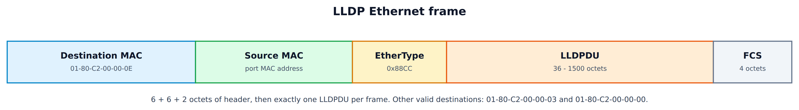
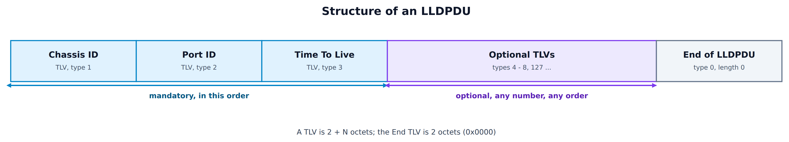
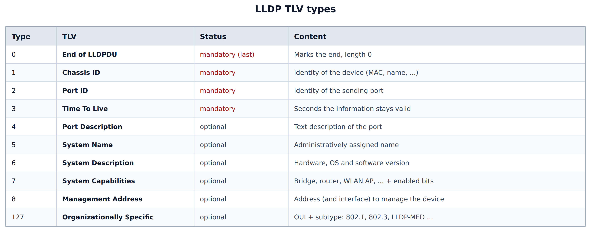
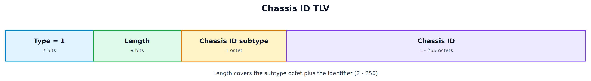
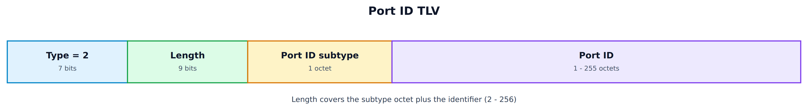
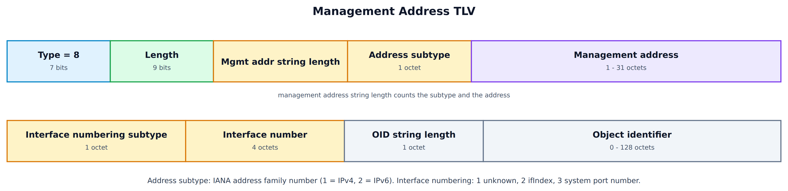
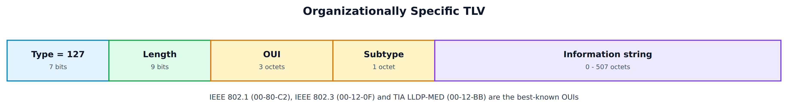

### Overview

---

When you manage a network, one of the first questions is simple: *what is plugged into this port?* Without help, the answer lives in a spreadsheet, or in someone's memory. **LLDP (Link Layer Discovery Protocol)**, defined in **IEEE 802.1AB**, answers it automatically. Every device announces its identity and the port it is sending from, and every neighbour listens and remembers.

LLDP has three properties that explain most of its design:

* **It is a Layer 2 protocol.** It runs directly on Ethernet, with no IP address needed, so two devices with different network-layer protocols (or none yet) can still learn about each other.
* **It is one-hop only.** A frame is sent to a multicast address that bridges do not forward, so it only ever reaches the device at the other end of the cable.
* **It is vendor neutral.** It replaces vendor protocols such as Cisco CDP, Extreme EDP and Foundry FDP, and it has a defined extension mechanism for vendor and standards-body information.

LLDP only **advertises**. It does not configure anything by itself and it has no authentication. The data it collects is used by a network management system (NMS), by the operator on the command line, and by features that need to know the neighbour, such as PoE negotiation and voice VLAN assignment.

---

### What LLDP Is Used For

---

| Use | What LLDP provides |
|-----|--------------------|
| Topology discovery | Which device and port is on the other end of each link |
| Inventory and troubleshooting | System name, description, software version, management address |
| PoE negotiation | Power requested and allocated, through the 802.3 *Power via MDI* TLV and LLDP-MED |
| VLAN and QoS provisioning | Port VLAN ID and VLAN names (802.1 TLVs), network policy for IP phones (LLDP-MED) |
| Link validation | Mismatch of speed, duplex or maximum frame size between the two ends |
| Wi-Fi deployments | An access point learns the switch port, VLAN and PoE class on its Ethernet uplink |

---

### The Frame

---

An LLDP frame is an ordinary Ethernet frame with a dedicated EtherType, **0x88CC**.

<div style="text-align: center;">



</div>

---

##### Destination address

---

The destination is a **link-local multicast address** from the range 01-80-C2-00-00-00 to 01-80-C2-00-00-0F that IEEE reserves for protocols that must not be forwarded. LLDP may use three of them, which differ in how far the frame can travel:

| Destination MAC | Name | Which bridges stop it |
|-----------------|------|-----------------------|
| `01-80-C2-00-00-0E` | Nearest Bridge (the default) | Every bridge, including simple two-port relays (TPMR) |
| `01-80-C2-00-00-03` | Nearest non-TPMR Bridge | Normal bridges, but not TPMRs |
| `01-80-C2-00-00-00` | Nearest Customer Bridge | Customer bridges, but not provider bridges |

In almost every network you will only see `01-80-C2-00-00-0E`.

---

##### Source address and EtherType

---

The source is the MAC address of the **sending port**. The EtherType is `0x88CC`. Older drafts of the protocol used the 802.3 *Slow Protocols* EtherType (0x8809) with a subtype, but the published standard does not, so a capture filter of `ether proto 0x88cc` is what you want.

---

##### Payload

---

The payload is exactly **one LLDPDU**. An LLDPDU must fit in a single frame, and the sender must not fragment it. The number of TLVs you can send is therefore limited by the MTU of the link.

---

### The LLDPDU

---

An LLDPDU is nothing but a list of **TLVs** (Type, Length, Value). There is no separate header.

<div style="text-align: center;">



</div>

* The first three TLVs are **mandatory and must come in this order**: Chassis ID, Port ID, Time To Live.
* Optional TLVs follow, in any order.
* The last TLV is **End of LLDPDU** (type 0, length 0). Anything after it is ignored.

---

### TLV Format

---

Every TLV starts with a 2-octet header that packs the type and the length together:

<div style="text-align: center;">


</div>

* **Type** (7 bits): which TLV this is, from 0 to 127.
* **Length** (9 bits): the number of octets of the information string, from 0 to 511.
* **Information string**: the content. Its format depends on the type.

Unlike many protocols, a TLV is **not padded to a 4-byte boundary**. The next TLV starts right after the last octet of the previous one.

---

##### The standard TLVs

---

<div style="text-align: center;">



</div>

Types 9 to 126 are reserved. A receiver must **skip any TLV type it does not know** and keep processing the rest of the LLDPDU.

---

#### Chassis ID TLV

---

The Chassis ID identifies the device as a whole. Together with the Port ID it forms the identifier of the connection endpoint.

<div style="text-align: center;">



</div>

The subtype says how to read the identifier:

| Subtype | Meaning | Typical content |
|:-------:|---------|-----------------|
| 1 | Chassis component | Entity MIB `entPhysicalAlias` |
| 2 | Interface alias | `ifAlias` |
| 3 | Port component | Entity MIB `entPhysicalAlias` of a port |
| **4** | **MAC address** | A MAC of the device, the most common choice |
| 5 | Network address | An IP address, with an address family prefix |
| 6 | Interface name | `ifName`, for example `eth0` |
| 7 | Locally assigned | Any string the administrator chose |

---

#### Port ID TLV

---

The Port ID identifies the port that sent the frame. It has the same layout as the Chassis ID TLV, with type 2.

<div style="text-align: center;">



</div>

| Subtype | Meaning |
|:-------:|---------|
| 1 | Interface alias |
| 2 | Port component |
| 3 | MAC address |
| 4 | Network address |
| **5** | **Interface name** (for example `Gi1/0/12`, the most common) |
| 6 | Agent circuit ID |
| 7 | Locally assigned |

---

#### Time To Live TLV

---

This 2-octet TLV (type 3) tells the receiver **how many seconds** the information is valid. The receiver keeps the neighbour in its table until the timer runs out, unless a newer frame refreshes it.

A TTL of **0** has a special meaning: the sender is shutting down, and the receiver must delete everything it learned from that neighbour at once.

#### Optional descriptive TLVs

---

* **Port Description** (4): free text for the port, for example the `ifDescr` or a label.
* **System Name** (5): the administratively assigned name, for example the hostname.
* **System Description** (6): hardware model, operating system and software version.
* **System Capabilities** (7): two bit fields of 2 octets each, *capabilities* and *enabled capabilities*. Bits include Other, Repeater, Bridge, WLAN access point, Router, Telephone, DOCSIS cable device and Station only. An AP typically reports "WLAN access point" in both fields.

---

#### Management Address TLV

---

The Management Address (type 8) tells the neighbour how to reach the device for management, for example over SNMP or SSH.

<div style="text-align: center;">



</div>

* **Address subtype**: an IANA address family number, for example 1 for IPv4 and 2 for IPv6.
* **Interface number**: the interface the address belongs to, numbered as an `ifIndex`, a system port number, or unknown.
* **OID**: an optional object identifier of the hardware that has this address. It is usually empty.

A device can send more than one Management Address TLV, for example one IPv4 and one IPv6.

---

#### Organizationally Specific TLV

---

Type 127 is the extension point. The first 3 octets are an **OUI** that says who defined the TLV, followed by a 1-octet subtype that the owner of that OUI assigns, and then the content.

<div style="text-align: center;">



</div>

A receiver that does not recognise the OUI or the subtype must ignore the TLV. An organization-specific TLV is not allowed to change how the base protocol works. The best-known sets are:

| OUI | Owner | Examples |
|-----|-------|----------|
| `00-80-C2` | IEEE 802.1 | Port VLAN ID, port and protocol VLAN ID, VLAN name, protocol identity, VID usage digest, link aggregation |
| `00-12-0F` | IEEE 802.3 | MAC/PHY configuration and status, Power via MDI, maximum frame size, EEE |
| `00-12-BB` | TIA-1057 (LLDP-MED) | Capabilities, network policy (voice VLAN, DSCP), location (including E911 data), extended power, inventory |
| Vendor OUIs | Individual vendors | Proprietary extensions, for example for stacking or fabric membership |

---

### Protocol Operation

---

LLDP is implemented as an **agent** per port. Each port has an administrative mode that you can set:

| Mode | Transmits | Receives |
|------|:---------:|:--------:|
| `txAndRx` (default on most systems) | yes | yes |
| `txOnly` | yes | no |
| `rxOnly` | no | yes |
| `disabled` | no | no |

A port normally acts as both sides: the transmit state machine sends your own information, and the receive state machine stores the neighbour's.

---

#### Timers and defaults

---

| Parameter | Default | Meaning |
|-----------|:-------:|---------|
| `msgTxInterval` | 30 s | Time between two regular frames |
| `msgTxHold` (hold multiplier) | 4 | TTL = `msgTxInterval` x `msgTxHold` |
| TTL sent | 120 s | The result of the two values above, capped at 65535 |
| `txFastInit` | 4 | Number of frames sent quickly when a new neighbour appears |
| `msgFastTx` | 1 s | Interval of those quick frames |
| `reinitDelay` | 2 s | Minimum wait after a port is disabled before it is enabled again |

Because the TTL is four times the interval, a neighbour survives the loss of up to three frames in a row.

---

#### Transmission

---

An agent sends a frame:

1. every `msgTxInterval` seconds, as a periodic refresh;
2. immediately, when **any local information changes** (for example the port name, the management address, or the speed). The frame goes out after a short delay and is rate limited by a credit mechanism, so that a flapping value cannot flood the link;
3. as a burst of `txFastInit` frames, one per second, when the agent sees a **new neighbour** (a new remote system appears). This lets a device that was just plugged in learn about its neighbour in a few seconds instead of waiting up to 30 s.

When a port goes down, or LLDP is turned off on it, the agent sends **one last frame with TTL 0** (the *shutdown LLDPDU*), so that the neighbour removes the entry at once instead of waiting for it to age out.

---

#### Reception

---

When a frame arrives, the agent:

1. Checks the frame. Wrong destination, wrong EtherType, or an LLDPDU that cannot be parsed is dropped, and an error counter is incremented.
2. Checks that the first three TLVs are Chassis ID, Port ID and TTL in that order, that each appears exactly once, and that none is repeated later. Otherwise the whole LLDPDU is discarded.
3. Skips TLVs with an unknown type, an unknown OUI or an unknown subtype.
4. Looks up the neighbour by the pair **(Chassis ID, Port ID)** on the receiving port.
5. If the neighbour is new, creates an entry. If it exists, updates it and restarts its TTL timer.
6. If the TTL is 0, **deletes** the entry.
7. If anything changed, raises a change notification (for example an SNMP trap) at most once per notification interval (default 30 s).

Entries that are not refreshed within their TTL are removed by the same aging timer.

---

#### No forwarding

---

Bridges and routers **terminate** LLDP: they process the frame and never retransmit it. This is guaranteed for `01-80-C2-00-00-0E` by every conformant bridge. The only exceptions are devices that cannot inspect frames at all, such as simple repeaters or hubs. They will repeat the frame, and an NMS can then see the same neighbour on several ports.

The consequence for Linux bridges is worth remembering. A Linux `bridge` does not forward `01-80-C2-00-00-0E` by default, because the group forward mask is zero. If you need LLDP to cross a Linux bridge, for example between a VM and a physical switch, you must set it:

```
echo 0x4000 > /sys/class/net/br0/bridge/group_fwd_mask
```

Bit 14 corresponds to the last octet `0E`. Only do this when you want a transparent bridge, because the VM then sees the physical switch as its direct neighbour.

---

### The MIBs

---

The agent exposes what it knows through SNMP:

* **LLDP-MIB** (IEEE 802.1AB): the local system information (`lldpLocalSystemData`), the remote neighbours (`lldpRemTable`, indexed by time mark, local port and remote index), configuration (`lldpPortConfigTable`) and statistics (`lldpStatsTxPortTable` and `lldpStatsRxPortTable`, with frames in, frames out, errors, discards, unknown and expired TLVs).
* **LLDP-EXT-DOT1-MIB** and **LLDP-EXT-DOT3-MIB**: the 802.1 and 802.3 extension data.
* **LLDP-MED-MIB**: the TIA extension data.

Older documents describe LLDP together with the **PTOPO-MIB** (RFC 2922), the *physical topology* MIB. That was the data model of the original IETF draft. Current implementations use the LLDP-MIB above, and a NMS builds the topology from the remote tables of all devices.

---

### LLDP on Linux

---

The kernel has no LLDP stack. An LLDP daemon runs in user space and uses a raw `AF_PACKET` socket bound to EtherType `0x88CC`, usually with the multicast address added to the interface. The common choices are:

| Daemon | Notes |
|--------|-------|
| **lldpd** | The most widely used. Supports LLDP, CDP, EDP, FDP, SONMP, LLDP-MED, a CLI (`lldpcli`), SNMP sub-agent, and Linux bridge, bond and VLAN awareness. It is also the package available on OpenWrt |
| **lldpad** | Intel's Open-LLDP. Used mainly for DCB/FCoE (the 802.1Qaz and 802.1Qbb TLVs) |
| `systemd-networkd` | A built-in LLDP receiver and sender (`LLDP=` and `EmitLLDP=` in a `.network` file). Basic information only |

---

##### Common commands with lldpd

---

```
# Show what the neighbours advertise
lldpcli show neighbors
lldpcli show neighbors details

# What this device advertises
lldpcli show chassis
lldpcli show interfaces

# Statistics, useful for finding drops and errors
lldpcli show statistics

# Configure
lldpcli configure system description "Wi-Fi 7 AP"
lldpcli configure system hostname ap-lab-01
lldpcli configure lldp tx-interval 30
lldpcli configure ports eth0 lldp status rx-and-tx

# Do not listen on a port (for example an untrusted one)
lldpcli configure ports eth1 lldp status disabled
```

A typical neighbour listing looks like this:

```
-------------------------------------------------------------------------------
LLDP neighbors:
-------------------------------------------------------------------------------
Interface:    eth0, via: LLDP, RID: 1, Time: 0 day, 02:11:35
  Chassis:
    ChassisID:    mac 00:11:22:aa:bb:cc
    SysName:      sw-access-03
    SysDescr:     Example Networks 24-port PoE switch, software 4.2.1
    MgmtIP:       192.168.10.3
    Capability:   Bridge, on
    Capability:   Router, off
  Port:
    PortID:       ifname Gi1/0/12
    PortDescr:    AP-lab-01
    TTL:          120
  VLAN:         10, pvid: yes VLAN-10-mgmt
  LLDP-MED:
    Device Type:  Network Connectivity Device
```

(Illustrative output. The exact fields depend on the version and on what the neighbour sends.)

---

##### Looking at the frames

---

```
# tcpdump
tcpdump -i eth0 -nn -vv ether proto 0x88cc

# Capture one LLDPDU to a file for Wireshark
tcpdump -i eth0 -c 1 -w lldp.pcap ether proto 0x88cc
```

In Wireshark use the display filter `lldp`. The dissector shows each TLV with its type, length and decoded value, which is the fastest way to see why a neighbour is not being recognised.

---

### LLDP on Access Points and Embedded Systems

---

On a Wi-Fi AP or an OpenWrt device, LLDP is useful on the **wired uplink**:

* The AP learns the switch name and port, so you can tell exactly which port it is plugged into when you debug a roaming or backhaul problem.
* The 802.3 *Power via MDI* TLV (and the LLDP-MED power extension) lets the AP and a PoE switch negotiate power beyond the coarse PoE class, which matters for Wi-Fi 6E and Wi-Fi 7 APs that need more than 802.3af.
* The PVID and VLAN name TLVs help detect a management VLAN mismatch between the AP and the switch.
* The AP can advertise itself with the capability **WLAN access point**, its system name and its management IP, so a controller or NMS can find it.

In a Multi-AP (EasyMesh) network, LLDP is separate from the IEEE 1905.1 topology discovery. 1905.1 discovers the *mesh* topology between the Agents and the Controller, while LLDP shows the wired neighbour of each Ethernet port.

Memory and CPU cost is small: an agent sends one frame every 30 s per port, and it stores a few hundred bytes for each neighbour. For a very small device, `lldpd` can be built without SNMP and without the extra protocol modules.

---

### Security Considerations

---

LLDP has **no authentication or encryption**, so treat everything in it as unauthenticated:

* **Information leak.** The frame tells anyone on the cable the device model, software version, management address and VLANs. Do not send LLDP on ports that face untrusted users or the internet, and keep the System Description short.
* **Spoofing and poisoning.** A host can send fake LLDP frames to confuse an NMS or to trigger a PoE or voice VLAN change through LLDP-MED. Limit LLDP-MED actions to ports that really have phones and APs.
* **Table exhaustion.** A device that learns thousands of fake neighbours can fill its remote table. Implementations cap the number of neighbours per port.
* **Not a trust anchor.** Never use the LLDP-reported chassis or port to make an access-control decision. Use 802.1X and MACsec for that.

The usual practice is to enable LLDP on infrastructure links (switch-to-switch, switch-to-AP) and disable it, or run it `txOnly`, on access ports for end users.

---

### Summary

---

1. LLDP (IEEE 802.1AB) lets a device advertise its identity to the single device at the other end of the cable. It uses EtherType `0x88CC` and a non-forwarded multicast address, by default `01-80-C2-00-00-0E`.
2. An LLDPDU is a list of TLVs with a 7-bit type and a 9-bit length. **Chassis ID, Port ID and Time To Live are mandatory and come first**, then optional TLVs, then End of LLDPDU.
3. The neighbour is identified by *(Chassis ID, Port ID)* and aged by the TTL, which is `msgTxInterval` x `msgTxHold`, 120 s by default. TTL 0 means "forget me".
4. Frames are sent periodically, on every change, and in a fast burst when a new neighbour appears. A shutdown frame with TTL 0 is sent when a port goes down.
5. Organizationally specific TLVs carry the 802.1 and 802.3 extensions and LLDP-MED, which handle VLANs, PoE and voice policy.
6. On Linux, use `lldpd` (`lldpcli show neighbors`). LLDP is unauthenticated, so enable it on infrastructure links and disable it on untrusted ports.

---

### References

---

* IEEE Std 802.1AB-2016, *Station and Media Access Control Connectivity Discovery*.
* ANSI/TIA-1057, *LLDP for Media Endpoint Devices* (LLDP-MED).
* IEEE Std 802.3, *Power via MDI* and *MAC/PHY configuration* TLVs (clause 79).
* RFC 2922, *Physical Topology MIB* (PTOPO-MIB).
* `lldpd` documentation: https://lldpd.github.io
