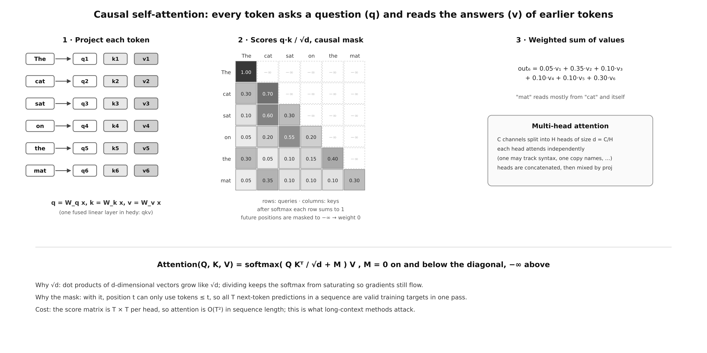
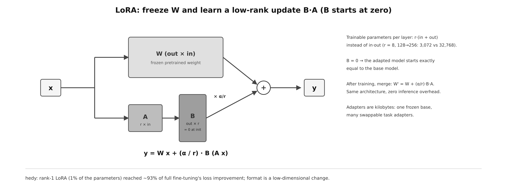
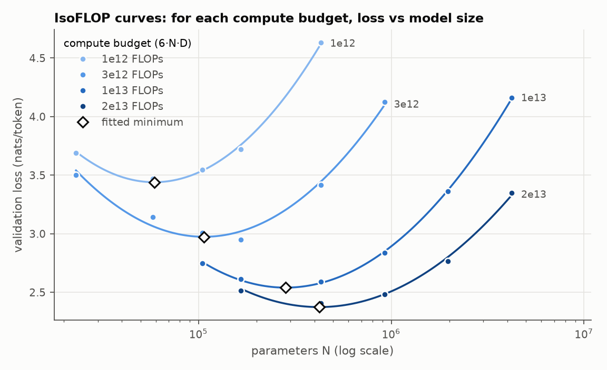
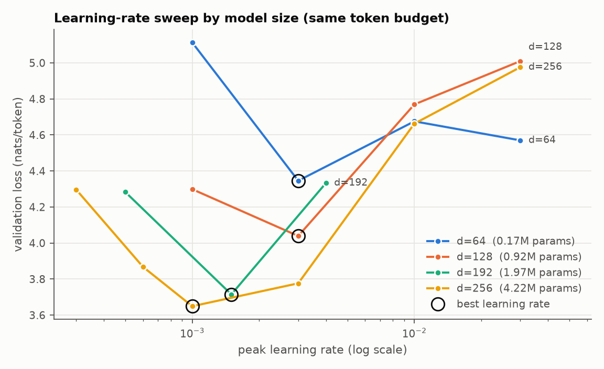
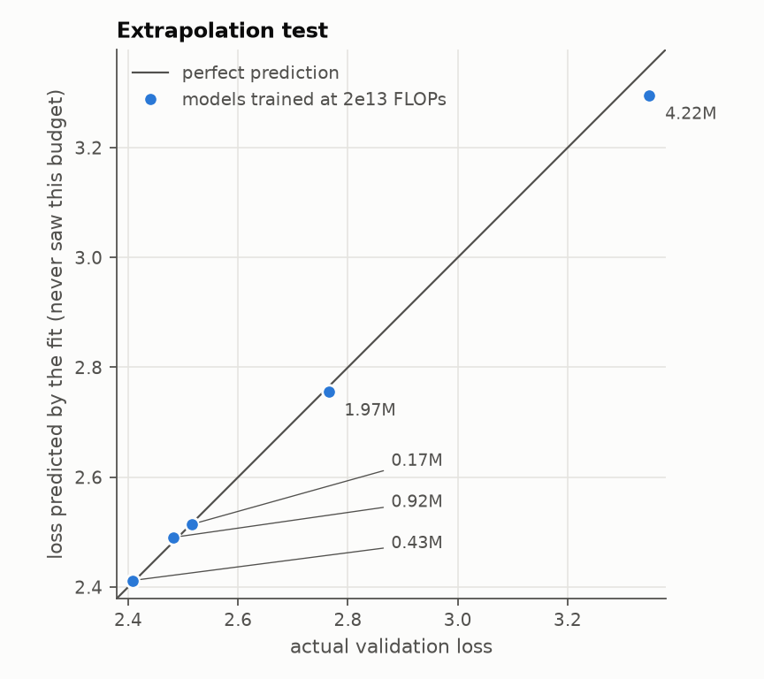
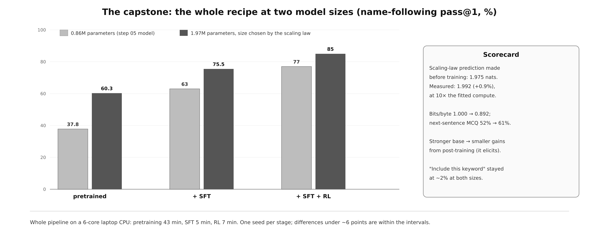

### How to Read This Guide

---

This is a study guide to large language models, written while building **hedy**: a small GPT implemented from scratch in PyTorch, from the tokenizer to online reinforcement learning, with no training frameworks. Every idea below was implemented, tested, and measured on a laptop CPU with an explicit baseline, a noise estimate and its limitations.

The models are tiny (0.8M to 4M parameters, trained on children's stories), so the *numbers* are not those of GPT-4 or LLaMA. The *mechanisms* are exactly the same, and a small model has one big advantage for learning: every experiment runs in minutes, so you can see cause and effect directly.

Each part follows the same pattern:

1. **Theory**: what problem the idea solves, and the math behind it.
2. **Code**: the core of hedy's implementation, usually a few lines.
3. **Experiment**: what actually happened when it was measured, and how to read the result honestly.
4. **Check yourself**: questions to answer before moving on.

Read it in order. Each part builds on the previous one, just as each step of hedy modified the last.


| Part | Topic | hedy code | Key result |
|---|---|---|---|
| 1 | Language modeling and the baseline GPT | `model.py`, `train.py` | initial loss = ln V, as theory predicts |
| 2 | Byte-level BPE tokenizer | `tokenizer.py` | 2.39 vs 2.66 bits/byte against characters |
| 3 | The transformer and attention | `model.py` | the core: causal self-attention |
| 4 | RoPE, RMSNorm, SwiGLU | `model.py` | RoPE is the clear win; RMSNorm is neutral |
| 5 | KV-cache and GQA | `model.py`, `bench.py` | 6.7× faster decoding, identical output |
| 6 | Training at scale | `train.py`, `prepare.py` | accumulation, mixed precision, compile, exact resume |
| 7 | Evaluation | `eval.py` | sliding-window perplexity, baselines, intervals |
| 8 | SFT and LoRA | `sft.py`, `lora.py` | format learned with 1% of the parameters |
| 9 | DPO with a verifier | `dpo.py` | sharpens pass@1, not pass@4 |
| 10 | Online RL (GRPO / RLOO) | `rl.py` | gentlest route to DPO-level accuracy |
| 11 | Scaling laws | `scaling.py`, `scalefit.py` | a fitted law predicts unseen runs to ~1% |
| 12 | Capstone | everything | a pre-registered prediction, met within 0.9% |

---

### Part 1: What a Language Model Is

---

#### Next-token prediction

---

A language model assigns a probability to text. It does so one token at a time, using the chain rule of probability:

$$
P(x_1, x_2, \dots, x_T) = \prod_{t=1}^{T} P(x_t \mid x_1, \dots, x_{t-1})
$$

An LLM is a neural network that computes the conditional distribution $P(x_t \mid x_{<t})$ over the whole vocabulary for every position $t$. That is all it is. Writing code, answering questions and translating are all *continuing text* in a way that is likely under this distribution.

---

#### The training objective: cross-entropy

---

Training maximizes the likelihood of real text, which is the same as minimizing the average **negative log-likelihood** (cross-entropy) of the true next token:

$$
\mathcal{L}(\theta) = -\frac{1}{T}\sum_{t=1}^{T} \log p_\theta(x_t \mid x_{<t})
$$

The training data needs no labels: the target at each position is simply the next token of the text. In code, the input `x` and the target `y` are the same window shifted by one token. **That shift is the training signal.**

```python
# hedy/data.py (idea): random windows, y is x shifted by one
ix = torch.randint(len(data) - block_size - 1, (batch_size,))
x = torch.stack([data[i : i + block_size] for i in ix])
y = torch.stack([data[i + 1 : i + 1 + block_size] for i in ix])
logits, loss = model(x, y)    # cross-entropy over (B·T, V)
```

---

#### The first sanity check: loss = ln V

---

An untrained model predicts roughly uniformly over $V$ tokens, so its loss should be $\ln V$. With 65 characters, $\ln 65 \approx 4.17$; hedy's first logged loss was **4.18**. With a 1,024-token BPE vocabulary, $\ln 1024 = 6.93$; observed **6.95**. If your initial loss is far from $\ln V$, something is broken (initialization, masking, or labels), and nothing you measure afterwards can be trusted.

**Perplexity** is $e^{\mathcal{L}}$: a model with perplexity 9 is as uncertain as a uniform choice among 9 tokens at each step.

---

#### Generation: sampling one token at a time

---

To generate, run the model, take the distribution at the last position, sample a token, append it, and repeat:

```python
# hedy/model.py, GPT._sample
logits = logits[:, -1, :] / temperature           # last position only
if top_k is not None:                              # keep the k most likely tokens
    v, _ = torch.topk(logits, top_k)
    logits[logits < v[:, [-1]]] = -float("inf")
next_token = torch.multinomial(F.softmax(logits, dim=-1), 1)
```

- **Temperature** $T < 1$ sharpens the distribution (safer, more repetitive); $T > 1$ flattens it (more varied, more nonsense).
- **Top-k** removes the unlikely tail, where most of the nonsense lives.

---

#### Experiment: the baseline GPT

---

A 0.81M-parameter character-level model on Tiny Shakespeare, 300 steps on a CPU:

| step | train loss | val loss |
|---|---|---|
| 0 | 4.184 | 4.179 (≈ ln 65: random) |
| 150 | 2.443 | 2.460 |
| 300 | 2.261 | 2.282 |

After 300 steps the output already has the **format** of a play (speaker names, colons, line breaks) with nonsense words. Format and local statistics are learned first; meaning comes much later, and only with much more capacity.

**Check yourself**

- Why does removing the causal mask make the training loss drop absurdly low? What happens when you then sample?
- Why must the loss of an untrained model be close to $\ln V$?
- What do temperature 0.5 and temperature 1.3 do to the shape of the next-token distribution?

---

### Part 2: Tokenization

---

Models consume integers, not text. A **tokenizer** maps text to a sequence of token ids and back.

| Unit | Problem |
|---|---|
| Characters / bytes | very long sequences (attention costs O(T²)), the model must learn spelling, each position carries little information |
| Words | huge vocabulary, unknown words (`<unk>`), no sharing between `run`, `runs`, `running` |
| **Subwords (BPE)** | frequent strings become one token, rare strings fall back to smaller pieces; fixed vocabulary, nothing is unknown |

---

#### Byte-pair encoding

---


**Training** learns an ordered list of merges:

1. Start with every text as a sequence of **bytes** (vocabulary = 256).
2. Count all adjacent pairs and pick the most frequent one, for example `(t, h)`.
3. Create a new token `th` and replace every occurrence of the pair.
4. Repeat until the vocabulary reaches the target size: `vocab = 256 + merges`.

**Encoding** new text applies the learned merges in the order they were learned. **Decoding** concatenates the bytes of each token and decodes UTF-8.

Three details that matter in practice:

- **Byte-level** means every possible string can be represented: emoji, Chinese, binary garbage. There is never an `<unk>`. The cost is that text unlike the training data costs more tokens (a Vietnamese or Chinese character is several bytes and rarely gets merged in an English-trained vocabulary).
- **Pre-tokenization**: before BPE, a regex splits text into chunks (words with their leading space, numbers, punctuation), and merges happen only inside a chunk. Otherwise BPE learns junk tokens that span word boundaries. A side effect: `" the"` and `"the"` are different tokens, which is why LLMs are sensitive to whitespace.
- **Vocabulary size** is a trade: a bigger vocabulary gives shorter sequences but a bigger embedding matrix and rare tokens that are poorly learned. Production models use 32k to 200k tokens; hedy uses 512 to 1,024 for megabytes of text.

---

#### Bits per byte: comparing models with different tokenizers

---

Loss is measured **per token**, and a BPE token covers about two bytes while a character token covers one. So per-token losses are **not comparable** across tokenizers. The fair metric is **bits per byte**:

$$
\text{bpb} = \frac{\sum_t \text{NLL}_t \ (\text{nats})}{\text{bytes} \cdot \ln 2}
$$

hedy's experiment (same model, 1,000 steps): BPE has a *higher* loss per token (3.145 vs 1.844) but is the *better* model in bits per byte (2.39 vs 2.66). Comparing raw losses would have reached the wrong conclusion.

**Check yourself**

- Why does a byte-level tokenizer never need an `<unk>` token?
- Why can't you compare the validation loss of a character model and a BPE model directly?
- Why are non-English languages often more expensive (more tokens per word) for English-trained models?

---

### Part 3: The Transformer

---


A decoder-only transformer turns token ids of shape `(B, T)` into next-token logits of shape `(B, T, V)`:

1. **Embedding**: each token id becomes a vector of width $C$.
2. **$N$ blocks**, each with two residual sub-layers:
   - $x \leftarrow x + \text{Attention}(\text{Norm}(x))$: tokens exchange information.
   - $x \leftarrow x + \text{MLP}(\text{Norm}(x))$: each token is transformed on its own.
3. **Final norm and LM head**: a linear layer to $V$ logits, then softmax.

---

#### Self-attention

---



Each token produces three vectors from its hidden state: a **query** $q$ (what am I looking for?), a **key** $k$ (what do I contain?), and a **value** $v$ (what do I pass on?). The output for token $i$ is a weighted average of the values of all tokens $j \le i$, with weights given by how well $q_i$ matches $k_j$:

$$
\text{Attention}(Q, K, V) = \text{softmax}\!\left(\frac{QK^\top}{\sqrt{d}} + M\right) V,
\qquad M_{ij} = \begin{cases} 0 & j \le i \\ -\infty & j > i \end{cases}
$$

- **The causal mask** $M$ stops position $i$ from looking at the future. Because of it, a single forward pass produces $T$ valid next-token predictions, one per position, and all of them are trained at once.
- **The $\sqrt{d}$ scaling**: dot products of $d$-dimensional vectors grow like $\sqrt{d}$; without the scaling the softmax saturates and its gradients vanish.
- **Multi-head**: the $C$ channels are split into $H$ heads of size $d = C/H$ that attend independently (one might track syntax, another copy names), then are concatenated and mixed by an output projection.
- **Cost**: the score matrix is $T \times T$, so attention is $O(T^2)$ in sequence length.

hedy's attention, abridged:

```python
# hedy/model.py, CausalSelfAttention.forward (abridged)
q, k, v = self.qkv(x).split([H * d, Hk * d, Hk * d], dim=2)   # one fused projection
q = q.view(B, T, H, d).transpose(1, 2)                        # (B, heads, T, d)
k = k.view(B, T, Hk, d).transpose(1, 2)
v = v.view(B, T, Hk, d).transpose(1, 2)
if self.rope:
    cos, sin = rope_cache(T, d, x.device, offset=offset)
    q, k = apply_rope(q, cos, sin), apply_rope(k, cos, sin)   # position, Part 4
y = F.scaled_dot_product_attention(q, k, v, is_causal=True)   # softmax(QK^T/sqrt(d)+M) V
return self.proj(y.transpose(1, 2).contiguous().view(B, T, C))
```

`scaled_dot_product_attention` computes exactly the formula above (with fused, memory-efficient kernels on GPU).

---

#### The rest of the block

---

- **MLP**: applied to each token independently, $C \to 4C \to C$ (or SwiGLU, Part 4). It holds about two thirds of the parameters.
- **Residual connections**: each sub-layer *adds* to the residual stream instead of replacing it, so information and gradients flow straight through a deep stack.
- **Pre-norm**: normalizing *before* each sub-layer keeps the residual stream clean and makes deep models train stably.
- **Weight tying**: the output head reuses the input embedding matrix. Fewer parameters, usually better for small models.
- **Initialization**: weights from $\mathcal{N}(0, 0.02)$, and the residual output projections are scaled by $1/\sqrt{2N}$ so that the variance of the residual stream doesn't grow with depth (a GPT-2 trick).

**Parameter count**: about $12C^2$ per layer ($4C^2$ for attention, $8C^2$ for the MLP) plus $V \cdot C$ for the tied embedding. hedy's final model: $C = 192$, 4 layers, $V = 1024$: **1.97M parameters**.

**Check yourself**

- Why are past queries never needed again during generation, while past keys and values are?
- What would happen to training if the residual connections were removed in a 48-layer model?
- Count the parameters of a block with $C = 128$ by hand.

---

### Part 4: The Modern Recipe: RoPE, RMSNorm, SwiGLU

---

GPT-2 used learned absolute positions, LayerNorm and a GELU MLP. LLaMA, Mistral, Qwen and most current open models use **RoPE**, **RMSNorm** and **SwiGLU**. hedy made each change a config switch and measured them **one at a time**.

---

#### RoPE: rotary position embedding

---


Attention by itself is order-blind. GPT-2 adds a learned vector per position, which caps the length, must be learned from data, and encodes *absolute* position when language mostly cares about *relative* offsets.

RoPE instead **rotates** the query and key vectors. Split the head dimension into pairs $(x_{2i}, x_{2i+1})$, treat each pair as a 2-D point, and rotate it by an angle proportional to the position $p$:

$$
\theta_{p,i} = p \cdot \omega_i, \qquad \omega_i = 10000^{-2i/d}
$$

Early pairs rotate fast (fine position), later pairs slowly (coarse position), like the hands of a clock. The key property is that rotations compose:

$$
\langle R(m)\,q,\; R(n)\,k \rangle = \langle q,\; R(n - m)\,k \rangle
$$

so the attention score between positions $m$ and $n$ depends only on their offset $n - m$. hedy tests this numerically.

```python
# hedy/model.py
def apply_rope(x, cos, sin):
    x1, x2 = x[..., 0::2], x[..., 1::2]        # even/odd channel pairs
    return torch.stack((x1 * cos - x2 * sin, x1 * sin + x2 * cos), dim=-1).flatten(-2)
```

RoPE is applied to $q$ and $k$ only (never $v$), inside every layer, with no new parameters. Context-extension methods (position interpolation, NTK scaling, YaRN) all work by changing these frequencies.

---

#### RMSNorm

---

LayerNorm subtracts the mean and divides by the standard deviation. RMSNorm only rescales:

$$
\text{RMSNorm}(x) = \frac{x}{\sqrt{\tfrac{1}{C}\sum_j x_j^2 + \epsilon}} \cdot g
$$

The claim (Zhang and Sennrich, 2019) is that re-scaling, not re-centering, is what stabilizes training. RMSNorm is slightly cheaper and has no bias.

---

#### SwiGLU

---

A gated MLP: one branch passes through a nonlinearity and **multiplies** the other, so the network can switch features on and off depending on the input:

$$
\text{SwiGLU}(x) = W_{\text{proj}}\big(\text{SiLU}(W_{\text{gate}}\,x) \odot W_{\text{fc}}\,x\big), \qquad \text{SiLU}(z) = z\,\sigma(z)
$$

Three matrices instead of two, so the hidden width is shrunk to about $\tfrac{8}{3}C$ to keep the parameter count equal. Comparisons must be **parameter-matched**, or a "win" may just be "more parameters".

---

#### Experiment: one change at a time

---

Character-level Tiny Shakespeare, 4 layers, width 128, 1,000 steps, same seed; validation bits per byte (lower is better):

| variant | val bpb | Δ vs baseline |
|---|---|---|
| baseline (learned positions, LayerNorm, GELU) | 2.630 | — |
| + RoPE | **2.395** | −0.235 |
| + RMSNorm | 2.655 | +0.025 |
| + SwiGLU | 2.581 | −0.049 |
| all three | **2.313** | −0.317 |

---

The most important habit here is **knowing the noise level**. Running the same baseline with a different thread count (so a different floating-point summation order) moved the result by about 0.03. So:

- **RoPE is a clear win** (8× the noise), and it learns faster from the start.
- **RMSNorm makes no measurable difference**, which is the expected result; its benefit is speed at scale.
- **SwiGLU's gain is at the edge of the noise**: same direction as the literature, not provable from one seed.

**Check yourself**

- Why can keys stored in a KV-cache stay valid with RoPE, but learned absolute positions cap the sequence length?
- Why must architectural comparisons be parameter-matched?
- If two variants differ by 0.02 bits/byte with one seed each, what can you conclude?

---

### Part 5: Inference: KV-Cache and Grouped-Query Attention

---


---

#### The KV-cache

---

Naive generation re-runs the whole sequence for every new token. But with a causal mask, the hidden states of earlier positions **never change** when a token is appended. The output at position $t$ needs its own query and the **keys and values of all positions $\le t$**. So cache K and V per layer:

- **Prefill**: run the whole prompt once and store K and V for every layer.
- **Decode**: run one new token, append its k and v to the cache, attend its q over the cached K and V.

Generating $N$ tokens costs about $N^2/2$ token-forwards without the cache and about $N$ with it.

| | Prefill | Decode |
|---|---|---|
| input | the whole prompt | one token |
| limited by | compute (big matrix multiplies) | **memory bandwidth** (read all weights and the cache to do little math) |
| metric | time to first token | tokens per second |

---

Two details hedy had to get right: **positions continue where the cache ended** (RoPE rotates the new token at its absolute position), and the cache is an optimization, so it must not change results. hedy tests that cached and uncached generation produce **identical tokens**. Measured speed-up: **1.9×** at 64 new tokens, **6.7×** at 480, growing with length because the uncached cost is quadratic.

---

#### The price: memory

---

$$
\text{KV bytes} = 2 \times n_{\text{layers}} \times n_{\text{kv heads}} \times d_{\text{head}} \times \text{bytes per value} \times \text{tokens}
$$

For LLaMA-2-70B (80 layers, 64 heads of 128, bf16) at 4,096 tokens with ordinary multi-head attention, that is about **10.7 GB per sequence**. At serving scale, the cache, not the weights, limits how many users fit on a GPU.

---

#### GQA and MQA

---

Query heads need to be diverse, but key/value heads can be **shared**:

- **MHA**: every query head has its own K/V head.
- **MQA**: all query heads share one K/V head.
- **GQA**: query heads are split into groups that share a K/V head. LLaMA-2-70B uses 8 K/V heads for 64 query heads: the cache shrinks **8×** (10.7 GB → 1.3 GB) and decoding gets faster because there is less to read.

hedy's measurement (4 query heads, bits per byte): MHA 2.313, GQA with 2 K/V heads 2.341 (half the cache), MQA 2.359 (a quarter). The cost is small and monotone, and every gap is close to the 0.03 noise level: a small quality cost for a large memory saving, the trade every serving system makes.

**Check yourself**

- Why is decoding memory-bandwidth bound while prefill is compute bound?
- Compute the KV-cache size of a model you know from its config.
- Why does the speed-up from caching grow with sequence length?

---

### Part 6: Training at Scale

---

#### The quantities that govern a run

---

- **Tokens per optimizer step** = micro-batch × gradient-accumulation steps × context length. Batch size is measured in *tokens*: real runs use 0.5M to 4M per step; hedy used 16k.
- **Compute**: training costs roughly

$$
C \approx 6 \cdot N \cdot D \ \text{FLOPs}
$$

for $N$ parameters and $D$ tokens (2 FLOPs per parameter per token in the forward pass, 4 in the backward pass).

---

#### Gradient accumulation

---

When the batch you want doesn't fit in memory, run $k$ micro-batches, let `.backward()` **add** their gradients, then take one optimizer step. Dividing each micro-loss by $k$ makes the sum equal the mean over the big batch, so this is exact (hedy tests it to $10^{-6}$), as long as nothing couples examples within a batch (LayerNorm and RMSNorm don't; BatchNorm would).

---

#### Mixed precision

---

| format | sign / exponent / mantissa bits | range | precision |
|---|---|---|---|
| fp32 | 1 / 8 / 23 | ±3·10³⁸ | ~7 digits |
| fp16 | 1 / 5 / 10 | ±65,504 | ~3 digits; gradients underflow, needs loss scaling |
| **bf16** | 1 / 8 / 7 | ±3·10³⁸ | ~2 digits; same range as fp32, the modern default |

---

Autocast runs the matrix multiplies (most of the FLOPs) in low precision and keeps sensitive operations (softmax, norms, loss) in fp32. The weights and optimizer state stay in **fp32 master copies**: a bf16 weight update of $10^{-5}$ on a weight of $0.02$ would be rounded away.

**Memory per parameter** with AdamW: weights 4 B + gradients 4 B + two Adam moments 8 B = **16 bytes**, before activations. A 7B model needs about 112 GB of state, which is why large runs shard it across GPUs (ZeRO, FSDP).

A lesson from measuring instead of assuming: on hedy's CPU, which has no bf16 hardware, **bf16 was 7.5× slower** than fp32, while the numerics were indistinguishable. On an A100 or H100, the same flag is a large speed-up. Measure on the target hardware.

---

#### The rest of a real training loop

---

- **AdamW** with $\beta = (0.9, 0.95)$, weight decay only on matrices, gradient clipping at 1.0. Log the gradient norm before clipping: sudden jumps come before divergence.
- **Learning-rate schedule**: linear warmup, then cosine decay to about 10%.
- **`torch.compile`** fuses memory-bound operations (norms, residual adds, RoPE) into single kernels: about 20–30% faster in hedy.
- **Dropout 0**: with one pass over fresh data there is little to regularize, and dropout cost about 50% of throughput.
- **Data**: tokenize once into a flat `uint16` file and memory-map it, so a 100 GB corpus costs no RAM. Split train and validation **by document**.
- **Checkpoints** store model, optimizer state and step, written atomically. Seeding each step by its step number makes a resumed run bit-identical to an uninterrupted one (tested).

---

#### Experiment: a real (small) corpus

---

0.86M parameters on TinyStories, 16,384 tokens per step, 1,000 steps (16.4M tokens, about 19 tokens per parameter), 14 minutes on a CPU. Validation went from 6.95 (≈ ln 1024) to 2.21 nats per token. A sample:

> *Once upon a time, there was a little fish named Alice. Alice loved to explore the world and look for new things. One day, she was running up the pit. She walked up and found a diamond. It was a basket of herbs!*

Grammar, dialogue, character names and story shape are all there; meaning is not (a fish "running up the pit"). **Local syntax is cheap to learn; coherence over many sentences needs far more capacity.**

**Check yourself**

- Why is gradient accumulation exact for a transformer but not for a network with BatchNorm?
- Why must master weights stay in fp32 even when the matmuls run in bf16?
- Estimate the memory needed to train a 1B-parameter model with AdamW (state only).

---

### Part 7: Evaluation: What Do the Numbers Mean?

---

A loss of 2.2 or an accuracy of 51.6% means nothing on its own. Every number needs a **definition, a baseline, a noise estimate, and a leak check**.

---

#### Perplexity done properly

---

If the validation set is cut into non-overlapping windows, the first tokens of every window are predicted with almost no context, which inflates the loss. A **sliding window** advances by a stride smaller than the window and scores only the newest tokens, so every token is scored once with plenty of context.

| method | bits per byte |
|---|---|
| chunked windows | 1.034 |
| sliding window, stride 64 | **1.000** |
| sliding window, stride 16 | 1.000 |

---

Chunked evaluation overstated the loss by 3.4%. The loss by position inside a window shows why: 3.83 nats at position 0, 2.38 at position 7, about 2.15 after 16 tokens of context.

---

#### Baselines give the number its meaning

---

| model | bits per byte |
|---|---|
| uniform over 1,024 tokens | 3.258 |
| unigram (token frequencies) | 2.725 |
| bigram (previous token) | 1.633 |
| **0.86M transformer** | **1.000** |

---

The bigram's smoothing was tuned on training data, never on validation: tuning on the test set is the most common way to fool yourself.

---

#### How benchmarks work: likelihood scoring

---

Most base-model benchmarks (HellaSwag, ARC, MMLU in its likelihood form) don't generate anything. For each answer choice, compute $\log P(\text{choice} \mid \text{question})$ and pick the highest:

- **acc**: total log-likelihood, biased toward short choices.
- **acc_norm**: log-likelihood per byte, which removes the length bias.

Real benchmarks score at chance for a model this small, so hedy built a next-sentence task from held-out stories (4 choices):

| scorer | accuracy (95% CI) |
|---|---|
| acc | 42.6% (38.3–47.0) |
| **acc_norm** | **51.6%** (47.2–56.0) |
| always pick the shortest / longest choice | 24.8% / 22.8% |
| untrained model | 23.0% / 24.6% |

Validate the benchmark itself first: an untrained model and trivial shortcuts must score at chance, or you are measuring the benchmark, not the model. With 500 items the interval is about ±4.4 points, so two models closer than about 5–8 points are not distinguishable.

---

#### The evaluation checklist

---

- Split held-out data **by document**, before any tokenizer, model or hyper-parameter choice.
- Use a tokenizer-independent metric (bits per byte) when tokenizers differ.
- Always report baselines and a sanity check with a model whose answer you know.
- Report uncertainty, and don't over-read gaps smaller than it.
- Evaluate with full context, and say how.
- **Test the evaluation code**: evaluation bugs don't crash, they produce plausible wrong numbers.

**Check yourself**

- Why does chunked evaluation overstate the loss?
- What does an untrained model scoring 40% on your benchmark tell you?
- Why is acc biased toward short answers?

---

### Part 8: Post-Training I: Supervised Fine-Tuning and LoRA

---

A pretrained model only continues text. **Supervised fine-tuning (SFT)** continues training on (instruction, response) pairs so that it follows instructions. The loss is the same cross-entropy; only the data and the mask change.

---

#### The details that make SFT work

---

- **Loss masking**: compute the loss only on the response tokens (prompt targets set to `-100`, which cross-entropy ignores). The prompt is given at inference time; there's nothing to learn from predicting it.
- **Teaching the model to stop**: production models have an end-of-turn token. hedy's BPE has none, so each response ends with `### End`, which the model learns to emit and generation stops on. The base model emitted it **0%** of the time; every SFT variant reached **98–100%**.
- **Right-padding** is safe with a causal model: a real token never attends to later padding.

---

#### LoRA

---



Full fine-tuning updates every weight and needs gradients and optimizer state for all of them. **LoRA** (Hu et al., 2021) rests on the observation that the *change* needed to adapt a pretrained model has low rank. Freeze $W$ and learn

$$
y = Wx + \frac{\alpha}{r}\, B A x, \qquad A \in \mathbb{R}^{r \times d_{\text{in}}},\ B \in \mathbb{R}^{d_{\text{out}} \times r}
$$

```python
# hedy/lora.py, LoRALinear
self.lora_A = nn.Parameter(torch.empty(r, base.in_features))    # Kaiming init
self.lora_B = nn.Parameter(torch.zeros(base.out_features, r))   # zero: starts as the base model
def forward(self, x):
    return self.base(x) + (x @ self.lora_A.T @ self.lora_B.T) * self.scale   # scale = alpha / r
```

- $B = 0$ at the start, so the adapted model **equals** the base model, and on the first step only $B$ gets a gradient.
- **Merging** $W' = W + \tfrac{\alpha}{r}BA$ after training gives zero inference overhead.
- **Adapters are kilobytes**: one frozen base model can serve many tasks. The saving grows with size: an adapter costs about $2r/d$ of a layer, 12.5% at $d = 128$ but 0.4% at $d = 4096$.

---

#### Experiment: what SFT can and cannot teach

---

Task: verifiable instructions built from TinyStories ("write a story about a character named Sam", "include the word *money*"), checked by a program, with a coincidence control.

1. **Format is learned by everything, even 1% of the parameters.** Rank-1 LoRA (8,224 parameters, a 44 KB file) got ~93% of full fine-tuning's loss improvement. Format and style are a low-dimensional change, consistent with the "superficial alignment" idea that SFT mostly surfaces what the base model already has.
2. **Names: partly learned, and capacity matters.** The base model already copied the name from the prompt 37% of the time; full fine-tuning reached 60–66%. The improvement grew monotonically with LoRA rank.
3. **Keywords: nothing learned.** Across 14 runs, learning rates spanning 100×, ranks 1–16 and full fine-tuning, keyword inclusion stayed at 1–2%. Using a given word somewhere in a story needs planning, which this model can't do. **SFT cannot conjure a capability the base model lacks.**
4. **Forgetting**: bits per byte on the original pretraining text rose with how far the model moved. At matched task performance, LoRA showed **no** forgetting advantage over full fine-tuning; "LoRA learns less and forgets less" was just a point on the same trade-off curve.
5. **Noise**: the same config with another seed moved the pass rate from 42% to 51%. A smooth, teacher-forced probe (how much cheaper the required word becomes when the instruction asks for it) was far more stable, and is what separated close runs.

**Check yourself**

- Why mask the prompt tokens out of the SFT loss?
- Why does LoRA initialize $B$ to zero rather than $A$?
- What does "SFT elicits, it doesn't create" mean, and what evidence supports it here?

---

### Part 9: Post-Training II: Preference Optimization with DPO

---

SFT teaches a model to *imitate*. Preference optimization teaches it to *prefer* better outputs over worse ones.

---

#### From RLHF to DPO

---

Classic RLHF fits a **reward model** on human comparisons with the Bradley–Terry model $P(y_c \succ y_r) = \sigma(r(x, y_c) - r(x, y_r))$, then runs RL (PPO) to maximize reward while a KL penalty keeps the policy close to the starting model:

$$
\max_\pi\ \mathbb{E}\big[r(x, y)\big] - \beta\, \mathrm{KL}\big(\pi(\cdot \mid x)\,\|\,\pi_{\text{ref}}(\cdot \mid x)\big)
$$

**DPO** (Rafailov et al., 2023) notices that this problem has a closed-form optimum, $\pi^*(y \mid x) \propto \pi_{\text{ref}}(y \mid x)\, e^{r(x,y)/\beta}$, which can be inverted to express the reward through the policy: $r(x,y) = \beta \log \tfrac{\pi(y \mid x)}{\pi_{\text{ref}}(y \mid x)} + \text{const}$. Substituting into Bradley–Terry, the constant cancels, leaving a supervised loss on preference pairs, with **no reward model and no sampling loop**:

$$
\mathcal{L}_{\text{DPO}} = -\log \sigma\!\Big(\beta\big[(\log \pi(y_c) - \log \pi_{\text{ref}}(y_c)) - (\log \pi(y_r) - \log \pi_{\text{ref}}(y_r))\big]\Big)
$$

```python
# hedy/dpo.py
def dpo_loss(pc, pr, rc, rr, beta):          # policy / reference log-probs of chosen, rejected
    margin = beta * ((pc - rc) - (pr - rr))  # implicit reward of chosen minus rejected
    return -F.logsigmoid(margin).mean()
```

Read it as: raise the chosen response's probability *relative to the reference*, lower the rejected one's, and stop caring once the margin is large. At the start the margin is 0 and the loss is $\ln 2$.

---

#### Preference data from a verifier

---

Instead of human labels, hedy uses a program as the judge: sample 8 responses per instruction from the SFT model, keep those that pass (finished and contain the name) as *chosen*, pair them with finished failures as *rejected*. Prompts where all 8 pass or all 8 fail give no pair: **no contrast, no learning signal**. For keywords (0.8% pass rate), 94% of prompts produced nothing.

Two controls make the result meaningful:

- **RFT** (rejection-sampling fine-tuning): plain SFT on the chosen responses only. If DPO doesn't beat this, you didn't need the contrast.
- **pass@1 vs pass@4**: pass@4 is "at least one of 4 samples passes". A gap means the model *can* do it but not reliably.

---

#### Results and the failure modes they reveal

---


1. **Every method helps, and the simple baseline gets most of it.** RFT reached 73.5% with almost no side effects; the well-behaved DPO runs reached 76–80%.
2. **It sharpens; it doesn't expand.** pass@4 barely moved (82.7% → 82–87%) while pass@1 climbed toward it. The model became reliable at something it could already do sometimes. With no successes to contrast, keywords stayed at noise.
3. **Over-optimization is visible before the metric breaks.** Raising the learning rate kept pass@1 flat (76 → 79 → 78.5%) while the share of responses that still *stopped* fell from 98% to **10%**. The verifier never checked termination, so it couldn't notice: **Goodhart's law** in one table.
4. **The early warning is the chosen response's log-probability.** DPO only constrains the *difference*, and pushing the rejected response down drags the chosen one with it. Collapse came with the chosen log-prob falling by 20–29 nats; healthy runs kept it near or above zero.
5. **The reward gets hacked.** Passing responses mentioned the name 3.4–6.4 times under DPO (2.7 for the SFT model and RFT), against 2.5 in real stories and 2.0 in the chosen examples. DPO found that repetition is a safer way to satisfy "the name appears".
6. **The fixes**: a larger $\beta$ (a tighter leash: $\beta = 0.3$ was both the most effective and the safest) and an **NLL anchor** on the chosen response (99% still finishing, the highest pass@4, the least hacking).

**Check yourself**

- Derive why the partition function cancels in the DPO loss.
- Why can't preference optimization teach a behaviour the model never samples?
- Which metric warned of DPO's collapse before pass@1 did, and why?

---

### Part 10: Post-Training III: Online RL with a Verifiable Reward

---

DPO trains on pairs sampled **once**. Online RL samples **fresh responses from the current policy at every step**, so the policy keeps generating its own data and could, in principle, discover new successes.

---

#### The policy gradient

---

To maximize the expected reward $J(\theta) = \mathbb{E}_{y \sim \pi_\theta}[R(x,y)]$, the log-derivative trick gives

$$
\nabla_\theta J = \mathbb{E}\big[R(x,y)\, \nabla_\theta \log \pi_\theta(y \mid x)\big]
$$

Sample a response and raise its log-probability in proportion to how good it was (REINFORCE). The reward can be **any program**: nothing about it needs to be differentiable.

---

#### Baselines and group advantages

---

Subtracting a baseline $b$ that doesn't depend on the sampled response leaves the expected gradient unchanged (because $\mathbb{E}[\nabla \log \pi] = 0$) but reduces its noise a lot. PPO learns a value network as $b$, a second model as large as the policy. **Group methods** instead sample $K$ responses to the same prompt and use the others as the baseline:

| method | advantage of sample $i$ |
|---|---|
| **GRPO** (DeepSeekMath, 2024) | $(r_i - \bar r) / (\sigma_r + \epsilon)$ |
| **RLOO** | $r_i - \text{mean of the other } K - 1$ (exactly unbiased) |

```python
# hedy/rl.py
def advantages(rewards, kind="grpo", eps=1e-4):
    r = np.asarray(rewards, dtype=np.float64)
    if kind == "rloo":
        return r - (r.sum() - r) / (len(r) - 1)
    a = r - r.mean()
    return a / (r.std() + eps) if r.std() > eps else np.zeros_like(r)   # all-equal group: no signal
```

If all $K$ samples get the same reward, every advantage is zero: **too-hard and too-easy prompts carry no signal**.

---

#### The full objective

---

$$
\mathcal{L} = -\min\!\big(\rho_t A,\ \text{clip}(\rho_t, 1-\epsilon, 1+\epsilon)\,A\big) + \beta\, \underbrace{\big(e^{\delta_t} - \delta_t - 1\big)}_{k_3 \text{ KL estimate}},
\qquad \rho_t = \frac{\pi_\theta(y_t)}{\pi_{\text{old}}(y_t)},\ \delta_t = \log \pi_{\text{ref}}(y_t) - \log \pi_\theta(y_t)
$$

- The **clipped ratio** (from PPO) only matters when a batch is reused for several updates; with one update per batch, $\rho = 1$ and this is REINFORCE with a group baseline.
- The **KL penalty** to a frozen reference keeps the policy from drifting toward whatever the reward over-rewards. The $k_3$ estimator is always non-negative and unbiased.
- **Sample on-policy**: at temperature 1 with no top-k, exactly the distribution whose log-probabilities are differentiated.
- **Credit assignment**: one reward per response means every token gets the same advantage. hedy's first unit test, rewarding only the first token, didn't learn in 25 steps; a dense reward learned quickly. Sparse, single-token rewards need many more samples.

---

#### Results

---

- **It works, and is clean at gentle settings**: 50 steps of GRPO took name-following from 63% to **77%** with almost no forgetting (+0.006 bits/byte) and 100% of responses still finishing. RLOO gave the same result (76.8%).
- **Compared with DPO**: at matched accuracy, online RL forgot **less**, at similar sampling compute. The gentlest route to DPO-level accuracy, not a different league.
- **It still sharpens**: pass@4 stayed at 84–87% while pass@1 rose toward it.
- **Success starves the signal**: as the policy improved, the fraction of groups with any contrast fell from 79% to 41%.
- **Reward hacking scales with optimization pressure**: mentions per passing response rose from 3.6 to 4.1 as the policy moved further from the reference.

The real test was keywords (0.8% pass rate), where online sampling might discover what fixed pairs couldn't. A gentle run learned nothing. An aggressive run (high learning rate, no KL) raised keyword success to 6.7% and then collapsed: **name-following fell from 63% to 21%**, and nearly every story became the same template ("Once there was a little girl was three years old and loved to explore the forest…"). 87% of its "successes" were for the four keywords *explore, three, years, forest*, which appear in the template. This is **specification gaming**: with almost no real successes to learn from, RL amplified the cheapest correlate of reward.

**Check yourself**

- Why does subtracting a baseline not bias the policy gradient?
- Why does a group where all samples pass contribute zero gradient?
- What does "a verifier is a spec, and optimizers read the spec literally" mean in the keyword experiment?

---

### Part 11: Scaling Laws

---

Every earlier part trained one model. Scaling laws ask how loss changes with **model size** $N$, **data** $D$ and **compute** $C$, and answer the practical question: *for a fixed compute budget, how big should the model be and how long should it train?*

---

#### The Chinchilla form

---

$$
L(N, D) = E + \frac{A}{N^\alpha} + \frac{B}{D^\beta}
$$

- $E$: the **irreducible loss**, the entropy of the text itself.
- $A/N^\alpha$: the cost of a finite model, even with infinite data.
- $B/D^\beta$: the cost of finite data, even with an infinite model.

With $C = 6ND$ fixed, minimizing $L$ gives a closed-form compute-optimal allocation:

$$
N^*(C) \propto C^{\frac{\beta}{\alpha+\beta}}, \qquad D^*(C) \propto C^{\frac{\alpha}{\alpha+\beta}}
$$

Chinchilla (Hoffmann et al., 2022) found both exponents close to ½: **model size and data should grow together, about 20 tokens per parameter**. That overturned the earlier Kaplan result and showed many early large models were under-trained.

---

#### The method: IsoFLOP curves

---

For each compute budget, train several model sizes with $D = C/6N$, plot loss against $N$, and find the bottom of the U-shaped curve. hedy did this at four budgets (10¹² to 2·10¹³ FLOPs), 22 runs from 23k to 4.2M parameters, every run with its own full schedule and fresh data.



Two things had to be done first:

- **Tune the learning rate per size**: the best learning rate fell as models got wider (roughly $\propto d^{-0.75}$). One shared value would have penalized the larger models and bent the fit.
- **Measure the noise floor**: the same configuration with three seeds varied by 0.02–0.04 nats, so smaller differences mean nothing.



---

#### Results

---

- **The model you pick matters enormously.** At 2·10¹³ FLOPs, the 4.2M-parameter model was **0.94 nats worse** than the best choice (0.43M). The best allocation reaches that big model's loss with about **16× less compute**. *A bigger model on too little data is worse than a smaller model on enough data.*
- **The fitted law**: $L(N, D) = 1.36 + 80.5/N^{0.371} + 8772/D^{0.631}$, giving an optimal-size exponent of 0.63 (IsoFLOP: 0.68), faster than Chinchilla's ½.
- **The exponent depends on bookkeeping**: counting only non-embedding parameters, as Kaplan did, gave 0.73 on the same data. Published exponents disagree partly for this reason.
- **Prediction**: the fit predicted held-out runs at a 2× larger budget to **0.5%** on average, and larger models it never saw to 1.3%, about the size of the seed noise.



---

#### Caveats that matter in practice

---

- **Compute-optimal is not deployment-optimal**: inference is paid per use, so models meant for heavy serving are deliberately **over-trained** far past 20 tokens per parameter.
- **Wall-clock is not FLOPs**: small models ran at a tenth of the hardware rate of larger ones on hedy's CPU.
- **Loss is not capability**: laws are smooth in loss, while benchmarks can look like sudden "emergence".
- **Data runs out**: past one pass over the corpus, more compute needs more data (Muennighoff et al. found up to ~4 epochs are nearly as good as fresh data).

**Check yourself**

- Why does a fixed compute budget produce a U-shaped curve of loss against model size?
- Why must the learning rate be tuned per model size before fitting a law?
- When would you deliberately train a model smaller than compute-optimal?

---

### Part 12: The Capstone: One Model, the Whole Recipe

---

The final step combined everything: the scaling law **chose the model size** for a 10× larger budget (2·10¹⁴ FLOPs), and its predicted loss was **written down before training**.

| choice | value | evidence |
|---|---|---|
| tokenizer | byte-level BPE, 1,024 tokens | Part 2 |
| architecture | RoPE + RMSNorm + SwiGLU, plain multi-head | Parts 4 and 5 (GQA brings nothing at context 128) |
| optimizer | AdamW, warmup + cosine, dropout 0, `torch.compile` | Part 6 |
| size and tokens | 1.97M parameters, 16.9M tokens, chosen by the law | Part 11 |
| post-training | full SFT, then online RL (GRPO) | Parts 8 and 10 |

**The prediction test**: predicted 1.975 nats, measured **1.992**, an error of **+0.9%**, inside the interval and about the size of the seed noise. A law fitted on runs up to 2·10¹³ FLOPs predicted a run with 10× more compute.



What the scorecard says:

- **The recipe composes**: every stage improves the model at both sizes.
- **A better base lifts every stage, and post-training gains shrink as the base improves** (SFT: +25 points for 0.86M, +15 for 1.97M). Post-training elicits what the base can already do.
- **It sharpens rather than expands**, at both sizes.
- **"Include this keyword" stayed at ~2%** even with a 2.3× larger base: the capacity explanation from Part 8 was not confirmed.
- **The whole pipeline took about one hour of CPU**: pretraining 43 minutes, SFT 5, RL 7.

---

### The Big Lessons

---

1. **An LLM is a next-token predictor.** Everything else is a choice of data, architecture, objective or decoding on top of that one loss.
2. **Sanity-check against theory first**: initial loss $\approx \ln V$; an untrained model scores at chance; a cache doesn't change outputs.
3. **Change one thing at a time, and know your noise floor.** Most single-seed differences under the noise are not results.
4. **Compare fairly**: bits per byte across tokenizers, parameter-matched architectures, matched task performance for forgetting.
5. **Pretraining creates capability; post-training elicits and sharpens it.** pass@k bounds what preference and RL training can reach.
6. **Contrast is the fuel of preference and RL training**: no successes, no signal.
7. **A reward is a specification, and optimizers read it literally.** Measure what the reward can't see: termination, repetition, drift.
8. **Build the evaluation before the training**, and test it like any other code.
9. **Scale by the law, not by intuition**: for a fixed budget, the right size beats the biggest size.
10. **Measure on the target hardware**: bf16 and compile gains are hardware-specific.

---

### Glossary

---

| Term | Meaning |
|---|---|
| Token | the unit a model reads and writes, from a fixed vocabulary |
| Logits | unnormalized scores over the vocabulary; softmax turns them into probabilities |
| Cross-entropy / NLL | the average negative log-probability of the true next token |
| Perplexity | $e^{\text{loss}}$: the effective number of equally likely choices |
| Bits per byte | tokenizer-independent loss: total NLL ÷ (bytes · ln 2) |
| Causal mask | stops a position from attending to later positions |
| Residual stream | the running hidden state that every sub-layer adds to |
| RoPE | position encoded by rotating q and k; scores depend on relative offset |
| KV-cache | stored keys and values of past tokens, so each new token costs O(T) |
| GQA / MQA | sharing key/value heads across query heads to shrink the cache |
| SFT | fine-tuning on instruction/response pairs, loss on the response only |
| LoRA | a frozen weight plus a trainable low-rank update $BA$ |
| DPO | a supervised loss on preference pairs derived from KL-regularized RL |
| RFT | fine-tuning on the model's own samples that pass a check |
| GRPO / RLOO | policy-gradient RL with a group of samples as the baseline |
| Verifier | a program that scores a response (a reward without a reward model) |
| pass@k | the probability that at least one of k samples is correct |
| Reward hacking | maximizing the reward through a loophole instead of the intended behaviour |
| IsoFLOP curve | loss against model size at fixed compute |
| Compute-optimal | the model size and token count that minimize loss for a budget |

---

### Further Reading

---

**Foundations**
- Vaswani et al., *Attention Is All You Need* (2017)
- Radford et al., *Language Models are Unsupervised Multitask Learners* (GPT-2, 2019)
- Sennrich et al., *Neural Machine Translation of Rare Words with Subword Units* (BPE, 2016)
- Karpathy, *Let's build GPT from scratch*, *nanoGPT*, and *Let's build the GPT Tokenizer*

**Architecture and inference**
- Su et al., *RoFormer* (RoPE, 2021); Zhang and Sennrich, *RMSNorm* (2019); Shazeer, *GLU Variants Improve Transformer* (2020)
- Touvron et al., *LLaMA* (2023)
- Shazeer, *Fast Transformer Decoding* (MQA, 2019); Ainslie et al., *GQA* (2023)
- Pope et al., *Efficiently Scaling Transformer Inference* (2022); Kwon et al., *PagedAttention / vLLM* (2023)

**Training and evaluation**
- Micikevicius et al., *Mixed Precision Training* (2017); Rajbhandari et al., *ZeRO* (2019)
- Eldan and Li, *TinyStories* (2023); Penedo et al., *FineWeb* (2024)
- Gao et al., *lm-evaluation-harness*; Zellers et al., *HellaSwag* (2019); Miller, *Adding Error Bars to Evals* (2024)

**Post-training**
- Ouyang et al., *InstructGPT* (2022); Zhou et al., *LIMA* (2023)
- Hu et al., *LoRA* (2021); Dettmers et al., *QLoRA* (2023); Biderman et al., *LoRA Learns Less and Forgets Less* (2024)
- Rafailov et al., *Direct Preference Optimization* (2023); Schulman et al., *PPO* (2017)
- Shao et al., *DeepSeekMath* (GRPO, 2024); Ahmadian et al., *Back to Basics* (RLOO, 2024); DeepSeek-AI, *DeepSeek-R1* (2025)
- Yue et al., *Does RL Really Incentivize Reasoning Capacity Beyond the Base Model?* (2025); Skalse et al., *Defining and Characterizing Reward Hacking* (2022)

**Scaling**
- Kaplan et al., *Scaling Laws for Neural Language Models* (2020); Hoffmann et al., *Chinchilla* (2022)
- Porian et al., *Resolving Discrepancies in Compute-Optimal Scaling* (2024); Muennighoff et al., *Scaling Data-Constrained Language Models* (2023)
- Yang et al., *µP / Tensor Programs V* (2022); Sardana and Frankle, *Beyond Chinchilla-Optimal* (2023)

**Whole courses**
- Stanford CS336, *Language Modeling from Scratch*; Karpathy, *Neural Networks: Zero to Hero*; Hugging Face, *Smol Training Playbook*
