### Overview

---

Shannon's capacity formula sets the limit for any single radio channel:

$$
C = B \log_2(1 + \text{SNR})
$$

There are only a few ways to raise it. More **bandwidth** ($B$) raises capacity linearly. More **SNR** helps only logarithmically: doubling the signal power adds about one bit per second per hertz. **MIMO** adds a third option: with several antennas on both sides and enough multipath, several independent streams share the same channel at the same time, and capacity grows roughly with the number of streams:

$$
C \approx \min(M, N) \cdot B \log_2(1 + \text{SNR})
$$

where $M$ and $N$ are the numbers of transmit and receive antennas. Starting with 802.11n, every Wi-Fi generation has used both levers: wider channels (**channel bonding**) and more antennas (**MIMO**). This post covers both.

---

### Channel Bonding

---

A wider channel is like a wider road: it carries more traffic at the same speed. 802.11a and 802.11g use 20 MHz channels. 802.11n can bond two adjacent 20 MHz channels into one **40 MHz** channel, 802.11ac adds **80 MHz** and **160 MHz** (or **80+80 MHz**), and Wi-Fi 7 adds **320 MHz** in the 6 GHz band.

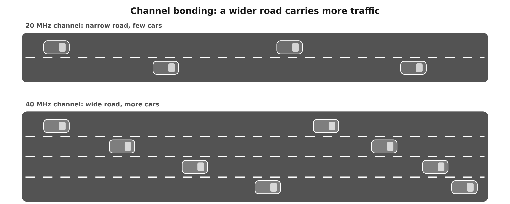

Bonding gives slightly **more than twice** the throughput. A 20 MHz OFDM channel leaves unused **guard bands** (null subcarriers) at both edges to limit interference with neighboring channels. When two channels are bonded, the gap between them no longer needs a guard band and carries data too. An 802.11n 20 MHz channel has **52 data subcarriers**; a 40 MHz channel has **108**, not 104. That is 108 / 52 ≈ 2.08 times the data rate of a single 20 MHz channel.

| Width | 802.11n/ac data subcarriers | 802.11ax/be data subcarriers |
|---|---|---|
| 20 MHz | 52 (48 in 802.11a/g) | 234 |
| 40 MHz | 108 | 468 |
| 80 MHz | 234 | 980 |
| 160 MHz | 468 | 1960 |

(802.11ax uses subcarriers spaced four times closer, which is why it has about four times as many in the same width.)

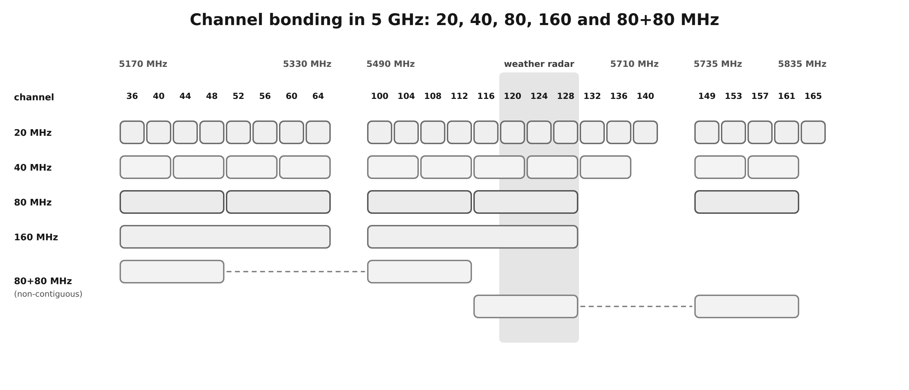

An 80 MHz channel bonds two adjacent 40 MHz channels, and a 160 MHz channel bonds two adjacent 80 MHz channels. Because contiguous 160 MHz blocks are scarce in 5 GHz, 802.11ac also allows **80+80 MHz**: two non-adjacent 80 MHz channels used as one. Few products implemented it, and 802.11be dropped 80+80 in favor of contiguous 160 and 320 MHz channels in 6 GHz.

Wider is not always better. Each doubling of width halves the number of independent channels, spreads the same transmit power over twice the spectrum (about 3 dB less power per subcarrier, so slightly less range at a given MCS), and makes [co-channel interference](/blog/cci/) more likely. Dense enterprise networks usually run 20 or 40 MHz in 5 GHz.

#### Primary and secondary channels

---

A bonded channel always has one **primary 20 MHz channel**. Beacons and other management frames, and all non-HT (legacy) transmissions, are sent on the primary channel, and a station runs its full CCA and backoff on it.

In a 160 MHz channel, the **primary 80 MHz** channel is the half that contains the primary 20 MHz channel, and the other half is the **secondary 80 MHz**. Inside the primary 80, the **primary 40 MHz** contains the primary 20 and the other 40 MHz is the **secondary 40**. Inside the primary 40, the 20 MHz channel next to the primary is the **secondary 20**.

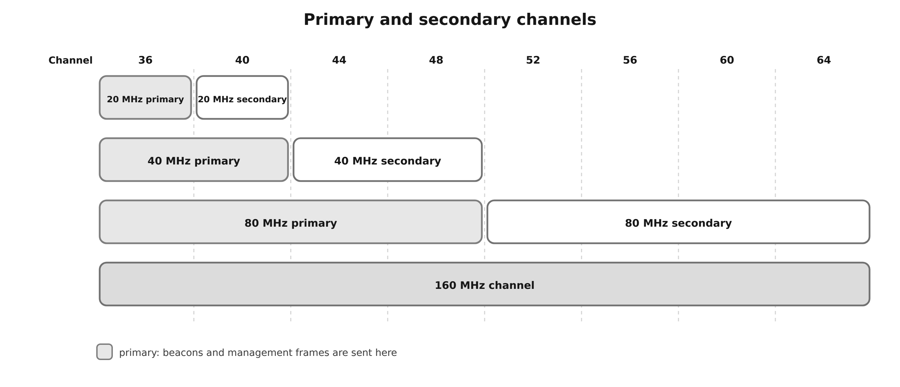

#### Static and dynamic bandwidth

---

With channels from 20 to 160 MHz wide, a transmitter often finds some subchannels busy. What it does then depends on the bandwidth mode:

- **Static bandwidth** (802.11n behavior): a transmission uses the whole bonded channel or nothing. If the secondary channel is busy, the transmitter cannot use the full width and has to wait, or fall back to the primary 20 MHz only.
- **Dynamic bandwidth** (802.11ac): the transmitter sends an **RTS** duplicated on every 20 MHz subchannel, with the intended bandwidth signaled in the frame. The receiver checks which subchannels are idle at its end and answers with **CTS** frames only on idle subchannels, always including the primary. The transmitter then sends data on the width the CTS covered, for example 40 MHz out of 80, instead of giving up.

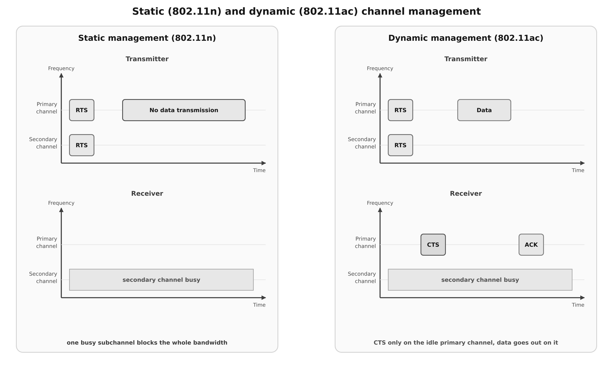

Dynamic bandwidth improves channel utilization when neighboring networks use overlapping channels of different widths. Two APs whose wide channels overlap can each grab whatever subchannels are idle at the moment, so the shared spectrum stays busy with useful traffic instead of being blocked for both. They still take turns on any given 20 MHz subchannel; they do not transmit on it at the same time.

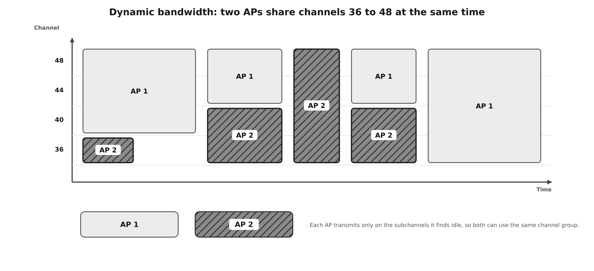

802.11ax and 802.11be go further with **preamble puncturing**: a transmitter can skip a busy 20 MHz subchannel in the middle of a wide channel and still use the rest of it.

---

### MIMO

---

#### SISO, SIMO and MISO

---

**SISO (single input, single output)** uses one transmit antenna and one receive antenna and carries one **spatial stream**. It is simple, but when multipath makes the signal fade at the receiver's location, there is nothing to fall back on.

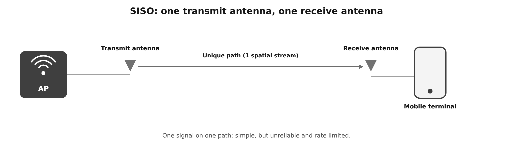

Adding antennas on one side gives **diversity**: several copies of the same signal that fade differently.

- **SIMO (single input, multiple output), receive diversity**: one signal is transmitted and received on two or more antennas. Each antenna sees a different combination of paths, so they rarely fade at the same moment. The receiver picks the best copy (selection diversity) or, better, combines them with **maximal-ratio combining (MRC)**, weighting each copy by its quality. The result is a higher and steadier SNR. The data rate can rise through a better MCS, but there is still only one stream.
- **MISO (multiple input, single output), transmit diversity**: two or more antennas transmit to a single receive antenna. Simply sending the identical signal from every antenna does not work: the copies can arrive out of phase and cancel (the spatial hole shown in the beamforming section below). Transmit diversity therefore needs either **space-time block coding (STBC)**, which sends differently coded versions of the data from each antenna (the Alamouti scheme for two antennas), or **beamforming**, which needs knowledge of the channel. 802.11n/ac also use **cyclic shift diversity (CSD)**, a small per-antenna delay that prevents unintended beamforming.

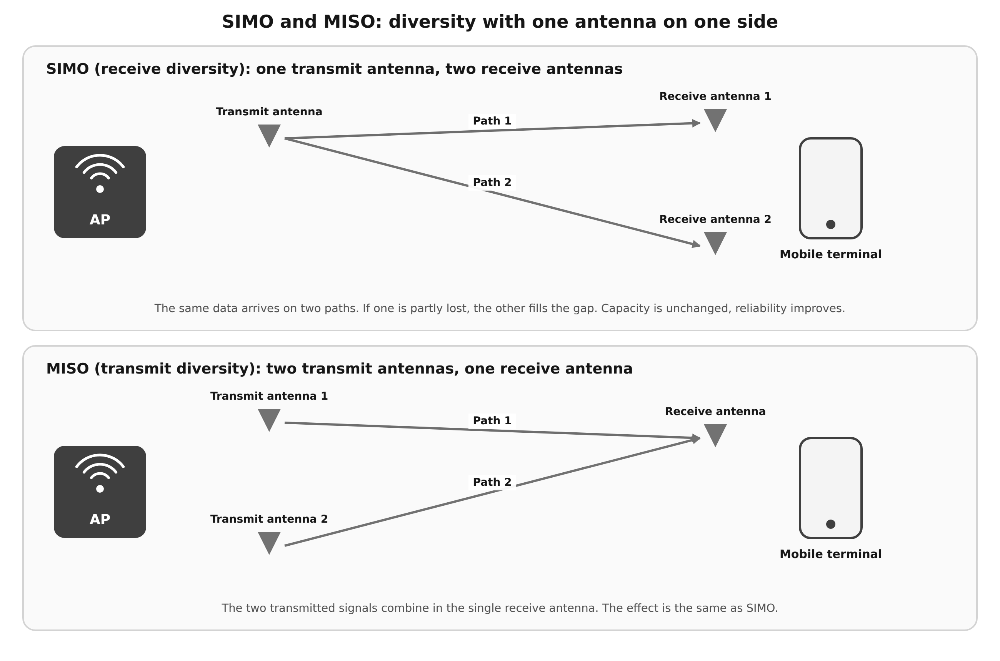

Diversity makes a link more reliable and gives some SNR gain, but it does not multiply capacity. That needs multiple antennas on **both** sides.

#### MIMO

---

**MIMO (multiple input, multiple output)** uses several antennas at both ends. With $M$ transmit and $N$ receive antennas there are $M \times N$ propagation paths, described by a channel matrix $\mathbf{H}$ whose element $h_{ij}$ is the path from transmit antenna $j$ to receive antenna $i$. The receiver estimates $\mathbf{H}$ from training fields at the start of every frame (HT-LTF, VHT-LTF, HE-LTF). Depending on how the antennas are used, MIMO trades between reliability, range and throughput, all without using more spectrum.

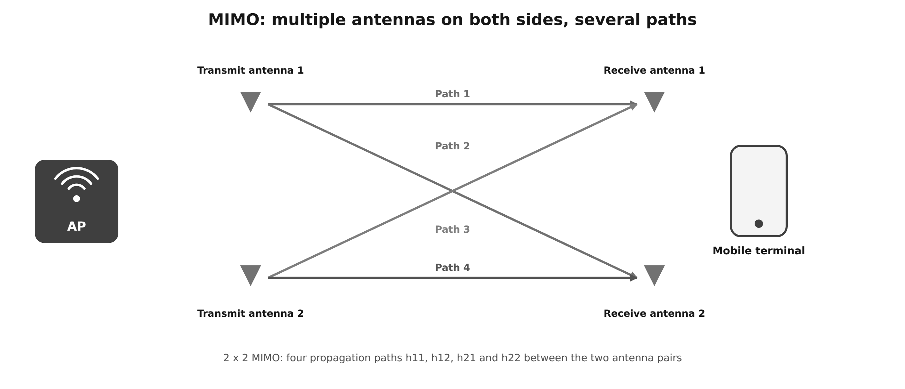

MIMO combines two techniques:

1. **Space diversity (space-time coding)** sends different encoded versions of the **same** data stream from several antennas, for example with STBC. The receiver uses its knowledge of the channel to combine them and recover the original stream. The link becomes more robust against fading, which extends range or allows a higher MCS, but it still carries one stream's worth of data.

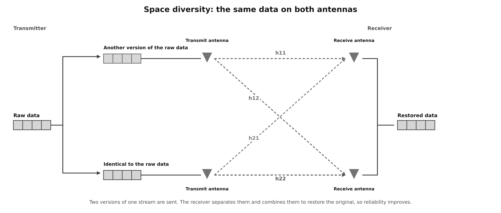

2. **Spatial multiplexing** splits the data into **independent** streams and sends them simultaneously on the same channel. The streams do not travel on separate "wires": every receive antenna hears a different mixture of all of them, weighted by the paths in $\mathbf{H}$. The receiver separates them by solving that mixture (MIMO detection, for example zero-forcing, MMSE or maximum-likelihood). This only works when the paths are different enough, which indoor multipath usually provides, and when the SNR is high enough. With $S$ streams the data rate is up to $S$ times that of one stream.

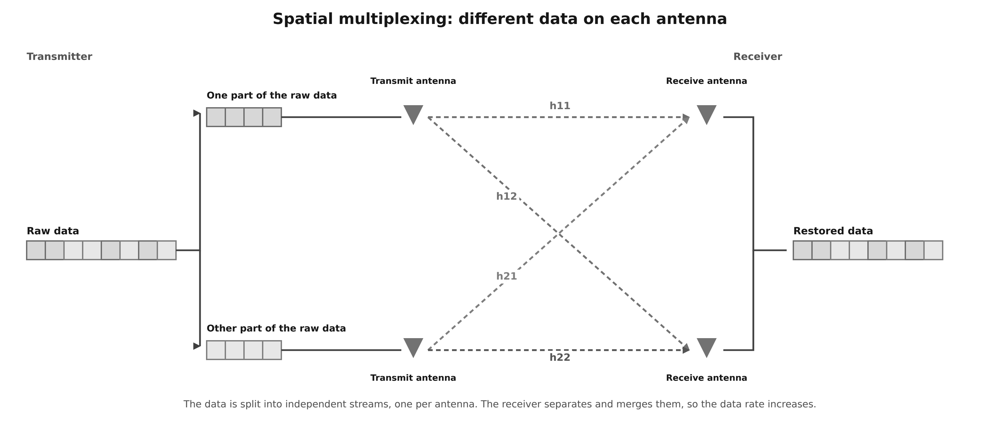

The two are not exclusive. A 4x4 AP talking to a 2x2 client can send two multiplexed streams and use its extra antennas for diversity and beamforming gain.

#### Spatial streams and antennas

---

A MIMO system is written **M x N** (or MTNR): $M$ transmit and $N$ receive antennas. Wi-Fi data sheets usually write **T x R : S**, where $S$ is the number of spatial streams the radio supports. A 3x3:2 radio has three transmit chains, three receive chains and supports two streams.

The number of streams can never exceed the number of antennas at either end:

$$
S \le \min(M, N)
$$

So 4x4 MIMO supports up to four streams, and 3x2 MIMO up to two. Two devices use the smaller of their stream counts: a 4x4:4 AP and a 2x2:2 phone run two streams. Most phones are 2x2, laptops 2x2, and enterprise APs 4x4 or 8x8.

| Standard | Max spatial streams | MU-MIMO |
|---|---|---|
| 802.11n (Wi-Fi 4) | 4 | no |
| 802.11ac (Wi-Fi 5) | 8 | downlink, up to 4 users (Wave 2) |
| 802.11ax (Wi-Fi 6/6E) | 8 | downlink and uplink, up to 8 users |
| 802.11be (Wi-Fi 7) | 16 | downlink and uplink |

---

#### Beamforming

---

When several antennas transmit, their signals add up differently at every point in space. Where two paths arrive with the same strength but opposite phase, they cancel and leave a **spatial hole**: a spot with very poor signal, even close to the AP.

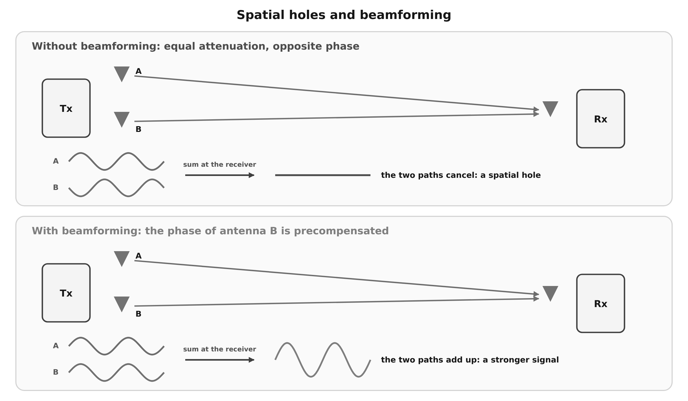

**Transmit beamforming** prevents this deliberately. The transmitter applies a weight (a phase and amplitude) to each antenna so that the copies arrive **in phase** at the target receiver and add up constructively. The gain is typically a few dB of SNR at the client, which turns into a higher MCS or more range. To compute the weights the transmitter needs **channel state information (CSI)**:

- **Implicit beamforming** estimates the channel from frames the client sends, assuming the channel is the same in both directions. It needs no client support but is less accurate.
- **Explicit beamforming** asks the client to measure the channel. 802.11n defined several explicit and implicit options, but vendors implemented different ones, so they rarely interoperated. 802.11ac standardized a single method, **channel sounding**: the beamformer sends an **NDP Announcement**, then a **Null Data Packet (NDP)** with only training fields; the client (beamformee) measures the channel and returns a **compressed beamforming feedback** report, from which the AP computes the steering matrix. 802.11ax and 802.11be use the same procedure, extended for multiple users and OFDMA.

Beamforming needs at least two transmit antennas and works best when the AP has more antennas than the number of streams it is sending.

---

#### SU-MIMO and MU-MIMO

---

**SU-MIMO (single-user MIMO)** sends all spatial streams to one client at a time. The number of streams is limited by the client: an AP with four antennas can send only two streams to a client with two antennas, and its other antennas add diversity and beamforming gain.

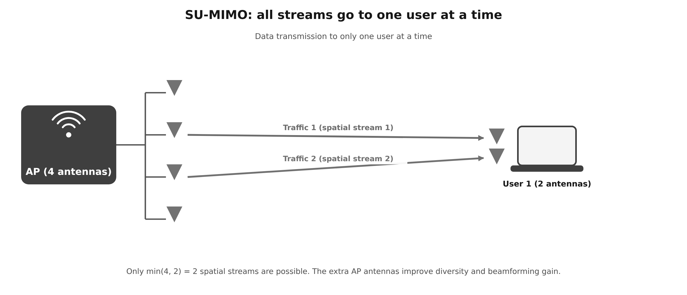

**MU-MIMO (multi-user MIMO)** sends different streams to **different clients at the same time**, on the same channel and subcarriers. A 4x4 AP can serve four single-stream phones simultaneously instead of one after another, so its antennas are not wasted on clients with few antennas.

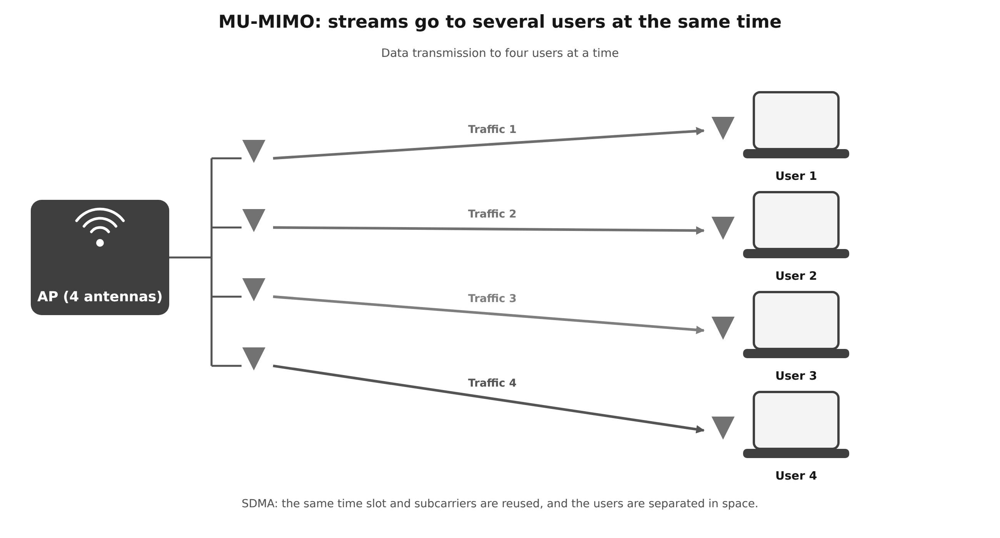

MU-MIMO is a form of **space division multiple access (SDMA)**: the users are separated in space, not in time or frequency. It does not work by giving each user its own antenna. The AP uses the CSI from channel sounding to **precode** the streams, a beamforming matrix that steers each user's stream toward that user and places nulls toward the others, so that each client receives mainly its own data. This requires accurate, fresh CSI (sounding costs airtime), clients far enough apart to be separated spatially, and traffic queued for several clients at once. It suits relatively static, high-traffic clients and works poorly with clients that move fast.

802.11ac Wave 2 introduced **downlink** MU-MIMO for up to four users. 802.11ax extended it to eight users and added **uplink** MU-MIMO, coordinated by trigger frames, and can combine MU-MIMO with **OFDMA**, which separates users by frequency (resource units) instead of space. OFDMA helps most with many clients sending small frames; MU-MIMO helps most with a few clients moving large amounts of data.

---

### Summary

---

- **Channel bonding** raises capacity linearly with bandwidth: 40 MHz gives about 2.08 times the 20 MHz rate because the guard band between the bonded channels carries data. Wider channels cost independent channels and per-subcarrier power, and need primary/secondary rules and dynamic bandwidth (RTS/CTS on each subchannel) or puncturing to cope with partly busy spectrum.
- **Diversity** (SIMO with MRC, MISO with STBC or beamforming) makes one stream more reliable; it does not multiply capacity.
- **Spatial multiplexing** sends independent streams on the same channel and separates them with the channel matrix. The number of streams is at most min(transmit antennas, receive antennas), and it needs rich multipath and good SNR.
- **Beamforming** steers energy toward a client using CSI; 802.11ac and later standardize explicit sounding with NDPA, NDP and compressed feedback.
- **MU-MIMO** serves several clients at once by precoding their streams in space: downlink since 802.11ac Wave 2, uplink since 802.11ax, alongside OFDMA.

---

### References

---

- IEEE Std 802.11-2020: clause 19 (HT PHY, 802.11n), clause 21 (VHT PHY, 802.11ac), including channel sounding and beamforming
- IEEE Std 802.11ax-2021: clause 27 (HE PHY), MU-MIMO and OFDMA
- E. Perahia and R. Stacey, *Next Generation Wireless LANs: 802.11n and 802.11ac*, 2nd ed., Cambridge University Press, 2013
- M. Gast, *802.11ac: A Survival Guide*, O'Reilly, 2013
- D. Tse and P. Viswanath, *Fundamentals of Wireless Communication*, Cambridge University Press, 2005 (diversity, spatial multiplexing, MIMO capacity)
- S. M. Alamouti, "A Simple Transmit Diversity Technique for Wireless Communications", *IEEE Journal on Selected Areas in Communications*, vol. 16, no. 8, 1998
- G. J. Foschini and M. J. Gans, "On Limits of Wireless Communications in a Fading Environment when Using Multiple Antennas", *Wireless Personal Communications*, vol. 6, 1998
- On this blog: [Wi-Fi Overview](/blog/wifi-overview/), [Co-Channel Interference](/blog/cci/), [Wi-Fi 7](/blog/wifi7/), [Enterprise Wireless](/blog/wireless/)
