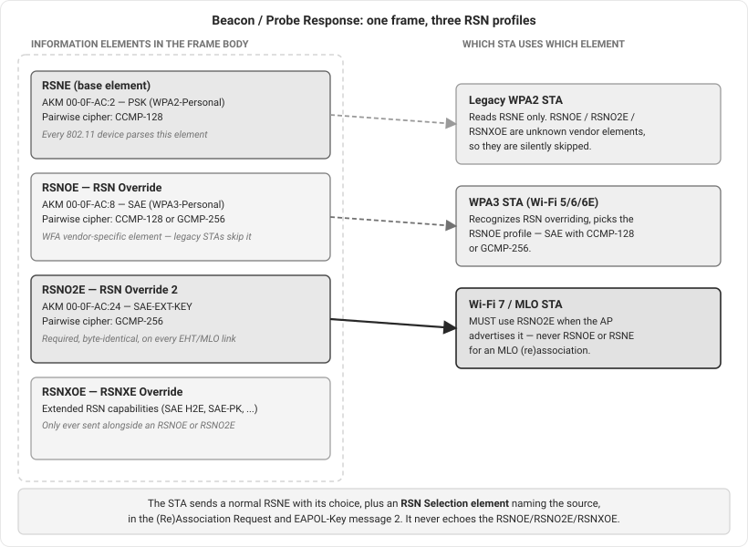
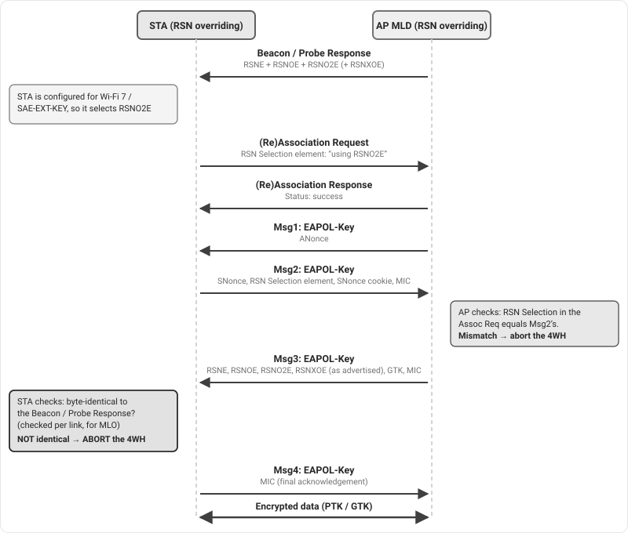
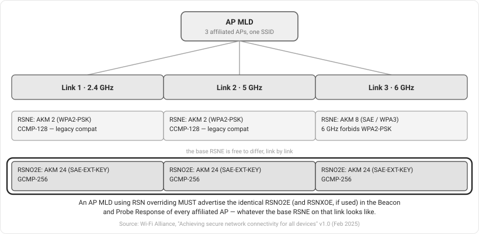

Wi-Fi 7 (802.11be) requires a new, stronger security baseline for EHT and MLO: the SAE-EXT-KEY AKM and GCMP-256 encryption. Simply adding those to the standard RSN Information Element alongside everything older clients already expect turned out to break real deployed devices. RSN Overriding is the Wi-Fi Alliance's fix: let the AP keep publishing a small, boring RSNE that legacy clients have always coped with, and push the new, stronger options into separate elements that only capable clients look at. Multiple RSN Overriding (MRSNO) is what happens when the AP does this more than once at the same time, and consistently across every link of a multi-link device, so that WPA2, WPA3 and Wi-Fi 7 clients all connect correctly to one SSID. This post walks through the mechanism in depth: the elements, the selection rule, the anti-downgrade check, and why MLO needs it specifically. For the background this builds on, see [Wi-Fi 7](/blog/wifi7/), [WPA3](/blog/wpa3/) and [Wi-Fi Overview](/blog/wifi-overview/).

---

### Why Wi-Fi 7 Needed a New Mechanism

---

802.11be adds a new authentication and key management suite built for EHT and MLO: SAE-EXT-KEY. Unlike plain SAE, its derived key length follows the SAE group instead of being fixed at 256 bits, which matters once GCMP-256 is mandatory. A BSS that enables EHT or MLO is required to advertise AKM `00-0F-AC:24` for this reason, regardless of which band the link is on. [4]

| AKM suite (00-0F-AC:x) | Name | Introduced for |
|---|---|---|
| 2 | PSK | WPA2-Personal |
| 8 | SAE | WPA3-Personal |
| 9 | FT-SAE | WPA3-Personal with 802.11r |
| 24 | SAE-EXT-KEY | Wi-Fi 7 (802.11be), required for EHT/MLO |
| 25 | FT-SAE-EXT-KEY | Wi-Fi 7 with 802.11r |

---

| Cipher suite (00-0F-AC:x) | Name | Notes |
|---|---|---|
| 4 | CCMP-128 | WPA2/WPA3 default |
| 8 | GCMP-128 | Optional, higher throughput than CCMP |
| 9 | GCMP-256 | Required pairwise cipher for Wi-Fi 7 EHT/MLO |
| 10 | CCMP-256 | Enterprise Suite B |

---

The obvious approach, putting AKM 2, 8 and 24 and both CCMP and GCMP ciphers into one RSNE, is exactly what broke in the field. The Wi-Fi Alliance's February 2025 technical note on this problem lists real interoperability failures: [1]

- Some WPA2 client stacks will only associate if the AP advertises a **single** AKM.
- Some will not connect if **more than two** AKMs are advertised.
- Some will not connect if **two or more** pairwise cipher suites are advertised.
- Some clients copy fields straight out of the AP's RSNE instead of selecting from their own configured profile, so they end up negotiating capabilities they don't actually support.
- Some clients and APs cannot parse an EAPOL-Key frame that carries an RSNXE at all, and simply fail the 4-way handshake.

None of this is a theoretical parsing edge case; it is shipped firmware. The fix the WFA settled on isn't "write better parsers" (though the spec does also tighten the parsing rules), it's structural: stop putting every option in one element.

---

### RSN Override Elements: RSNOE, RSNO2E, RSNXOE

---

RSN Overriding adds three new elements, defined by the WPA3 Specification on top of the IEEE 802.11 RSNE/RSNXE framework: [1][2]

| Element | Carries | Who reads it |
|---|---|---|
| **RSNE** (existing) | The baseline profile, kept deliberately small | Every 802.11 device |
| **RSNOE** — RSN Override | A second, usually stronger profile (e.g. WPA3-SAE) | STAs that implement RSN overriding |
| **RSNO2E** — RSN Override 2 | A third profile, narrowed to exactly the Wi-Fi 7/MLO requirement (SAE-EXT-KEY + GCMP-256) | Wi-Fi 7 and MLO STAs |
| **RSNXOE** — RSNXE Override | Extended RSN capabilities (SAE H2E, PMF-related bits) for the overridden profile | Paired with RSNOE/RSNO2E only |

---

A device that has never heard of RSNOE/RSNO2E/RSNXOE does not need to: per ordinary 802.11 element-parsing rules, an unrecognized element ID is simply skipped. That is the entire trick. The AP keeps its RSNE tiny and compatible, and layers the modern options on top where only capable clients look.

A few hard rules from the spec keep this from becoming its own mess: [1]

- An AP **MUST NOT** include an RSNXOE unless it also advertises an RSNOE or an RSNO2E — an override of the extended capabilities only makes sense alongside an overridden RSN profile.
- An AP **MUST** advertise the same RSNE/RSNOE/RSNO2E/RSNXE/RSNXOE on a given channel in both Beacon and Probe Response frames.
- An AP **MUST NOT** advertise cipher suites or, in the 6 GHz band, AKM suites that the WPA3 specification or 802.11 standard forbid there.

---

### Multiple RSN Overriding (MRSNO): One Beacon, Three Audiences

---

"Multiple" in MRSNO means the AP is overriding more than once at the same time: RSNE *and* RSNOE *and* RSNO2E, all live in the same Beacon, each aimed at a different population of clients on one SSID.

| Client | Element it uses | AKM | Pairwise cipher |
|---|---|---|---|
| Legacy WPA2 STA | RSNE | PSK (2) | CCMP-128 |
| WPA3 STA (Wi-Fi 5/6/6E) | RSNOE | SAE (8) | CCMP-128 or GCMP-256 |
| Wi-Fi 7 SLO (Single-Link Operation) or MLO STA | RSNO2E | SAE-EXT-KEY (24) | GCMP-256 |

---

Two selection rules make this safe rather than just "pick whatever looks strongest":

- **A STA connects only using the profile it is configured for.** It does not scan RSNE/RSNOE/RSNO2E and opportunistically grab the strongest one it understands; its network profile already says SAE-EXT-KEY, or PSK, or whatever credential it holds, and it looks for the matching element.
- **A STA MUST use fields from exactly one element.** It cannot mix, say, the AKM from RSNO2E with a cipher list copied from RSNOE. Whichever element it selects, it uses wholesale. [1]

How the STA tells the AP which element it used matters just as much as the elements themselves, and that's the subject of the next section.

---

### RSN Selection Element and the Anti-Downgrade Check

---

A STA using RSN overriding does **not** re-send the RSNOE/RSNO2E/RSNXOE it chose. Instead it includes a new, lightweight **RSN Selection element** in the (Re)Association Request and, together with an SNonce cookie, in message 2 of the 4-way handshake. This is how the AP learns which of its advertised profiles the STA picked. [1]

That alone would not stop an on-path attacker from quietly stripping the RSNOE/RSNO2E out of the frames it forwards, hoping the STA falls back to the weaker base RSNE without noticing. The spec closes that gap with explicit consistency checks instead of trusting the advertisement once:

- The AP checks that the RSN Selection element in the (Re)Association Request matches the one in message 2. A mismatch aborts the 4-way handshake.
- The STA checks that the RSNE (and, where used, RSNOE/RSNO2E/RSNXE/RSNXOE) carried in message 3 are **byte-identical** to what it saw in the Beacon/Probe Response — checked per link, for an MLO (re)association. Any difference aborts the 4-way handshake.

Stripping the override out of one frame but not another is exactly what this is designed to catch, since the two copies must match or the handshake never completes.

See [4-Way Handshake](/blog/wifi-overview/#4-way-handshake) for the baseline exchange this extends.

---

### MRSNO Across Multi-Link Operation

---

This is where the "Multiple" in MRSNO earns its second meaning. An AP MLD runs one affiliated AP per link (2.4 GHz, 5 GHz, 6 GHz), each with its own Beacon and Probe Response. Those links are not required to look identical: 6 GHz already forbids WPA2-PSK by regulation, so its base RSNE can safely start at AKM 8 (SAE) with no legacy fallback, while the 2.4 GHz and 5 GHz links still need to carry the legacy RSNE for older single-link clients.

What must not drift between links is the override aimed at Wi-Fi 7/MLO clients. The spec requires: an AP MLD using RSN overriding and MLO **MUST** include the identical RSNO2E in the Beacon and Probe Response on every operating channel of its affiliated APs, and if it uses an RSNXOE, that must be identical across links too. [1]

The consequence for the STA side is just as strict: a STA using RSN overriding together with MLO **MUST use the RSNO2E** when the AP advertises one, and must not fall back to RSNOE or RSNE for an MLO (re)association even if it would otherwise be eligible. [1] In other words, for an EHT/MLO association, RSNO2E is the only profile in play, consistently, on every link. Two more rules fall out of the same consistency requirement:

- SAE hash-to-element (H2E) is mandatory whenever SAE is used with MLO or in the 6 GHz band.
- An AP may still advertise AKMs that are forbidden for MLO use, but a STA must never accept a forbidden AKM as part of an MLO (re)association.

---

### Deployment Modes You'll Actually See

---

Network admins generally land on one of three WPA3-Personal rollouts, and RSN Overriding is specifically what makes the third one viable: [5][6]

| Mode | How it looks on the air | Trade-off |
|---|---|---|
| WPA3-Personal Only | Separate SSIDs per security tier | Clean security isolation, but more SSIDs to manage and users must pick the right one |
| WPA3-Personal Transition | One SSID, every AKM (2, 8, 24...) in a single RSNE | Simple, but the exact RSNE-parsing bugs from the first section surface here |
| WPA3-Personal Compatibility Mode (RSN Overriding) | One SSID: minimal RSNE (AKM 2) + RSNOE (AKM 8) + RSNO2E (AKM 24) | Best compatibility, but only if the client actually implements RSN Overriding |

---

That last caveat is the real catch today. A WPA3- or Wi-Fi 7-capable client that has not yet implemented RSN Overriding parsing simply never sees the RSNOE/RSNO2E at all, and quietly falls back to whatever the base RSNE offers, typically WPA2-PSK. It is not a security break (the base RSNE is still a perfectly valid policy you chose), but it is a missed hardening opportunity, and it is the chicken-and-egg problem CableLabs has flagged publicly: APs are cautious about enabling Compatibility Mode until client stacks widely support it, and client vendors have limited pressure to add support until APs ship it. [3]

---

### Spotting It in a Capture

---

In Wireshark, filter `wlan.fc.type_subtype == 0x08` for Beacons and look at the information elements after the standard RSNE. RSNOE, RSNO2E and RSNXOE are carried as Wi-Fi Alliance vendor-specific elements (OUI `50:6F:9A`); if your Wireshark build's dissector doesn't yet recognize the specific OUI type, they will still show up as an undissected "Vendor Specific" tag rather than disappearing, which is enough to confirm RSN Overriding is in use even before the field decode catches up.

---

### References

---

[1] Wi-Fi Alliance, "Technical Note: Achieving secure network connectivity for all devices," v1.0, February 25, 2025. https://www.wi-fi.org/system/files/Wi-Fi%20Alliance%20Technical%20Note%20-%20Achieving%20secure%20network%20connectivity%20for%20all%20devices%20v1.0.pdf \
[2] Wi-Fi Alliance, WPA3 Specification. https://www.wi-fi.org/file/wpa3-specification \
[3] CableLabs, "Wi-Fi 7 and WPA3 Security Compatibility: A Call to Action for Device Manufacturers." https://www.cablelabs.com/blog/wi-fi-7-wpa3-security-compatibility-device-manufacturers \
[4] IEEE P802.11-REVme/D7.0, August 2024. https://ieeexplore.ieee.org/document/10638490 \
[5] mrncciew, "WPA3-Personal Deployment Options." https://mrncciew.com/2025/10/20/wpa3-personal-deployment-options/ \
[6] Intuitibits, "Balancing Security and Compatibility with RSN Override." https://www.intuitibits.com/2025/07/01/balancing-security-and-compatibility-with-rsn-override/
