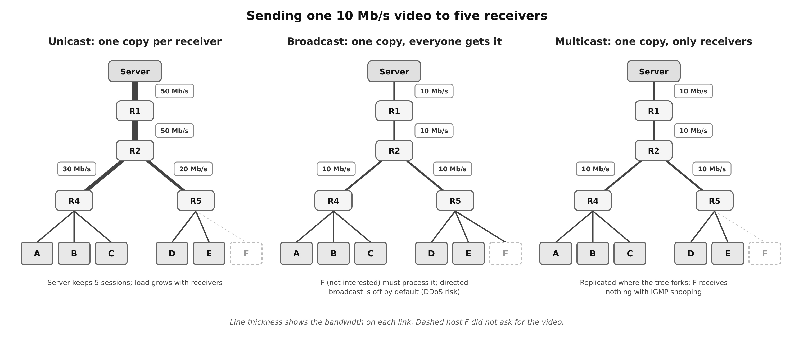
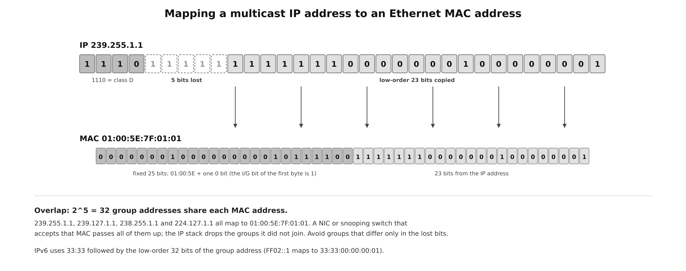
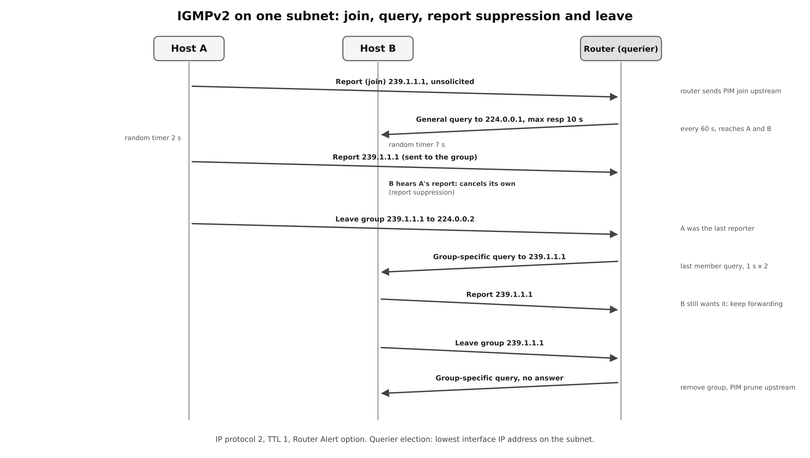
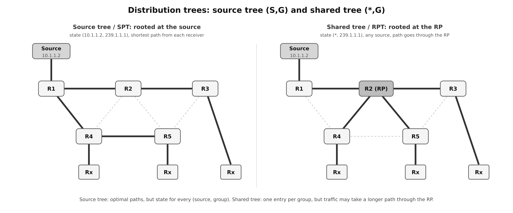

### Overview

---

Most traffic is **unicast**: one sender, one receiver. But IPTV, live video, conferencing, stock tickers, music on hold, software distribution and many control protocols send **the same data to many receivers at the same time**. Sending a separate copy to each receiver wastes bandwidth and server resources. Broadcasting it to everyone wastes the CPU of every uninterested host.

**IP multicast** sends **one copy** of each packet to a **group address**. The network replicates the packet only where the path to the receivers splits, and delivers it only to hosts that asked for it. Two protocols make this work:

* **IGMP** (Internet Group Management Protocol) between **hosts and their local router**: "I want to receive group G".
* **PIM** (Protocol Independent Multicast) **between routers**: build a distribution tree from the source to every router that has receivers.

Switches add a third piece, **IGMP snooping**, so that multicast is not flooded to every port of a VLAN.

---

### Unicast, Broadcast and Multicast

---

<div style="text-align: center;">



</div>

| Method | Server load | Bandwidth on the shared links | Who processes the packets |
|--------|-------------|-------------------------------|---------------------------|
| **Unicast** (one-to-one) | One session per receiver | Grows with the number of receivers (5 × 10 = 50 Mb/s) | Only the receivers |
| **Broadcast** (one-to-all) | One stream | 10 Mb/s | **Every host**, interested or not. IP directed broadcast is disabled by default on Cisco routers, because it is a DDoS vector |
| **Multicast** (one-to-many) | One stream | 10 Mb/s | **Only hosts that joined the group** |

---

The packets of one multicast flow are called a **stream**, sent to a **group address**. The hosts that receive it are **receivers**. The path from the source to all receivers is the **multicast distribution tree (MDT)**. Multicast normally uses **UDP**: there is no TCP-style connection to one receiver, so reliability, if needed, is handled by the application.

---

### Terminology

---

| Term | Meaning |
|------|---------|
| **Source** | The host that sends to the group. It does not need to join the group |
| **Receiver** | A host that joined the group with IGMP |
| **FHR** (first-hop router) | The router directly attached to the source |
| **LHR** (last-hop router) | The router directly attached to receivers |
| **RP** (rendezvous point) | The root of a shared tree in PIM sparse mode |
| **Upstream / downstream** | Toward the source (or RP) / toward the receivers |
| **IIF / RPF interface** | The incoming interface: the one the router uses to reach the source (or RP) in the unicast table |
| **RPF neighbor** | The PIM neighbor on the RPF interface, toward the source or RP |
| **OIF / OIL** | An outgoing interface / the outgoing interface list for an entry |
| **(S,G)** | State for one source S and group G ("S comma G"), a **source tree** |
| **(\*,G)** | State for group G from any source ("star comma G"), a **shared tree** |
| **MRIB / MFIB** | The multicast routing table (control plane) and the forwarding table built from it (data plane) |

---

### Multicast Addressing

---

IANA reserves **224.0.0.0/4** for IPv4 multicast (the old **class D**, 224.0.0.0 to 239.255.255.255). Every address in it starts with the bits **1110**. A group address is only ever a **destination**. A multicast address is never used as a source.

| Block | Range | Use |
|-------|-------|-----|
| **Local network control** | 224.0.0.0/24 | Protocol traffic on one link. **Never forwarded** by routers, whatever the TTL |
| **Internetwork control** | 224.0.1.0/24 | Protocol traffic that **may be forwarded** (NTP, Auto-RP) |
| Ad hoc blocks | 224.0.2.0–224.0.255.255, 224.3.0.0–224.4.255.255, 233.252.0.0/14 | Assigned to applications |
| SDP/SAP | 224.2.0.0/16 | Session announcements |
| **Source-Specific Multicast** | **232.0.0.0/8** | SSM (RFC 4607): (S,G) only, no RP |
| **GLOP** | 233.0.0.0/8 | Static global groups derived from a 16-bit ASN: **233.X.Y.0/24**, where X.Y is the ASN (RFC 3180) |
| **Administratively scoped** | **239.0.0.0/8** | Private, inside an organization (RFC 2365), like RFC 1918 for unicast. Never assigned by IANA |
| Reserved | The rest | |

---

Some well-known addresses in the control blocks:

| Address | Use |
|---------|-----|
| 224.0.0.1 | All hosts on this subnet |
| 224.0.0.2 | All routers on this subnet |
| 224.0.0.5 / 224.0.0.6 | OSPF all routers / all DRs (see [OSPF](/blog/ospf/)) |
| 224.0.0.9 | RIPv2 |
| 224.0.0.10 | EIGRP |
| **224.0.0.13** | **All PIM routers** |
| 224.0.0.18 | VRRP |
| **224.0.0.22** | **IGMPv3** reports |
| 224.0.0.102 | HSRPv2 and GLBP |
| 224.0.0.251 | mDNS |
| 224.0.1.1 | NTP |
| **224.0.1.39 / 224.0.1.40** | Cisco Auto-RP announce / discovery |

---

**IPv6** multicast uses **FF00::/8**. After FF come four flag bits and a 4-bit **scope**: FF02::/16 is link-local (FF02::1 all nodes, FF02::2 all routers, FF02::D all PIM routers), FF05:: is site-local, FF0E:: is global, and **FF3x::/32** is the SSM range. Scope is part of the address, so IPv6 does not need the TTL tricks of IPv4.

---

### Layer 2: Mapping Groups to MAC Addresses

---

A NIC must recognize the frames of the groups its host joined, without passing every multicast frame up to the CPU. Each IPv4 group is therefore mapped to an Ethernet MAC address:

* The first 24 bits are **01:00:5E**. The lowest bit of the first byte, the **I/G (individual/group) bit**, is 1, which marks a multicast frame.
* The 25th bit is always **0**.
* The low **23 bits** of the group address are copied into the low 23 bits of the MAC address.

<div style="text-align: center;">



</div>

So 239.255.1.1 becomes **01:00:5E:7F:01:01**. A group address has 28 variable bits (after 1110), but only 23 reach the MAC address. The other **5 bits are lost**, so **32 group addresses share each MAC address**. For example 239.255.1.1, 239.127.1.1, 238.255.1.1 and 224.127.1.1 all map to 01:00:5E:7F:01:01.

The consequence: a host that joins 239.255.1.1 also receives, at the NIC level, frames for 239.127.1.1. The IP stack discards them, but the CPU still does the work, and a snooping switch cannot tell the groups apart either. When you plan groups, avoid addresses that differ only in those 5 bits, and **avoid any group that maps to the same MAC as 224.0.0.x** (for example 225.0.0.1 or 239.128.0.1), because switches flood those MAC addresses to every port.

IPv6 maps a group to **33:33** followed by the low 32 bits of the address: FF02::1 becomes 33:33:00:00:00:01.

---

### IGMP: Hosts Join Groups

---

**IGMP** is how a receiver tells its local router which groups it wants. When a host joins a group, it sends an IGMP report and programs its NIC to accept the group's MAC address. IGMP must be supported by the host and by the router interfaces facing hosts.

| Version | RFC | Notes |
|---------|-----|-------|
| IGMPv1 | 1112 | Queries and reports only, no leave message. Rarely used |
| **IGMPv2** | 2236 | Adds **leave** messages, group-specific queries and querier election. The most common version |
| **IGMPv3** | 3376 | Adds **source filtering** (include/exclude lists). Required for **SSM** |

---

The IPv6 equivalent is **MLD** (Multicast Listener Discovery), carried in ICMPv6: MLDv1 is like IGMPv2, and MLDv2 is like IGMPv3.

---

#### IGMPv2 message format

---

IGMP is carried directly in IP with **protocol number 2**, with **TTL 1** so that it never leaves the subnet, and with the **IP Router Alert** option, which tells routers to look at the packet even though it is not addressed to them. The message is 8 bytes:

| Field | Size | Meaning |
|-------|:----:|---------|
| **Type** | 1 | The message type (below) |
| **Max Response Time** | 1 | In queries only: the longest a host may wait before answering, in **tenths of a second** (default 100 = 10 s). Zero in other messages |
| **Checksum** | 2 | The standard Internet checksum of the IGMP message |
| **Group Address** | 4 | 0.0.0.0 in a general query; the group in a group-specific query, a report or a leave |

---

| Type | Message | Sent to |
|:----:|---------|---------|
| 0x11 | **General membership query** (group 0.0.0.0) | 224.0.0.1, by the querier, periodically |
| 0x11 | **Group-specific query** | The group address, after a leave |
| **0x16** | **Version 2 membership report**, the "**IGMP join**" | The group address |
| 0x17 | **Leave group** | 224.0.0.2 (all routers) |
| 0x12 | Version 1 membership report | For compatibility with IGMPv1 hosts |
| 0x22 | Version 3 membership report | 224.0.0.22 |

---

#### IGMPv2 operation

---

<div style="text-align: center;">



</div>

1. **Join.** A host that wants a group sends an **unsolicited report** right away, without waiting for a query. The router creates IGMP state for the group on that interface, and sends a **PIM join upstream** if it is not already receiving the group. When the stream arrives, it forwards it onto the subnet.
2. **Query.** The querier periodically sends a **general query** to 224.0.0.1 (every 60 s on Cisco IOS, 125 s in the RFC), with a Max Response Time of 10 s.
3. **Report suppression.** Each member starts a **random timer** between 0 and the Max Response Time for each of its groups. The first host whose timer expires sends a report **to the group address**, so all other members hear it, cancel their own timer and stay silent. The router only needs to know that *at least one* member exists, not who they are.
4. **Leave.** A host that leaves sends a **leave group** message to 224.0.0.2, if it was the last host to report for the group. Otherwise it may leave silently.
5. **Last-member check.** The router answers a leave with a **group-specific query** (by default twice, 1 s apart). If a member answers, forwarding continues. If nobody does, the router removes the group and **prunes** it upstream.

**Querier election.** When several routers share a subnet, only one sends queries. Each router starts as querier. When it hears a query from a router with a **lower IP address**, it stops querying. The router with the **lowest interface address** wins.

---

#### IGMPv3

---

IGMPv2 says only "I want group G", from **any source**. IGMPv3 lets a receiver choose **sources**, with a new **Version 3 membership report** (sent to 224.0.0.22) that can carry several group records:

* **Include mode**: receive group G **only** from the sources in the list. This is what **SSM** uses: "(S, G) only".
* **Exclude mode**: receive group G from **every source except** those in the list. An empty exclude list means "any source", the same as IGMPv2.

IGMPv3 is backward compatible with IGMPv2. It also drops report suppression: every host reports, so the router can track each source list, and snooping switches see every member.

---

### IGMP Snooping

---

A switch learns unicast MAC addresses from the **source** address of frames. A multicast MAC address is **never a source**, so it is never learned, and the switch **floods** multicast frames to every port in the VLAN like unknown unicast. Every host then has to process them (or drop them at the NIC), and every link carries the stream.

Switches avoid this in two ways:

* **IGMP snooping** (RFC 4541), the normal method. The switch **listens to IGMP** messages that pass through it, and builds a table of which ports have members for which group. A stream for a group is sent **only to ports with members**, plus the ports toward multicast routers (**mrouter ports**, learned from queries and PIM hellos).
* **Static MAC entries** for a group. They work, but they do not react to changes, so they do not scale and are not recommended.

Snooping depends on **queries**: if no router queries the VLAN, the membership entries age out and streams stop (or start flooding, depending on the switch). On a VLAN with no multicast router, enable an **IGMP snooping querier** on the switch. Addresses in 224.0.0.0/24 are always flooded, because link-local protocols need them.

Wi-Fi has its own problem with multicast: frames are sent at a **low basic rate, without acknowledgments or retries**, to every station. Access points therefore often convert multicast to **unicast** for each associated member (for example `multicast_to_unicast` in hostapd and OpenWrt), using the snooping table to know who the members are.

---

### Multicast Routing with PIM

---

Routers need a **multicast routing protocol** to locate sources and build the delivery path to every receiver. Several have existed (DVMRP, MOSPF, CBT). Today the standard is **PIM**, and it is the only one Cisco fully supports.

PIM is **protocol independent**: it has no topology exchange of its own. It uses the **unicast routing table**, whatever filled it (OSPF, IS-IS, EIGRP, BGP, static routes), to decide which interface leads toward a source or an RP.

---

#### Distribution trees

---

<div style="text-align: center;">



</div>

* A **source tree**, or **shortest path tree (SPT)**, is rooted at the **source**. Its branches follow the shortest unicast paths from the source to each receiver. The state is **(S,G)**, for example (10.1.1.2, 239.1.1.1). Paths are optimal, but routers keep state for **every source** of every group.
* A **shared tree**, or **rendezvous point tree (RPT)**, is rooted at a chosen router, the **RP**. Traffic for group G from **any source** flows down the same tree. The state is **(\*,G)**, for example (\*, 239.1.1.1). There is less state, but traffic may take a longer path through the RP.

---

#### Reverse Path Forwarding

---

Unicast routing looks at the **destination**. Multicast routing looks at the **source**: the destination is a group, and a router must make sure it never forwards a packet back the way it came. The tool is the **RPF check**:

1. Look up the **source address** (or the RP address, for shared-tree traffic) in the unicast routing table. The outgoing interface for that lookup is the **RPF interface**.
2. If the multicast packet **arrived on the RPF interface**, forward it out every interface in the **OIL**.
3. If it arrived on **any other interface**, **drop it**. It is a duplicate, or a loop.

PIM also uses RPF to decide where to send **joins and prunes**: (S,G) joins go out the RPF interface toward the **source**, and (\*,G) joins go toward the **RP**. Because RPF follows the unicast table, a multicast path problem is very often a **unicast routing** problem: an asymmetric path, a missing route to the source or RP, or a route through an interface without PIM.

---

#### PIM messages

---

All PIM messages use **IP protocol 103**. Most are multicast to **224.0.0.13** (all PIM routers) with **TTL 1**. Register and Register-Stop are **unicast** between the FHR and the RP.

| Type | Message | Purpose |
|:----:|---------|---------|
| 0 | **Hello** | Discover neighbors, elect the DR, exchange options. Every **30 s** by default |
| 1 | **Register** | FHR to RP, unicast: carries the source's packets encapsulated |
| 2 | **Register-Stop** | RP to FHR, unicast: stop encapsulating |
| 3 | **Join/Prune** | Add or remove a branch of a tree, for (\*,G) or (S,G) |
| 4 | **Bootstrap** | BSR messages: the RP set, flooded hop by hop |
| 5 | **Assert** | Elect a single forwarder on a LAN with duplicate traffic |
| 6 / 7 | Graft / Graft-Ack | Dense mode: quickly re-attach a pruned branch |
| 8 | **C-RP-Advertisement** | Candidate RP to BSR, unicast |

---

Every PIM router keeps the hello information of each neighbor. A neighbor is considered gone after the **hold time**, by default 3.5 × the hello interval (**105 s**).

---

#### PIM modes

---

| Mode | Model | Trees | Use |
|------|-------|-------|-----|
| **PIM-DM** (dense) | Flood and prune: assume everyone wants it | Source trees | Small labs. Not recommended in production |
| **PIM-SM** (sparse) | Explicit join: nobody gets traffic without asking | Shared tree via an RP, then source trees | The general-purpose mode |
| **Sparse-dense** (Cisco) | Sparse for groups with a known RP, dense otherwise | Both | Mainly to carry Auto-RP groups. Risky: a lost RP makes every group dense |
| **PIM-SSM** | Receivers name the source with IGMPv3 | Source trees only, no RP | One-to-many with known sources: IPTV, financial feeds |
| **Bidir-PIM** | Traffic flows up and down one shared tree | (\*,G) only | Many-to-many with many sources: conferencing, trading floors |

---

PIM-DM and PIM-SM are together called **any-source multicast (ASM)**, because receivers join a group without naming a source.

---

### PIM Dense Mode

---

PIM-DM assumes receivers exist **everywhere**:

1. When a source starts sending, every router **floods** the traffic to all its PIM neighbors, after an RPF check. Copies that arrive on a non-RPF interface are dropped.
2. A router with **no receivers and no downstream neighbors** that want the traffic sends a **prune** upstream.
3. The result is an SPT from the source to the receivers. But the **(S,G) state remains on every router** in the network as long as the source is active, and pruned branches **time out after about 3 minutes**, so the flooding repeats (unless the *state refresh* extension is used).
4. A new receiver behind a pruned branch triggers a **graft**, which re-attaches the branch immediately.

Dense mode is simple to set up and has no RP, which is why it is used in labs. In a real network, receivers are rarely on every subnet, and the periodic flood-and-prune wastes bandwidth everywhere.

---

### PIM Sparse Mode

---

PIM-SM uses an **explicit join** model: a router receives a group only if a downstream router or a local receiver asked for it. It was designed for receivers scattered across the network, and it also works well when they are dense. Like PIM-DM, it uses the unicast table for RPF and does not care which protocol built it.

<div style="text-align: center;">


</div>

**Building the shared tree (receiver side).**

1. A receiver sends an **IGMP join** for 239.1.1.1 to its LHR.
2. The LHR creates (\*,G) state and sends a **PIM (\*,G) join** out its RPF interface **toward the RP**. Each router on the way does the same, until the join reaches the RP or a router that already has (\*,G) state. This builds the **shared tree** from the RP down to the LHR.

**Registering the source (source side).**

3. When the source starts sending, the FHR (more precisely, the DR on the source's subnet) **encapsulates** the packets in unicast **Register** messages to the RP. The RP de-encapsulates them and forwards them down the shared tree, so receivers get traffic immediately.
4. The RP then sends an **(S,G) join** toward the source, which builds a **source tree from the FHR to the RP**. When native traffic arrives over this tree, the RP sends a **Register-Stop**, and the FHR stops encapsulating. If there are no receivers at all, the RP sends Register-Stop at once.

At this point there are two trees: an **SPT (S,G) from the FHR to the RP** and a **shared tree (\*,G) from the RP to the LHR**.

**Switching to the shortest path tree.**

5. Traffic arrives at the LHR through the RP, and the LHR **learns the source address** from the first packet.
6. The LHR sends an **(S,G) join toward the source**. On Cisco routers this **SPT switchover** is the default and happens **after the first packet**, even if the shortest path to the source goes through the RP anyway. `ip pim spt-threshold infinity` keeps the LHR on the shared tree.
7. Once traffic arrives on the SPT, the LHR sends an **(S,G,rpt) prune** up the shared tree, so the RP stops sending that source's traffic down it. Traffic now takes the shortest path (R1 to R3 in the figure).

Joins are **soft state**: routers resend Join/Prune messages periodically (every 60 s by default), and state that is not refreshed expires.

---

#### Designated router

---

When several PIM routers share a LAN, they elect a **designated router (DR)** with PIM hellos: the **highest DR priority** (default 1), then the **highest IP address**. The DR has two jobs:

* On a **receiver** LAN, only the DR sends PIM joins upstream for the groups that hosts joined, so the traffic does not arrive twice.
* On a **source** LAN, only the DR sends Register messages to the RP.

If no hello is heard from the DR for the hold time (105 s), a new DR is elected. Lowering the hello interval (`ip pim query-interval`) speeds up DR failover. Note that the PIM DR and the IGMP querier are separate roles: the querier is the **lowest** address, the PIM DR the **highest**.

---

#### Avoiding duplicates on a LAN

---

Two mechanisms prevent the same stream from being sent twice onto a shared segment:

* **Upstream neighbor in joins.** A PIM join is multicast to 224.0.0.13, so every router on the LAN sees it, but the join carries the address of the **RPF neighbor** it is meant for. If R4 sends a join with R3 as its upstream neighbor, only R3 acts on it and joins toward the RP. R2 ignores it.
* **Assert.** If two routers still forward the same (S,G) or (\*,G) onto a LAN (for example in dense mode, or after a routing change), each sees the other's packets arrive on an interface in its own OIL. They exchange **Assert** messages, and the winner is the router with the **lowest administrative distance** to the source, then the **lowest metric**, then the **highest IP address**. The loser stops forwarding onto that LAN.

---

### Source-Specific Multicast

---

In **SSM**, the receiver already knows the source, and says so with **IGMPv3** (or MLDv2): "join (S,G)". The LHR sends an **(S,G) join directly toward the source**. There is **no RP, no shared tree, no register**, and no SPT switchover.

* SSM uses **232.0.0.0/8** by default (FF3x::/32 in IPv6). Within this range, routers only build (S,G) state.
* Two sources can use the same group address without colliding, because the channel is the pair (S,G).
* It is simpler and more secure than ASM: a host cannot inject traffic into a channel just by sending to the group. The main requirement is IGMPv3 on hosts, or **SSM mapping** on the LHR for IGMPv2 hosts.

SSM is the natural fit for one-to-many services with well-known sources, such as IPTV channels.

---

### Bidirectional PIM

---

In **Bidir-PIM**, traffic from every source flows **up** the shared tree to the RP and **down** to the receivers, using only **(\*,G)** state. There are no source trees and no registers. On each link, a **designated forwarder (DF)**, elected as the router with the best path to the RP, is the only one allowed to forward traffic toward the RP. Bidir scales very well when a group has **many sources** (every receiver is also a sender, as in conferencing), at the cost of non-shortest paths. The RP does not even need to be a real router: it can be an unused address on a link, called a phantom RP.

---

### Rendezvous Points

---

In PIM-SM, every router must know **which RP serves which group**. All routers in the domain must agree, or the shared trees break. There are three ways to distribute this group-to-RP mapping.

#### Static RP

---

Every router is configured with the RP address (optionally for a group range): `ip pim rp-address 10.0.0.1`.

* It is simple, takes one line per router, and works on every vendor.
* Every router must have **the same** configuration. Changing the RP means touching every router.
* By itself it has **no failover** and **no load sharing**. It is usually combined with **Anycast RP**: several routers share the same RP address (a loopback advertised by all of them), the IGP sends each join to the nearest one, and they exchange source information with **MSDP** or PIM Anycast RP (RFC 4610).

---

#### Auto-RP (Cisco)

---

Auto-RP automates the mapping with two roles:

* **Candidate RPs (C-RPs)** announce themselves, with the group ranges they serve (224.0.0.0/4 by default), in **RP-Announce** messages to **224.0.1.39**. The hold time is three times the announce interval.
* **Mapping agents (MAs)** join 224.0.1.39, collect the announcements, and elect one RP per group range: the C-RP with the **highest IP address**. They advertise the result in **RP-Discovery** messages to **224.0.1.40**, every 60 s by default or when something changes.
* Every PIM router joins 224.0.1.40 and caches the mappings.

Auto-RP makes it easy to use several RPs for different group ranges, to share load, to provide backup RPs, and to avoid inconsistent static configurations. It has a bootstrap problem: 224.0.1.39 and 224.0.1.40 are multicast groups themselves, and in sparse mode they would need an RP. They are therefore flooded in **dense mode**, either with sparse-dense mode on the interfaces or with `ip pim autorp listener`, which dense-floods only these two groups.

---

#### Bootstrap Router (BSR)

---

**BSR** (RFC 5059) is the **standard** equivalent, part of PIMv2, and works between vendors:

1. **Candidate BSRs** announce themselves, and one **BSR** is elected: the **highest BSR priority**, then the highest IP address.
2. **Candidate RPs** send **C-RP-Advertisement** messages by **unicast** to the BSR.
3. The BSR collects them and sends the whole **RP set** in **Bootstrap** messages every **60 s**, flooded **hop by hop** to 224.0.0.13 out of every PIM interface. No multicast routing is needed to deliver them, so there is no bootstrap problem.
4. Each router stores the RP set and **chooses the RP itself** for each group: the longest matching group range, then the **lowest C-RP priority value**, then a **hash** of the group address (using the hash mask length) that spreads groups across the candidates, then the highest IP address.

The RP set contains, for each entry: the **group range**, the **RP address**, the **RP priority**, the **hash mask length**, and the **SM/Bidir** flag. Unlike Auto-RP, the BSR does not choose the RP: it only distributes the candidates, and every router runs the same algorithm.

| | Static RP | Auto-RP | BSR |
|---|---|---|---|
| Standard | Yes | Cisco proprietary | Yes (RFC 5059) |
| Failover | Only with Anycast RP | Yes | Yes |
| Group-range load sharing | By configuration | Yes | Yes (hash) |
| Transport | None | Dense-mode groups 224.0.1.39/40 | Hop-by-hop PIM messages |
| Who picks the RP | The administrator | The mapping agent (highest IP) | Each router (priority, hash) |

---

### Cisco IOS Configuration and Verification

---

```
ip multicast-routing                      ! (ip multicast-routing distributed on some platforms)
!
interface GigabitEthernet0/0              ! every interface on the multicast path
 ip pim sparse-mode
 ip igmp version 3                        ! receiver-facing interfaces
 ip pim dr-priority 100
!
! choose ONE way to learn the RP
ip pim rp-address 10.0.0.1                ! static
!
ip pim send-rp-announce Loopback0 scope 16     ! Auto-RP candidate RP
ip pim send-rp-discovery Loopback0 scope 16    ! Auto-RP mapping agent
ip pim autorp listener
!
ip pim bsr-candidate Loopback0            ! BSR candidate
ip pim rp-candidate Loopback0             ! BSR candidate RP
!
ip pim ssm default                        ! enable SSM for 232.0.0.0/8
ip pim spt-threshold infinity             ! optional: stay on the shared tree
!
ip igmp snooping                          ! on switches (on by default on Catalyst)
ip igmp snooping querier                  ! VLANs without a multicast router
```

PIM must be enabled on **every interface along the RPF path**, including the ones toward the RP and the source, not only on the receiver side. An RPF interface without PIM is the most common reason for a broken tree.

| Command | Shows |
|---------|-------|
| `show ip mroute [group]` | The multicast table: (\*,G) and (S,G) entries, **incoming interface and RPF neighbor**, **outgoing interface list**, flags (S sparse, C connected, T SPT, J join SPT, P pruned, R RP bit) |
| `show ip mroute count` | Packet counters per source and group: is traffic flowing? |
| `show ip pim neighbor` | PIM neighbors, DR priority, uptime |
| `show ip pim interface` | PIM interfaces, mode, neighbor count, **DR** |
| `show ip pim rp mapping` | The group-to-RP mapping, and where it was learned (static, Auto-RP, BSR) |
| `show ip pim bsr-router` | The elected BSR |
| `show ip rpf <source or RP>` | The **RPF interface and neighbor** for an address |
| `show ip igmp groups` | Groups joined on each interface, last reporter, uptime |
| `show ip igmp interface` | IGMP version, querier, timers |
| `show ip igmp snooping groups` | On a switch: groups and member ports per VLAN |

---

### Multicast on Linux

---

An application joins a group with a socket option, and the kernel sends the IGMP report:

```c
struct ip_mreqn mreq = { .imr_multiaddr.s_addr = inet_addr("239.1.1.1"),
                         .imr_ifindex = if_nametoindex("eth0") };
setsockopt(fd, IPPROTO_IP, IP_ADD_MEMBERSHIP, &mreq, sizeof(mreq));
/* IGMPv3 source filter: IP_ADD_SOURCE_MEMBERSHIP with struct ip_mreq_source */
```

Useful commands:

```
ip maddr show dev eth0                       # groups and MAC addresses joined on an interface
cat /proc/sys/net/ipv4/conf/eth0/force_igmp_version
bridge mdb show                              # Linux bridge snooping table
ip link set br0 type bridge mcast_snooping 1 mcast_querier 1
ip mroute show                               # kernel multicast routes (when a daemon runs)
tcpdump -i eth0 -vv igmp or pim              # IGMP and PIM control traffic
```

The kernel forwards multicast only under the control of a user-space daemon: **smcroute** for static routes, **pimd** or **FRRouting's pimd** for PIM-SM:

```
! FRRouting (pimd=yes in /etc/frr/daemons)
interface eth0
 ip pim
 ip igmp
!
ip pim rp 10.0.0.1 239.0.0.0/8               ! newer FRR: "rp ..." under "router pim"
```

On a Linux bridge used as an access point (OpenWrt), snooping is enabled per bridge (`option igmp_snooping '1'` on the bridge device), and Wi-Fi multicast-to-unicast conversion is set per interface in the wireless configuration.

---

### Troubleshooting

---

Work from the receiver toward the source, one layer at a time:

| Symptom | Likely cause | Check |
|---------|--------------|-------|
| Receiver never gets the stream | No IGMP report reaches the router (host firewall, wrong interface, IGMP version mismatch) | `show ip igmp groups` on the LHR, capture IGMP |
| Stream stops after a few minutes | No IGMP querier on the VLAN, snooping entries age out | `show ip igmp snooping querier`, enable a querier |
| Stream floods every switch port | Snooping disabled, or a group that maps to a 224.0.0.x MAC address | `show ip igmp snooping`, the group-to-MAC mapping |
| (\*,G) exists on the LHR but nothing arrives | RP unknown, or the RP is unreachable | `show ip pim rp mapping`, `show ip rpf <RP>` |
| RP shows (S,G) with "Registering" but no traffic downstream | No (\*,G) join reached the RP: PIM missing on an interface toward the receivers | `show ip mroute` along the path |
| Traffic dropped with RPF failures | The unicast route to the source points to another interface, or PIM is not enabled on the RPF interface | `show ip rpf <source>`, `show ip mroute count` (RPF failed counter) |
| Duplicate packets on a LAN | Two routers forwarding: assert problem, or two DRs on a misconfigured LAN | `show ip pim interface`, asserts in debug |
| Some routers use a different RP | Inconsistent static RPs, or Auto-RP and BSR mixed | `show ip pim rp mapping` on each router |
| SSM group does not work | Host uses IGMPv2, or the group is outside the SSM range | `show ip igmp groups detail`, `ip pim ssm` range |
| Multicast stops at a firewall or router boundary | TTL too low, or scoping (`ip multicast boundary`) | TTL set by the sender, boundary ACLs |

---

### Summary

---

1. Multicast sends **one copy** of each packet to a **group address**, and the network replicates it only where the tree forks. It saves server load and bandwidth compared with unicast, and spares uninterested hosts compared with broadcast.
2. IPv4 groups are in **224.0.0.0/4**: 224.0.0.0/24 is link-local, **232/8 is SSM**, **239/8 is private**, and **233/8 is GLOP**. IPv6 uses **FF00::/8** with an explicit scope.
3. A group maps to MAC **01:00:5E** plus the low **23 bits** of the address, so **32 groups share each MAC address**.
4. Hosts join with **IGMP**: v2 adds leave and querier election (lowest IP), v3 adds **source filtering** for SSM. Reports are suppressed in v2, and the router keeps a group until a group-specific query goes unanswered.
5. **IGMP snooping** stops switches from flooding multicast, and needs a querier on the VLAN.
6. **PIM** uses the unicast table for the **RPF check** and to send joins: (S,G) toward the source, (\*,G) toward the RP. **Source trees** give optimal paths, **shared trees** save state.
7. **Dense mode** floods and prunes. **Sparse mode** uses explicit joins: (\*,G) join to the RP, the FHR **registers** the source, the RP joins the source, and the LHR **switches to the SPT** after the first packet by default.
8. The **DR** (highest priority, then highest IP) avoids duplicate joins and registers. **Asserts** remove duplicate forwarders on a LAN.
9. **SSM** needs no RP and suits known sources. **Bidir-PIM** suits many-to-many groups.
10. The RP is learned **statically** (with Anycast RP for redundancy), with Cisco **Auto-RP** (224.0.1.39/40, highest IP), or with standard **BSR** (hop-by-hop flooding, priority and hash).
