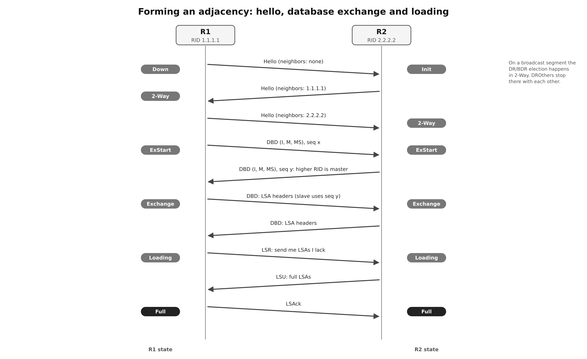
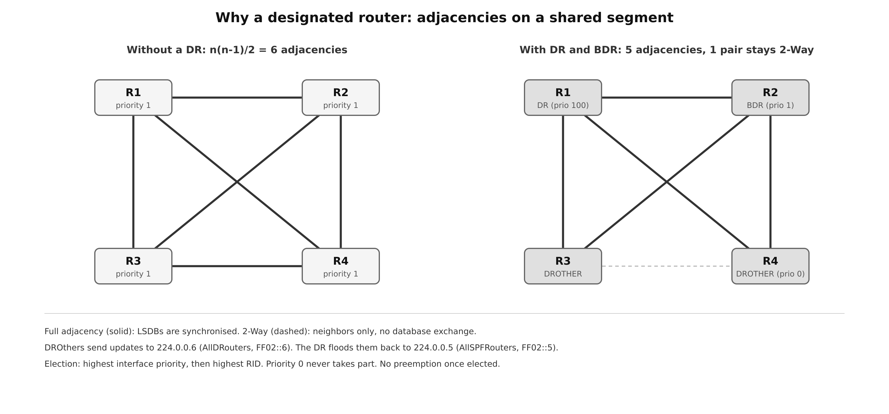
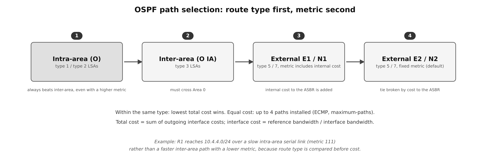

### Overview

---

**OSPF (Open Shortest Path First)** is the most widely used open **Interior Gateway Protocol (IGP)**: the protocol that routers inside one organization use to learn every prefix in the network and the best path to it. It is a non-proprietary standard. **OSPFv2** (RFC 2328) carries IPv4, and **OSPFv3** (RFC 5340) was written for IPv6 and can also carry IPv4.

OSPF replaced distance-vector protocols such as RIP, which only tell a neighbor "I can reach X at distance N". OSPF is a **link-state** protocol instead. Each router describes **its own links** to everyone, so every router holds the same map of the network and computes paths from it. From the start, OSPF also supported classless routing (VLSM), summarization, authentication and tagging of external routes.

Three properties explain most of its design:

* **Every router in an area has an identical database.** Correctness depends on it, and that is why filtering and summarization only happen at area borders.
* **Paths are computed locally** with Dijkstra's **Shortest Path First (SPF)** algorithm, so there is no routing-by-rumor and no count-to-infinity.
* **The network is split into areas** around a backbone, which limits how far detail travels and how often each router must run SPF.

---

### Link-State Fundamentals

---

The protocol revolves around three structures:

| Term | Meaning |
|------|---------|
| **LSA** (Link-State Advertisement) | A record that describes a piece of the topology: a router and its links, a multi-access segment, a prefix from another area, an external route |
| **LSDB** (Link-State Database) | The collection of all LSAs a router has received for an area. It is the map of the network |
| **SPT** (Shortest Path Tree) | The result of running SPF on the LSDB, with **the local router as the root**. Each router has its own tree, built from the same map |

---

The process is the same on every router:

1. Discover neighbors with **Hello** packets.
2. Synchronize the LSDB with each adjacent neighbor.
3. **Flood** LSAs reliably whenever something changes. Every LSA is acknowledged.
4. Run **SPF** on the LSDB and install the best paths in the routing table.

The cost of a path is the **sum of the costs of the outgoing interfaces** along it. A lower cost is better.

---

### Packets and Transport

---

OSPF runs **directly over IP** with protocol number **89**. It does not use TCP or UDP, so it implements its own reliability with acknowledgments. Where possible it uses multicast to avoid disturbing hosts:

| Address | Name | Used by |
|---------|------|---------|
| **224.0.0.5** (IPv6 **FF02::5**) | AllSPFRouters | Hellos, and the DR flooding to everyone on a segment |
| **224.0.0.6** (IPv6 **FF02::6**) | AllDRouters | Non-DR routers sending updates to the DR and BDR |

---

There are five packet types, which share a common header:

| Type | Packet | Purpose |
|:----:|--------|---------|
| 1 | **Hello** | Discover neighbors and keep them alive |
| 2 | **Database Description (DBD / DDP)** | Summarize the LSDB with LSA headers during adjacency formation |
| 3 | **Link-State Request (LSR)** | Ask a neighbor for the LSAs that are missing or older locally |
| 4 | **Link-State Update (LSU)** | Carry complete LSAs, in response to an LSR or when flooding a change |
| 5 | **Link-State Acknowledgment (LSAck)** | Confirm the receipt of LSAs, which makes flooding reliable |

---

The OSPFv2 header is 24 bytes: version, type, packet length, **Router ID**, **Area ID**, checksum, authentication type and 8 bytes of authentication data.

#### The Hello packet

---

| Field | Meaning |
|-------|---------|
| **Router ID (RID)** | A 32-bit identifier, unique in the OSPF domain, written like an IPv4 address |
| **Area ID** | The area of the interface. 32 bits, written as a decimal (256) or dotted-decimal (0.0.1.0) value |
| **Network mask** | The mask of the interface's primary address |
| **Hello and Dead intervals** | How often hellos are sent, and how long to wait before declaring a neighbor down |
| **Options** | Capability flags, including the area type (stub, NSSA) |
| **Router priority** | Used for the DR election |
| **DR and BDR** | The addresses of the current designated router and backup |
| **Active neighbors** | The RIDs of every neighbor heard on this segment within the Dead interval |
| **Authentication** | None, plain text or MD5 (OSPFv2) |

---

The **active neighbor list** is what makes communication two-way: a router knows that the neighbor hears it when it finds **its own RID** in the neighbor's hello.

---

### Neighbors and Adjacencies

---

#### Neighbor states

---

| State | Meaning |
|-------|---------|
| **Down** | No hello received yet |
| **Attempt** | Only on non-broadcast networks with manually configured neighbors: no recent information, still trying |
| **Init** | A hello was received, but it does not list our RID yet |
| **2-Way** | Each side sees itself in the other's hello. **The DR/BDR election happens here** |
| **ExStart** | The two routers choose a **master and slave** (the higher RID becomes master) and the initial DBD sequence number |
| **Exchange** | DBD packets describe each LSDB with LSA headers |
| **Loading** | LSRs ask for the LSAs that the Exchange revealed as missing or newer, and LSUs deliver them |
| **Full** | The databases are synchronized. The routers are **fully adjacent** |

---

<div style="text-align: center;">



</div>

**Neighbor** and **adjacency** are not the same thing. Two routers are neighbors once they reach 2-Way. They are adjacent only when they reach Full, and only adjacent routers exchange LSAs. On a broadcast segment, two routers that are neither DR nor BDR **stay in 2-Way with each other by design**. That is normal, not a fault.

---

#### Requirements for an adjacency

---

Two routers form an adjacency only if all of these match:

* **Unique RIDs.** Two routers with the same RID cause strange flooding problems.
* **A common subnet** on the interfaces (OSPFv2).
* The same **MTU**. A mismatch typically leaves the neighbor stuck in **ExStart/Exchange**, because large DBD packets are dropped.
* The same **Area ID** on the segment.
* The same **DR requirement**, which in practice means compatible network types.
* The same **Hello and Dead timers**.
* The same **authentication** type and credentials.
* The same **area type flags** (stub, NSSA).

---

### Designated Router and Backup

---

On a multi-access segment with *n* routers, a full mesh of adjacencies needs *n(n−1)/2* adjacencies, and each change would be flooded on each of them. Four routers already need six. OSPF solves this with a **Designated Router (DR)**: every router becomes adjacent only with the DR and a **Backup DR (BDR)**, and the DR is responsible for the segment.

<div style="text-align: center;">



</div>

* A **DROTHER** that has a change sends it to **224.0.0.6**, which reaches the DR and BDR.
* The **DR** floods it back to **224.0.0.5**, so every router on the segment receives it once.
* The DR also originates the **type 2 (Network) LSA** that represents the segment in the LSDB.
* The **BDR** listens to everything and takes over immediately if the DR fails.

**Election.** Every interface with a priority from 1 to 255 is a candidate (default **1**). The **highest priority** wins, then the **highest RID**. The DR is chosen first, then the BDR among the remaining routers. An interface with priority **0** never becomes DR or BDR.

**No preemption.** Once elected, the DR keeps its role even if a "better" router joins. The roles only move on failure, or when the OSPF process restarts on the DR or BDR. To place the DR deliberately, raise the priority on the chosen router and set 0 on routers that must never be elected, then restart the process on the segment if needed.

---

### Network Types

---

The network type decides whether a DR is elected and which timers are used. It is chosen from the media, and can be overridden per interface. Both ends of a link must agree.

| Type | Default on | DR/BDR | Hello / Dead |
|------|-----------|:------:|:------------:|
| **Broadcast** | Ethernet | Yes | 10 / 40 s |
| **Non-broadcast (NBMA)** | Frame Relay main interface | Yes | 30 / 120 s |
| **Point-to-point** | Serial, GRE, Frame Relay P2P subinterfaces | No | 10 / 40 s |
| **Point-to-multipoint** | Never by default | No | 30 / 120 s |
| **Loopback** | Loopback interfaces | N/A | N/A |

---

* **Broadcast** expects a segment with possibly many routers, and elects a DR to control flooding.
* **Point-to-point** has only two routers, so no DR and no wait timer. Setting an Ethernet link between two routers to point-to-point is a common optimization: it skips the election and removes the type 2 LSA for that link.
* **Loopback** always advertises the address as a **/32 host route**, whatever mask is configured.
* **Point-to-multipoint** advertises each endpoint as a host route, and sets the next hop to the outgoing interface.

---

### Areas and Router Roles

---

A single large area works, but it does not scale. Every link flap triggers a **full SPF** on every router, the LSDB grows with each link and consumes memory, and nothing can be summarized. The design must also fit the **smallest, slowest router** in the area.

OSPF solves this with a **two-tier hierarchy**:

* **Area 0**, the **backbone**. Every other area must connect to it.
* **Non-backbone areas** advertise their prefixes into Area 0, and Area 0 advertises them into all other areas.

An area **hides its topology** from other areas, but keeps its **prefixes visible**. Inside an area, routers see every router and link. Outside, they only see a list of prefixes with a cost.

<div style="text-align: center;">


</div>

| Role | Definition |
|------|------------|
| **Internal router** | All its interfaces are in one area |
| **Backbone router** | At least one interface in Area 0 |
| **ABR** (Area Border Router) | Interfaces in **Area 0 and at least one other area**. It translates routes between areas |
| **ASBR** (AS Boundary Router) | Injects **external routes** into OSPF through redistribution (static, BGP, another OSPF process, and so on) |

---

Some rules are easy to miss:

* Area membership is a property of an **interface**, not of a router. An interface belongs to exactly one area.
* A router that connects Area 1 and Area 2 **without** an interface in Area 0 is **not** an ABR, and it will not pass routes between the two areas.
* The Area ID is 32 bits. `area 256` on one router and `area 0.0.1.0` on another are the same area, and they form an adjacency. Hellos always carry the dotted form.

In the routing table, routes learned from the same area are **intra-area** (`O`). Routes from another area through an ABR are **inter-area** (`O IA`). Routes redistributed by an ASBR are **external** (`O E1`, `O E2`, or `O N1`, `O N2` in an NSSA).

---

### LSA Types

---

| Type | Name | Originated by | Flooding scope | Content |
|:----:|------|---------------|----------------|---------|
| **1** | Router | Every router | Its area | The router's links in the area: type, neighbor, cost |
| **2** | Network | The DR | Its area | The multi-access segment and every router attached to it |
| **3** | Summary | ABR | Into other areas | A prefix from another area, with its cost |
| **4** | ASBR Summary | ABR | Into other areas | How to reach an ASBR located in another area |
| **5** | AS External | ASBR | Whole domain, except stub areas | A redistributed (external) prefix |
| **7** | NSSA External | ASBR inside an NSSA | The NSSA only | An external prefix. The ABR translates it to type 5 at the border |

---

Every LSA carries a header with its **type**, **Link-State ID**, **advertising router**, **age** and **sequence number**:

* **Age.** It grows by one each second. The originating router **refreshes** its LSA every **1800 s** (30 minutes) with a new sequence number. An LSA that reaches **3600 s** (MaxAge) is invalid and is removed.
* **Sequence number.** A 32-bit number that orders versions of the same LSA, so that a delayed copy can never overwrite a newer one.
* All routers of an area hold **identical LSAs for that area**. An ABR keeps **one LSDB per area**.

---

#### Types 1 and 2: the topology inside an area

---

Every router originates one **type 1** LSA, listing each OSPF-enabled interface: a point-to-point link to a neighbor, a **transit** link to a segment with a DR, or a **stub** network (a segment with no neighbor, such as a loopback or a passive interface). If a segment has no DR, it appears only as a stub in the type 1 LSA and there is no type 2.

The **type 2** LSA, originated by the DR, describes the segment as a node in the graph and lists every attached router. Type 1 and type 2 LSAs **never leave the area**, and they are what SPF runs on.

---

#### Type 3: prefixes from other areas

---

The ABR turns the result of its SPF in one area into **type 3** LSAs for the other areas. A type 3 LSA contains only the **prefix, the mask, the ABR's RID and a cost**. It works like a distance vector: a router in another area does not know whether the prefix is attached to the ABR or many hops further away.

The cost in a type 3 LSA is:

* the ABR's **total path cost** to the prefix, when created from a type 1/2 LSA of an attached area,
* the ABR's cost to the originating ABR **plus the cost in the original type 3**, when created from a type 3 received in Area 0.

A receiving router adds its own cost to the ABR. In the figure, R4 advertises 10.56.1.0/24 into Area 1234 with a cost of 2, and R3's cost to R4 is 65, so R3 reaches the prefix with a total cost of **67**.

The type 3 LSAs replace detail with summary: in Area 1234, three type 1 LSAs and one type 2 LSA describe the 10.123.1.0/24 segment, while outside the area a single type 3 LSA represents it.

---

#### How ABRs create type 3 LSAs, and discontiguous networks

---

An ABR follows three rules:

1. **Type 1/2 information** from an area becomes type 3 LSAs into Area 0 and the other attached areas.
2. **Type 3 LSAs received from Area 0** become type 3 LSAs into the non-backbone areas.
3. **Type 3 LSAs received from a non-backbone area are only used locally.** They are never re-advertised into any other area, not even into another part of Area 0.

Rule 3 is the loop-prevention rule. It forces all inter-area traffic through the backbone, the same idea as split horizon. It also explains **discontiguous networks**: if Area 0 is split in two (for example by a hardware failure, or by a design that puts a non-backbone area between two parts of the backbone), the prefixes on one side never reach the other side. The routing table may look as though routes cross the middle area, but they stop there.

The fix is to keep **Area 0 contiguous**, with redundant backbone links. A **virtual link** through a transit area, or a GRE tunnel in Area 0, can repair a partition, but both are workarounds rather than designs.

---

### Path Selection

---

OSPF compares **route types first** and costs second:

<div style="text-align: center;">



</div>

1. **Intra-area** routes are always preferred over inter-area routes, **even with a higher cost**. In the classic example, R1 reaches 10.4.4.0/24 over a slow serial link inside its area (cost 111) instead of a faster path through another area.
2. **Inter-area** routes, which must pass through Area 0.
3. **External type 1** (E1, or N1 in an NSSA): the external cost **plus** the internal cost to the ASBR.
4. **External type 2** (E2/N2, the default for redistribution): only the external cost, the same everywhere in the domain. A tie is broken by the cost to the ASBR.

Within the same type, the **lowest total cost** wins. If several paths have the same cost, they are all installed as **ECMP** routes. Cisco IOS installs up to **4** by default (`maximum-paths`).

OSPF routes have an **administrative distance of 110** in Cisco IOS. `show ip route` shows `[110/2]`: the AD, then the OSPF cost.

---

### Tuning

---

#### Link cost

---

The interface cost is **reference bandwidth / interface bandwidth**, with a minimum of 1. The default reference is **100 Mb/s**, which was reasonable in the 1990s:

| Interface | Cost with the default reference (100 Mb/s) | With a 100 Gb/s reference |
|-----------|:------:|:------:|
| T1 (1.544 Mb/s) | 64 | 64,766 |
| Ethernet (10 Mb/s) | 10 | 10,000 |
| Fast Ethernet | 1 | 1,000 |
| Gigabit Ethernet | 1 | 100 |
| 10 Gigabit Ethernet | 1 | 10 |
| 100 Gigabit Ethernet | 1 | 1 |

---

With the default, a Fast Ethernet link costs the same as a 10 Gb/s link, and OSPF may choose a poor path. Set `auto-cost reference-bandwidth` to a value above your fastest link, and **set it on every router**, or the costs will not be consistent. A single interface can also be given a fixed cost with `ip ospf cost` (1–65535).

---

#### Failure detection

---

A neighbor is declared down when no hello arrives within the **Dead interval**, by default **four times the Hello interval**. On a broadcast link, that means **40 seconds** with the defaults. The router then floods a new LSA and every router in the area runs SPF.

The timers can be changed per interface (`ip ospf hello-interval`, `ip ospf dead-interval`, 1–65535 s), but they **must match** on both sides, and the Dead interval must be larger than the Hello interval. For fast failover, it is usually better to keep the timers and add **BFD**, which detects failures in milliseconds and notifies OSPF.

---

#### Router ID and passive interfaces

---

* The **RID** is chosen as: a configured `router-id`, else the highest loopback address, else the highest active interface address. **Set it statically**. A RID that changes when an interface goes down changes the identity of the router in every LSA. A new RID only takes effect after `clear ip ospf process`.
* A **passive interface** still advertises its subnet into the LSDB, but **sends no hellos and ignores received OSPF packets**, so no adjacency can form. Use it on every interface toward hosts. This saves resources, and it stops a rogue device from injecting routes. `passive-interface default` with `no passive-interface` on the uplinks is the safest pattern.

---

### Summarization

---

Areas already reduce the LSDB, because detailed type 1/2 LSAs become type 3 LSAs. **Summarization** goes further by replacing many type 3 LSAs with one. Since all routers in an area need an identical LSDB, summarization happens **at the borders**: on the **ABR** for inter-area routes, and on the **ASBR** for external routes (`summary-address`).

Summarization also **contains SPF work**. Without a summary, when a link inside Area 1 fails, the ABR updates the type 3 LSAs of the affected prefixes and the routers in Area 0 recompute them. With a summary such as 10.1.0.0/18, the routers in Area 1 still run SPF, but Area 0 sees no change at all.

**Interarea summarization** is configured with `area <area-id> range` on the ABR, for the area where the type 1 LSAs **originate**:

* When at least one prefix of the source area falls in the range, the ABR advertises **one type 3 LSA** for the range, and **suppresses** the more specific type 3 LSAs. The type 1 LSAs inside the source area are not affected.
* In Cisco IOS the summary's cost is, by default, the **lowest cost** among the component prefixes. It changes whenever that best component changes. A fixed `cost` avoids recalculation and flooding when components flap.
* The ABR installs a **discard route** to **Null0** for the summary. If a packet arrives for an address in the range that has no more specific route, it is dropped instead of following a default route back and forth. In Cisco IOS, the discard route has AD **110** for internal summaries and **254** for external ones.

Summarization only works on prefixes that **originate in an attached area**, so the address plan must be built for it: give each area a contiguous block.

---

### Route Filtering

---

Distance-vector protocols filter routes as they send updates. In OSPF, all routers of an area **must** keep the same LSDB, so filtering is limited to a few points:

| Method | Where | Effect |
|--------|-------|--------|
| `area X range ... not-advertise` | ABR | Advertises **no type 3** for any prefix in the range. The prefixes stay visible **only inside their own area** |
| `area X filter-list prefix NAME {in \| out}` | ABR | Filters **type 3 generation** per prefix: `out` for type 3 LSAs leaving area X, `in` for those entering area X. More precise than `not-advertise`, for example to keep a prefix in Area 0 but hide it from Area 34 |
| `distribute-list ... in` | Any router | Keeps the route **out of the local routing table** only. The LSA is still in the LSDB and still flooded, so neighbors are unaffected |

---

A distribute-list is a local decision. Used carelessly, it creates **black holes**: neighbors still compute a path through this router, but the router has no route to forward with.

---

### Default Route

---

OSPF does not advertise a default route unless asked to. Under the OSPF process, `default-information originate` makes the router an ASBR and advertises **0.0.0.0/0 as a type 5 LSA** (E2 with metric 1 by default), **only if the router itself has a default route** in its routing table.

* `always` advertises it even without a local default. This is useful on an Internet edge router, but dangerous if the upstream is down, because the router keeps attracting traffic it cannot deliver.
* `metric` and `metric-type 1` change the cost and make it E1, so that, with two exit routers, each part of the network uses the closer exit.

Stub and NSSA areas receive a default route from their ABR in place of external routes (see below).

---

### Special Area Types

---

| Area type | Type 3 | Type 4/5 | Type 7 | Default route |
|-----------|:------:|:--------:|:------:|---------------|
| **Normal** | yes | yes | no | Only if originated |
| **Stub** | yes | **no** | no | Injected by the ABR as type 3 |
| **Totally stubby** (Cisco) | **only the default** | no | no | Injected by the ABR as type 3 |
| **NSSA** | yes | no | yes (local ASBR) | Optional |
| **Totally NSSA** (Cisco) | only the default | no | yes | Injected by the ABR |

---

The area type is carried in the hello options, so **every router in the area must agree** on it, or no adjacency forms. These area types are the main way to shrink the LSDB on small routers at the edge of the network.

---

### OSPFv3

---

OSPFv3 keeps the same algorithm, the same five packet types, the same neighbor states, the same DR/BDR logic and the same area design. What changes is how **addresses** are separated from **topology**.

#### What is different

---

| Topic | OSPFv2 | OSPFv3 |
|-------|--------|--------|
| Transport | IPv4, protocol 89 | IPv6, next header 89, sent from the **link-local** address |
| Multicast | 224.0.0.5 / 224.0.0.6 | FF02::5 / FF02::6 |
| Address families | IPv4 only | IPv6, and IPv4 through **address families** (RFC 5838) |
| Prefixes | Inside type 1 and type 2 LSAs | In separate **Intra-Area-Prefix** and **Link** LSAs |
| Router ID | Can be derived from an IPv4 address | Still a 32-bit number. It **must be configured** when the router has no IPv4 address |
| Neighbors | Identified by interface address on broadcast links | Always identified by **Router ID** |
| Subnet check | Neighbors must share a subnet | Neighbors form over link-local addresses, even **without a common subnet** |
| Authentication | In the OSPF header (none, plain text, MD5) | Removed from the header. Uses **IPsec** (AH/ESP), or the later authentication trailer (RFC 7166) |
| Multiple instances | No | **Instance ID** in the header, to run separate instances on one link |
| Header | 24 bytes | 16 bytes: no authentication fields, an Instance ID instead |

---

#### LSA types

---

The LS Type field now encodes the **flooding scope** and tells routers how to handle unknown LSA types (the high bits: link-local, area, or AS scope).

| LS Type | Name | Purpose |
|---------|------|---------|
| 0x2001 | **Router** | The router's interfaces and their costs in the area. **No prefixes** |
| 0x2002 | **Network** | Originated by the DR: the routers attached to the segment. **No prefixes** |
| 0x2003 | **Inter-Area-Prefix** | Was the type 3 Summary LSA: IPv6 prefixes from other areas |
| 0x2004 | **Inter-Area-Router** | Was the type 4 ASBR Summary LSA |
| 0x4005 | **AS-External** | Redistributed routes and default routes (AS scope) |
| 0x2007 | **NSSA** | External routes in an NSSA |
| 0x0008 | **Link** | **Link-local scope**: maps the router's link-local address to the global prefixes on that link. Only shared between neighbors on the link |
| 0x2009 | **Intra-Area-Prefix** | The IPv6 prefixes of a router, a stub network or a transit segment |

---

Because Router and Network LSAs no longer carry addresses, the SPF tree is built from **links only**. Adding or changing a prefix on an interface changes an Intra-Area-Prefix LSA, and **does not require a full SPF run**: the router only recalculates the affected prefixes.

---

### Cisco IOS Configuration and Verification

---

#### OSPFv2

---

```
router ospf 1
 router-id 1.1.1.1
 auto-cost reference-bandwidth 100000          ! 100 Gb/s, same value on every router
 passive-interface default
 no passive-interface GigabitEthernet0/1
 network 10.0.0.0 0.255.255.255 area 0         ! method 1: network statement
 default-information originate metric 10 metric-type 1
!
interface GigabitEthernet0/2
 ip ospf 1 area 0                              ! method 2: per interface (takes precedence)
 ip ospf network point-to-point
 ip ospf cost 10
 ip ospf priority 100                          ! 0 = never DR/BDR
 ip ospf hello-interval 10
 ip ospf dead-interval 40
```

The `network` statement matches the **primary IPv4 address** of each interface against a wildcard mask, and puts matching interfaces in the given area. The per-interface command is more explicit. If both exist, the interface command wins.

**ABR: summarization and filtering**

```
router ospf 1
 area 1234 range 172.16.0.0 255.255.0.0 cost 45   ! one type 3 for the range
 area 12 range 172.16.0.0 255.255.0.0 not-advertise
 area 34 filter-list prefix NO-172-16-1 in
 distribute-list prefix LOCAL-ONLY in             ! local RIB filter only
!
ip prefix-list NO-172-16-1 deny 172.16.1.0/24
ip prefix-list NO-172-16-1 permit 0.0.0.0/0 le 32
```

| Command | Shows |
|---------|-------|
| `show ip ospf interface brief` | Interface, process, area, address, **cost**, **state** (DR, BDR, DROTHER, P2P, LOOP), **Nbrs F/C** (full / total) |
| `show ip ospf interface Gi0/1` | Network type, timers, priority, DR and BDR |
| `show ip ospf neighbor [detail]` | Neighbor RID, priority, **state/role** (e.g. `FULL/DR`), dead timer, address, interface |
| `show ip route ospf` | Installed OSPF routes: `O`, `O IA`, `O E1/E2`, `[110/cost]` |
| `show ip ospf database [router \| network \| summary \| external]` | The LSDB, by LSA type |
| `clear ip ospf process` | Restart OSPF, for example after a RID change |

---

#### OSPFv3

---

```
ipv6 unicast-routing
!
router ospfv3 1
 router-id 3.3.3.3                         ! mandatory without an IPv4 address
 passive-interface default
 address-family ipv6 unicast
  area 34 range 2001:db8:0:4::/62           ! ABR summarization
 exit-address-family
!
interface GigabitEthernet0/1
 ipv6 address 2001:db8:0:34::3/64
 ospfv3 1 ipv6 area 34
 ospfv3 1 ipv4 area 34                      ! IPv4 over OSPFv3 (needs an IPv6 address)
 ospfv3 network point-to-point
```

The old `ipv6 router ospf` and `ipv6 ospf <pid> area <id>` syntax is legacy. The `ospfv3` commands cover both address families. A `passive-interface` placed under the process applies to both families, and placed under an address family it applies to that family only.

To carry **IPv4 in OSPFv3**, the interface needs an IPv6 address (global or link-local), because the packets are always sent over IPv6. Then enable the IPv4 address family on it.

| Command | Shows |
|---------|-------|
| `show ospfv3 ipv6 neighbor` | IPv6 neighbors: RID, priority, state, interface |
| `show ospfv3 neighbor` | Neighbors of both address families |
| `show ospfv3 interface [brief]` | Area, address family, state, interface ID, DR and BDR |
| `show ipv6 route ospf` | IPv6 routes: `O`, `OI` |
| `show ip route ospfv3` | IPv4 routes learned through OSPFv3 |
| `show ospfv3 database [router \| network \| link \| prefix]` | The OSPFv3 LSDB |

---

### OSPF on Linux with FRRouting

---

On Linux (and on OpenWrt), OSPF is provided by **FRRouting**: `ospfd` for OSPFv2 and `ospf6d` for OSPFv3. The configuration is close to IOS:

```
! /etc/frr/frr.conf  (enable ospfd / ospf6d in /etc/frr/daemons)
interface eth0
 ip ospf network point-to-point
 ip ospf cost 10
 ipv6 ospf6 area 0
!
router ospf
 ospf router-id 1.1.1.1
 auto-cost reference-bandwidth 100000
 passive-interface default
 no passive-interface eth0
 network 10.0.0.0/24 area 0
 area 1 range 10.1.0.0/16
!
router ospf6
 ospf6 router-id 1.1.1.1
```

```
vtysh -c 'show ip ospf neighbor'
vtysh -c 'show ip ospf database'
vtysh -c 'show ipv6 ospf6 neighbor'
tcpdump -i eth0 -vv ip proto 89          # OSPFv2 packets
tcpdump -i eth0 -vv ip6 proto 89         # OSPFv3 packets
```

The routes computed by FRR are installed in the kernel routing table (`ip route` shows them with `proto ospf`).

---

### Troubleshooting

---

| Symptom | Likely cause | Check |
|---------|--------------|-------|
| No neighbor at all | Passive interface, ACL blocking protocol 89 or multicast, different subnet, area or authentication | `show ip ospf interface`, hellos in a capture |
| Stuck in **Init** | Hellos only flow in one direction (multicast filtered, unidirectional link) | The neighbor list in the received hellos |
| Stays in **2-Way** | Normal between two DROTHERs. Otherwise, both ends have priority 0 | Priorities and network type |
| Stuck in **ExStart/Exchange** | **MTU mismatch**, or duplicate RIDs | `show ip ospf interface`, interface MTU |
| Neighbor flaps every 40 s | Hello/Dead mismatch, or hellos dropped under load | Timers on both ends |
| Adjacency forms but routes are missing | Wrong area type, discontiguous Area 0, filtering, or a distribute-list | `show ip ospf database`, ABR configuration |
| Routes appear, but the path is suboptimal | Default reference bandwidth, intra-area preferred over inter-area | Interface costs, route type |
| Two routers both claim to be DR | Network type mismatch (broadcast on one end, point-to-point on the other) | `show ip ospf interface` on both ends |
| Constant SPF runs | A flapping link inside a large area | `show ip ospf statistics`, summarization and area design |

---

### Summary

---

1. OSPF is a **link-state IGP**. Every router floods LSAs that describe its links, keeps an **identical LSDB** per area, and runs **SPF** with itself as the root.
2. It runs on **IP protocol 89**, uses **224.0.0.5/6** (FF02::5/6), and has five packet types: **Hello, DBD, LSR, LSU, LSAck**.
3. Neighbors move through **Down, Init, 2-Way, ExStart, Exchange, Loading and Full**. RIDs must be unique, and subnet, MTU, area, timers, authentication and area type must match.
4. On multi-access segments a **DR and BDR** (highest priority, then highest RID, no preemption) cut the number of adjacencies and originate the type 2 LSA.
5. The **network type** decides whether a DR is used and which timers apply. Both ends must agree.
6. **Area 0** is the backbone. **ABRs** turn type 1/2 LSAs into **type 3** summaries, never pass type 3 LSAs from one non-backbone area to another, and so require a **contiguous Area 0**. **ASBRs** inject **type 5** (or type 7 in an NSSA) external routes.
7. Path selection compares **route type first** (intra-area, inter-area, E1, E2) and **cost second**, with up to four ECMP paths. Raise the **reference bandwidth** on every router.
8. **Summarize at ABRs** with `area range` to shrink the LSDB and contain SPF, and filter with `not-advertise`, `filter-list` or a local `distribute-list`.
9. **OSPFv3** keeps the same machinery but moves prefixes into **Intra-Area-Prefix** and **Link** LSAs, runs over link-local IPv6, uses IPsec for authentication, and can carry IPv4 through address families.
