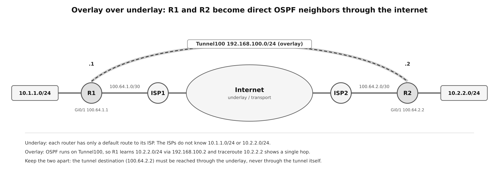
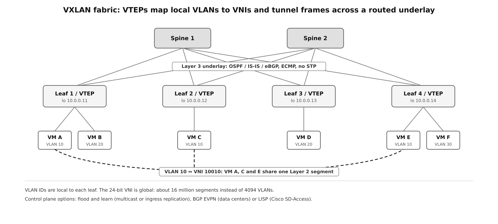

### Overview

---

An **overlay network** is a logical network built on top of another network. The network underneath, the **underlay** or **transport**, only has to deliver packets between the tunnel endpoints. The overlay carries its own addresses, its own routing and sometimes its own Layer 2 segments, and the underlay never looks inside.

The trick is always the same: **encapsulation**. The ingress device wraps the original packet in a new header addressed to the far tunnel endpoint. The underlay routes on that outer header. The egress device removes it (**de-encapsulation**) and forwards the original packet as if it had arrived on a directly connected link.

Overlays solve problems that the underlay cannot or will not solve:

- **Connecting private networks across the internet.** The ISPs do not carry 10.0.0.0/8 routes, but they do carry packets between two public addresses.
- **Running a routing protocol across a network you do not control**, for example OSPF between two branches over broadband.
- **Security**: encrypting and authenticating traffic over an untrusted transport (IPsec).
- **Scale and mobility**: separating *who* an endpoint is from *where* it is attached (LISP), or giving millions of tenants their own Layer 2 segments on a routed fabric (VXLAN).

This post covers the four overlays in the CCNP Enterprise core: **GRE**, **IPsec**, **LISP** and **VXLAN**. The [VPN post](/blog/vpn/) gives a broader tour of VPN types and protocols. This one goes deeper into how the tunnels are built, configured and debugged.

| Technology | Encapsulates | Outer header | Main job |
|---|---|---|---|
| GRE | almost any L3 protocol, including multicast | IP protocol 47 | generic tunnel, carries routing protocols |
| IPsec (ESP) | IP packets | IP protocol 50 (or UDP 4500 through NAT) | confidentiality, integrity, peer authentication |
| LISP | IP packets (L2 in some variants) | UDP 4341 (control 4342) | separate endpoint identity from location |
| VXLAN | Ethernet frames | UDP 4789 | Layer 2 and Layer 3 segments over a routed fabric |

---

### Generic Routing Encapsulation (GRE)

---

**GRE** (RFC 2784, with the optional key and sequence number fields in RFC 2890) is the simplest general-purpose tunnel. It can carry almost any network-layer protocol over an IP network: IPv4, IPv6, MPLS and, importantly, **multicast and broadcast**, which is why routing protocols such as OSPF and EIGRP run over GRE without any special handling.

GRE is used to:

- connect discontiguous parts of a network over a transport that does not know their routes,
- carry traffic through a firewall or an ACL that only permits traffic between the two endpoints,
- build VPNs, usually combined with IPsec, because **GRE itself provides no encryption and no authentication**.

---

#### GRE packet format

---


The router adds two headers in front of the original (passenger) packet:

1. A **new IP header**, the delivery header. Its source is the local tunnel source address and its destination is the remote tunnel endpoint. Its protocol field is **47 (GRE)**.
2. A **GRE header**, minimum 4 bytes: flags, version and a **protocol type** field that says what is inside (0x0800 for IPv4, 0x86DD for IPv6). Optional fields add a checksum, a 32-bit **key** (used to tell several tunnels between the same endpoints apart) and a sequence number.

Routers in the transport forward the packet based on the delivery header only. When it reaches the remote endpoint, the GRE and outer IP headers are removed and the original packet is routed normally. GRE works with IPv4 or IPv6 in either role: an IPv6 overlay over an IPv4 underlay, or the reverse.

---

#### MTU and fragmentation

---

Basic GRE adds **24 bytes** (20 IP + 4 GRE). A full-size 1500-byte packet becomes 1524 bytes and no longer fits a standard Ethernet link in the underlay. Either the tunnel router fragments it (CPU cost, and the far end has to reassemble) or, if the DF bit is set, the packet is dropped and an ICMP "fragmentation needed" message is sent back. If a firewall somewhere blocks that ICMP message, path MTU discovery fails silently: small packets work, large transfers hang.

The standard fix is to set the MTU on the tunnel interface and clamp the TCP MSS:

```text
interface Tunnel100
 ip mtu 1400
 ip tcp adjust-mss 1360
```

`ip mtu 1400` makes the router fragment (or reject) oversize packets **before** encapsulation, rather than fragmenting the GRE packet. `ip tcp adjust-mss 1360` rewrites the MSS option in TCP SYN packets so that hosts never send TCP segments that are too large (1360 = 1400 - 20 IP - 20 TCP). 1400 leaves room for IPsec on top of GRE as well. For plain GRE, 1476 is the exact limit.

---

#### GRE configuration

---



In this topology, R1 and R2 each have only a **default route** to their ISP. The ISPs know nothing about 10.1.1.0/24 or 10.2.2.0/24, so the two LANs cannot reach each other. A GRE tunnel gives the two routers a virtual point-to-point link, Tunnel100 on 192.168.100.0/24, and OSPF runs over it.

The steps:

1. Create the tunnel interface: `interface tunnel tunnel-number`.
2. Set the local source: `tunnel source {ip-address | interface-id}`. It can be a physical interface or a loopback.
3. Set the remote endpoint: `tunnel destination ip-address`.
4. Give the tunnel an IP address: `ip address ip-address subnet-mask`.
5. (Optional) Set `bandwidth` in kbps. Tunnel interfaces default to a low value (100 kbps on many platforms), which skews OSPF and EIGRP metrics and QoS percentages.
6. (Optional) Enable GRE keepalives: `keepalive [seconds [retries]]`. The default is 10 seconds and 3 retries. Without keepalives a GRE tunnel stays up/up as long as a route to the destination exists, even when the far end is dead.
7. (Optional) Set `ip mtu` (and `ip tcp adjust-mss`).

```text
! R1
interface Tunnel100
 bandwidth 4000
 ip address 192.168.100.1 255.255.255.0
 ip mtu 1400
 ip tcp adjust-mss 1360
 keepalive 5 3
 tunnel source GigabitEthernet0/1
 tunnel destination 100.64.2.2
!
router ospf 1
 router-id 1.1.1.1
 network 10.1.1.1 0.0.0.0 area 1
 network 192.168.100.1 0.0.0.0 area 0
!
ip route 0.0.0.0 0.0.0.0 100.64.1.2

! R2
interface Tunnel100
 bandwidth 4000
 ip address 192.168.100.2 255.255.255.0
 ip mtu 1400
 ip tcp adjust-mss 1360
 keepalive 5 3
 tunnel source GigabitEthernet0/1
 tunnel destination 100.64.1.1
!
router ospf 1
 router-id 2.2.2.2
 network 10.2.2.0 0.0.0.255 area 2
 network 192.168.100.2 0.0.0.0 area 0
!
ip route 0.0.0.0 0.0.0.0 100.64.2.1
```

Note what OSPF advertises: the LAN and the tunnel subnet, **not** the 100.64.x.x transport links. That is deliberate (see recursive routing below). The tunnel mode defaults to `tunnel mode gre ip`, so it is not shown.

---

#### Verification

---

```text
R1# show interfaces tunnel 100 | include Tunnel.*is|Keepalive|Tunnel s|Tunnel p
Tunnel100 is up, line protocol is up
  Keepalive set (5 sec), retries 3
  Tunnel source 100.64.1.1 (GigabitEthernet0/1), destination 100.64.2.2
  Tunnel protocol/transport GRE/IP

R1# show ip route ospf
O IA  10.2.2.0/24 [110/26] via 192.168.100.2, 00:17:37, Tunnel100

R1# traceroute 10.2.2.2 source 10.1.1.1
  1 192.168.100.2 3 msec 5 msec *
```

The traceroute shows **one hop**: the whole internet path is hidden inside the tunnel. A tunnel interface comes up when it has a source address that is up and a route to the destination. If keepalives are configured, it also needs replies from the far end.

---

#### Problems with overlay networks

---


**Recursive routing** happens when the router learns the route to the **tunnel destination through the tunnel**. A common way to cause it is to advertise the transport network into the same routing protocol that runs on the overlay. The OSPF route to 100.64.2.0/30 via Tunnel100 is more specific than the static default route, so it wins. Now, to send a packet into the tunnel, the router must send it to 100.64.2.2, which is reached through the tunnel. IOS detects the loop, logs `%TUN-5-RECURDOWN: Tunnel100 temporarily disabled due to recursive routing` and brings the tunnel down. The OSPF route then disappears, the tunnel comes back up, and the cycle repeats: the tunnel **flaps**.

Fixes, from simplest to cleanest:

- Do not advertise the transport addresses over the tunnel: precise `network` statements, `passive-interface`, or a distribute-list filtering the tunnel endpoints.
- Pin the endpoint with a more specific route through the underlay: `ip route 100.64.2.2 255.255.255.255 100.64.1.2`.
- Put the transport interface in a **front-door VRF** and point the tunnel at it with `tunnel vrf`. The underlay routes and the overlay routes then live in different tables and cannot interfere at all. This is the standard design for DMVPN and SD-WAN.

**Outbound interface selection** is the related problem on routers with more than one transport (for example MPLS and internet). The tunnel source is one interface, but the route to the tunnel destination may point out of the other, so packets leave with a source address that the return path does not expect. FVRFs solve this too, one per transport.

---

### IPsec Fundamentals

---

**IPsec** is a framework of open standards for securing IP traffic. It is not one algorithm but a set of protocols and negotiable options that together provide four security services:

| Service | What it prevents | Methods |
|---|---|---|
| Peer authentication | talking to an impostor | pre-shared key (PSK), digital certificates (RSA or ECDSA signatures) |
| Data confidentiality | eavesdropping | encryption: AES (recommended); DES and 3DES are obsolete |
| Data integrity | tampering in transit (man-in-the-middle) | HMAC with SHA-2 (SHA-256/384/512), or AES-GCM; MD5 and SHA-1 should not be used |
| Replay detection | an attacker resending captured packets | a sequence number in every packet; the receiver drops numbers it has already seen (anti-replay window) |

---

#### AH and ESP

---

IPsec defines two packet formats:

- **Authentication Header (AH)**, IP protocol 51, authenticates the packet, including most of the outer IP header, so any change in transit is detected. It **does not encrypt**. Because the outer IP addresses are covered by the integrity check, AH breaks when NAT rewrites them. It is rarely used.
- **Encapsulating Security Payload (ESP)**, IP protocol 50, encrypts the payload and adds its own header (SPI and sequence number), a trailer (padding and next header) and an integrity check value (ICV). ESP provides confidentiality, integrity and anti-replay in one protocol, and it is what almost every IPsec VPN uses.

---

#### Transport mode and tunnel mode

---


- **Tunnel mode** encrypts the **entire original packet**, header included, and adds a new outer IP header between the two IPsec gateways. The original addresses are hidden, and the new header routes the packet, so tunnel mode is itself an overlay. This is the default for site-to-site VPNs.
- **Transport mode** protects only the **payload**. The original IP header is kept and used for routing, so it provides no overlay function. It suits host-to-host traffic, and it is the efficient choice for **GRE over IPsec**: the GRE delivery header is already an IP header between the two routers, so IPsec only needs to protect what follows it, saving 20 bytes.

---

#### Algorithms and keying

---

| Function | Options | Status |
|---|---|---|
| Encryption | DES (56-bit), 3DES (168-bit) | obsolete, do not use |
|  | AES-CBC 128/192/256 | fine, combine with an HMAC |
|  | AES-GCM 128/256 | preferred: encryption and integrity in one pass (AEAD) |
| Integrity (HMAC) | MD5 (128-bit), SHA-1 (160-bit) | legacy, avoid |
|  | SHA-256, SHA-384, SHA-512 | recommended |
| Key exchange | Diffie-Hellman groups 1, 2, 5 | broken or too small |
|  | group 14 (2048-bit MODP) | minimum acceptable |
|  | groups 19, 20, 21 (ECDH P-256, P-384, P-521) | recommended |
| Authentication | pre-shared key | simple, fine for a few sites |
|  | RSA or ECDSA signatures (certificates) | scales, needs a PKI |

**Diffie-Hellman** lets two peers agree on a shared secret over an insecure channel without ever sending it. That secret is used to derive the symmetric keys for AES and the HMAC. **Perfect Forward Secrecy (PFS)** runs a fresh DH exchange for each IPsec SA, so a key compromised later cannot decrypt earlier traffic. It costs some CPU, but it is recommended.

A **transform set** is the combination of protocols and algorithms that the peers propose for an IPsec SA. At most one transform of each type is allowed:

| Type | Examples |
|---|---|
| AH authentication | `ah-sha-hmac`, `ah-sha256-hmac`, `ah-sha384-hmac`, `ah-sha512-hmac` (and the legacy `ah-md5-hmac`) |
| ESP encryption | `esp-aes` (128), `esp-aes 192`, `esp-aes 256`, `esp-gcm` (128 or 256, includes integrity), `esp-gmac` (integrity only), `esp-null`; legacy `esp-des`, `esp-3des`, `esp-seal` |
| ESP authentication | `esp-sha-hmac`, `esp-sha256-hmac`, `esp-sha384-hmac`, `esp-sha512-hmac` (and the legacy `esp-md5-hmac`) |
| Compression | `comp-lzs` |

---

(The `ah-sha256-hmac` family uses SHA-2 hashes. Some course material labels them "AES", which is wrong: AES is a cipher, not a hash.) With `esp-gcm` you do not add an ESP authentication transform, because GCM already provides integrity.

---

#### Internet Key Exchange (IKE)

---

IPsec needs keys and agreed parameters before it can protect anything. **IKE** negotiates them and authenticates the peers. The result is a set of **security associations (SAs)**: agreements on algorithms, keys and lifetimes, identified by a Security Parameter Index (SPI).

- **IKEv1** (RFC 2409) is built on **ISAKMP**, the framework for SA negotiation. On Cisco devices "IKE" and "ISAKMP" are used interchangeably, hence commands such as `crypto isakmp policy`.
- **IKEv2** (RFC 7296) is a redesign: fewer messages, more features, better security.
- IKE runs over **UDP 500**. When NAT is detected between the peers, both IKE and ESP move to **UDP 4500** (NAT traversal), because ESP has no ports for a NAT device to translate.


**IKEv1** works in two phases:

- **Phase 1** builds one bidirectional **ISAKMP SA**, a secure channel for the negotiation itself. Either peer can then start phase 2.
  - **Main mode (MM)**, six messages. MM1/MM2 agree on a proposal (encryption, hash, authentication method, DH group, lifetime). MM3/MM4 exchange DH public values and nonces, after which both sides can compute the keys. MM5/MM6 exchange identities and authenticate, already **encrypted**, so the identities stay hidden.
  - **Aggressive mode (AM)**, three messages. The initiator sends its proposal, DH value and identity at once, and the responder answers with everything in one message. It is faster, but the identities travel in clear and, with a PSK, an eavesdropper can capture a hash to attack the key offline. Avoid it.
- **Phase 2**, **quick mode (QM)**, three messages protected by the ISAKMP SA. QM1 proposes the IPsec transforms and the traffic to protect (the proxy identities), plus a DH value if PFS is on. QM2 answers. QM3 confirms. The result is **two unidirectional IPsec SAs**, one for each direction.

**IKEv2** replaces all of that with request/response **exchanges**:

1. **IKE_SA_INIT** negotiates algorithms, exchanges DH values and nonces (the work of MM1 to MM4). The responder can answer with a **cookie** first to defeat spoofed floods (anti-DoS).
2. **IKE_AUTH** authenticates both sides and exchanges identities, and also creates the **first child SA** (the IPsec SA). This covers MM5, MM6 and quick mode.

That is **four messages** to bring up the IKE SA and the IPsec SAs, against nine for IKEv1 main mode or six for aggressive mode. Additional child SAs and rekeys use **CREATE_CHILD_SA**. Dead peer detection, deletes and errors use **INFORMATIONAL**.

| | IKEv1 | IKEv2 |
|---|---|---|
| Exchanges | main mode / aggressive mode, then quick mode | IKE_SA_INIT, IKE_AUTH, CREATE_CHILD_SA |
| Messages to first IPsec SA | 9 (main) or 6 (aggressive) | 4 |
| Authentication | PSK, RSA signatures, RSA encryption; both peers use the same method | PSK, RSA and ECDSA signatures, EAP; each peer can use a different method |
| Next Generation Encryption (AES-GCM, SHA-2, ECDH, ECDSA) | limited | supported |
| NAT traversal, DPD | add-on extensions | built in |
| Protection | MitM, eavesdropping | MitM, eavesdropping, anti-DoS (cookies) |

Use IKEv2 for anything new. IKEv1 is still everywhere, so it is worth being able to read its configuration.

---

#### Cisco IPsec VPN solutions

---

- **Site-to-site (LAN-to-LAN) IPsec**: standards-based and interoperable between vendors, but every pair of sites needs its own configuration, which becomes hard to manage at scale.
- **DMVPN (Dynamic Multipoint VPN)**: multipoint GRE (mGRE) + **NHRP** + IPsec. Spokes register with a hub, and spokes can build direct spoke-to-spoke tunnels on demand. One hub configuration serves hundreds of spokes.
- **GET VPN (Group Encrypted Transport)**: a **tunnel-less** design for private WANs such as MPLS. Group members share keys from a key server and keep the original IP header, so the provider's routing and QoS still work. It addresses compliance requirements to encrypt traffic even on a private network.
- **FlexVPN**: Cisco's IKEv2 framework that unifies site-to-site, hub-and-spoke, spoke-to-spoke and remote access in one configuration model. It interoperates with legacy crypto map peers.
- **Remote access VPN**: users connect to the corporate network from anywhere, with FlexVPN (IKEv2) on IOS or AnyConnect/Secure Client on ASA and Firepower firewalls.

---

#### GRE over IPsec with crypto maps

---

IPsec on its own carries only unicast IP and has no interface to run a routing protocol on. GRE carries multicast and gives you an interface, but no security. **GRE over IPsec** combines them: GRE builds the overlay and IPsec encrypts the GRE packets.

The classic method uses a **crypto map**. Crypto maps are no longer recommended for tunnels, but they are still widely deployed:

1. A **crypto ACL** that matches the traffic to encrypt, here the GRE packets between the two endpoints:
   `permit gre host 100.64.1.1 host 100.64.2.2`
2. An **ISAKMP policy** for the phase 1 SA: `crypto isakmp policy priority` with `encryption`, `hash`, `authentication` and `group`. A lower priority number is tried first.
3. A **pre-shared key** per peer: `crypto isakmp key keystring address peer-address`. (0.0.0.0 0.0.0.0 matches any peer, which is convenient but weak.)
4. A **transform set** with its mode: `crypto ipsec transform-set name transforms`, then `mode transport` or `mode tunnel`.
5. A **crypto map** that ties it together: `match address`, `set peer`, `set transform-set`.
6. Apply the map to the **outside** interface: `crypto map map-name`.

```text
! R1: GRE over IPsec using a crypto map
crypto isakmp policy 10
 encryption aes 256
 hash sha256
 authentication pre-share
 group 14
crypto isakmp key CISCO123 address 100.64.2.2
!
crypto ipsec transform-set AES_SHA esp-aes 256 esp-sha256-hmac
 mode transport
!
ip access-list extended GRE_IN_VPN
 permit gre host 100.64.1.1 host 100.64.2.2
!
crypto map VPN 10 ipsec-isakmp
 match address GRE_IN_VPN
 set peer 100.64.2.2
 set transform-set AES_SHA
!
interface GigabitEthernet0/1
 ip address 100.64.1.1 255.255.255.252
 crypto map VPN
!
interface Tunnel100
 bandwidth 4000
 ip address 192.168.100.1 255.255.255.0
 ip mtu 1400
 ip tcp adjust-mss 1360
 tunnel source GigabitEthernet0/1
 tunnel destination 100.64.2.2
```

---

#### GRE over IPsec with an IPsec profile

---

The modern method attaches IPsec **to the tunnel interface** instead of the physical interface. An **IPsec profile** replaces the crypto map and the crypto ACL: everything that leaves through the tunnel is protected, so there is nothing to match.

```text
! R2: GRE over IPsec using an IPsec profile
crypto isakmp policy 10
 encryption aes 256
 hash sha256
 authentication pre-share
 group 14
crypto isakmp key CISCO123 address 100.64.1.1
!
crypto ipsec transform-set AES_SHA esp-aes 256 esp-sha256-hmac
 mode transport
!
crypto ipsec profile IPSEC_PROFILE
 set transform-set AES_SHA
!
interface GigabitEthernet0/1
 ip address 100.64.2.2 255.255.255.252
!
interface Tunnel100
 bandwidth 4000
 ip address 192.168.100.2 255.255.255.0
 ip mtu 1400
 ip tcp adjust-mss 1360
 tunnel source GigabitEthernet0/1
 tunnel destination 100.64.1.1
 tunnel protection ipsec profile IPSEC_PROFILE
!
router ospf 1
 router-id 2.2.2.2
 network 10.2.2.0 0.0.0.255 area 2
 network 192.168.100.2 0.0.0.0 area 0
```

Both peers negotiate the same SA whichever method each one uses, which is why the R1 crypto map and the R2 profile above interoperate. In a real deployment, pick one method and use it on both sides.

---

#### Static VTI

---

A **virtual tunnel interface (VTI)** removes GRE altogether. The tunnel interface itself becomes an IPsec tunnel in **tunnel mode**: `tunnel mode ipsec ipv4`. It saves the 4-byte GRE header and is simpler to reason about, but it carries only one protocol per tunnel (IPv4 or IPv6) and no non-IP traffic. IP multicast, and therefore OSPF, still works. GRE keepalives do not apply to a VTI, so use IKE dead peer detection instead.

Converting the GRE over IPsec example to a VTI takes a few changes:

```text
! R1: remove the crypto map, use a profile and VTI mode
interface GigabitEthernet0/1
 no crypto map VPN
!
crypto ipsec transform-set AES_SHA esp-aes 256 esp-sha256-hmac
 mode tunnel
crypto ipsec profile IPSEC_PROFILE
 set transform-set AES_SHA
!
interface Tunnel100
 tunnel mode ipsec ipv4
 tunnel protection ipsec profile IPSEC_PROFILE

! R2: already uses the profile, only the mode changes
interface Tunnel100
 tunnel mode ipsec ipv4
```

`tunnel mode gre ip` turns a VTI back into a GRE tunnel.

A modern IOS-XE configuration would use IKEv2 instead (a `crypto ikev2 proposal`, `policy`, `keyring` and `profile`, referenced from the IPsec profile with `set ikev2-profile`), with AES-GCM and an ECDH group. The tunnel interface stays the same.

---

#### Verification

---

```text
R1# show interfaces tunnel100 | include Tunnel protocol
  Tunnel protocol/transport GRE/IP           ! or IPSEC/IP for a VTI
R1# show ip ospf neighbor                    ! neighbor 2.2.2.2 FULL on Tunnel100
R1# show ip route ospf                       ! remote LAN via 192.168.100.2
R1# show crypto isakmp sa                    ! phase 1: state QM_IDLE = established
R1# show crypto ipsec sa                     ! phase 2: SPIs and the encaps/decaps counters
```

In `show crypto ipsec sa`, watch the `#pkts encaps` and `#pkts decaps` counters. If encaps rises but decaps stays at zero, the local side sends encrypted traffic but nothing comes back: check the far end, the return route, or a firewall dropping ESP or UDP 4500. If the ISAKMP SA never reaches QM_IDLE, compare the phase 1 policies and the pre-shared keys, and look at `debug crypto isakmp`.

---

### LISP: Location/ID Separation Protocol

---

An IP address has two meanings at once: **who** an endpoint is (its identity) and **where** it is attached to the network (its location). Because they are the same number, a site that moves or multihomes needs its prefixes announced in more places. That is one of the reasons the internet routing table, the **default-free zone (DFZ)**, keeps growing. **LISP** (originally RFC 6830, now RFC 9300 and RFC 9301) splits the two roles:

- **Endpoint identifier (EID)**: the address of an endpoint inside a LISP site. These are ordinary IPv4 or IPv6 host addresses, and hosts use them exactly as they do today.
- **Routing locator (RLOC)**: the address of a LISP router facing the internet or the core. Only RLOCs are routed in the underlay.

An endpoint can then **move** from site to site and keep its EID. Only the EID-to-RLOC mapping changes. LISP is a routing architecture with its own control plane and data plane. Today its biggest use is as the control plane of **Cisco SD-Access**, rather than on the internet.

---

#### Components

---

| Component | Role |
|---|---|
| LISP site | a site with LISP routers and EIDs |
| ITR (ingress tunnel router) | encapsulates packets from local EIDs going to remote LISP sites |
| ETR (egress tunnel router) | de-encapsulates LISP packets arriving for local EIDs, and registers the site's EID prefixes |
| xTR | a router that is both ITR and ETR (most LISP routers) |
| PITR (proxy ITR) | an ITR on behalf of **non-LISP** sites sending traffic **to** EIDs |
| PETR (proxy ETR) | an ETR on behalf of EIDs sending traffic **to non-LISP** sites |
| PxTR | both PITR and PETR |
| Map server (MS) | learns EID-to-RLOC mappings from ETRs (Map-Register) and stores them in the mapping database |
| Map resolver (MR) | receives Map-Requests from ITRs and finds the right answer through the mapping system |
| MS/MR | both functions on one device, the common deployment |

---

#### Control plane and data plane

---

The **control plane** works much like DNS. DNS resolves a name into an IP address; LISP resolves an **EID into an RLOC**. ETRs register their EID prefixes with the map server (**Map-Register**, acknowledged with a **Map-Notify**). An ITR that needs to reach an unknown EID sends a **Map-Request** to the map resolver. LISP control messages use **UDP 4342**.

The **data plane** is IP-in-IP/UDP encapsulation. The ITR adds an outer IP header with RLOC source and destination addresses, a UDP header (destination port **4341**) and an 8-byte LISP header that carries flags, a nonce or map version, and an **Instance ID** used to separate VRFs or virtual networks.

---

#### Map-Request and Map-Reply

---


When host1 in site 1 talks to host2 in site 2 for the first time:

1. host1 resolves host2's name by DNS and gets **10.1.2.2**, the destination EID.
2. The ITR receives the packet, looks up its FIB and finds no entry for that EID (in IOS the first packets are dropped while the mapping is resolved).
3. The ITR sends an encapsulated **Map-Request** for 10.1.2.2 to the map resolver.
4. The MS/MR forwards the request to the **authoritative ETR**, the one that registered 10.1.2.0/24.
5. The ETR sends a **Map-Reply** directly to the ITR: 10.1.2.2 → RLOC 100.64.2.2.
6. The ITR installs the mapping in its **map cache**, programs its FIB, and starts forwarding.

From then on the data path is simple. The ITR receives a packet from EID 10.1.1.1 to EID 10.1.2.2, finds the cache entry, and encapsulates it with outer source 100.64.1.1 (its own RLOC) and outer destination 100.64.2.2. The core routes on RLOCs only. The ETR strips the outer headers and delivers the original packet to host2.

---

#### Talking to non-LISP sites

---

LISP has to coexist with the rest of the internet:

- **Proxy ETR (outbound).** host1 resolves www.example.com to 100.64.254.254, a normal internet address. The ITR sends a Map-Request, and the mapping system answers with a **negative Map-Reply**: this prefix is not a LISP EID. It includes a calculated non-LISP prefix for the ITR to cache. The ITR then encapsulates that traffic to the **PETR**, which de-encapsulates it and forwards it natively to the internet.
- **Proxy ITR (inbound).** The PITR advertises the EID prefixes (often aggregated) to the internet, so traffic from non-LISP sites for 10.1.1.1 reaches it. The PITR sends a Map-Request, gets the Map-Reply 10.1.1.1 → 100.64.1.1 from the ETR, and LISP-encapsulates the traffic to that ETR, which delivers it to host1.

---

### VXLAN: Virtual Extensible LAN

---

Server virtualization and containers broke the assumptions of classic Layer 2 networks:

- The 12-bit VLAN ID allows only **4094 VLANs**, far too few for multi-tenant data centers.
- Hundreds of thousands of VMs and containers mean **huge MAC address tables** on every switch.
- **STP** blocks redundant links to prevent loops, so a large part of the bandwidth sits idle (see the [Spanning Tree post](/blog/spanning_tree_protocol/)).
- Layer 2 has **no ECMP**: traffic cannot be spread across several equal paths.
- VM **mobility** wants the same Layer 2 segment everywhere, which pushes VLANs across the whole data center.

**VXLAN** (RFC 7348) answers all of these by carrying Ethernet frames over a **routed Layer 3 underlay**. The underlay can be a leaf-spine fabric running OSPF, IS-IS or eBGP, with ECMP and no STP. Each VM keeps its Layer 2 segment, which now exists only in the overlay.

---

#### VNI and VTEP

---



- The **VXLAN network identifier (VNI)** is a **24-bit** segment ID in the VXLAN header: about **16 million** segments can coexist on the same infrastructure. A VNI can represent a Layer 2 segment (bridging) or a Layer 3 VRF (routing between segments).
- A **VXLAN tunnel endpoint (VTEP)** does the encapsulation. It has two sides:
  - **local LAN interfaces** facing the hosts, which bridge local traffic and map each local VLAN to a VNI;
  - an **IP interface** facing the core, usually a loopback, whose address identifies the VTEP in the underlay.

VLAN IDs become **locally significant**: VLAN 10 on leaf 1 and VLAN 210 on leaf 3 can both map to VNI 10010 and form one segment. VTEPs can be hardware switches or software (the Linux kernel, Open vSwitch, a hypervisor).

---

#### VXLAN and LISP headers

---


VXLAN reused the **Layer 2 LISP** header format. The LISP Instance ID became the 24-bit **VNI**, and the LISP fields that VXLAN does not need are reserved. The essential difference is the payload:

- **LISP** carries **IP packets** (IP in IP/UDP), a Layer 3 overlay, on UDP 4341.
- **VXLAN** carries **whole Ethernet frames** (MAC in IP/UDP), so it supports both Layer 2 and Layer 3 overlays, on UDP **4789**.

Three practical consequences:

- **MTU**: VXLAN over IPv4 adds **50 bytes** (outer Ethernet 14 + IP 20 + UDP 8 + VXLAN 8). The underlay needs an MTU of at least 1550. Fabrics normally run jumbo frames (9216) so that hosts can keep 1500 or even use 9000.
- **ECMP**: the outer UDP **source port** is a hash of the inner frame's headers, so the underlay's ECMP spreads different overlay flows across all equal-cost paths.
- **Control plane**: VXLAN defines only the data plane and works with any control plane. Options are **flood and learn** (BUM traffic sent to an underlay multicast group or replicated by the ingress VTEP to every peer, and MAC addresses learned from the data plane), **BGP EVPN** (the standard in data centers: MAC and IP routes are advertised in BGP) and **LISP**. **Cisco SD-Access** is exactly this last combination: a VXLAN data plane with a LISP control plane.

---

### Overlay Tunnels on Linux

---

The same building blocks are available on any Linux box, OpenWrt router or cloud VM (see also [Linux Netfilter and Traffic Control](/blog/linux-netfilter-and-traffic-control/)).

```sh
# GRE tunnel (R1 side)
ip tunnel add gre1 mode gre local 100.64.1.1 remote 100.64.2.2 ttl 255
ip addr add 192.168.100.1/24 dev gre1
ip link set gre1 mtu 1400 up
iptables -t mangle -A FORWARD -o gre1 -p tcp --tcp-flags SYN,RST SYN -j TCPMSS --clamp-mss-to-pmtu

# Layer 2 GRE (gretap) can be bridged like an Ethernet port
ip link add gretap1 type gretap local 100.64.1.1 remote 100.64.2.2

# VXLAN VTEP with static peers (head-end replication, no multicast)
ip link add vxlan10 type vxlan id 10010 local 10.0.0.11 dstport 4789 nolearning
bridge fdb append 00:00:00:00:00:00 dev vxlan10 dst 10.0.0.12
bridge fdb append 00:00:00:00:00:00 dev vxlan10 dst 10.0.0.14
ip link add br10 type bridge
ip link set vxlan10 master br10
ip link set eth1 master br10            # local hosts in "VLAN 10"
ip link set vxlan10 up; ip link set br10 up

# inspect
ip -d link show vxlan10
bridge fdb show dev vxlan10
tcpdump -ni eth0 'proto gre or udp port 4789 or esp or udp port 500 or udp port 4500'
```

For IPsec, **strongSwan** with IKEv2 is the usual choice. This protects the GRE tunnel above in transport mode, the same design as the Cisco example:

```text
# /etc/swanctl/swanctl.conf
connections {
  site2 {
    version = 2
    local_addrs = 100.64.1.1
    remote_addrs = 100.64.2.2
    proposals = aes256gcm16-prfsha384-ecp384
    local  { auth = psk  id = r1 }
    remote { auth = psk  id = r2 }
    children {
      gre {
        mode = transport
        local_ts  = 100.64.1.1/32[gre]
        remote_ts = 100.64.2.2/32[gre]
        esp_proposals = aes256gcm16-ecp384
        start_action = trap
      }
    }
  }
}
secrets {
  ike-site2 { id-1 = r1  id-2 = r2  secret = "use-a-long-random-key" }
}
```

`swanctl --load-all` loads it, `swanctl --list-sas` shows the IKE and child SAs, and `ip xfrm state` / `ip xfrm policy` show what the kernel actually installed. For a route-based design like a Cisco VTI, use an **XFRM interface** (`ip link add ipsec0 type xfrm if_id 1`) and set `if_id_in` / `if_id_out` on the child SA. FRR can then run OSPF or BGP over it exactly as over Tunnel100.

---

### Troubleshooting Checklist

---

| Symptom | Likely cause | Check |
|---|---|---|
| Tunnel is up/down | no route to the destination, keepalives failing, source interface down | `show interfaces tunnel`, `show ip route <destination>` |
| Tunnel flaps, `TUN-5-RECURDOWN` | the route to the tunnel destination points into the tunnel | stop advertising the transport, /32 static route, front-door VRF |
| Ping works, web pages or file transfers hang | MTU black hole, ICMP "fragmentation needed" blocked | `ip mtu 1400`, `ip tcp adjust-mss 1360`, `ping <x> size 1500 df-bit` |
| OSPF neighbor stuck in EXSTART/EXCHANGE over the tunnel | IP MTU mismatch between the tunnel ends | same `ip mtu` on both sides |
| No ISAKMP SA | phase 1 mismatch (policy, PSK, peer address), UDP 500 blocked | `show crypto isakmp sa`, `debug crypto isakmp` |
| ISAKMP SA up, no IPsec SA | transform set or crypto ACL mismatch, PFS on one side only | `show crypto ipsec sa`, `debug crypto ipsec` |
| encaps rises, decaps stays at 0 | return traffic lost: ESP or UDP 4500 filtered, or NAT without NAT traversal | firewall rules, `show crypto ipsec sa` on the peer |
| LISP: first packets lost, then fine | normal map-cache resolution | `show ip lisp map-cache` |
| VXLAN: ARP works, large packets fail | underlay MTU below 1550 | underlay MTU, jumbo frames end to end |
| VXLAN: no traffic to one VTEP | missing flood list or EVPN route, underlay route to the VTEP loopback missing | `bridge fdb`, `show nve peers`, underlay routing |

---

### Summary

---

- An **overlay** is a logical network built by **encapsulation** on top of an **underlay** that only needs to deliver packets between tunnel endpoints.
- **GRE** (IP protocol 47) adds 24 bytes and carries almost anything, including multicast and routing protocols, but provides **no security**. Set `ip mtu` and `ip tcp adjust-mss`, and keep the route to the tunnel destination in the underlay to avoid **recursive routing**.
- **IPsec** provides peer authentication, confidentiality, integrity and anti-replay. **ESP** (protocol 50) is what you use; **AH** (51) does not encrypt and does not survive NAT. **Tunnel mode** wraps the whole packet, **transport mode** protects only the payload and is the right choice under GRE.
- **IKE** builds the SAs. IKEv1 needs phase 1 (main mode, 6 messages; aggressive mode, 3) and phase 2 (quick mode, 3). **IKEv2** does it in **4** messages with NAT traversal, DPD, anti-DoS and modern cryptography built in. Prefer IKEv2 with AES-GCM, SHA-2 and ECDH groups.
- On Cisco IOS, **GRE over IPsec** uses a crypto map (legacy) or an **IPsec profile** with `tunnel protection` (preferred). A **VTI** (`tunnel mode ipsec ipv4`) drops GRE altogether.
- **LISP** separates identity (**EID**) from location (**RLOC**). ITRs ask the **map resolver**, ETRs register with the **map server**, and the data plane is IP in IP/UDP 4341. PITRs and PETRs connect LISP sites to the rest of the internet.
- **VXLAN** carries Ethernet frames in UDP 4789 with a **24-bit VNI** (16 million segments) between **VTEPs**, over a routed underlay with ECMP and no STP. It adds 50 bytes, uses flood and learn, BGP EVPN or LISP as its control plane, and is the data plane of Cisco SD-Access.

---

### References

---

- CCNP Enterprise: Core Networking, Chapter 16: Overlay Tunnels (Cisco instructor materials)
- RFC 2784, Generic Routing Encapsulation (GRE); RFC 2890, Key and Sequence Number Extensions to GRE
- RFC 4301, Security Architecture for the Internet Protocol; RFC 4303, IP Encapsulating Security Payload (ESP); RFC 4302, IP Authentication Header
- RFC 2409, The Internet Key Exchange (IKE); RFC 7296, Internet Key Exchange Protocol Version 2 (IKEv2); RFC 3948, UDP Encapsulation of IPsec ESP Packets
- RFC 9300, The Locator/ID Separation Protocol (LISP); RFC 9301, LISP Control Plane
- RFC 7348, Virtual eXtensible Local Area Network (VXLAN); RFC 7432, BGP MPLS-Based Ethernet VPN
