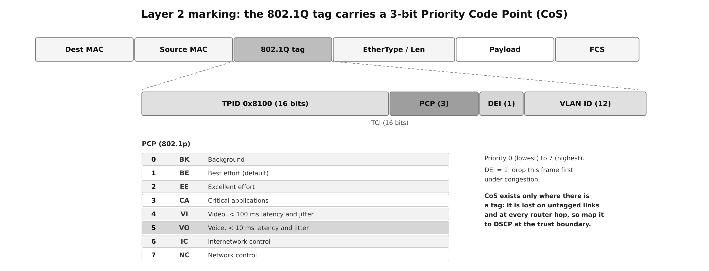
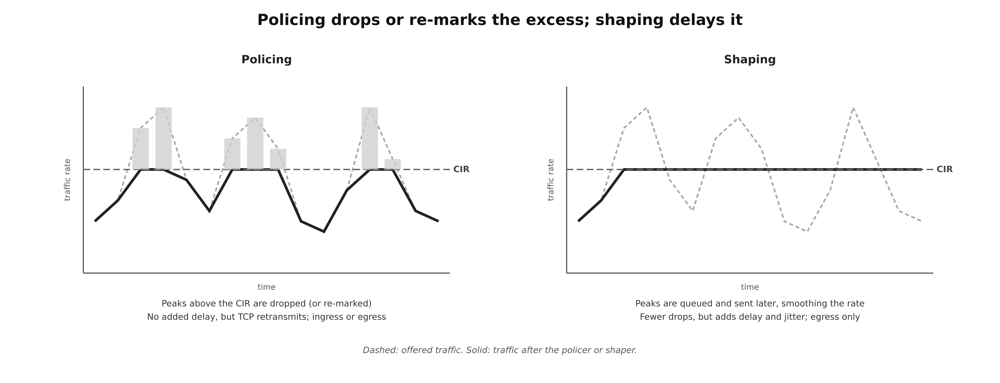

### Overview

---

A network without QoS treats every packet the same: **best effort**. That is fine while links have spare capacity. When a link becomes congested, packets wait in queues, arrive late or out of order, or are dropped, and the packets that suffer are chosen at random. For a file download this is a small slowdown. For a voice call it means echo, gaps and broken speech. For video it means pixelization, freezes and lost lip sync.

**Quality of Service (QoS)** is the set of tools that gives different traffic different treatment. Important traffic gets **less loss, less delay and less jitter** during congestion, and the rest still gets best-effort service. The tools work in a pipeline:

1. **Classification**: decide which class a packet belongs to.
2. **Marking**: write the class into the packet header, so that other devices do not need to classify again.
3. **Policing and shaping**: enforce rate limits by dropping, re-marking or delaying excess traffic.
4. **Congestion management**: queue and schedule packets by class when an interface is congested.
5. **Congestion avoidance**: drop (or ECN-mark) selected packets **before** the queues are full.

QoS does not create bandwidth. It decides **who waits and who is dropped** when there is not enough bandwidth.

---

### Why Quality Suffers

---

There are three causes, and every QoS tool addresses one of them.

#### Lack of bandwidth

---

The bandwidth available on a path equals the capacity of its **slowest link**. When traffic exceeds it, queues fill and packets are dropped. The solutions are to add bandwidth (not always possible, for budget or technical reasons), or to use QoS so that voice, video and business-critical traffic get what they need and the least important traffic gets the rest.

---

#### Latency and jitter

---

**Latency** is the one-way time from source to destination. ITU-T **G.114** recommends no more than **400 ms** for any application, and **less than 150 ms** for real-time traffic. In practice, voice quality does not degrade much until about **200 ms**. Latency has four parts:

| Component | Type | What it depends on |
|-----------|:----:|--------------------|
| **Propagation delay** | Fixed | Distance. Light in fiber travels at about c / 1.5 ≈ **200,000 km/s**, so about **5 µs per km**. A fiber around the equator (40,075 km) would take about 200 ms |
| **Serialization delay** | Fixed | Packet size / link speed. A 1500-byte packet takes **12 ms** at 1 Mb/s but **12 µs** at 1 Gb/s |
| **Processing delay** | Fixed | Moving the packet from input to output queue: CPU speed and load, switching path (process switching, software or hardware CEF), architecture, features configured |
| **Queuing delay** | **Variable** | How many packets are ahead in the output queue: the only part QoS can change |

---

**Jitter** (delay variation) is the difference in latency between packets of the same flow: if one packet takes 50 ms and the next 70 ms, the jitter is 20 ms. It comes mostly from **queuing during congestion**, and from variable packet sizes. Real-time receivers use a **de-jitter buffer** that holds packets and plays them out at a steady rate. The buffer absorbs jitter, but it adds delay, and packets that arrive after their play-out time are as good as lost.

---

#### Packet loss

---

Loss usually happens at a congested interface whose queue is full. The remedies are:

* more link speed;
* **congestion management and avoidance**, so that the right packets wait and the right packets are dropped;
* **policing**, which drops low-priority traffic early to protect high-priority traffic;
* **shaping**, which delays bursts instead of dropping them. It suits data, but not real-time traffic, because the delay adds jitter.

---

### QoS Models

---

| Model | How it works | Scale | Guarantee |
|-------|--------------|:-----:|:---------:|
| **Best effort** | No QoS. Every packet is treated the same | Unlimited | None |
| **IntServ** | Applications **signal** the network to reserve resources per flow (RSVP) | Poor | End to end, per flow |
| **DiffServ** | The network groups traffic into **classes**, marks them, and treats each class per hop | Excellent | Per hop, per class |

---

#### IntServ and RSVP

---

**Integrated Services** was built for real-time applications that need guaranteed bandwidth, delay and loss. It uses **RSVP** (Resource Reservation Protocol):

1. The sender sends **PATH** messages toward the receiver, with the addresses and the traffic description. Each router on the way stores **path state**, including the previous hop.
2. The receiver answers with **RESV** messages that travel **back hop by hop** along the same path (each router sends it to the previous hop recorded in its path state).
3. Each router that accepts the RESV **reserves bandwidth** on its link for the data flowing **from the sender to the receiver**. This is also **call admission control (CAC)**: if a link cannot accept the reservation, the flow is refused instead of degrading everyone.

IntServ gives real end-to-end guarantees, but every router and both endpoints must keep **state for every flow**, and reserved bandwidth that is not used is wasted. With thousands or millions of flows, it does not scale. RSVP survives mainly as **RSVP-TE** for MPLS traffic engineering.

---

#### DiffServ

---

**Differentiated Services** keeps no per-flow state and needs no signaling:

* Traffic is divided into a small number of **classes** based on business requirements, and each packet is **marked** with its class in the IP header.
* Each device reads the marking and applies a **per-hop behavior (PHB)**: how much bandwidth, how much delay, how likely to be dropped.
* Policies are configured **independently on each device**, hop by hop.

DiffServ scales to any size, which is why it is the model used almost everywhere. It does not give strict end-to-end guarantees: the end-to-end result is only as good as the policy on every hop, which is why a **consistent design across the whole network** matters.

---

### Classification

---

**Classification** identifies which class a packet belongs to. After that, the packet can be marked, queued, policed or shaped. Classification can use almost any field:

| Layer | Descriptors |
|-------|-------------|
| Internal | **QoS group** (local to one router) |
| Layer 1 | Physical interface, subinterface, port |
| Layer 2 | MAC address, **802.1Q/p CoS** |
| Layer 2.5 | **MPLS EXP** (Traffic Class) bits |
| Layer 3 | **DSCP**, **IP Precedence**, source and destination address |
| Layer 4 | TCP and UDP ports |
| Layer 7 | Applications, with **NBAR2** |

---

**NBAR2** (Next Generation Network-Based Application Recognition) is Cisco's deep packet inspection engine. It recognizes more than 1000 applications from Layer 3 to Layer 7 data, and new applications are added through protocol packs without an IOS upgrade. It runs in two modes: **Protocol Discovery**, which reports which applications are on the network and how much traffic they use (a good starting point for a policy), and **MQC** classification, where `match protocol` puts, for example, Webex in one class and YouTube in another.

Deep inspection costs CPU, so the best practice is to **classify once, as close to the source as possible, and mark**. Every other device then classifies on the marking alone.

---

### Marking

---

**Marking** writes a value into a header field so that later devices can treat the packet without classifying it again. The fields are:

* **QoS group**: an internal value inside one router, removed when the packet leaves. Used when a marking would be hidden by encapsulation or de-encapsulation between ingress and egress.
* **802.1Q/p CoS** at Layer 2.
* **MPLS EXP** (3 bits) at Layer 2.5.
* **DSCP** or **IP Precedence** at Layer 3.

---

#### Layer 2: 802.1Q and CoS

---

<div style="text-align: center;">



</div>

The 802.1Q tag adds two 16-bit fields after the source MAC address: the **TPID** (0x8100, which identifies a tagged frame) and the **TCI**, which contains:

* **PCP** (Priority Code Point, 3 bits), defined by 802.1p and usually called **CoS**: eight values, from 0 (lowest) to 7 (highest).
* **DEI** (Drop Eligible Indicator, 1 bit): 1 means the frame may be dropped first during congestion.
* **VLAN ID** (12 bits).

The weakness of CoS is that it exists **only where there is a tag**. It is lost on untagged links and at every routed hop. Traffic should therefore also carry a Layer 3 marking, typically by **mapping CoS to DSCP** at the edge. The eight CoS values correspond directly to the eight IP Precedence values.

---

#### Layer 3: IP Precedence and DSCP

---

<div style="text-align: center;">


</div>

The IPv4 header originally had a **Type of Service (ToS)** byte, of which only the first 3 bits, **IP Precedence**, were used for marking. IPP 6 and 7 are reserved for network control, which leaves six usable classes. RFC 2474 redefined the byte (and the IPv6 **Traffic Class** byte) as the **DiffServ field**: a 6-bit **DSCP** (Differentiated Services Code Point, 64 values) and 2 bits now used for **ECN**. The first 3 bits of the DSCP are the same bits as IP Precedence, which keeps the two compatible.

A Layer 3 marking survives across routers and links, so it is the marking that end-to-end policies rely on.

---

### Per-Hop Behaviors

---

A **behavior aggregate** is the set of packets with the same DSCP crossing a link in one direction. A **per-hop behavior (PHB)** is the treatment a DiffServ node gives that aggregate: forward it quickly, give it bandwidth, delay it, or drop it first. Four PHBs are standardized:

| PHB | DSCP | Service |
|-----|------|---------|
| **Default Forwarding (DF)** | 0 (000000) | Best effort. Also applied to anything that does not match a defined class |
| **Class Selector (CS)** | CS0–CS7 = 0, 8, 16 … 56 (xxx000) | Backward compatibility with IP Precedence: CSx is precedence x |
| **Assured Forwarding (AF)** | AF11–AF43 (aaadd0) | **Guaranteed bandwidth**, with access to more if available, and three drop precedences |
| **Expedited Forwarding (EF)** | **46** (101110) | **Low delay, low jitter, low loss**: voice |

---

#### Assured Forwarding

---

An AF code point is written **AFxy**, where **x** is the class (1–4, the first 3 bits) and **y** the **drop probability** (1 low, 2 medium, 3 high, the next 2 bits). The decimal value is **8x + 2y**: AF41 = 8 × 4 + 2 × 1 = **34**.

* The class number is **not a priority**: AF4 is not served before AF1. Each class should be given its own queue and its own bandwidth, and treated independently.
* Within a class, drop probability decides **who is dropped first** during congestion: AFx3, then AFx2, then AFx1, typically with **WRED**.
* Short bursts are absorbed by giving each class its **own queue** (CBWFQ). The standard defines the required behavior, not a particular algorithm.

---

#### Expedited Forwarding

---

**EF** (DSCP 46) is for traffic that needs **low loss, low latency, low jitter and assured bandwidth**: voice, and sometimes interactive video. Devices give it a **priority queue** (LLQ) with a guaranteed minimum departure rate, and **police** it so that it cannot starve the other classes. Its first 3 bits (101) map to IP Precedence 5, so older devices still give it precedence 5.

---

#### Scavenger

---

The **scavenger** class is for traffic that should get **less than best effort**: peer-to-peer file sharing, games, entertainment video. It is usually heavily rate limited or blocked. Since best effort already uses DSCP 0 and there is no negative DSCP, RFC 4594 uses **CS1** (DSCP 8) for scavenger. (RFC 8622 later defined a dedicated *Lower Effort* PHB with DSCP 1.)

---

### Trust Boundary

---

<div style="text-align: center;">


</div>

Packets should be **marked at the endpoint or as close to it as possible**. The **trust boundary** is the point where the network starts believing markings:

* A port that **trusts** the endpoint keeps its CoS or DSCP values.
* A port that **does not trust** it rewrites the markings (usually to 0), then **reclassifies and re-marks** the traffic according to policy.

In a campus with IP phones, the phone marks its voice with **CoS 5 / DSCP 46 (EF)**. Traffic from the PC plugged into the phone's switch port is **re-marked to CoS 0 / DSCP 0** by the phone, even if the PC set its own values. The access switch then trusts the phone (often only after detecting it with CDP or LLDP). Boundaries 1 and 2 in the figure are optimal. Boundary 3, at the distribution layer, is acceptable only when the access switch cannot classify. A user PC should never be trusted: anyone could mark their downloads as EF.

---

### Wireless QoS

---

A **wireless LAN controller (WLC)** sits between the wireless and wired networks, so it is a natural trust boundary. On Cisco controllers, each WLAN has a QoS profile with human-readable names that map to CoS and DSCP:

| Profile | Traffic | 802.1p | DSCP |
|---------|---------|:------:|:----:|
| **Platinum** | Voice | 5 | 46 (EF) |
| **Gold** | Video | 4 | 34 (AF41) |
| **Silver** (default) | Best effort | 0 | 0 |
| **Bronze** | Background | 1 | 10 (AF11) |

---

A new WLAN defaults to **Silver**. A WLAN created for voice is set to **Platinum**, so its traffic is treated for low latency and jitter and marked CoS 5 / EF on the wired side.

Over the air, 802.11 does not use DSCP directly. **WMM** (802.11e) defines a 3-bit **User Priority** (UP) per frame, grouped into four **access categories**, each with its own contention parameters (AIFSN and contention window). A higher category waits less before transmitting and wins the medium more often:

| Access category | User priority | Typical DSCP (RFC 8325) |
|-----------------|:-------------:|-------------------------|
| **AC_VO** voice | 6, 7 | EF → UP 6 |
| **AC_VI** video | 4, 5 | AF4x → UP 4 |
| **AC_BE** best effort | 0, 3 | DF → UP 0, AF2x → UP 3 |
| **AC_BK** background | 1, 2 | CS1 → UP 1 |

---

Access points and controllers translate between DSCP and UP in both directions. Wi-Fi contention makes these priorities **statistical**, not strict: heavy traffic in AC_VO from many clients can still congest the medium.

---

### Policing and Shaping

---

Policers and shapers both **measure traffic against a rate** and classify it the same way. They differ in what they do with the excess.

<div style="text-align: center;">



</div>

| | Policer | Shaper |
|---|---|---|
| Excess traffic | **Dropped or re-marked** | **Buffered and sent later** |
| Direction | Ingress or egress | **Egress only** |
| Delay and jitter | None added | Added (queuing) |
| TCP | Drops cause retransmissions | Fewer retransmissions |
| Typical place | Network edge, inbound from users or customers | Enterprise interface **toward a provider** |

---

* **Inbound policers** belong at the **edge**, so that excess traffic does not waste bandwidth in the core. Service providers police what customers send.
* **Shapers** are used by enterprises on provider-facing interfaces, when the provider polices at a lower rate than the physical link (for example a 100 Mb/s service on a 1 Gb/s port), or when exceeding the contract has a cost. Shaping to the contract rate is better than letting the provider drop the excess at random.

**Markdown.** Instead of dropping, a policer can **re-mark** excess traffic to a lower class: AFx1 becomes AFx2 (or AFx3 with a two-rate policer). DSCP-based WRED in the rest of the network then drops AFx3 before AFx2 before AFx1, so excess traffic is the first to go when there is congestion, and passes when there is not.

---

#### Token buckets

---

Cisco policers and shapers are built on **token buckets**:

| Term | Meaning |
|------|---------|
| **CIR** (Committed Information Rate) | The contract rate, in bits per second |
| **Bc** (Committed Burst) | The size of the token bucket: the most traffic that can be sent in one interval |
| **Tc** (Committed Time Interval) | The interval over which Bc is sent: **Tc = Bc / CIR** |
| **Token** | Permission to send one byte |

---

Tokens are added to the bucket at the CIR, up to Bc. A packet of B bytes needs B tokens. If there are enough, the packet **conforms** and the tokens are removed. If not, it **exceeds**, and the shaper **delays** it until enough tokens accumulate, while the policer **drops** or **re-marks** it. Tokens that arrive when the bucket is full are lost. **Bc must be at least the size of the largest packet**, or large packets will never conform.

**Worked example.** A policer on a 1 Gb/s interface has CIR = 120 Mb/s and Bc = 12 Mb (1.5 MB):

* Tc = 12,000,000 / 120,000,000 = **100 ms**, so there are **10 intervals per second**.
* Each interval allows 12,000,000 / 12,000 = **1000 packets** of 1500 bytes. Packets beyond that are dropped or re-marked.
* 1000 packets × 10 intervals = 10,000 packets per second, and 10,000 × 12,000 bits = **120 Mb/s**, the CIR.
* At line rate, the 1000 packets take 12,000,000 / 1,000,000,000 = **12 ms**. The rest of the 100 ms interval, **88 ms**, is silent.

That silence is why the interval matters. Recommended Tc values are **8 to 125 ms**. Real-time traffic needs a short Tc (8–10 ms) to keep gaps small. Above 125 ms, the gaps become too large for most networks.

---

#### Policer types

---

<div style="text-align: center;">


</div>

| Policer | Buckets | Colors | Behavior |
|---------|---------|--------|----------|
| **Single-rate two-color** | One (Bc at CIR) | Conform, exceed | Simple. Use it when only two different actions are needed |
| **Single-rate three-color** (srTCM, RFC 2697) | Bc, plus **Be** filled by **overflow** from Bc | Conform (green), exceed (yellow), violate (red) | Unused tokens from quiet periods allow later bursts. Fewer TCP retransmissions, a good fit for AFx1/AFx2/AFx3 |
| **Two-rate three-color** (trTCM, RFC 2698) | Bc at **CIR**, Bp at **PIR** | Conform, exceed, violate | A sustained excess rate up to the PIR. Checks **violate first** (over PIR), then exceed (over CIR), then conform |

---

The srTCM's excess depends on how much the traffic was idle before, which makes it less predictable. The trTCM caps the excess at a defined rate, so violating traffic can be dropped above a known **peak** rate. A three-color policer only makes sense if the three colors get **different actions**.

---

### Congestion Management

---

**Congestion management** is queuing plus scheduling. Congestion happens when the output interface is slower than the input, or when several inputs send to one output. Each interface has a small hardware FIFO, the **transmit ring (Tx-ring)**. When it is full, the interface is congested, and the software queuing system takes over: packets wait in queues, and a scheduler decides which goes next. When the Tx-ring has room again, queuing is effectively inactive.

Older queuing methods, such as FIFO, priority queuing (PQ), custom queuing, round robin, weighted round robin and weighted fair queuing, each solved part of the problem. PQ, for example, protects voice but can starve every other class. The methods used today combine their strengths:

* **CBWFQ** (Class-Based Weighted Fair Queuing): up to **256 classes**, each with its own queue and a **guaranteed share of bandwidth** during congestion.
* **LLQ** (Low-Latency Queuing): CBWFQ plus a **strict priority queue** that is always served first.

<div style="text-align: center;">


</div>

In LLQ, the priority classes are **policed during congestion** to the rate you configure (a fixed amount or a percentage of the interface), so they cannot starve the CBWFQ classes as legacy PQ did. Two different priority classes can be configured, for example voice policed to 10 Mb/s and video to 100 Mb/s, which a single priority class with one policer could not do.

---

### Congestion Avoidance

---

#### Tail drop and TCP synchronization

---

By default, when a queue is full, every arriving packet is dropped regardless of its class: **tail drop**. It is particularly bad for TCP. Many flows lose packets **at the same moment**, all back off together, the link becomes underused, then all flows speed up together and overflow the queue again. This cycle is called **TCP global synchronization**.

---

#### RED, WRED and ECN

---

<div style="text-align: center;">


</div>

**RED** (Random Early Detection) watches the **average queue depth**:

* Below a **minimum threshold**, nothing is dropped.
* Between the minimum and **maximum** thresholds, packets are dropped **at random**, with a probability that rises to the **mark probability** at the maximum.
* Above the maximum threshold, all new packets are dropped.

Random early drops slow down a few TCP flows at a time, before the queue overflows, which avoids global synchronization and keeps the link busy.

**WRED** (Weighted RED) is Cisco's version: each **IP Precedence** or **DSCP** value has its own thresholds. Lower precedence is dropped more aggressively, and within an AF class **AFx3 is dropped before AFx2, before AFx1**. This is what makes AF drop precedence and policer markdown actually work.

WRED can also use **ECN** (Explicit Congestion Notification): instead of dropping a packet from an ECN-capable flow, the router sets the **Congestion Experienced** codepoint in the two ECN bits. The receiver reports it to the sender, which slows down as if a packet had been lost, without the loss.

WRED should be used on **TCP data classes**. It is useless, or harmful, for the voice priority queue and for UDP real-time traffic, which does not slow down when packets are dropped.

---

### Cisco MQC Configuration

---

Cisco configures QoS with the **Modular QoS CLI (MQC)**, in three steps: **class-maps** classify, **policy-maps** define actions per class, and **service-policy** applies a policy to an interface in one direction.

```
! 1. classification
class-map match-any VOICE
 match dscp ef
class-map match-any VIDEO
 match dscp af41 af42 af43
class-map match-any CRITICAL-DATA
 match dscp af21 af22 af23
class-map match-any SCAVENGER
 match protocol youtube                        ! NBAR2
 match dscp cs1
!
! 2a. marking and policing at the ingress edge
policy-map EDGE-IN
 class SCAVENGER
  set dscp cs1
  police cir 10000000 conform-action transmit exceed-action drop
 class CRITICAL-DATA
  police cir 50000000 bc 625000 be 625000 conform-action transmit exceed-action set-dscp-transmit af22 violate-action set-dscp-transmit af23
!
! 2b. queuing at the egress
policy-map WAN-QUEUING
 class VOICE
  priority percent 10                          ! LLQ, policed during congestion
 class VIDEO
  priority percent 20
 class CRITICAL-DATA
  bandwidth percent 25
  random-detect dscp-based
 class SCAVENGER
  bandwidth percent 1
 class class-default
  fair-queue
  random-detect dscp-based
!
! 2c. shape to the provider's rate, then queue inside the shaper
policy-map WAN-SHAPER
 class class-default
  shape average 100000000
  service-policy WAN-QUEUING
!
! 3. apply
interface GigabitEthernet0/1
 service-policy input EDGE-IN
interface GigabitEthernet0/0
 service-policy output WAN-SHAPER
```

The **hierarchical** shaper in step 2c matters: if the physical port is 1 Gb/s but the provider delivers 100 Mb/s, congestion happens inside the provider, not on your Tx-ring, and your queues never activate. Shaping to 100 Mb/s moves the congestion point into your router, where LLQ and CBWFQ can do their job.

Policer forms: `police cir X` (single-rate two-color), `police cir X bc Y be Z` (single-rate three-color), `police cir X pir Y` (two-rate three-color). Note that IOS gives Bc and Be in **bytes**.

| Command | Shows |
|---------|-------|
| `show policy-map interface Gi0/0` | Per class: packets and bytes matched, offered and drop rates, queue depth, policer conform/exceed/violate counters, WRED drops |
| `show class-map` / `show policy-map` | The configured classes and policies |
| `show ip nbar protocol-discovery` | Applications seen and their traffic, when Protocol Discovery is enabled |
| `show mls qos interface` (Catalyst) | Trust state and marking on switch ports |

---

### QoS on Linux

---

Linux implements QoS with **traffic control (tc)** queuing disciplines (see [Linux Netfilter and Traffic Control](/blog/linux-netfilter-and-traffic-control/)):

```
# mark at the edge (nftables)
nft add rule inet filter forward udp dport 5060-5061 ip dscp set cs3
nft add rule inet filter forward ip saddr 10.0.10.0/24 udp dport 16384-32767 ip dscp set ef

# token bucket shaper (tbf)
tc qdisc add dev eth0 root tbf rate 10mbit burst 32kbit latency 50ms

# CAKE: shaper + DiffServ-aware queuing + flow fairness, a common choice on OpenWrt
tc qdisc replace dev wan root cake bandwidth 95mbit diffserv4

# ingress policer
tc qdisc add dev eth0 handle ffff: ingress
tc filter add dev eth0 parent ffff: protocol ip matchall action police rate 50mbit burst 64k drop

tc -s qdisc show dev wan                     # statistics per qdisc and tin
```

On home and small-office routers, shaping slightly **below** the WAN rate with **CAKE** or **fq_codel** (via SQM on OpenWrt) is one of the most effective fixes for latency under load (*bufferbloat*), because it keeps the queue in a device that manages it well instead of in the modem.

---

### Troubleshooting

---

| Symptom | Likely cause | Check |
|---------|--------------|-------|
| Voice is choppy only when the link is busy | No priority queue, or voice not marked EF | `show policy-map interface`, packet captures for DSCP |
| QoS policy shows no drops but users still complain | Congestion happens elsewhere (provider policing at a lower rate) | Shape to the contract rate with a hierarchical policy |
| Markings lost after a router | CoS used instead of DSCP, or a device re-marking to 0 | Trust settings, CoS-to-DSCP maps |
| Users' traffic marked EF | PC ports trusted | Trust only phones and infrastructure, re-mark the rest |
| Priority queue drops voice | Voice exceeds the LLQ policer (more calls than planned) | Increase the priority rate or add call admission control |
| Large TCP transfers stall or saw-tooth | Policer with a small Bc, or tail drop | Larger Bc, shaping instead of policing, WRED |
| Real-time traffic has jitter through a shaper | Real-time traffic shaped with data | Put it in LLQ inside the shaper |
| One class starves the others | Legacy PQ, or an unpoliced priority class | Use LLQ, set priority rates |
| Wi-Fi calls are poor despite wired QoS | DSCP not mapped to WMM UP, or the medium is saturated | AP/WLC QoS profile, DSCP-to-UP mapping, airtime |

---

### Summary

---

1. QoS manages **bandwidth, delay, jitter and loss** during congestion. It does not create bandwidth, it decides who waits and who is dropped.
2. Latency is propagation, serialization, processing and **queuing** delay. Only queuing is variable, and it is the source of jitter. G.114: below 150 ms for real time, 400 ms maximum.
3. **IntServ** reserves resources per flow with RSVP (PATH downstream, RESV upstream) and does not scale. **DiffServ** marks classes and applies **per-hop behaviors**, and scales.
4. **Classify once**, as close to the source as possible (ACLs, ports, **NBAR2**), and **mark**: **CoS** (3 bits, Layer 2, lost at routers), **MPLS EXP**, **DSCP** (6 bits, end to end).
5. PHBs: **DF** (0), **CS** (precedence compatibility), **AFxy** (bandwidth with three drop levels, DSCP = 8x + 2y), **EF** (46, low delay). Scavenger uses **CS1**.
6. Set a **trust boundary** at the phone or access switch, and re-mark untrusted traffic. Wi-Fi maps DSCP to **WMM access categories**.
7. **Policers** drop or re-mark the excess, **shapers** delay it. Both use **token buckets**: Tc = Bc / CIR. srTCM (RFC 2697) and trTCM (RFC 2698) give three colors.
8. **CBWFQ** guarantees bandwidth per class, **LLQ** adds a **policed priority queue** for voice and video.
9. **WRED** drops early and randomly, more for higher drop precedence, avoiding TCP global synchronization. **ECN** marks instead of dropping.
10. On a link slower than its port, **shape first and queue inside the shaper**, or the queues never activate.
