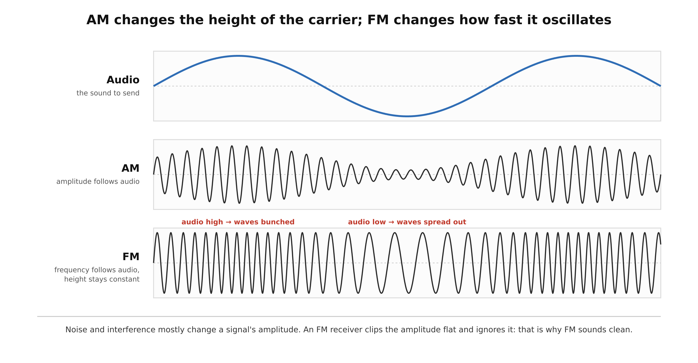

### Overview

---

A radio receiver is one of the most satisfying circuits you can build. A coil, a capacitor and a diode are enough to pull music and speech out of the air, and the simplest version does not even need a battery. This post explains how AM and FM reception work and walks through three builds:

1. **Build 1: a crystal radio.** It uses a hand-wound coil, a tuning capacitor, a germanium diode and a crystal earpiece. There is no battery: the radio station's own signal powers the earpiece.
2. **Build 2: a one-chip AM radio with a speaker.** An MK484 receiver IC and a ferrite-rod antenna do the receiving, and an LM386 amplifier drives a small speaker. Everything runs on a 9 V battery and fits in your hand.
3. **Build 3: an AM/FM radio.** A CXA1691 single-chip superheterodyne receives both FM and AM, is tuned with an ordinary knob and drives a speaker. There is no microcontroller and no code.

The AM builds use only the ideas from the [Circuit Theory](/blog/circuirt_theory/) post plus one new one: **resonance**. The FM build adds one more: the superheterodyne.

> **Before you start:** AM medium-wave broadcasting has been reduced in many countries. Check which medium-wave (MW) stations are on air where you live before you buy parts. Reception is much better **at night**, when MW signals reflect off the ionosphere and travel hundreds of kilometres. If there is no AM station near you, skip to [Build 3](#build-3-amfm-radio-without-a-microcontroller): FM stations are on air almost everywhere.

---

### How AM Reception Works

---

An AM (amplitude-modulated) transmitter sends a **carrier**, a sine wave at the station's frequency (somewhere between 531 and 1602 kHz on medium wave). It makes the carrier's **amplitude** rise and fall in step with the sound. The sound is in the **envelope**, the outline of the peaks.

A receiver has to do four things:

1. **Pick up signals.** An antenna, which is just a wire, has tiny voltages induced in it by every station in range.
2. **Select one station.** A **tuned circuit**, a coil and a capacitor in parallel, responds strongly at one frequency and hardly at all at others.
3. **Detect.** A **diode** lets only the positive half of the wave through. The full wave averages to zero, but the half-waves do not: their average rises and falls with the envelope.
4. **Smooth.** A capacitor (in the crystal radio, the earpiece itself) cannot follow the 1 MHz carrier but easily follows the audio. What is left is the sound.

---

#### The tuned circuit

---

An inductor $L$ and a capacitor $C$ in parallel resonate at:

$$
f_0 = \frac{1}{2\pi\sqrt{LC}}
$$

At $f_0$ the energy swings back and forth between the coil's magnetic field and the capacitor's electric field, and the circuit has a very high impedance. A station at $f_0$ develops a large voltage across it. Stations at other frequencies are shorted to ground through the coil (below $f_0$) or the capacitor (above $f_0$). Turning a **variable capacitor** changes $C$ and moves $f_0$ across the band. That is what the tuning knob on every analogue radio does.

With $L = 240\ \mu\text{H}$ and a standard 365 pF tuning capacitor (plus about 20 pF of stray capacitance from wiring and the coil itself), the circuit covers roughly 525 kHz to well past 1.6 MHz:

$$
f_\text{low} = \frac{1}{2\pi\sqrt{240\,\mu\text{H} \times 385\,\text{pF}}} \approx 525\ \text{kHz}
\qquad
C_\text{1602 kHz} = \frac{1}{(2\pi f)^2 L} \approx 41\ \text{pF}
$$

Because $f \propto 1/\sqrt{C}$, stations crowd together at the low-capacitance (plates open) end of the dial. That is normal.

---

### Build 1: Crystal Radio

---

The crystal radio is named after the galena crystal and "cat's whisker" wire that early sets used as the detector. A germanium diode does the same job today. With no battery, every microwatt you hear comes from the transmitter, so the antenna and ground are the most important parts of the radio.

---

#### Parts

---

| Part | Value | Notes |
|---|---|---|
| Coil | ~240 µH | 80–90 turns of 0.3–0.5 mm enamelled copper wire on a 40–50 mm tube (cardboard tube, PVC pipe, pill bottle) |
| Tuning capacitor | 365 pF variable | Air-spaced is best. Salvaged plastic "polyvaricon" capacitors work; their AM sections are often smaller (about 140–270 pF), so connect two sections in parallel or add turns |
| Diode | Germanium 1N34A or 1N60 | Low forward voltage (0.2–0.3 V) matters for weak signals. Schottky BAT46, BAT85 or 1N5711 are alternatives. A silicon 1N4148 needs about 0.6 V and only works on strong stations |
| Earpiece | Crystal / ceramic (piezo) earpiece | Must be **high impedance**. Normal 32 Ω headphones will not work without a matching transformer |
| Resistor | 47–100 kΩ | Bleeds charge off the piezo earpiece so it can follow the audio |
| Antenna | 10–30 m of any insulated wire | As long and as high as possible, with insulators at the ends |
| Ground | Ground rod or metal water pipe | A metre of copper or steel rod driven into damp soil. Many water pipes are now plastic: check |
| Board | Piece of wood, screws or terminal blocks | A "breadboard" in the original sense |

---

#### Winding the coil

---

1. Punch two small holes near one end of the tube and thread the wire through them to anchor it. Leave 15 cm free as the start lead.
2. Wind **tightly, side by side**, with no gaps and no overlaps. Every 10 turns, pull out a small loop, twist it a few times and carry on. These are **taps**.
3. After 85 turns, anchor the end through two more holes and leave another 15 cm lead.
4. Scrape the enamel off the lead ends and the tips of the tap loops with sandpaper or a knife until you see bright copper.

You can check the value with Wheeler's formula for a single-layer coil, where $r$ is the coil radius and $l$ its length, both in inches:

$$
L\,(\mu\text{H}) \approx \frac{r^2 N^2}{9r + 10l} = \frac{0.886^2 \times 85^2}{9(0.886) + 10(1.51)} \approx 246\ \mu\text{H}
$$

The exact number does not matter much. If you cannot reach the top of the band, take off a few turns. If you cannot reach the bottom, add some.

---

#### Assembly

---

1. Mount the coil and tuning capacitor on the board. Connect the start of the coil to one terminal of the capacitor and the end of the coil to the other.
2. Connect the **ground** wire to the bottom of the tuned circuit and the **antenna** to the top.
3. Connect the diode from the top of the tuned circuit. The band on the diode body (the cathode) points away from the coil.
4. Connect the 100 kΩ resistor and the earpiece in parallel, between the diode's cathode and the bottom of the tuned circuit.
5. Put the earpiece in, slowly turn the capacitor and listen.

---

#### Getting the most out of it

---

- **Antenna first.** Doubling the antenna length or height makes more difference than any other change. Run it outdoors, horizontally, away from buildings, with plastic insulators at the ends.
- **Use the taps.** Connecting the antenna (or the diode) to the full coil gives maximum volume, but strong stations may spread across the dial. Moving the antenna to a lower tap loads the tuned circuit less: it gives you **sharper selectivity** at the cost of some volume. Try every tap.
- **Listen at night**, when distant stations come in.
- **Hearing two stations at once** means the tuned circuit is being loaded too heavily. Use a lower tap for the antenna, or connect the diode to a tap instead of the top of the coil.

> **Antenna safety.** Never run an antenna anywhere near power lines. Disconnect it and connect it straight to ground when there is a thunderstorm nearby. A long outdoor wire collects static and can be struck by lightning.

---

### Build 2: One-Chip AM Radio with a Speaker

---

![Schematic of the MK484 and LM386 radio. On the receiver side, a ferrite-rod coil of about 60 turns and a 365 pF variable capacitor form the tuned circuit feeding the MK484 input. The bottom of the tuned circuit is decoupled by C2, 10 nF, and fed back from the output through R3, 100 kilo-ohms, for AGC. The MK484 output has a 1 kilo-ohm load R2 to a 1.3 volt rail and a 100 nF RF bypass C3. The 1.3 volt rail comes from the 9 volt battery through R1, 1 kilo-ohm, and two 1N4148 diodes in series, decoupled by C1, 100 microfarads. On the audio side, C4, 1 microfarad, couples the audio to a 10 kilo-ohm volume potentiometer whose wiper drives the LM386 non-inverting input, pin 3. Pin 2 is grounded, pin 6 goes to +9 V, pin 4 to ground, and C5, 10 microfarads, across pins 1 and 8 sets a gain of 200. Pin 5 drives an 8 ohm speaker through C6, 220 microfarads, with a 10 ohm plus 47 nF Zobel network to ground. A 100 microfarad capacitor decouples the 9 volt supply](../../assets/img/radio/mk484.png)

The crystal radio is magical, but it is quiet and needs a big antenna. Build 2 fixes both problems by adding gain.

- The **MK484** (a modern equivalent of the classic ZN414) is a complete **TRF** (tuned radio frequency) receiver in a three-pin TO-92 package. It contains several stages of RF amplification, a detector and automatic gain control (AGC). Its high gain lets it work from the small **ferrite-rod antenna** found inside every portable AM radio, so it needs no outdoor wire.
- The **LM386** is a small audio power amplifier that takes the MK484's weak audio and drives an 8 Ω speaker.

---

#### How the circuit works

---

**Receiver (blue box).** The ferrite rod concentrates the magnetic part of the radio wave through the coil, so a 10 cm rod picks up as much as many metres of wire would. The coil and the variable capacitor select the station, as before. The MK484 amplifies and detects it. Its audio output appears across **R2**, the 1 kΩ load resistor, and **C3** removes any RF left over.

**R3** (100 kΩ) feeds the output's average DC level back to the bottom of the tuned circuit, where it sets the bias of the MK484's input. A strong station pushes that level down and reduces the chip's gain. This **automatic gain control** keeps loud and weak stations at a similar volume and stops strong ones from overloading the chip. **C2** grounds the bottom of the coil for RF while letting it carry that slow DC level.

**Supply.** The MK484 needs only about 1.2–1.6 V and misbehaves at higher voltages. **R1** and two silicon diodes in series make a simple regulator: each diode drops about 0.65 V, so the rail sits near 1.3 V whatever the battery voltage. **C1** keeps it clean.

**Audio amplifier (amber box).** **C4** blocks the MK484's DC level and passes the audio to the volume control. The LM386 has a gain of 20 by default; **C5** across pins 1 and 8 raises it to 200, which a ferrite-rod receiver needs. **C6** blocks DC from the speaker. The **Zobel network** (10 Ω and 47 nF) gives the amplifier a stable load at high frequencies and stops it from oscillating.

---

#### Parts

---

| Ref | Part | Notes |
|---|---|---|
| IC1 | MK484 (or ZN414, TA7642) | **Check the pinout.** MK484/ZN414: with the flat face toward you and the legs down, 1 = output, 2 = input, 3 = ground. TA7642 is different (1 = ground, 2 = input, 3 = output) |
| IC2 | LM386N | 8-pin DIP; use a socket |
| L | Ferrite rod with coil | Rod about 10 mm × 100 mm. Salvage one from an old AM radio, or wind 60–80 turns of 0.3 mm enamelled wire on a paper sleeve that can slide along the rod |
| VC | 365 pF variable capacitor | Same as Build 1 |
| R1, R2 | 1 kΩ | |
| R3 | 100 kΩ | |
| VR | 10 kΩ potentiometer | Logarithmic (audio) taper if you can get one |
| — | 10 Ω | Zobel resistor |
| D1, D2 | 1N4148 | |
| C1 | 100 µF, 16 V electrolytic | |
| C2 | 10 nF ceramic | |
| C3 | 100 nF ceramic | |
| C4 | 1 µF | Electrolytic or film |
| C5 | 10 µF electrolytic | Optional: leave out for gain 20 |
| C6 | 220 µF, 16 V electrolytic | |
| — | 47 nF ceramic | Zobel capacitor |
| — | 100 µF, 16 V electrolytic | Supply decoupling across the battery |
| SPK | 8 Ω speaker, 0.25–0.5 W | 50–60 mm diameter |
| — | 9 V battery, snap, switch | |

Everything is available from any electronics shop or online for a few dollars. MK484 chips are also sold in cheap "single-chip AM radio" kits that include a ferrite rod and tuning capacitor.

---

#### Assembly

---

Build it on a solderless breadboard first, then move it to perfboard once it works.

1. **Supply first.** Wire the battery, the 100 µF decoupling capacitor, R1, D1, D2 and C1. Check with a multimeter that the MK484 rail reads **1.2–1.4 V**.
2. **Audio amplifier next.** Wire the LM386 with C5, C6, the Zobel network, the speaker and the volume pot. Touch the pot wiper with a finger: you should hear a hum from the speaker. Now you know the amplifier works.
3. **Receiver last.** Wire the tuned circuit, the MK484, R2, R3, C2 and C3, then connect C4 to the top of the volume pot. **Keep the MK484 leads and tuned-circuit wiring short.**
4. Switch on, turn the volume half-way, and tune slowly. Rotate the whole radio: a ferrite-rod antenna is **directional**, and a station is loudest when the rod is broadside (at right angles) to the transmitter.

---

#### Troubleshooting

---

| Symptom | Likely cause and fix |
|---|---|
| Nothing at all, not even hiss | Check the MK484 pinout and the 1.3 V rail. Check that C4 actually reaches the volume pot |
| Hiss but no stations | Wrong band coverage. Slide the coil along the rod or change the number of turns. Try again at night, and near a window |
| Loud howl or squeal | The LM386 output is getting back into the ferrite rod or the MK484. Move the rod and the speaker apart, keep the speaker leads away from the receiver, add 100 µF directly at the LM386 supply pin, or remove C5 to drop the gain |
| Stations distorted or overlapping | The MK484 rail is too high, giving too much gain. Replace R1 with a 2.2 kΩ resistor or a 2.2 kΩ trimmer and adjust between 1.1 and 1.4 V for the best result |
| Motorboating (slow putt-putt) when the battery is low | The battery's internal resistance is coupling the stages. Replace the battery, or add a 100 Ω resistor in series with R1 plus another 100 µF capacitor to ground at that point |
| Works on the bench, dead in a metal box | The metal blocks the magnetic field. Use a plastic or wooden case |

---

### FM Radio

---

AM is simple to receive, but it is noisy: lightning, motors and switching power supplies all add amplitude spikes that come straight out of the speaker. **FM (frequency modulation)** broadcasting, on 87.5–108 MHz, fixes that. It is what most music stations use today, and in many places it is the only broadcast radio left on air.

---

#### How FM works

---

An FM transmitter keeps the carrier's **amplitude constant** and changes its **frequency** instead. When the audio voltage goes up, the carrier frequency goes up; when it goes down, the frequency goes down. For broadcast FM the maximum swing, the **deviation**, is ±75 kHz around the station frequency, and the audio goes up to 15 kHz. Carson's rule gives the bandwidth:

$$
B \approx 2(\Delta f + f_\text{audio}) = 2(75 + 15) = 180\ \text{kHz}
$$

That is why FM stations sit 200 kHz or more apart, while AM stations are 9 or 10 kHz apart. The wide channel buys three things:

- **Noise immunity.** Most noise changes a signal's amplitude. The receiver clips the amplitude flat (a **limiter**) before it demodulates, so that noise is thrown away.
- **The capture effect.** When two stations share a frequency, an FM receiver locks onto the stronger one and suppresses the weaker almost completely. An AM receiver plays both.
- **Hi-fi stereo.** The 15 kHz audio band is much wider than AM's roughly 4.5 kHz.

**Stereo** is added in a backwards-compatible way. The main channel carries **L + R**, which is all a mono radio plays. A 19 kHz **pilot tone** tells stereo receivers that stereo is present. **L − R** is sent on a 38 kHz subcarrier (twice the pilot), and the receiver adds and subtracts the two to get L and R back. **RDS** data (station name, song title, clock) rides on another subcarrier at 57 kHz.

Transmitters also boost the treble before sending (**pre-emphasis**) and receivers cut it back by the same amount (**de-emphasis**), which cuts high-frequency hiss. The time constant is **50 µs** in most of the world, including Vietnam and Europe, and **75 µs** in the Americas and South Korea. A receiver set to the wrong one sounds slightly dull or slightly harsh.

---

#### Why the AM circuits cannot receive FM

---

- **The detector is wrong.** A diode detector follows the *amplitude*, and an FM signal's amplitude does not change. FM needs a detector that turns *frequency* into voltage: a discriminator, a quadrature detector, a phase-locked loop, or software.
- **The frequency is 100 times higher.** At 100 MHz the wavelength is 3 m, so a few centimetres of wire is a significant inductor, and stray capacitance between parts shifts the tuning. A hand-wired LC circuit is hard to keep stable, and you need much more gain before detection.
- **The channel is wide and the stations are dense.** You need filters with a flat 180 kHz passband and steep sides, and a simple tuned circuit cannot do that.

Commercial FM radios solve all of this with a **superheterodyne** design. A local oscillator mixes the incoming station down to one fixed **intermediate frequency** (10.7 MHz in classic radios). The sharp filtering, limiting and demodulation are all designed once, for that one frequency. Tuning only changes the oscillator.

Today a complete AM/FM superheterodyne fits in one chip, with only the coils, filters and tuning capacitor outside. That is Build 3.

---

### Build 3: AM/FM Radio Without a Microcontroller

---

![Block diagram of the CXA1691 AM/FM radio. FM path: telescopic antenna, RF amplifier tuned by a coil and the FM-RF gang, mixer fed by an FM oscillator (air coil plus FM-OSC gang, running at the station frequency plus 10.7 MHz), a 10.7 MHz ceramic filter, IF amplifier and limiter, and FM detector with a 10.7 MHz discriminator. AM path: ferrite rod with the AM-ANT gang feeding a mixer, fed by an AM oscillator (red coil plus AM-OSC gang, running at the station frequency plus 455 kHz), a 455 kHz IF transformer and filter, IF amplifier with AGC, and AM detector. A band switch selects FM or AM audio for the volume control and audio power amplifier, which drives a speaker. Chip blocks are grey; external parts are amber. One knob turns all four gangs together](../../assets/img/radio/fm_superhet.png)

The **CXA1691** (originally Sony; the **CD1691** is a common clone) is a complete AM/FM superheterodyne radio on one chip. It contains the FM RF amplifier, both mixers and oscillators, both IF amplifiers, the FM limiter and detector, the AM detector with AGC, and an audio power amplifier that drives a speaker directly. Around it go the parts that set the frequencies: coils, ceramic filters and a four-gang tuning capacitor.

There is no code and nothing to program. You tune it with a knob, just like Build 2, and it receives both FM and AM. It is sold very cheaply as an **"AM/FM radio kit"** (search for *CXA1691 radio kit* or *CD1691 radio kit*), with a printed circuit board, all the parts, a speaker and often a case. Building from a kit is strongly recommended: at 100 MHz the board layout is part of the circuit, and a kit's PCB has already been designed to work.

---

#### How the superheterodyne works

---

A **superheterodyne** does not filter the station where it is. It **moves** the station to one fixed frequency and filters it there.

1. The **local oscillator** runs at the station frequency plus the intermediate frequency (IF): $f_\text{LO} = f_\text{RF} + f_\text{IF}$. For FM that is 98.7–118.7 MHz to cover 88–108 MHz.
2. The **mixer** multiplies the antenna signal by the oscillator. The output contains the difference frequency, $f_\text{LO} - f_\text{RF} = f_\text{IF}$, for whichever station you are tuned to.
3. A fixed **ceramic filter** passes only that IF, 10.7 MHz for FM (about 200 kHz wide) and 455 kHz for AM (about 10 kHz wide). Every other station lands somewhere else and is rejected.
4. The **IF amplifier** provides most of the gain. For FM a **limiter** then clips the signal to constant amplitude, and the **discriminator** converts frequency changes into audio voltage.

Turning the knob moves the RF tuning and the oscillator **together**, because they are sections of one four-gang capacitor. The filters never move. That is why a superheterodyne has the same sharp selectivity at every point on the dial, which a simple tuned circuit like Build 1 cannot achieve.

The IF of 10.7 MHz is chosen carefully. A mixer also responds to the **image** frequency, $f_\text{RF} + 2f_\text{IF}$, which is 21.4 MHz above the station. With a 10.7 MHz IF, every image lands above 108 MHz, outside the FM broadcast band, where the RF stage can reject it.

---

#### Parts

---

The kit supplies everything, but it helps to know what each part does:

| Part | What it does | Notes |
|---|---|---|
| CXA1691 / CD1691 | The whole radio | Often surface-mount (SOP-28). Some kits supply it pre-soldered; otherwise solder it **first**, with the pin-1 dot matching the board |
| 4-gang polyvaricon | Tuning: FM-RF, FM-OSC, AM-ANT, AM-OSC | Each section has a small **trimmer** on the back, used for alignment |
| FM oscillator and RF coils | Air-core coils of a few turns | Their spacing sets the FM band; do not squash them while soldering |
| 10.7 MHz ceramic filter | FM IF selectivity | 3 pins, usually orange or blue |
| 10.7 MHz discriminator | FM detector | Small ceramic part; some kits use a coil instead |
| 455 kHz IF transformer and filter | AM IF selectivity | Usually a yellow-core coil, pre-tuned at the factory |
| AM oscillator coil | Sets the AM band | Usually a red core |
| Ferrite rod with coil | AM antenna | Keep it away from the speaker magnet |
| Telescopic antenna | FM antenna | |
| Band switch, volume pot, speaker, 2 × AA holder | | Runs on 3 V |

---

#### Assembly

---

1. **Check the parts** against the kit list, and identify the coils by colour or marking before you start.
2. **Solder the IC first** if it is not already fitted. Check every pin for bridges with a magnifier. A solder bridge on the IC is the most common reason a kit does not work.
3. Then fit parts in order of height: **resistors, ceramic capacitors, transistors (if any), electrolytic capacitors** (watch the polarity), **filters and coils, the tuning capacitor, the volume pot and band switch**.
4. Fit the **telescopic antenna, ferrite rod, speaker and battery holder** last. Keep the speaker leads short and away from the ferrite rod.
5. Before inserting batteries, check for shorts between the battery terminals with a multimeter.

---

#### Aligning the dial

---

A kit usually works straight away, but the dial may not cover the whole band. **Alignment** sets which frequencies the ends of the dial reach. It is the same idea as the tuning curve from Build 1: the oscillator's coil mostly sets the low end (gang fully closed), and its trimmer capacitor mostly sets the high end (gang fully open).

**FM:**

1. Turn the knob fully to the low end. Squeeze the turns of the **FM oscillator coil** closer together with a non-metallic tool to move the dial lower, or spread them apart to move it higher, until the lowest station in your area comes in near this end.
2. Turn the knob to the high end and adjust the **FM-OSC trimmer** until the highest station comes in near this end.
3. Repeat steps 1 and 2 two or three times, because each adjustment moves the other end slightly.
4. Tune to a weak station near the middle and adjust the **FM-RF trimmer** (and the RF coil spacing) for the loudest, cleanest sound.
5. Once you are happy, fix the coils with a drop of wax or glue so that they cannot move.

**AM** works the same way. Use the **red oscillator coil** core at the low end and the **AM-OSC trimmer** at the high end. Then peak the reception by sliding the **coil along the ferrite rod** at the low end and adjusting the **AM-ANT trimmer** at the high end.

Use a plastic alignment tool, not a metal screwdriver: metal near a coil changes its inductance while you adjust it. Leave the yellow IF transformer alone unless you have a signal generator; it is set at the factory.

---

#### Troubleshooting

---

| Symptom | Likely cause and fix |
|---|---|
| Completely dead | Battery polarity, a missing battery spring contact, or the IC fitted the wrong way round. Check the IC pins for solder bridges |
| AM works, FM only hisses | The FM oscillator is not running or is far off band. Check the air coils were not crushed while soldering, check the band switch, and check every pin of the 10.7 MHz filter and discriminator |
| FM works, AM is silent | Ferrite rod coil wires not scraped and soldered, or the AM coils swapped. Compare the coil colours with the kit's placement diagram |
| Stations at the wrong places on the dial, or missing at one end | Alignment: see above |
| A station appears at two places on the dial | Image reception or the RF stage mistuned. Peak the FM-RF trimmer |
| FM drifts off the station, or changes when you move your hand near it | Your hand's capacitance detunes the oscillator coil. Fix the coil with wax, and keep the case closed |
| Howling at high volume | The speaker is coupling back into the ferrite rod or the antenna. Move the speaker leads away and check that the supply decoupling capacitor is fitted |
| Distorted or weak with fresh batteries | An electrolytic capacitor fitted backwards, or a bad joint on the volume pot |

---

### Going Further

---

- **Combine the AM builds.** Feed the crystal radio's detected audio into the LM386 amplifier (replace the earpiece with the volume pot). With a good outdoor antenna, you get speaker volume from a passive receiver.
- **A discrete superheterodyne.** Build 3 hides the superheterodyne inside a chip. Building one from transistors and IF transformers (455 kHz for AM, 10.7 MHz for FM) is the classic way to see every stage working, and kits are widely available.
- **A one-transistor FM receiver.** A **superregenerative** detector can receive FM with a single transistor and a hand-wound air coil. It is finicky to adjust, but it shows how much gain one stage can give when it is pushed to the edge of oscillation.
- **Software-defined radio.** A cheap RTL-SDR USB dongle and free software turn a laptop into a receiver covering roughly 24 MHz to 1.7 GHz, and the AM band too with direct-sampling mode or an upconverter. You can see every station in a band at once on the screen.

---

### Summary

---

- An AM station is a **carrier** whose **envelope** carries the sound.
- A **tuned LC circuit** selects one station: $f_0 = 1/(2\pi\sqrt{LC})$. With 240 µH and a 365 pF capacitor, it covers the whole medium-wave band.
- A **diode** detects the signal, and a **capacitor** (or the earpiece itself) removes the carrier, leaving audio.
- **Build 1**, the crystal radio, needs no battery. A long antenna, a good ground, a low-drop germanium diode and a high-impedance earpiece are what make it work.
- **Build 2**, the MK484 receiver plus LM386 amplifier, adds RF gain, AGC and speaker volume. It runs from a ferrite rod and a 9 V battery.
- Most AM problems come from **band coverage** (adjust the coil), **too much gain** (lower the MK484 voltage) or **feedback** (separate the speaker from the receiver).
- An **FM** station keeps its amplitude constant and moves its frequency by ±75 kHz. A limiter throws away amplitude noise, which is why FM sounds clean, and stereo and RDS ride on 19, 38 and 57 kHz subcarriers.
- A diode cannot detect FM, and 100 MHz is hard to tune by hand. Real FM receivers are **superheterodynes**, and today the whole thing fits in one chip.
- **Build 3**, the CXA1691, mixes the station down to a fixed IF ($f_\text{LO} = f_\text{RF} + f_\text{IF}$: 10.7 MHz for FM, 455 kHz for AM) where fixed ceramic filters do the selecting. One four-gang knob tunes it, and **alignment** (coils for the low end, trimmers for the high end) sets the dial.
