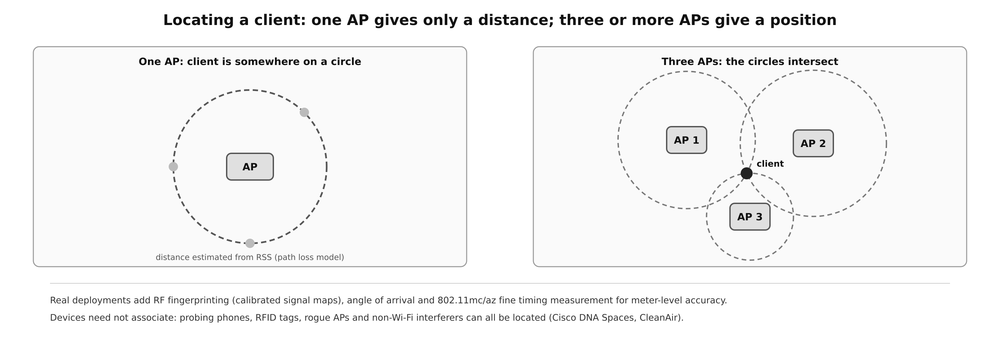

### Overview

---

A wireless LAN replaces the cable with radio. Everything else follows from that one change: the medium is shared and half-duplex, signals fade with distance and walls, neighbors on the same channel take turns, anyone in range can listen, and a client walking down a hallway changes its point of attachment several times a minute.

Enterprise Wi-Fi deals with these problems in layers, and this post follows the same order as the CCNP Enterprise core chapters 17 to 21:

1. **RF and modulation**: how a signal carries data, how strong it is, and how to reason about gain and loss in dB.
2. **Infrastructure**: autonomous and controller-based architectures, how lightweight APs join a wireless LAN controller (WLC), and how antennas shape coverage.
3. **Roaming and location**: how a client moves between APs and controllers without losing its session, and how the network works out where a device is.
4. **Authentication**: Open, pre-shared key, 802.1X/EAP and web authentication.
5. **Troubleshooting**: finding out whether a problem belongs to one client, one AP or the controller.

Several topics have their own deeper posts on this blog: [Wi-Fi Overview](/blog/wifi-overview/), [MIMO](/blog/mimo/), [Co-Channel Interference](/blog/cci/), [802.11r Fast Roaming](/blog/802_11r_fast_roaming/), [802.11k and 802.11v](/blog/802_11k_v_roaming_assistance/), [WPA3](/blog/wpa3/), [Captive Portal](/blog/captive-portal/), [Wi-Fi 7](/blog/wifi7/) and [hostapd](/blog/hostapd/). This one ties them together from the enterprise network engineer's point of view.

---

### RF Fundamentals

---

A transmitter drives an alternating current into an antenna. The current sets up electric and magnetic fields, at right angles to each other, that propagate away from the antenna as an **electromagnetic wave**. The wave does not travel in a straight line like a beam. It spreads out in all directions, so only a tiny fraction of the energy reaches any one receiver. At the receiver the process is reversed: the passing wave induces a small current in the antenna, which is (ideally) a faithful copy of the transmitted signal.

---

#### Frequency, wavelength and phase

---

- **Frequency** is the number of complete cycles per second, measured in **hertz** (kHz, MHz, GHz). The range from about 3 kHz to 300 GHz is called **radio frequency (RF)**.
- **Wavelength (λ)** is the distance one cycle covers. Radio waves travel at (almost) the speed of light, so λ = c / f: about **12.5 cm at 2.4 GHz** and **6 cm at 5 GHz**. Higher frequency means shorter waves, smaller antennas, and generally less range and less penetration through walls.
- **Amplitude** is the strength of the wave, from peak to trough.
- **Phase** is the shift of a wave in time relative to the start of a cycle. Two identical signals **in phase** add together. Two signals **180° out of phase** cancel. This is the basis of multipath fading, and also of beamforming, which deliberately adjusts phase so that signals add up at one receiver.

---

#### Power and the decibel

---

RF power is measured in **watts** or milliwatts, an absolute value. The numbers range from hundreds of milliwatts at a transmitter to a fraction of a nanowatt at a receiver, so engineers use a logarithmic scale instead: the **decibel**, which compares two power levels:

$$
\text{dB} = 10 \log_{10}\left(\frac{P_2}{P_1}\right)
$$

Three rules cover most of the math:

| Power change | dB |
|---|---|
| equal | 0 dB (law of zero) |
| ×2 | +3 dB |
| ÷2 | −3 dB |
| ×10 | +10 dB |
| ÷10 | −10 dB |

Example: going from 5 mW to 200 mW is ×2 ×2 ×10, so +3 +3 +10 = **+16 dB**. Multiplying powers becomes adding dB, which is what makes link budgets easy.

The common absolute and relative units:

- **dBm**: power relative to 1 mW. 0 dBm = 1 mW, 10 dBm = 10 mW, 20 dBm = 100 mW, 30 dBm = 1 W, −70 dBm = 0.1 nW.
- **dBi**: antenna gain relative to an **isotropic** antenna, an ideal point source that radiates equally in all directions. It cannot be built, but it can be calculated, so it is the universal reference.
- **dBd**: antenna gain relative to a dipole. 0 dBd = 2.14 dBi.

---

#### EIRP and the link budget

---


The **effective isotropic radiated power (EIRP)** is what actually leaves the antenna:

$$
\text{EIRP} = P_{tx} - L_{cable} + G_{antenna}
$$

With a 20 dBm transmitter, 2 dB of cable loss and a 5 dBi antenna, EIRP = 23 dBm. Regulators limit **EIRP**, not transmitter power, so a higher-gain antenna can force you to turn the transmitter down.

A **link budget** extends the same arithmetic to the receiver: start from the transmit power in dBm, add every gain and subtract every loss in dB, and the result is the received signal in dBm.

---

#### Free space path loss

---

Even with nothing in the way, a signal weakens as it spreads over an ever larger sphere. This **free space path loss (FSPL)** depends only on distance and frequency:

$$
\text{FSPL(dB)} = 20 \log_{10}(d_{km}) + 20 \log_{10}(f_{MHz}) + 32.44
$$

Two consequences:

- The loss is logarithmic: the signal drops fast near the antenna and more slowly farther out. Every doubling of distance costs 6 dB.
- At the same distance, 5 GHz loses about 6 dB more than 2.4 GHz. With equal EIRP, a 5 GHz cell is therefore smaller. Walls and bodies also absorb more at higher frequencies.

---

#### At the receiver: RSSI, noise and SNR

---


- **RSSI (received signal strength indicator)**: the standard defines it as a relative 0 to 255 value whose scale is vendor-specific. In practice tools report received power in **dBm**: −30 dBm is excellent, −67 dBm is a common design target for voice, below −80 dBm only the slowest rates work.
- **Receiver sensitivity**: the weakest signal a receiver can still decode, which depends on the data rate. Slow, robust rates work at much lower levels than fast ones.
- **Noise floor**: the average level of everything else on the channel (other transmitters, electrical noise, thermal noise). A clean 5 GHz channel sits around −90 to −100 dBm.
- **Signal-to-noise ratio (SNR)**: signal minus noise floor, in dB. SNR, not RSSI alone, decides which data rate works. A −65 dBm signal is fine with a −95 dBm noise floor (30 dB SNR) and poor with a −80 dBm noise floor (15 dB).

---

### Carrying Data over RF

---

#### Bands and channels

---


- **2.4 GHz** (2.400 to 2.4835 GHz): channels are only **5 MHz apart**, but each signal is about 20 to 22 MHz wide, so neighboring channels overlap. Only **1, 6 and 11** can be used side by side without interfering (channel 14 exists only in Japan, for 802.11b). Three channels, plus Bluetooth, microwave ovens and every IoT device, make 2.4 GHz the most crowded band.
- **5 GHz** (5.150 to 5.850 GHz) is split into **U-NII** sub-bands: U-NII-1 (36 to 48), U-NII-2A (52 to 64), U-NII-2C (100 to 144) and U-NII-3 (149 to 165), with a gap between 5.350 and 5.470 GHz. Channels are 20 MHz wide and do not overlap. U-NII-2A and 2C are **DFS** channels: the AP must check for radar before using them and leave the channel when radar appears.
- **6 GHz** (5.925 to 7.125 GHz where allowed): 1200 MHz of clean spectrum, 59 channels of 20 MHz, usable only by Wi-Fi 6E and Wi-Fi 7 devices, with WPA3 mandatory.

Channels can be **bonded** into 40, 80 or 160 MHz (320 MHz at 6 GHz with Wi-Fi 7). Wider channels raise peak throughput but leave fewer independent channels for neighboring APs, which increases [co-channel interference](/blog/cci/). Dense enterprise designs usually stay at 20 or 40 MHz on 5 GHz.

---

#### Modulation

---

**Modulation** changes a property of the carrier to represent bits; **demodulation** recovers them. A carrier can only be varied in **frequency** (slightly around the center), **phase** or **amplitude**. Wireless LANs need high bit rates, so they spread data over a range of frequencies (**spread spectrum**):

- **DSSS (direct sequence spread spectrum)**, used by 802.11b at 2.4 GHz: 22 MHz channels, phase modulation, 1 to 11 Mbps.
- **OFDM (orthogonal frequency division multiplexing)**, used by 802.11a/g/n/ac/ax/be: a 20 MHz channel is split into many narrow **subcarriers** (tones) that carry data in parallel. Each subcarrier uses **QAM**, which varies both phase and amplitude. Denser constellations carry more bits per symbol but need more SNR: BPSK carries 1 bit, 64-QAM 6, 256-QAM 8 (802.11ac), 1024-QAM 10 (802.11ax) and 4096-QAM 12 (802.11be).

A **modulation and coding scheme (MCS)** combines a constellation with a coding rate (the share of bits that are data rather than error correction, from 1/2 to 5/6). **Dynamic rate shifting (DRS)** is the adaptation: as a client moves away or interference rises, the sender steps down to a more robust MCS, trading speed for reliability, and steps back up when conditions improve.

---

#### 802.11 amendments

---

| Standard | Wi-Fi name | Bands | Channel widths | Max PHY rate | Key techniques |
|---|---|---|---|---|---|
| 802.11b (1999) | | 2.4 GHz | 22 MHz | 11 Mbps | DSSS / CCK |
| 802.11a (1999) | | 5 GHz | 20 MHz | 54 Mbps | OFDM, 64-QAM |
| 802.11g (2003) | | 2.4 GHz | 20 MHz | 54 Mbps | OFDM at 2.4 GHz |
| 802.11n (2009) | Wi-Fi 4 (HT) | 2.4 / 5 GHz | 20, 40 MHz | 600 Mbps (4 streams) | MIMO, channel bonding, aggregation |
| 802.11ac (2013) | Wi-Fi 5 (VHT) | 5 GHz | 20 to 160 MHz | 6.9 Gbps (8 streams; products 4) | 256-QAM, MU-MIMO downlink |
| 802.11ax (2019) | Wi-Fi 6 / 6E (HE) | 2.4 / 5 / 6 GHz | 20 to 160 MHz | 9.6 Gbps (8 streams) | OFDMA, 1024-QAM, UL MU-MIMO, BSS coloring, TWT |
| 802.11be (2024) | Wi-Fi 7 (EHT) | 2.4 / 5 / 6 GHz | up to 320 MHz | ~46 Gbps (16 streams) | 4096-QAM, multi-link operation |

---

(Course material lists 802.11g as 22 MHz; it is OFDM, so 20 MHz, and 802.11ac supports up to 8 spatial streams in the standard, although products ship with up to 4.) The big shift with **802.11ax** is efficiency rather than peak speed: **OFDMA** divides a channel into **resource units** so that several clients can transmit in the same airtime, which matters most in dense environments. See the [Wi-Fi 7 post](/blog/wifi7/) for 802.11be.

---

#### MIMO and multiple radio chains

---

Before 802.11n, a device had one transmitter and one receiver: a single radio chain, **SISO**. 802.11n and later use several radio chains, **MIMO**, written as T×R:S. A 3×3:2 device has 3 transmit chains, 3 receive chains and supports 2 spatial streams. MIMO enables three techniques (more detail in the [MIMO post](/blog/mimo/)):

- **Spatial multiplexing**: independent data streams are sent on the same channel through different antennas and separated at the receiver by digital signal processing. Throughput scales with the number of streams. Two devices use the lowest number of streams both support.
- **Transmit beamforming (TxBF)**: the same signal is sent from several antennas with adjusted phases so that the copies arrive **in phase** at one specific receiver, raising its SNR.
- **Maximal-ratio combining (MRC)**: the receiver combines the copies received on several antennas into one signal that is better than any single copy.

---

### Wireless LAN Architectures

---


---

#### Autonomous APs

---

An **autonomous** AP is self-sufficient: it provides its own BSSs and bridges each SSID to a VLAN, so the switch port is a **trunk** carrying every data VLAN plus a management VLAN. Traffic between two clients on the same AP stays on the AP, and the path to the wired network is short.

The problem is scale. Every AP is configured on its own (or through a management platform such as Cisco Prime Infrastructure), and to let clients roam with the same IP address, every VLAN must reach every AP across the campus. RF management, security policy and troubleshooting are all per AP.

---

#### Lightweight APs and the split-MAC architecture

---

A **lightweight** AP cannot work alone: it must join a **WLC**. The 802.11 functions are split (**split-MAC**):

- **The AP** handles the real-time work: beacons, probe responses, ACKs, retransmissions, encryption on many platforms, and RF measurements.
- **The WLC** handles management: authentication and association policy, security, RF management (channel and power), roaming, QoS policy and the configuration of every AP.

AP and WLC are linked by **CAPWAP** (Control and Provisioning of Wireless Access Points, RFC 5415) tunnels: **UDP 5246** for control messages (always protected by DTLS) and **UDP 5247** for client data (optionally encrypted). All SSIDs and VLANs travel inside the same tunnel, so the AP needs only one IP address and an **access** port, not a trunk.

Where the WLC sits defines the topology:

| Topology | WLC location | Scale (Cisco) | Notes |
|---|---|---|---|
| Centralized (unified) | data center or core | up to ~6000 APs per WLC | VLANs exist only at the WLC; all client traffic hairpins through it. AP-to-WLC RTT must stay under 100 ms. |
| Embedded | inside the access switch | ~200 APs | very short tunnels; common policy for wired and wireless users; same hardware for both. |
| Mobility Express / EWC | software on one of the APs | ~100 APs | small sites and branches without a dedicated controller. (Mobility Express is succeeded by the Embedded Wireless Controller on Catalyst 9100 APs.) |
| Cloud-managed | in the cloud (e.g. Meraki) | very large | only management and statistics go to the cloud; data is switched locally at the AP. |

**FlexConnect** is a variation for branches: the AP stays managed by a central WLC but can switch client traffic locally onto a VLAN, and keeps serving clients if the WAN link to the WLC goes down.

---

#### How a lightweight AP joins a WLC

---


Lightweight APs are designed to be "touch free": configure the switch port with the right access VLAN and PoE, and the AP finds a controller by itself. It goes through the CAPWAP states in order:

1. **Boot**: load a small image and get an IP address (DHCP or static).
2. **WLC discovery**: send CAPWAP Discovery Requests and collect Discovery Responses.
3. **CAPWAP tunnel**: build the DTLS session; AP and WLC authenticate each other with certificates.
4. **WLC join**: send a Join Request to the chosen controller and receive a Join Response.
5. **Download image**: if the AP software differs from the WLC's, download the matching image, reboot and start over.
6. **Download config**: SSIDs, RF settings, security and QoS.
7. **Run**: the AP brings up its BSSs and accepts clients.
8. **Reset**: if the WLC resets the AP, all clients and tunnels are torn down and the AP starts again from boot.

**Discovery.** The AP builds a list of candidate controllers from every source it can:

1. A **broadcast** Discovery Request on the local subnet (UDP 5246). If the WLC is on another subnet, the router can relay it:

   ```text
   ip forward-protocol udp 5246
   interface Vlan20
    ip helper-address 10.10.10.5
    ip helper-address 10.10.10.6
   ```

2. Addresses stored in NVRAM: a **primed** primary, secondary and tertiary controller, and up to 8 addresses learned from the controller it joined last.
3. **DHCP option 43**, which carries the WLC management addresses.
4. **DNS**: the name `CISCO-CAPWAP-CONTROLLER.<domain>`, using the domain name learned from DHCP.
5. If nothing answers, the AP resets and tries again.

**Selection.** The AP joins its primed primary controller if it can, then the secondary and tertiary. Otherwise it picks a controller configured as **master**, and failing that the **least-loaded** WLC (joined APs divided by capacity). A full controller rejects new APs, but an AP with a higher **priority** can push out a lower-priority one.

**Availability.** A joined AP sends heartbeats to its controller (every 30 seconds by default) and moves to another controller when they go unanswered, about 35 seconds with default timers or a few seconds with fast heartbeat settings. Configuring primary/secondary/tertiary controllers on every AP is the most deterministic design. **HA SSO** goes further: an active/standby controller pair keeps AP and client state in sync, so a failure is transparent and APs only know the active unit. Keep candidate controllers on the same software release, or an AP that rehomes will first download a new image and reboot.

---

#### AP modes

---

| Mode | What the AP does |
|---|---|
| Local | the default: serves clients on its channel and scans other channels between transmissions for noise, interference, rogues and IDS events |
| FlexConnect | switches traffic locally at a remote site; keeps working if the link to the WLC fails |
| Monitor | does not transmit; a dedicated sensor for rogues, IDS and location |
| Sniffer | captures 802.11 frames on a channel and forwards them to Wireshark or Omnipeek |
| Rogue detector | watches the wired network (ARP) to find rogue APs that are also heard over the air |
| Bridge / Flex+Bridge | point-to-point, point-to-multipoint or mesh backhaul between APs |
| SE-Connect | full-time spectrum analysis for tools such as Chanalyzer or Spectrum Expert |

Any mode other than local (and FlexConnect) disables client service on that AP.

---

### Antennas

---


An antenna does not create energy. It **redirects** it: squeeze the sphere of an isotropic radiator in one direction and it bulges in another. Gain is the measure of how strongly an antenna focuses energy in its main direction, in dBi.

- **Radiation pattern**: a plot of relative signal strength around the antenna, drawn in two planes. The **H plane** (azimuth) is the view from above; the **E plane** (elevation) is the view from the side. The antenna is at the center and the outer ring is the strongest level. Gain is not shown on the plot; read it from the data sheet.
- **Beamwidth**: the angle between the two points where the signal drops **3 dB** (half power) from the peak, given for both planes.
- **Polarization**: the orientation of the electric field. Transmit and receive antennas should match; a vertical-to-horizontal mismatch loses a lot of signal.

| Antenna | Typical gain | Pattern | Use |
|---|---|---|---|
| Omnidirectional (dipole, integrated) | +2 to +5 dBi | donut: wide horizontally, flat vertically | open offices and rooms, AP in the middle |
| Patch | 6 to 8 dBi (2.4 GHz), 7 to 10 dBi (5 GHz) | half-space in front of a flat panel | walls, ceilings pointing down, hallways |
| Yagi | 10 to 14 dBi | egg-shaped beam along its length | long corridors, warehouse aisles, building to building |
| Parabolic dish | 20 to 30 dBi | very narrow beam | long line-of-sight point-to-point links |

Most enterprise APs use **integrated** omnidirectional antennas hidden inside the case. External antennas are for special coverage shapes, high ceilings and outdoor links.

---

### Roaming

---

The **client** decides when to roam. When the signal from its current AP drops below its own threshold, it scans (probe requests on each channel), picks a better AP and **reassociates**. Where exactly each roam happens depends on the client's algorithm, which is why the same building can feel very different with different phones and laptops. The network can help with [802.11k neighbor reports and 802.11v BSS transition management](/blog/802_11k_v_roaming_assistance/), which tell the client which APs to consider and when to move.

A roam has to be fast. During the transition the client is briefly associated with no AP. If the network also requires a full 802.1X authentication with a RADIUS server, plus a DHCP renewal, a voice call can drop.

---

#### Making re-authentication fast

---

- **CCKM (Cisco Centralized Key Management)**: a controller caches client keys and hands them to other APs and controllers. Requires Cisco Compatible Extensions (CCX) on the client.
- **Key caching**: the client keeps the keys (PMKs) from previous associations and presents the matching one when it returns to an AP (PMKID caching). **Opportunistic Key Caching (OKC)** lets the controller reuse one PMK across all its APs. The client's cache is limited (eight entries in the course material).
- **802.11r Fast BSS Transition**: the key hierarchy is designed for roaming, so the client and target AP derive new keys in the authentication and reassociation frames themselves, without a new 802.1X exchange or 4-way handshake. QoS reservations can move with the client. See the [802.11r post](/blog/802_11r_fast_roaming/).

---

#### Intracontroller and intercontroller roaming

---


- **Intracontroller roam**: both APs are joined to the same WLC. The controller updates its client table to use the new AP's CAPWAP tunnel. The VLAN, IP address and policy do not change.
- **Layer 2 intercontroller roam**: the APs are on different controllers, but the WLAN maps to the **same VLAN and subnet** on both. The client entry moves to the new controller and the client keeps its IP address.
- **Layer 3 intercontroller roam**: the WLAN maps to **different VLANs** on the two controllers. To let the client keep its IP address, the original controller becomes the **anchor** and the new one the **foreign** controller. A tunnel between them carries the client's traffic, so it still enters the wired network at the anchor (the point of presence) while the client is attached at the foreign controller (the point of attachment). Traffic hairpins, but sessions survive.

Controllers that should support fast roams are organized into **mobility groups**. Each controller has a **mobility list** of the peers it knows and trusts (MAC address, IP address and group name). Within a group, controllers share client and key state, so roams are fast. Roams between controllers in different groups still work, but keys are not shared and the client must authenticate fully. A set of mobility groups that know each other forms a **mobility domain**.

---

### Locating Devices

---



Received signal strength falls predictably with distance, so an AP can estimate how far away a device is, but not in which direction. With three or more APs hearing the same device, the distance circles intersect at its position (**trilateration**). Real systems improve on this with **RF fingerprinting** (comparing measurements with a calibrated map of the building), angle of arrival from antenna arrays, and the fine timing measurement of 802.11mc/az, which measures round-trip time instead of signal strength.

Location services (Cisco DNA Spaces and similar) display devices on floor maps. They also locate devices that never associate: phones that send probe requests, **RFID tags** that wake up to send a probe or multicast frame, **rogue APs**, and non-Wi-Fi **interferers** such as cordless phones and video senders detected by spectrum analysis (CleanAir).

---

### Authenticating Wireless Clients

---

Wireless security on a WLC is configured **per WLAN** (per SSID). A client first finds a BSS, then performs 802.11 authentication and association, and then, depending on the WLAN, a real authentication step.

---

#### Open authentication

---

The original 802.11 standard had only two choices: **Open System** and **WEP** (long broken). Open authentication is not really authentication: any client that sends an authentication request is accepted. It is used for guest and public hotspots, usually with **WebAuth** on top. Traffic over the air is not encrypted. **Enhanced Open (OWE)**, part of the [WPA3](/blog/wpa3/) family, keeps the no-password experience but gives each client its own encryption keys, and should be preferred wherever clients support it.

---

#### WPA, WPA2 and WPA3

---

The Wi-Fi Alliance certifies three generations of **Wi-Fi Protected Access**. Each supports two authentication modes: **Personal** (pre-shared key) and **Enterprise** (802.1X).

| | WPA (WPA1) | WPA2 | WPA3 |
|---|---|---|---|
| Encryption | TKIP (RC4-based) | AES-CCMP | AES-CCMP or GCMP (192-bit suite for Enterprise) |
| Personal | PSK | PSK | SAE (resists offline dictionary attacks, forward secrecy) |
| Enterprise | 802.1X | 802.1X | 802.1X, optional 192-bit mode |
| Management frame protection | no | optional | mandatory |
| Status | obsolete | baseline | required for 6 GHz, recommended everywhere |

---

#### Pre-shared key (Personal mode)

---

Every client and AP share the same passphrase. From it both sides derive the same **PMK**, and the **4-way handshake** proves that each knows it and derives fresh per-session keys (PTK for unicast, GTK for broadcast) without sending the key over the air. PSK is simple, but everyone who knows the key can join, removing one user means changing the key on every device, and with WPA2 a captured handshake can be attacked offline. WPA3-Personal replaces the PSK exchange with **SAE** to close that hole.

On the WLC (AireOS GUI): create the WLAN, set the SSID, interface and status on the **General** tab, then on **Security > Layer 2** select WPA+WPA2, keep only **WPA2 Policy** with **AES**, set the authentication key management to **PSK** and enter the key. The WLAN list then shows the security policy as `[WPA2][Auth(PSK)]`. On a Catalyst 9800 controller (IOS-XE) the same WLAN looks like this:

```text
wlan devices 2 devices
 no security wpa akm dot1x
 security wpa akm psk
 security wpa psk set-key ascii 0 <long-random-passphrase>
 no shutdown
!
wireless profile policy DEVICES-POLICY
 vlan 120
 no shutdown
wireless tag policy SITE-TAG
 wlan devices policy DEVICES-POLICY
```

On the 9800, the WLAN profile defines the SSID and security, the **policy profile** defines the VLAN and other policies, and a **policy tag** ties them together and is assigned to APs.

---

#### 802.1X and EAP (Enterprise mode)

---


**EAP (Extensible Authentication Protocol)** is a framework, not a single method. Combined with **IEEE 802.1X** port-based access control, it lets a client associate but blocks everything except EAP until it authenticates. There are three roles:

- **Supplicant**: the client device.
- **Authenticator**: the device that controls access, the WLC (or the AP in autonomous and some FlexConnect designs). It relays EAP between the client (EAPOL over 802.11) and the server (inside RADIUS).
- **Authentication server (AS)**: usually a **RADIUS** server such as Cisco ISE (UDP 1812 for authentication, 1813 for accounting). It checks credentials against a user database and policy and returns Access-Accept or Access-Reject.

On success, the RADIUS server sends the key material (PMK) to the authenticator, and the same 4-way handshake as in Personal mode derives the session keys. RADIUS can also return per-user **VLAN, ACL and QoS** attributes. Every user has their own credentials and their own keys, and access can be revoked per user.

| EAP method | Server certificate | Client credential | Notes |
|---|---|---|---|
| EAP-TLS | yes | client certificate | strongest; needs a PKI to issue client certificates |
| PEAP (MSCHAPv2) | yes | username + password inside a TLS tunnel | most common; clients must validate the server certificate |
| EAP-TTLS | yes | password (PAP, MSCHAPv2, ...) inside TLS | flexible inner methods |
| EAP-FAST | optional (PAC) | password or certificate inside a tunnel | Cisco-designed, replacement for LEAP |
| LEAP | no | password | Cisco legacy, broken; do not use |

---

**On the WLC with an external RADIUS server**: under **Security > AAA > RADIUS > Authentication**, add the server's IP address, shared secret and port (1812), enable it, and tick **Network User**. Then on the WLAN, select WPA2 + AES with **802.1X** key management. By default the WLAN uses the global server list in order. The WLAN's **AAA Servers** tab can override it. The 9800 equivalent:

```text
aaa new-model
radius server ISE1
 address ipv4 10.10.10.20 auth-port 1812 acct-port 1813
 key <shared-secret>
aaa group server radius ISE-GROUP
 server name ISE1
aaa authentication dot1x ISE-DOT1X group ISE-GROUP
!
wlan staff_eap 3 staff_eap
 security dot1x authentication-list ISE-DOT1X
 no shutdown
```

(WPA2 with 802.1X key management is the default security for a new WLAN on the 9800.)

**Local EAP**: for a small site without RADIUS, the WLC itself can act as the authentication server. It supports LEAP, EAP-FAST, PEAP and EAP-TLS, with users in a local database (**Security > AAA > Local Net Users**) or in LDAP. Create a profile under **Security > Local EAP > Profiles**, enable the methods, and point the WLAN at it. If external RADIUS servers are also configured, they are tried first and Local EAP becomes the backup.

---

#### Web authentication (WebAuth)

---

**WebAuth** is the only method that interacts with the user through a web page: the client gets an IP address, its first HTTP request is redirected to a portal, and access opens after the user logs in or accepts the terms. It can be layered on top of Open, PSK or 802.1X WLANs, and is the usual choice for guests (more in the [captive portal post](/blog/captive-portal/)).

- **Local Web Authentication (LWA)**: the portal runs on the WLC. Variants: credentials checked against the WLC's internal database, against RADIUS or LDAP, with a redirect to an external page after login, with an external splash page, or **passthrough**, which only asks the user to accept an acceptable use policy.
- **Central Web Authentication (CWA)**: the portal and the user database live on a central server such as ISE. The WLC does MAC filtering with RADIUS, ISE returns a redirect URL, and after the user logs in ISE sends a RADIUS **Change of Authorization (CoA)** to grant access. CWA scales across many controllers and keeps guest policy in one place.

Configuration (AireOS GUI): create an Open WLAN (Layer 2 security **None**), then on **Security > Layer 3** choose **Web Policy** and either **Authentication** (log in) or **Passthrough** (accept a page). The content comes from **Security > Web Auth > Web Login Page**, or from an external server. The WLAN list shows the policy as `Web-Passthrough`.

---

### Troubleshooting Wireless Connectivity

---


---

#### Gather information and look for a pattern

---

"The Wi-Fi is down" can mean the client cannot associate, cannot authenticate or cannot get an IP address. Ask questions and look for patterns:

- **One user**: focus on that client and its relationship with one AP: driver, settings, credentials, distance.
- **Many users in one area**: suspect an AP: radio down, switch port or PoE problem, channel or interference.
- **Many areas, or one SSID everywhere**: suspect the controller or WLAN configuration: security settings, interface or VLAN mapping, RADIUS or DHCP.

A client needs three things to work: it is within **RF range** and associates, it **authenticates**, and it **gets an IP address**.

---

#### Troubleshooting a client from the WLC

---

Search the client's **MAC address** on the WLC. The client view shows its username (if it authenticated with one), hostname, SSID, AP, uptime, RF values, and its progress through the policy states:

1. **Start**: activity has begun.
2. **Association**: 802.11 authentication and association with an AP.
3. **Authentication**: the Layer 2 PSK or 802.1X policy.
4. **DHCP**: the WLC is waiting to learn the client's IP address.
5. **Online** (RUN): Layer 2 and Layer 3 policies passed; the client can pass traffic.

A client stuck at one state points straight at the cause: authentication (wrong key, RADIUS rejecting or unreachable, untrusted certificate) or DHCP (wrong VLAN on the WLAN's interface, scope exhausted, missing relay).

For performance complaints, look at the RF numbers. In the course example, the AP hears the client at **−76 dBm with 18 dB SNR**; the client is running at 29 Mbps against a possible 144 Mbps, a **connection score** of about 20% (current rate divided by the lower of the AP and client maximum rates). The client has simply moved too far from its AP. The client view also shows the end-to-end path (WLC, AP, client, VLAN, IP address) and the applied policies: VLAN, QoS level, WPA2, CCMP-AES, PSK or EAP.

The **client test** tools provide live data rather than a snapshot:

- **Ping test**: five ICMP echoes from the WLC to the client.
- **Connection**: debugs the client for up to three minutes and checks each policy step as it joins; for example, a Layer 2 authentication failure because the PSK does not match.
- **Event log**: a detailed log of the join attempt, mostly for TAC-level analysis.
- **Packet capture**: an over-the-air capture at the client's AP, saved to an FTP server for Wireshark or Omnipeek.

---

#### Troubleshooting at the AP

---

A lightweight AP needs two things to provide a BSS: connectivity to its access switch (link, PoE, the right VLAN) and connectivity to its WLC (unless it runs FlexConnect). Search the AP name on the WLC: if it is joined, the AP view shows its IP address, the **CDP** neighbor (switch and port), PoE status, and RF information for each radio.

Key RF indicators:

- **Noise level**: should be around **−90 to −100 dBm**. The course example shows channel 161 at −80 dBm, which is abnormal.
- **Air quality**: 0 (worst) to 100 (best), a measure of how much non-Wi-Fi interference degrades the channel. Channel 11 at 97 is fine; channel 161 at 59 is a problem.
- **RF Troubleshoot / CleanAir**: lists neighboring and rogue APs and classified interferers. The example finds a **continuous transmitter** on channel 161 with a severity of 45, a **duty cycle of 100%** (it never stops transmitting) and −78 dBm.

The fix is to find and remove or move the interferer. If that is not possible, move the AP to another channel. If the AP is not joined at all, work through the join process: IP address, discovery (option 43, DNS, helper address), DTLS and certificates (check the clock), software version, and the switch port.

---

### Wi-Fi on Linux and OpenWrt

---

The same concepts appear directly in [hostapd](/blog/hostapd/) on Linux and OpenWrt APs. A WPA2/WPA3 transition-mode PSK network:

```text
# /etc/hostapd/hostapd.conf
interface=wlan0
driver=nl80211
ssid=devices
hw_mode=a
channel=36
ieee80211n=1
ieee80211ac=1
wpa=2
wpa_key_mgmt=WPA-PSK SAE
rsn_pairwise=CCMP
wpa_passphrase=long-random-passphrase
sae_password=long-random-passphrase
ieee80211w=1          # PMF optional (required for SAE clients)
```

The same SSID with 802.1X against an external RADIUS server, and 802.11r fast roaming:

```text
wpa=2
wpa_key_mgmt=WPA-EAP FT-EAP
ieee8021x=1
auth_server_addr=10.10.10.20
auth_server_port=1812
auth_server_shared_secret=shared-secret
mobility_domain=a1b2
ft_over_ds=0
nas_identifier=ap1.example.com
# plus r0kh= / r1kh= entries for the other APs in the mobility domain
```

Useful commands for the RF side:

```sh
iw dev wlan0 link              # client: AP, signal (dBm), tx bitrate / MCS
iw dev wlan0 station dump      # AP: per-client signal, rates, retries
iw dev wlan0 survey dump       # noise floor and channel busy time per channel
iw dev wlan0 scan | grep -E 'BSS|signal|SSID|primary channel'
```

`survey dump` gives the noise floor and how busy each channel is, the Linux equivalent of the WLC's noise and channel utilization view.

---

### Summary

---

- **RF**: frequency, wavelength, amplitude and phase describe a wave. Use **dB** to add gains and losses: ×2 = +3 dB, ×10 = +10 dB. **EIRP** = transmitter power − cable loss + antenna gain, and it is what regulators limit. **FSPL** grows with distance and frequency. **SNR**, not RSSI alone, determines the usable data rate.
- **Data over RF**: 2.4 GHz has three non-overlapping channels (1, 6, 11); 5 GHz and 6 GHz offer many 20 MHz channels that can be bonded. OFDM with QAM carries the data, and **DRS** steps the MCS down as SNR falls. 802.11n/ac/ax/be add MIMO (spatial multiplexing, beamforming, MRC), wider channels, denser QAM, OFDMA and multi-link operation.
- **Architecture**: autonomous APs work alone and need trunks; lightweight APs use **split-MAC** and **CAPWAP** (UDP 5246/5247) to a WLC that can be centralized, embedded in a switch, run on an AP, or be replaced by cloud management. APs discover WLCs by broadcast, NVRAM, DHCP option 43 and DNS, then join the primed, master or least-loaded controller.
- **Antennas**: omnidirectional antennas cover rooms; patch, Yagi and dish antennas trade coverage angle for gain. Beamwidth is measured at the −3 dB points, and polarization must match.
- **Roaming**: the client decides; 802.11k/v help it choose. CCKM, key caching and **802.11r** avoid a full 802.1X exchange. Intracontroller and Layer 2 roams move the client entry; **Layer 3** roams anchor the client at its original controller through a mobility tunnel. Mobility groups share state.
- **Authentication**: Open (with WebAuth, or OWE), **PSK** (WPA2) or **SAE** (WPA3) for Personal, **802.1X/EAP** with RADIUS for Enterprise, and **WebAuth** (local or central) for guests.
- **Troubleshooting**: decide whether the problem is one client, one AP or the controller; follow the client through Start, Association, Authentication, DHCP and Online; check RSSI, SNR, noise floor, air quality and interferers.

---

### References

---

- CCNP Enterprise: Core Networking, Chapters 17 to 21 (Cisco instructor materials): Wireless Signals and Modulation; Wireless Infrastructure; Understanding Wireless Roaming and Location Services; Authenticating Wireless Clients; Troubleshooting Wireless Connectivity
- IEEE 802.11-2020, and amendments 802.11ax-2021 and 802.11be
- RFC 5415, Control And Provisioning of Wireless Access Points (CAPWAP) Protocol Specification; RFC 5416, CAPWAP Binding for IEEE 802.11
- IEEE 802.1X-2020, Port-Based Network Access Control; RFC 3748, Extensible Authentication Protocol (EAP)
- Wi-Fi Alliance, WPA3 Specification and Wi-Fi CERTIFIED Enhanced Open
- Cisco Catalyst 9800 Series Wireless Controller Software Configuration Guide
